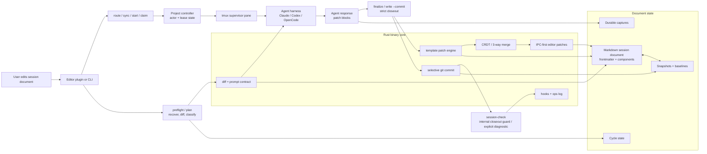

# Architecture

How agent-doc splits work between the deterministic Rust binary and the
agent-facing skill instructions. This page moved here from the project
[README](../../README.md).

The binary owns all deterministic behavior: component parsing, patch application, CRDT merge, snapshot management, git operations, tmux routing, and IPC writes. The bundled skill / AGENTS instructions are the non-deterministic orchestrator layer — they read the diff, generate responses, and decide what to write.

For how concurrent agent writes and live editor keystrokes merge without splicing content across unrelated regions of the document, see [Document Node-Merge Architecture](node-merge-architecture.md).

## Binary vs. Agent Responsibility

| Responsibility | Owner | Why |
|---------------|-------|-----|
| Component parsing, patch application, mode resolution | **Binary** (Rust) | Deterministic, testable, consistent across agents |
| CRDT merge, snapshot management, atomic writes | **Binary** (Rust) | Concurrency safety requires flock + atomic rename |
| Diff computation, comment stripping, truncation detection | **Binary** (Rust) | Reproducible baseline comparison |
| Git operations (commit, history, clean) | **Binary** (Rust) | Direct `std::process::Command` calls; selective commit can self-heal narrow missed agent-owned drift and normalize boundary cleanup without absorbing free-form user prompts |
| Tmux routing, session registry, pane management | **Binary** (Rust) | Process-level coordination |
| Pre-response snapshots, undo, extract, transfer | **Binary** (Rust) | File-level atomicity |
| Boundary marker lifecycle (insert, reposition, cleanup) | **Binary** (Rust) | Deterministic, all write paths need it |
| Reading diff, interpreting user intent | **Skill** (SKILL.md) | Requires LLM reasoning, including treating imperative document edits as executable directives rather than meta-only discussion topics |
| Generating response content | **Skill** (SKILL.md) | Non-deterministic |
| Deciding what to write to which component | **Skill** (SKILL.md) | Context-dependent, including the shared Claude/Codex/OpenCode manual-repair rule to use `agent-doc write --commit <file>` when the prompt already exists |
| Enforcing response-cycle completion for the normal happy path | **Binary** (Rust) | `agent-doc finalize` fails closed unless the write reaches a terminal committed cycle state |
| Console progress, final-response timing | **Skill** (SKILL.md) | Partial output stays outside the document |
| Pending item management (parse, populate, process) | **Skill** (SKILL.md) | Semantic understanding of prompts |

See [AGENTS.md](../../AGENTS.md) for the full module layout, stream mode details, and release process.

Large specs now split behind stable entrypoint files instead of growing indefinitely. For command behavior, start at [`specs/07-commands.md`](../../specs/07-commands.md), which indexes the focused sibling specs for core commands, tmux/session behavior, closeout, and orchestration. For the authoring rule behind that split, see [`runbooks/split-spec-files.md`](../../runbooks/split-spec-files.md). That runbook applies across agent-doc-managed harness instruction surfaces, while custom root instruction files stay opt-in unless they still match the generated baseline.
## Domain Ontology

agent-doc extends the [existence kernel vocabulary](https://github.com/btakita/existence-lang) with domain-specific terms.

### Document Lifecycle

| Term | Definition |
|------|-----------|
| **Session** | A persistent conversation between a user and an agent, identified by UUID. Stored in frontmatter as `agent_doc_session`. |
| **Document** | A markdown file that serves as the UI for a session. Contains frontmatter, components, and user/agent content. |
| **Snapshot** | A baseline copy of the document at a known state. Used for diff computation and CRDT merge. |
| **Component** | A named region in a template document (`<!-- agent:name -->...<!-- /agent:name -->`). Targeted by patch blocks. |
| **Boundary** | A marker (`<!-- agent:boundary:hash -->`) that separates committed content from uncommitted user edits. |
| **Exchange** | The shared conversation surface where user and agent write inline. A component with `patch=append`. |

### Pane Lifecycle

| Term | Definition |
|------|-----------|
| **Binding** | The document→pane association stored transactionally in the controller actor store. Created by `claim` (explicit) or `auto_start` (automatic). One active document owns a pane; if a stale cross-document alias exists, the incoming owner closes and clears the displaced binding. |
| **Reconciliation** | The process of matching editor layout to tmux layout. Performed by `sync`. Stashes unwanted panes, provisions missing ones. |
| **Provisioning** | Creating a new tmux pane and starting the configured agent harness for a document. Performed by `route::auto_start`. The normal path for new documents — sync triggers provisioning when it finds a session UUID with no registered pane. |
| **Initialization** | Assigning a session UUID, creating a snapshot, and committing to git. Performed by `ensure_initialized()`. Called from claim, preflight, and sync's resolve_file. |

Layout-owned provisioning stages new panes off-screen until the current layout
places them. A late startup cannot add a third visible pane to a two-editor
layout or select its intermediate window; existing sessions remain alive.

### Integration Layer

Codex Stop recovery uses the shared queue eligibility policy. A deferred review
item cannot reopen a committed response merely because its queue line remains;
eligible manual prompts still require document writeback.

| Term | Definition |
|------|-----------|
| **Route** | Resolve which tmux pane handles a file. Creates panes if needed (provisioning). |
| **Sync** | Reconcile editor layout with tmux layout. The primary entrypoint from the JB plugin on every tab switch. |
| **Claim** | Bind a document to a specific existing pane. Used for manual pane assignment; not needed in normal editor workflow (sync + auto_start handles it). |

### Interaction Model

| Term | Definition |
|------|-----------|
| **Directive** | A signal that authorizes and requests action. User inputs like "do", "go", "yes" are directives. Classified as `DiffType::Approval` in preflight. The directive's brevity is independent of the expected execution thoroughness — quality processes always apply in full. |
| **Cycle** | One round-trip: user edits -> preflight -> agent response -> write-back -> commit. Logged in `.agent-doc/logs/cycles.jsonl` for diagnostics, while the authoritative phase and exact captured response live transactionally in `.agent-doc/state.db`. Recovery projections may be rebuilt from proven ledger state but are never read as hot-path authority. |
| **Layout check** | Pre-agent tmux health inspection (`check_layout()`). Detects: missing window 0, non-idle stash panes, and session drift (registered panes spanning multiple tmux sessions). Preflight immediately attempts the narrow base-index repair when window 0 is missing, then reports remaining issues as `layout_issues[]` in preflight JSON. Full manual sync also repairs window order to `0:agent-doc`, `1:stash`, then overflow `N:stash` before reconciliation. |
| **Session drift** | Condition where registered document panes span more than one tmux session. Detected by preflight's `check_layout()`. Fixed by `agent-doc session set <N>` to consolidate panes into the target session. |
| **Diff** | The user's changes since the last snapshot. Classified by `classify_diff()` into a `DiffType` for skill routing. Comment-stripped before comparison. |
| **Annotation** | A user edit to agent-written content (inline modification, colon-append). Classified as `DiffType::Annotation`. |
