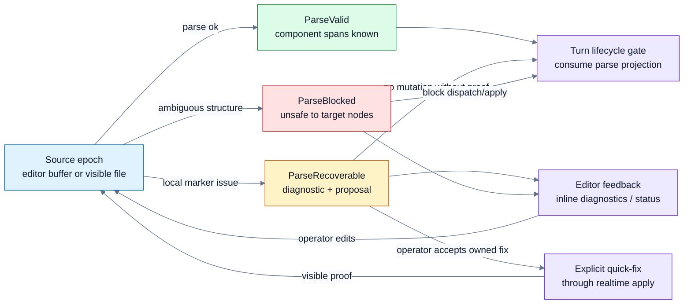

# Real-Time Workflow Authority

## Monotonic response transactions

Lazily owns both operator edits and unsealed agent response checkpoints. A
checkpoint is a cumulative semantic cell, not a whole-document candidate and not
a live-buffer sidecar. A newer checkpoint supersedes only response nodes absent
from the committed exchange anchor; operator prompt nodes and unsaved queue
deletions remain authoritative.

Standalone conclusions may cross the write boundary earlier as a distinct
cycle-scoped salient-response node. The agent declares salience; the binary only
validates structural completeness and upserts through controller/CRDT
authority. The node is explicitly non-final, has no queue/progress answer
authority, and is deterministically replaced or removed by later salient/final
mutations.

The explicit close of the last editor replica first publishes the exact final
buffer cut, then releases the replica. If no replica remains, the binary projects
that retained cut to disk; zero-member delivery alone is never visible-write
proof. A reconnect/replay transient containing duplicate response cells or
standalone protocol boundaries is normalized through Lazily before the generic
integrity gate. Malformed component structure and inline boundary text continue
to fail closed.

This spec is the canonical workflow authority for live session documents. It is
implementation-independent: editor plugins, CRDT transports, IPC payloads,
snapshots, harness hooks, and direct CLI calls may change only if they preserve
these rules or the change is explicitly discussed and accepted.

This is the realtime state machine. For the separate turn/closeout lifecycle
that consumes verified realtime handoffs and owns commits, see
[Turn Lifecycle Authority](15-turn-lifecycle.md).

## Core Invariant

Captured editor splice recovery observes current canonical text and translates
only ranges proven unchanged by independent canonical edits. Shared native
policy validates the complete ordered splice stream against its captured base;
overlapping changes remain retained. An already-present complete batch is a
no-op. Registration fences the observed canonical hash before replacing the
old membership, and the editor's visible cut remains fenced during the swap.
After durable publication, an outstanding canonical projection drives the
existing editor-apply/native-save effect even when no peer update remains in
the delivery queue. Recovery never requires canonical text to regress to an
obsolete captured baseline and never adopts an entire stale editor buffer.

The operator-visible document state is authoritative for every
operator-authored change. An operator change is any text, whitespace, component
body, frontmatter edit, queue/backlog edit, prompt, comment, partial word, or
plugin-defined component content that appears in the editor or visible file and
was not produced by the current binary-owned write.

When a causally valid editor insertion materializes outside the component the
editor changed, the relay may restore only framing regions proven untouched by
that editor. If that restoration would remove member-authored lines, it must
relocate those lines at their intended boundary inside the edited component. If
a concurrent controller write deleted that component, the closest surviving
component in document order receives them (with a preceding-component tie
break). The repaired result must pass the member-insertion loss check before it
is published; otherwise the relay retains the lossless raw union and reports a
refusal.

Captured agent responses are durable `state.db` intents. File snapshots and
`state.db` CRDT checkpoints are cold recovery projections. Lazily receipts are
transition proof. None of these is a
second current-document candidate or authority to delete/reset operator text.

Snapshots are durable backup/audit state, not hot-path authority. Until every
write path carries a structured operation record, a snapshot may temporarily
provide a bounded agent-response candidate, but the hot path must still merge
that candidate into the latest source-of-truth document. A snapshot must never
be load-bearing for deciding what operator-visible state should survive.

## Retained closeout transition table

Retained Compact completion, cycle-scoped queue acknowledgement, and serialized
editor delivery share one rule: only exact, current authority proof may advance
the operation. Durable payloads remain available for audit and recovery after
their transition window closes, but they do not grant authority over later
operator edits.

| State | Required evidence | Transition |
| --- | --- | --- |
| Retained compact; editor target equals disk | Exact canonical editor and disk hash equality | Checkpoint, commit, and settle |
| Retained compact; target delivered but disk stale | Exact live editor target, delivery convergence, and native-save receipt | Re-observe editor/disk equality, then checkpoint, commit, and settle |
| Retained delivery; native-save route absent after disk reached the projected revision | Exact disk byte length and content hash for that immutable delivery epoch | Acknowledge that epoch as durable; do not retry waiting for another editor route |
| Captured response is already `write_applied` when session-check begins | Matching capture identity and response hash, the exact response materialized once, and canonical editor authority equals disk | Resume that same captured closeout and commit without requiring a redundant native-save request |
| Open exact closeout capture | Matching cycle identity and nonterminal phase | May project the answered free-text queue strike; a retained-delivery Source change retries the same projection until its exact application receipt exists |
| Terminal or mismatched capture | Committed/terminal proof or a different cycle identity | Preserve the durable response payload, but expose no queue-strike target |
| Serialized target awaiting delivery/save | Exact delivery and disk receipt within the bounded deadline | Complete the same serialized command |
| Serialized target missing or authority advances | Deadline expiry or a different canonical hash | Preserve the original retained intent and fail closed |

A consumer that pauses on a retained closeout names the holder from the same
read that decides it (`retained_session_closeout_holder`, `#sdkretained`): a
write intent by `intent_id`, a retained compact by `continuation_id`. A pause
that cannot name a holder is not a pause — the Codex auto-queue gate continues
instead of waiting on an unobserved holder, and an observed write intent that
the shared ownership predicate proves cannot converge (`DeliveryRejected`,
`ReplicaUnserved`, `EditorHoldsUnmergedVisibleText`, unregistered refusing
endpoint) names that recovery.

No terminal response may answer an identical recurring queue command introduced
for a later task. Native save is an external editor-authority effect after exact
visible delivery, never an admission-time disk write. Turn commit eligibility is
defined separately by [Turn Lifecycle Authority](15-turn-lifecycle.md).

An answered free-text strike owned by the open capture is part of that capture's
closeout target, not ignorable queue-only drift. Terminal commit proof requires
the exact struck target in editor authority, disk, and Git `HEAD`; replay-hash or
queue-neutral normalization cannot substitute for that proof. If projection is
deferred for editor delivery, the retained delivery frontier re-drives the same
Effect and no second response/finalize payload is admitted.

The closeout commit is therefore ordered after the open cycle's own late
projections, from receipts rather than elapsed time. The controller's
`commit_document` seals only when the relay barrier is ready, the editor has
saved the exact converged canonical (`disk_projection_ready`), and, after it
publishes the pre-commit queue authority, the answered free-text strike that
observation projects carries its exact application receipt
(`answered_free_text_strike_applied` equals the projection id). Each refusal is
stamped `recovery=await_live_projection_then_retry_controller_commit`
(`controller_commit_strike_receipt_pending` logs the strike case). While a cycle
is open, the closing command does not fall back to a local commit on such a
refusal: it awaits the delivery-convergence frontier and asks the controller
again (`controller_commit_awaiting_live_projection`, then
`controller_commit_live_projection_landed`). Only a document with no open cycle,
a refusal that is not a pending projection, or an exhausted bounded budget
(`controller_commit_live_projection_wait_exhausted`) takes the local commit, and
the composed late-projection proof stays the backstop for that last case. A
`--status` that a retained tracked-work transaction held back is landed by the
closing command itself once the deferral converges
(`tracked_work_deferral_held_back_status_landed`), so it is in the canonical the
controller seals rather than in a later captured-finalize replay. On 2026-10-20
(`cycle-1792520608189`) the immediate local fallback sealed the response two
seconds before the held-back status and four answered free-text strike nodes
landed through the live editor, and the terminal retry refused the cycle's own
projections as typed-component drift.

If an older binary nevertheless records terminal response proof before that
strike reaches `HEAD`, recovery may commit forward only when replaying the
terminal cycle's durable captured response against committed `HEAD` derives the
current authority bytes exactly, either as the struck target or as that target
with only those exact struck node keys reaped by queue cleanup. Any additional
queue edit, including a later recurrence of identical prompt text, breaks that
equality and remains a new operator turn rather than being absorbed by `commit`.

## Prompt-to-response acknowledgement

`agent-doc-diff` owns the policy that associates an operator prompt with an
answering response cell (`#prompt-response-adjacency`). Its sources are the
admitted baseline, the ordered unsuppressed diff changes, and the current
operator-visible Exchange projection. The computed result is the aggregate of
still-unanswered prompt changes consumed by realtime steering, admission, and
session-check. Those consumers must not reconstruct acknowledgement from a
filtered change list.

| Transition | Computed acknowledgement |
| --- | --- |
| Exact prompt block followed immediately by a response heading | answered |
| Prompt followed by substantive prose or another prompt, then a later response heading | unresolved |
| Plain prompt-and-answer prose in one contiguous added run | answered when the existing plain-response classifier proves it |
| Explicit prompt followed by binary-owned backlog/done maintenance | unresolved; component maintenance cannot answer steering |
| Existing prompt gains only the canonical `❯` marker | metadata normalization; no new prompt |
| No associated response | unresolved |

The selector fails open: ambiguity keeps the operator prompt actionable. This
can repeat a prompt, but it cannot silently omit operator work. No plugin
receipt, controller generation, or later response heading may substitute for
this document-structure association. Prompt presence also does not suppress a
structural repair whose pure transformation proves that it carries the complete
prompt into the repaired projection. Such narrow repairs run before the broad
live-steering guard and publish through the same authority-fenced write; general
template normalization stays behind the guard.

The atomic CRDT response-cell path is narrower than template compatibility.
Before selecting it, the write runtime must prove that the complete exchange
patch parses as canonical assistant-only response nodes. A legacy response
heading depth such as `## Re:` or any embedded operator prompt is ineligible and
must fall through to compatibility patchback without sending a controller
`response_cell_add` request. A parser rejection at that boundary must not turn a
durable `response_captured` closeout into an identical automatic retry loop.

## Source Of Truth

When a live editor owner owns the document, the CRDT relay/editor buffer is the
source of truth for operator changes. Disk is only a projection of that buffer.
Editor-buffer authority is origin-scoped: only a genuine incremental user edit
may originate editor-to-CP document state. A whole-buffer reload, file-cache
refresh, force-refresh attachment, or mutation performed while applying a CP
projection is non-operator state and must never be adopted into the canonical
document. When such a projection differs, the CP canonical is re-applied to the
editor; convergence is derived only after the visible text hash matches.
If disk and editor state disagree, the binary must converge through the editor,
wait for proven relay delivery, or fail closed. It must not use a direct disk
write as an automatic recovery behind the editor. There is no full live-buffer
side channel: current text lives in the Lazily/CP CRDT model, while open/close,
sync epochs, editor identity, plugin version, and capabilities travel on the
reliable-sync Lazily plane. No filesystem representation of live editor state
is created or consulted.
Per-document authority reads range directly over that document's contiguous
`(document_hash, pid)` keys. They must not fold or allocate the full
cross-document live set on every idle-watch probe. The ranged result preserves
the authority distinction: a document with retained open/close history but no
live pid is known closed (`Some(false)`), while a document with no open-set fact
is a cold miss (`None`) that may require durable hydration. Per-document
sync-in-flight reads use the same bounded-key rule.
The controller's fixed-cadence process-exit watcher likewise must not refold
every retained OR-set tag on each poll. The liveness projection maintains a
derived count of present document memberships per pid, updated only when an
Open/Close fold changes that key's actual OR-set presence. Idempotent replay,
an observed-remove that misses a concurrent reopen, and hydration through the
ordinary batch fold therefore leave or rebuild the exact same pid index. The
watcher polls only those indexed candidate pids; the OR-set remains authority.
A routed, allocated CRDT model created by replica registration is itself
editor-attachment proof while the separately scheduled reliable-sync `open`
projection is delayed or being rebuilt. The controller, write convergence, and
write runtime must use the relay-owned authority decision: disk becomes eligible
only when both the routed model and durable editor liveness are absent. No
adapter may independently demote that registration gap to a detached disk write.
When a controller recycle removes server-side membership but the editor still
holds a cached client, refresh must retire that cached client and issue a new
registration. Every stale supervisor/controller recycle request emits that
forced-refresh event centrally, no matter which turn stage scheduled it. The
typed `reload_library` intent also refreshes all open document
replicas. If the replacement controller has no live or retained canonical model
and the editor carries a native-reload frontier, registration starts from an
empty canonical frontier and the retained replica publishes its missing CRDT
operations through the normal durable document-op path before attach completes.
An accepted matching-lineage document-op frame that advances the canonical
frontier clears the retained-reseed gate exactly as the direct replica-update
path does. Stale-lineage, legacy-unscoped, and causal no-op frames cannot clear
that gate.
This is not whole-buffer adoption: the encoded replica and frontier are the
native-generation handoff, and any existing controller model outranks them.
Without a retained frontier (including an IDE restart), registration uses the
normal canonical bootstrap. Re-registration thereby publishes the exact current
editor state as the new replica baseline without consulting disk as authority.
It never installs or saves a Lazily-retained whole-document target first.
Retained agent intents replay afterward through the ordered document-cell/CRDT
delivery path over that published operator cut.
After a native-generation handoff tears down replicas, every expected open
agent-doc follows one total registration transition. With `A` = attached, `E` =
eligible for automatic retry, and `C` = attach in flight or retry timer armed:
`A` is attached; `!A && E && C` is converging; `!A && E && !C` must arm the
ordinary registration retry; and only `!A && !E` is terminal. A transient editor
read refusal, swap race, or worker failure therefore cannot leave an open
document with neither membership nor a retry owner. Diagnostics may say
`retry=scheduled` only after the timer was actually armed; an existing in-flight
attach is reported as already converging and an ineligible state as not
scheduled.
If a cached client reaches `replica_pull` after the controller generation has
already changed, the attached controller returns the typed
`{ "refused": true, "reason": "missing_replica" }` projection. JetBrains and VS
Code both classify that response as transport invalidation, atomically
re-register from the stable visible cut, and only then resume pull/projection.
An `ok` envelope with no updates is reserved for a registered idle member; it
cannot hide missing membership as an inert empty pull.
At controller startup, the replicated missing-replica set emits one targeted
rebuild request for every stranded registration, including editors that
advertise peer pull. Peer pull remains a complementary startup and detected
transport-recovery path; it cannot replace the controller push because a
controller restart may be transport-transparent to the editor. If the idle
supervisor later observes an explicit attached-missing-replica or sync-pending
state, it requests one targeted current observation and then backs off for 30
seconds rather than polling.
If a hot-path read observes an editor owner but no usable CRDT relay model, the
binary must first attempt a bounded document-model ensure through read-only
editor publish/re-registration before returning an error. A failed ensure is a
named startup/reconciliation failure; it must not be collapsed into the raw
missing-replica observation, and it must not use disk as a successful
editor-authoritative value.
After bounded missing-replica recovery exhausts, an editor that remains open
keeps disk ineligible even for reads: the adapter records a named refusal and
fails closed. Disk becomes read authority only after the editor is proven
detached. Sync-pending follows the same rule after its one model-rebuild attempt.

An explicitly authorized `--force-disk` write is the sole exception to waiting
for editor delivery. It must first retain the complete pre-write disk base and
target as a durable deferred intent, may then write and commit disk without
relay membership, and must reconcile the editor from that intent when the
replica returns. Git HEAD is never the recovery base.

When no live editor owner owns the document, the current visible file
is the source of truth. A stored snapshot may seed a merge candidate, but merge
still applies an agent delta onto the current file and rechecks that the file
still matches that merge input before writing. Snapshot text must not replace
current file content unless the operator explicitly chose a disk-authoritative
recovery.

Out-of-band disk writes are operator-authored only while the document is
detached. With an attached editor, Lazily current remains the single authority:
the disk image is an external candidate that must be causally rebased onto the
current editor generation or rejected. It may never replace the editor cut or
resurrect nodes deleted in a newer editor generation.

Lazily visible-write receipts prove what an editor observed after a patch. They
do not prove that older snapshot text should overwrite newer operator text.

### Editor transport health and endpoint refusals

Every unproven editor delivery is recorded against the document's
`editor_transport_health` row through ONE typed recorder
(`agent_doc_editor_transport_health_io::record_failure`; the write-converge compatibility entrypoint
is `record_ipc_socket_ack_failure`, both keyed by `SocketDeliveryFailure`). The
outcome type decides both how it counts toward degradation and how it moves the
trailing refusal run (`consecutive_rejections`, GH #131):

| Outcome | Site | Failure counter | Refusal run |
|---|---|---|---|
| `Rejected` (`IPC receipt rejected`) | socket send error, `crdt_replica_notify`, or `native_editor_save_request` | +1 | extend |
| `VisibleWriteDiverged` (receipt refused as divergent from canonical) | `socket_visible_write` adoption, after the ACK | +1 | extend |
| `ProjectionUnconverged` (editor never projected the target, or a terminal `deferred` receipt reports a changed save projection) | `serialized_atomic_write` retention, `socket_already_applied` without a visible response receipt, or native-save compare-and-save drift | +1 | carry unchanged |
| `Timeout` / `Unsupported` | socket send error or exhausted build-mismatch handoff | +1 | reset |

A recovery re-register received while the JetBrains native reload coordinator
has temporarily removed the CRDT replica manager is not a `Rejected` outcome.
The live project still owns the open document, and replacement managers are
being published, so `cause=no_replica_manager` returns `deferred`. The
controller may retry within its bounded re-observation loop, but the receipt
does not create a definitive not-serving witness, extend the transport refusal
run, degrade the endpoint, or authorize disk fallback for the open editor (GH
#297). Stable capture failures such as a disposed project, missing file, or
missing document remain rejected.

An exhausted build-mismatch recovery remains a definitive answer for authority
recovery (the old listener cannot serve the new controller), but it is recorded
as `Unsupported` for transport health. An upgrade handoff therefore resets an
older refusal run instead of pretending the endpoint refused this document.

`#gh131nonipc`: the two middle rows never reached a socket error branch, so they
used to record nothing and could not drive `degraded` or the one-shot
`#midturn-wedge-recycle`. A refused visible-write receipt is classified from the
protocol-owned phrase `EDITOR_RECEIPT_DIVERGENCE_REFUSAL`; a non-socket
retention is evidence of neither refusal nor acceptance, so it carries the run.
GH #138 extends that same invariant to the two relay paths whose typed
`definitive_refusals` outcome previously stopped at the log line. A batch with
any definitive refusal and no proven delivery records one refusal transition;
a successful route clears the episode under the cross-transport rule below.
The fold happens once after the bounded send loop and adds no retry or wait.

- A socket ACK is liveness, not delivery proof. With no refusal run open it
  clears the row (timeouts self-heal as before); with a run open it leaves the
  row intact (`ipc_socket_ack_kept_refusal_run`), because the visible-write
  receipt that follows can still be refused. Clearing on the ACK erased each
  refusal before the next landed, so the run could never exceed one.
- A proven delivery is the success that clears the row: a proven
  `socket_visible_write` (`socket_visible_write_proven`), an editor-convergence
  writeback, or a `serialized_atomic_write` whose exact editor projection was
  natively saved. A successful replica re-registration that reports the
  canonical projection (`crdt_replica_projection_observed projected=true`), a
  proven CRDT notification, native editor save, or `socket_already_applied`
  visible response also clears the same episode.
- `#crosstransportclear`: the row is per document, not per transport, so a
  success only recovers a refusal run its OWN transport recorded. A
  `crdt_replica_notify` ACK while a `native_editor_save_request` refusal run is
  open keeps the row (`editor_transport_refusal_run_kept`,
  `agent_doc_editor_transport_health_io::note_transport_success`); an exact
  native-save receipt is delivery proof and still clears the whole episode.
  Observed 2026-10-11 on a live session: the editor refused every
  `persist_current` for 26 minutes while the replica rewake ACKed between
  retries, each ACK deleted the row, the run read 1 forever, nothing degraded or
  unregistered, and the turn sat on `disk_projection_pending` until an
  unrelated install recycled the controller.
- An explicit negative socket receipt also quarantines the exact reliable-sync
  registration generation used by that send. The retained payload is not sent
  to that generation again: its matching CRDT relay members leave the live
  delivery cut, while the editor-open fact and canonical response remain
  authoritative above disk. A registration with a newer timestamp is not
  quarantined and may reconcile the retained canonical response. A late receipt
  from an older registration is stale evidence and must not disconnect or block
  that replacement. This per-generation transition is immediate; the broader
  transport-health refusal threshold below remains the cross-attempt endpoint
  degradation policy.
- A native-save compare-and-save request whose expected hash, byte length, or
  replica projection is no longer current returns a terminal `deferred` receipt
  with `reason=projection_changed`. It ends that socket attempt and asks the
  retained transition to retry from current authority, but it is not an
  endpoint refusal and must not extend `consecutive_rejections`, unregister the
  live endpoint, or prescribe an editor restart. This remains distinct from the
  reasonless code-3 `deferred` receipt for bounded work that is still running.
- After `EDITOR_ENDPOINT_UNREGISTER_REFUSAL_THRESHOLD` (3) consecutive refusals
  the endpoint counts as **unregistered** for delivery: the row is degraded
  regardless of the failure counter (`editor_endpoint_unregistered_after_refusals`),
  and the targeted socket path skips the send exactly like a detached document
  (`ipc_editor_delivery_skipped reason=endpoint_unregistered_after_refusals`),
  so the write recovers through document authority instead of re-asking an
  endpoint that has already answered NO. The skip is bounded: once
  `EDITOR_ENDPOINT_UNREGISTER_PROBE_AFTER_SECS` (60) pass since the most recent
  run-moving failure, one probe delivery is admitted, which either proves
  delivery (clearing the run) or refuses again (restarting the window). Within
  a live episode, a carried-over retention does not restart the window. The row
  does not store the endpoint pid, so the window is what keeps a restarted
  editor from being shut out by its predecessor's record.
- A failure arriving after
  `EDITOR_TRANSPORT_HEALTH_EPISODE_MAX_GAP_SECS` (the same 60-second horizon)
  starts a new episode. It cannot inherit failure/refusal counts, degradation,
  or the one-shot recycle latch from an idle document's prior upgrade. This age
  boundary is evaluated by the pure transition from the durable receipt time;
  no timer or polling loop owns it (GH #284).

The pure transition preserves the one-shot `recycle_attempted` latch across
every failure and makes `degraded` monotone inside an episode. Success deletes
the row idempotently and is the only recovery that clears degradation, recycle
and unregister state together. `formal/tla/EditorTransportHealth.tla` checks
these invariants and carries must-fail wedge and reachability configurations.

### Definitive recovery refusals constrain terminal guidance (GH #146)

A build-mismatch recovery refusal is a typed effect receipt, not diagnostic
prose. `sender_executable_replaced` proves an editor-native reload cannot change
the stale command sender; `reload_already_requested_for_listener_build` proves
the same listener generation has already spent that effect. The replica-signal
outcome carries the refusal and route pid into the document recovery witness.
Every terminal attached-editor error, including `compact` current-document
resolution, derives its instruction from that witness through
`authority_recovery::decide_attached_editor_recovery`. It must never prescribe
the effect the receipt definitively refused.

A mapped superseded plugin jar is diagnostic package state, not document-
authority state (GH #315). It must not by itself select `RestartEditor` or turn a
transient `missing_replica` into `RefuseNow`. While any registered native
endpoint remains reachable and no typed build-mismatch refusal overrides it,
the recovery remains `ReloadEditor`, so start admission holds for the bounded
replica-return window and re-resolves authoritative editor text. Restart is
terminal recovery only when every registered endpoint is unreachable; stale
plugin-package guidance otherwise remains advisory and may wait for a
convenient plugin-only update.

For a replaced sender, the terminal instruction names the already-scheduled
route-owned supervisor recycle and its next idle boundary. The native reload
planner remains the owner of process-scoped admission; when another document's
open cycle defers that editor pid, the terminal projection names that blocking
document. This blocker lookup is a one-shot failure-boundary observation: it
reuses the reload effect's planner and admission predicate, performs no reload,
and does not create a second long-lived state model. A newer editor registration
advances the liveness witness and invalidates the refusal.

When the route-owned supervisor itself is stale, that same typed
`sender_executable_replaced` refusal is affirmative permission to cross the
idle-boundary re-exec gate (GH #279). The old process cannot resolve an
editor-owned document through a listener that correctly rejects its build, so
waiting for successful pre-reexec resolution would deadlock the recovery. The
fresh image performs the recovery after `execve`; all other resolution failures,
including malformed frontmatter and `reload_already_requested`, continue to
defer the swap. The gate consumes the error produced by current-document
resolution: once replica recovery has translated the low-level refusal into an
`AttachedEditorDiskReadRefused`, `WaitForSenderRecycle` remains the authoritative
typed proof that re-exec is required (GH #285). It must not depend on the
low-level `BuildMismatchRecoveryRefused` remaining in the error chain after that
translation.

### Retained-write guidance must terminate (GH #131 reopened)

Every instruction an agent can receive about a retained write is a step in a
procedure; following the steps in order must end. On 0.35.453 three printed
instructions formed loops, each with no exit, while the response body was
already committed:

1. `session-check`'s tracked-work guard named
   `agent-doc write <FILE> --done <id> --pending-only --commit`; that write's
   envelope reached the editor authority, the post-write barrier refused with
   the converging-projection deferral (`retained=delivery_projection_pending`),
   and the deferral's remedy said "run `session-check`".
2. `session-check`'s attached-editor integrity gate prescribed
   `agent-doc admin reload-lib` for an editor that holds the document but is not
   serving its replica, while the deferral forbade `admin reload-lib` for the
   same document. `reload-lib` was the command that worked.
3. Preflight refused every new turn because "a retained document-write effect
   still owns the prior captured response", when the only retained intent was
   the later `--pending-only` repair.

The rules, each derived from `agent_doc_turn::write_ownership` rather than
re-decided at a site:

- **An unserved replica has one owned recovery (`#replicaunservedremedy`).**
  `RetainedWriteOwnership` carries `replica_unserved`, set only by a site that
  observed the attached editor with no registered replica
  (`CurrentText::EditorAttachedMissingReplica`). The verdict
  `ReplicaUnserved` names `editor_replica_recovery()` — run
  `agent-doc admin reload-lib`, retry, restart only if refused again — which is
  the exact sentence the integrity gate renders for the same observation. The
  `Deferred` remedy keeps forbidding re-send, force disk and `admin recycle`,
  and states (`EDITOR_REPLICA_RELOAD_SANCTION`) that `admin reload-lib` is
  sanctioned exactly when `session-check` reports the editor is not serving its
  replica. No verdict forbids `admin reload-lib` outright, and an observed
  unserved replica never reads as `Deferred` (exhaustive predicate test).
  `retained_write_ownership_guard.rs` owns both phrases.
- **An exhausted rebuild budget is the operator's to end
  (`#splicesessionack`, GH #273).** `RetainedWriteOwnership` carries
  `editor_holds_unmerged_visible_text`, set only from the durable
  `retained_persistence_rebuild_exhausted` record. Its verdict
  `EditorHoldsUnmergedVisibleText` ranks after `ReplicaUnserved` (a served,
  already-rebuilt replica is what makes the visible buffer the culprit) and
  before every holder's `Deferred` wait. Its remedy
  (`editor_holds_unmerged_visible_text_remedy`) names
  `state=editor_holds_unmerged_visible_text` and
  `operator_action=reconcile_editor_buffer_with_retained_write`, says the
  controller rolls the visible buffer forward in place
  (`#jetbrainsreplicaloops`, below), forbids re-send, force disk,
  `admin reload-lib`, and `agent-doc commit` (it adopts neither text), and
  returns to `session-check`. It no longer forbids `admin recycle`, the one
  command that ended the measured loop: a recycle is the sanctioned fallback
  only after the ops log records
  `retained_persistence_visible_roll_forward_requested` for the file and the
  state still holds (an editor plugin that predates the in-place request, or a
  buffer the template-structure guard refuses); operator reconciliation is the
  last resort after that. A tracked-work repair under it is
  `RecoverEditorFirst`; the Codex auto-queue gate returns its recovery; the
  write path's retained refusal withholds `retained=delivery_projection_pending`
  and logs `recovery=editor_holds_unmerged_visible_text
  operator_action=reconcile_editor_buffer_with_retained_write`.
  A socket notification is not completion: the editor acknowledges `applied`
  only after its serialized document lane publishes the exact visible cut (or
  proves that cut already canonical). A moved canonical, behind replica,
  in-flight remote apply, unavailable/structurally invalid visible cut, or a
  bounded lane timeout returns `deferred`; the controller refunds that attempt
  and may request it again only on the existing every-third-refusal cadence.
  Thus operator-visible text remains the base, the retained transition reapplies
  once on top of the accepted cut, and the canonical-hash fence makes a stale
  request a no-op rather than an overwrite.
  Formally, for request fence `E`, canonical `C`, replica `R`, visible cut `V`,
  structure predicate `Valid(V)`, and successful CRDT publication `Pub(V)`, the
  editor may acknowledge `Applied` iff
  `(C = V) ∨ (C = E ∧ R = C ∧ Valid(V) ∧ Pub(V))`. Every other non-terminal
  observation acknowledges `Deferred`; therefore `Deferred ⇒ attempts' =
  attempts`, while `Applied ⇒ attempts' = attempts + 1`. Replaying either edge
  is idempotent because `E ≠ C` cannot publish and `C = V` is already fixed.
- **A tracked-work repair is named only when it can complete
  (`#trackedrepairterminates`).** `tracked_work_repair_admission` asks the
  ownership exactly as the write path's own delivery refusal will
  (`with_retained_projection(true)`): `ReplicaUnserved`, `DeliveryRejected`
  and `EditorHoldsUnmergedVisibleText` return `RecoverEditorFirst`, and the guard text
  (`tracked_work_repair_instruction`) puts that verdict's recovery before the
  command; every other verdict renders the bare command. `session-check`'s
  pending-done, expect-done-or-gate and blocked-follow-up guards, and finalize's
  post-write pending-done advisory, read the observed ownership through
  `agent_doc_document_realtime_io::observed_retained_write_ownership`.
- **A converging retention beside a committed response is absorbed, not
  refused.** When a `--pending-only` envelope fails with the narrow
  `retained=delivery_projection_pending` refusal, a retained intent appeared
  during this invocation (its own envelope reached the authority), the
  response cycle is not open, and the exact target is recorded as the
  pending-only commit continuation, the write prints the retention notice and
  exits successfully (`pending_only_retention` → `Absorbed`, ops-log
  `pending_only_mutation_absorbed_by_retained_continuation`). `session-check`
  commits that continuation once delivery converges
  (`resume_retained_pending_only_commit`). The continuation is now recorded for
  this refusal too; before, only retry-without-disk refusals recorded it, so a
  retained `--done` had nothing that would ever commit it. A rejecting endpoint
  or an unserved replica withholds the narrow marker, so those stay refused
  with the recovery above.
  An absorbed envelope also records its keep-open ids (`--backlog-edit`,
  `--backlog-gate`/ungate targets, `--backlog-reorder`, review edits) on the
  cycle state as `pending_kept_open_ids` (`#keptopenabsorbed`). Before, the
  absorbed path returned before recording any lifecycle outcome, so once the
  continuation committed the edit, `expect_done_or_gate` and the
  `#queue-clear-unrun-items` guard still found no kept-open decision for the id
  and kept firing on an edit already in HEAD (haiven-dev `tasks/sdk.md`
  2026-10-11: `#quirkbigint`'s kept-open edit committed as `c0477a6a`, the
  guard fired twice more). Only the keep-open fact is recorded at absorption,
  because an edited item is open whether or not the envelope has landed;
  `--done` and `--backlog-gate` facts still wait for the landing proof the
  continuation owns.
- **Settlement racing synchronous inspection continues through the same
  witnesses.** The controller may converge and retire the retained intent after
  the delivery barrier constructs its `retained=delivery_projection_pending`
  refusal but before the pending-only error handler looks the intent up. With a
  committed response, that exact token and an absent new intent classify as
  `AwaitSettledDelivery`: the handler records the retained tracked-work
  envelope, performs the ordinary bounded delivery and
  `recorded_tracked_work_is_unlanded` checks, then continues through queue
  maintenance and commit only after both prove the mutation landed. It must not
  return the now-stale refusal and require a second `session-check`. An unserved
  or rejecting editor lacks the narrow token and remains fail-closed.
- **Ownership of a captured response belongs to the transition that introduces
  it.** `DocumentStateProjection::retained_captured_response_write` no longer
  attributes the capture to an intent whose own base (`expected_content`)
  already materializes the response, for a capture whose cycle is committed
  (`intent_builds_on_committed_response`). Such an intent delivers only its
  tracked-work delta, so it cannot block `PreflightStarted` /
  `TurnIntentCheckpointed` admission. A response-bearing intent earlier in the
  journal (base lacks the body) still owns the capture, so a cycle that crossed
  `committed` before its response was delivered keeps blocking as before; an
  intent with no recorded base, or a cycle that is not committed, keeps the old
  reading. This is consistent with `#admissionsteeringagree`: admission is
  refused only by a holder that can still change what the next turn reads.

A terminating remedy must also be safe for the caller who reads it. The
`UnansweredEditPending` remedy once said "run `agent-doc <FILE>` to open the
next cycle" unconditionally; a live Claude Code coordinator rendering it from
a `--origin skill` closeout obeyed, and the run path launched a headless child
resuming the coordinator's own conversation (`#runchildresumesowner`). The
remedy now comes from `unanswered_edit_answer_instruction`: inside a harness
turn, end the turn and let the next `/agent-doc <FILE>` cycle answer; never the
run path from inside a harness turn; `agent-doc run <FILE>` only from a plain
shell. The run path independently refuses a live-session resume, so the two
cannot recombine into the same loop.

### Binary-owned CLI writes settle a converging retention (`#binaryownedcli`)

Standalone mutation commands — `agent-doc backlog|icebox|review <FILE> ...`
and every `agent-doc queue ...` action — are binary-owned CLI writes. They
converge through the same write boundary as a response
(`agent_doc_write_converge_io::converge_or_disk_write` /
`converge_document_or_disk`), so with a live editor replica that has not yet
acknowledged the delivery, the post-write barrier refuses with the narrow
`retained=delivery_projection_pending` deferral even though the write is
already accepted by the editor authority and durable. Observed 2026-10-11 on
`agent-doc-bugs.md`: `queue_sync` deferred at `delivery_version=30`, the next
delivery edge (`delivery_version=31`, `delivery_converged=true`) followed within
seconds, but the command had already exited 1 with a dogfood
`projection_failure` fix prompt — so agents retried (double-applying adds) or
filed defects for a converging write.

`main` installs the binary-owned CLI write policy
(`retained_cli_write::enter_binary_owned_cli_write`) for those command families
only. The response/closeout path (`write`, `respond`, `commit`, compact) keeps
its own retained-capture ownership rules above. Under the policy, the barrier
refusal is settled at the write boundary, so the command continues normally
afterwards (read-back verification such as `backlog add`'s `#addreadback` sees
the item):

1. Only a refusal carrying the narrow `retained=delivery_projection_pending`
   token is settled. Every other refusal (an attached editor with no registered
   replica, editor sync pending, a rejecting endpoint, a guard failure)
   propagates unchanged and still fails with exit 1.
2. The command blocks on the delivery-convergence edge
   (`EditorConvergenceEffects::await_retained_delivery_projection`; at runtime
   `document_realtime_io::await_retained_delivery_projection`, which parks on
   the embedded relay's or the controller's delivery-convergence subscription
   keyed by the last observed delivery version — never a polling sleep) for a
   bounded wait: 30s by default, `AGENT_DOC_RETAINED_CLI_WRITE_WAIT_MS`
   overrides it.
3. Delivery converged and the authority carries every component (and the
   frontmatter) the write changed → the write returns success and the command
   exits 0 (ops-log `binary_owned_cli_write_retained_settled outcome=converged`).
   An unrelated concurrent edit elsewhere in the document does not void the
   proof.
4. The bound expired while still retained, the edge became unobservable, or a
   concurrent edit changed this write's own components → the typed
   `RetainedCliWriteDeferred` (`outcome=deferred`). It keeps the original
   refusal text (so token classifiers still recognize it) and carries
   `status=retained_write_deferred`.

Exit-status contract for these commands:

| Exit | Meaning | Output |
|------|---------|--------|
| 0 | Applied; any retained delivery converged and is visible. | Normal output; a converged retention prints one informational `[agent-doc] ... converged after Nms` line. |
| 75 (`EX_TEMPFAIL`) | **Deferred, not failed.** The write is durable in the editor authority and becomes visible on its own. Do NOT re-run the command (it would apply twice), force disk, or `admin recycle`; `agent-doc read <FILE>` shows it once the editor converges. | `[agent-doc] deferred (exit 75): [status=retained_write_deferred] ...` — no `Error:` prefix, no dogfood `ACTIONABLE_AGENT_DOC_FIX_PROMPT`. |
| 1 | A real failure. | `Error: ...`, plus the dogfood fix prompt on an opted-in document. |

Because the retention is settled at the write boundary, a command's own
post-write steps now run after a converged retention: `queue sync`'s baseline
checkpoint and `queue consume --id`'s snapshot strike advance the snapshot, so
the next preflight no longer diffs those binary-authored writes as operator
input (`[user+]`). Standalone `backlog`/`icebox`/`review` mutations advance the
baseline by their own structural delta once each write lands
(`#backlogiceboxreview`, see [Baseline and Crash-State
Sidecars](03-snapshot-system.md)); a deferred (exit 75) write is not attributed.

No step writes disk, requests a delivery, or forces anything; waiting is the
only effect. A queue-consume write that already spent this bounded wait does
not start a second `#qconsumedeferwedge` wait for the same answer.

## Editor Frontend Hot Path

The editor text-change callback is a capture boundary, not a convergence worker. JetBrains `DocumentListener` callbacks, VS Code
`onDidChangeTextDocument` callbacks, and equivalent future editor hooks must
capture only the small event fields needed to identify the document, mark the
document dirty/typing-active, and enqueue later work. They must not perform full-buffer reads, CRDT merge, code-point offset conversion, socket I/O, native sidecar writes, patch application, or document saves on the editor UI thread or extension-host text-change callback.

Dirty/typing attribution is reserved for proven operator events. JetBrains
admits incremental events outside its CP-apply guard; VS Code admits dirty
incremental events plus explicit undo/redo. Clean reloads and whole-document
replacements fence stale queued deltas, request a CP drain, and never set typing
or unsynced-user state. Both plugins must implement the same admission contract.

Any work that can scale with document size, block on native code, block on IPC,
or mutate the document must be queued onto cancellable background work. That
background work must re-check the latest operator-visible source before
ACKing, applying, or broadcasting a change, and must be disposed when the document closes or the plugin unloads. A queued editor task is therefore never
authority by itself; if it runs after newer operator input, it must rebase
against that input or fail closed.

### Removing one editor is not closing the document (GH #241)

"The document closes" means **no editor for the file remains open in any client**.
An editor event that removes one editor of a file — a duplicate editor, an
Editor/Preview replacement, or a Remote Dev guest dropping one of two editors —
is not a close while another editor, local or in any Remote Dev client, still has
the file open. Releasing the document on such an event publishes the closing cut,
deregisters the document's only CRDT replica and reports the per-editor
reliable-sync `Close`, so the still-open buffer stops receiving controller
deliveries: GH #241 measured 4 h 48 min with `realtime_doc_resolve ...
live_editors=0 editor_open=true` and every stale-replica recovery request
`request_skipped reason=no_live_editor`, because the controller cannot ask an
editor that has no registration to re-register.

Rules:

- A plugin releases a document (closing cut, replica deregister, per-editor
  close, reliable-sync liveness `Close`) only after observing that the file is
  open in no client. The observation must not count retained hidden-tab editors
  (JetBrains `EditorTracker.activeEditors`, GH #175), or a genuinely closed
  document would keep its replica forever.
- A removal observed while the file is still open keeps the replica and
  re-observes it (a no-op while attached), then re-observes the open set once
  after a bounded delay so a client manager that drops the file late still
  releases it.
- Re-registration of an open document whose replica is missing is editor-owned
  and event-driven: the editor is the only process that can create its own
  replica. Besides open, rename, startup, reload and the peer replica pull,
  selecting an open document re-attaches a missing replica.
- VS Code's `onDidCloseTextDocument` is already document-scoped (it fires only
  when the `TextDocument` itself is disposed, not when one of several editors on
  it closes), so it satisfies this rule without an open-set check.

## Realtime Queue + Exchange Rules

The `agent:run` and `agent:exchange` components are realtime document state,
not turn-local state. The operator may edit queue items and exchange text while
the queue is running. Every realtime observation must recompute the in-memory
queue projection and exchange update classification from the latest
source-of-truth document, including editor-buffer changes, pluginless disk
saves, backlog mirror inputs, priority markers, auto-DAG dependencies, and
exchange body additions/edits.

A route-owned queue mutation retained by the editor/CRDT plane has three
distinct settled observations. The exact target continues route dispatch; the
unchanged expected-current baseline remains pending because the retained target
has not become visible yet; and only a third projection is newer concurrent
editor state that requires a fresh read and CRDT re-merge. A converged baseline
must never be labeled as newer drift or consume the bounded re-merge attempts.

Exchange response-turn identity is content-derived from the response heading
**and** body, never the heading alone (`#qcellmerge-response-body-id`). Two
`### Re:` turns that share a heading — a same-topic or same-preset follow-up
drained from the queue — but carry different bodies are **distinct** turns and
must never collide: the cell merge must append the fresh turn, not treat it as a
duplicate of the prior committed turn and drop it ("a cell-merge chose the
existing content"). Byte-identical mirror-ordered duplicates left by a failed
3-way merge still share an identity (same heading and body, modulo the transient
` (HEAD)` annotation, a `~~…~~` strike wrapper, per-cycle boundary markers, and
trailing whitespace) and still collapse to one occurrence. This identity is owned
by `agent_doc_markdown_ast::exchange_tree::response_identity_digest` and is used
consistently by the append filter and the convergence dedup in
`agent-doc-merge`.

Every distinct exchange line or append segment is a Markdown boundary. If the
preceding retained segment does not end in a line terminator and the next segment
does not begin with one, the cell merge inserts exactly one newline. This applies
between retained line records and before an agent-new response turn, whether the
turn lands at the end of the exchange or immediately before a trailing
`agent:boundary` marker. Already terminated segments and empty appends remain
byte-verbatim. This prevents retained exchange prose from being concatenated
with an operator prompt or newly appended response node into one malformed node.

Capture-scoped replay normalization may fill a heading-only response shell from
the exact durable captured response only when that normalized response topic is
unique in the captured materialization and absent from the independently hashed
capture baseline. A same-topic baseline response or multiple captured candidates
is ambiguous and remains fail-closed. Operator prompts and the newest response
boundary remain byte-preserved around the restored cell.

A whole-document replay is transport corruption, not a prompt the agent must
repair. Preflight and route preparation may coalesce two structurally complete
copies only when they have byte-identical frontmatter and either are identical
or one copy's lines are an order-preserving subset of the other. The superset is
the canonical projection so concurrent live prompt additions are retained. Two
divergent or reordered copies remain ambiguous and must fail closed. The
coalesced projection is written through CRDT authority before prompt-residue
classification or dispatch. The shared merge entry point enforces the same
gate before lossless-tree, component, or whole-document reconciliation: it may
canonicalize an exact/monotonic replay, but it must reject two divergent
complete projections rather than pass them to the whole-document fallback.
Monotonic equivalence may ignore only shared transient materialization rules:
code-block-aware ` (HEAD)` heading annotations and exchange-scoped `❯ ` prompt
prefixes. The current superset is retained byte-verbatim; ordinary reordered or
changed lines remain ambiguous.

An accepted write that reaches canonical CRDT authority while the durable editor
owner has zero registered replicas remains a content-bearing deferred delivery,
not a partial response and not a repair request. It records the exact editor/disk
base and complete target, requests stale-supervisor recovery, and leaves disk
unchanged. Once a replica reattaches, terminal verification may automatically
resume that same target through the ordinary CRDT delivery-projection barrier only when
canonical authority equals committed `HEAD`, disk still equals the retained base,
and the retained hashes and bytes match exactly. Any newer editor or disk content
invalidates automatic resumption and fails closed.

The same retained-delivery rule applies when an attached editor has not yet
published the matching visible-state projection. The write remains a successful
retained continuation. No foreground recovery signal, replay request, refresh,
or re-registration command is emitted; a later projection invalidates the
derived settlement Computed and resumes the eligible Effect.

A controller handoff restores retained encoded CRDT state, lineage, and the
cached committed state vector without materializing the ordered document under
the default projection path. More importantly, every relay entry point checks
for the process-local live hub before observing or decoding that retained
recovery value; retained decoding is first-contact recovery, never per-RPC work.
Recovery may render current text only when an explicit live-document projection
cutover requires it. Handoff therefore cannot turn an inflated retained history
into a repeated whole-document CPU loop that blocks the controller RPC needed to
resume the already-owned continuation.

The replica also memoizes the exact serialized current state vector. A revision
probe is a compact wire reply and must remain O(1) while the replica is unchanged;
it must not walk retained CRDT history on every supervisor idle-watch poll. A real
local edit or novel remote update invalidates that memo, while an idempotent replay
preserves it. The next state-bearing operation flushes pending local edits before
recomputing the frontier, so memoization never exposes a stale revision.

Retained delivery has an explicit reactive fixed point. When the retained
Base→Target delta projected over the converged visible cut produces that same
cut, the Computed classifies it as already projected and emits only the existing
closeout-resume consequence—not another CP write. The relay independently
guards equal canonical content and publishes no Yrs transaction, no successor
delivery generation, and no new editor target. In particular, an ACK that
invalidates and re-evaluates the retained transition Effect remains valid;
equal-content re-evaluation cannot manufacture work that invalidates that ACK.
This lets Lazily settle a retained version from graph state alone instead of
requiring an imperative republish or controller recycle.

The delivery receipt is a proof of one frontier, not a lock on canonical
authority. A live editor delta may advance canonical text between that receipt
and disk projection. The document actor must retain the original projection base
and complete target and re-enter the same CRDT replace/projection operation against the
advanced frontier. This is an internal rebase of one semantic intent: response
and backlog mutations apply at most once, operator text survives, and no new
capture/finalize/force-disk operation is admitted. A bounded foreground retry may
hand the unchanged intent to asynchronous supervisor recovery, but must never
misreport the retained delivery as an instruction for the agent to retry it.
The retained projection derives component scope from its actual visible base and
rebased target and submits that scope to the relay. Stable exchange and backlog
components therefore remain independent CRDT mutations during retry; only a
structural component change may use the unscoped materialization fallback.

Component scope is computed over top-level components. Components nest — an
`agent:salient-response` node always lives inside `agent:exchange` — and a
nested body lies inside its parent's body, so a change inside the nested node is
a change to the parent's body and is declared as the parent's occurrence; the
nested occurrence is never declared separately. Occurrence indexes still count
every component of the same name in document order, nested or not. Text outside
the scope is compared over the union of the scoped bodies: a scope that names
both a parent and its nested child resolves to the parent's body alone, so the
relay diffs each byte once and never slices between overlapping ranges. A
component moving into or out of another component is a structural change and
takes the unscoped fallback (GH #264).

Every Run Agent Doc preflight invokes retained-write recovery before it admits a
new cycle. The state-backbone policy classifies the retained verdict: satisfied
or unobserved intent continues, authority/disk divergence waits for the existing
delivery to converge, and only an intent whose payload is absent from an
authority/disk-agreed cut is replayed as stranded. Replay uses the existing
content-bearing journal base and target to apply the retained agent delta over
the current operator cut. It must preserve newer operator text, validate the
rebased document, and clear the intent only after canonical authority and disk
both equal the replayed target.

Queue recomputation is allowed to update future queue state without retargeting
the current turn. The active HEAD set is the runnable prompt or prompts the
realtime scheduler has proven are currently executing after queue normalization,
backlog sync, priority sorting, auto-DAG topological ordering, and done/review
catch-up strikes. In the common single-owner drain this set has one head. If the
scheduler explicitly owns multiple concurrent heads, the active HEAD set may
have multiple heads.

The `🚧` marker is a projection of the active HEAD set into the visible document;
it is not operator intent, not queue identity, and not an independent scheduling
input. Realtime must update the document so every actively running HEAD carries
the `🚧` marker, and no inactive/drained head carries it. Cosmetic markers do not
change selected head identity. The canonical marker vocabulary is:

- `🚧` — active/in-progress HEAD projection (the head being dispatched this cycle).
- `⏭️` — SKIPPED head projection (`#queueskip`): a head that was dispatched, came
  back unconsumed, and was passed over so the queue could advance to a
  non-dependent drainable head. It is a re-derived cosmetic projection like `🚧`,
  never changes identity, and clears automatically once the head is consumed or is
  no longer a live head. A skipped head is left in the queue for the operator (it
  is never auto-marked-done or dropped — halt-safety is preserved); the binary
  decides the skip deterministically so the agent is never asked to reconcile it.
- `⏳` — AWAITING-OPERATOR head projection (`#queueawaitop`): a live head whose
  agent work is finished and which now waits on a human — its tracked item is
  `[operator-verify]` (and the head carries no inline operator verdict
  `do [#id]: <text>`) or it names a gated `agent:review` row — and that no
  worker holds a live claim on. `[focused-cycle]` is not awaiting the operator
  and gets no marker. Like `⏭️` it is re-derived every maintenance pass,
  stripped for identity, and clears once the head is consumed, claimed again, or
  stops waiting on the operator. It exists because a subagent that finished,
  tagged its item `[operator-verify]` and released its claim otherwise left a
  bare `do [#id]` that read as unstarted. An awaiting-operator head is never
  agent work (`#regressionawaitingoperat`): it is never listed under
  `queue_subagent_dispatch` (neither through an item `#subagents` tag nor the
  queue-level `subagents` attribute), and it is never the head preflight
  synthesizes as the cycle's continuation diff, so it never becomes a
  `prompt_target`, the turn driver, `pipeline.queue_task_id`, or a
  `--done` obligation. Repeated preflights over an unchanged document whose
  only remaining head awaits the operator report `no_changes`.
- `📌` (operator pin) / `📍` (agent pin) — priority pins. The binary INJECTS the
  direct emoji; the `:pushpin:` / `:round_pushpin:` shortcodes (and the
  `**pin**` / `*prioritized*` emphasis spellings) remain accepted on parse, so
  existing documents keep working. All are stripped for identity comparison.

The skip decision is cycle-state driven: a head skipped after coming back
unconsumed once is recorded in `skipped_queue_head_ids` and carried forward until
resolved. When every remaining head is skipped or depends (via the `after=` DAG)
on a skipped head, selection is empty and the queue falls back to stall-stop.

"Dispatched" means the head the prior turn actually ran (`#releaseskipblame`):
the head carrying `🚧`, or with none recorded, the first head selection would not
pass over. The cycle's recorded heads include every live queue line, so a later
tracked head must never inherit the blame. When the head that ran is a
preset-only invocation (`#gh-fix <url>`) or free text, no tracked id was
dispatched and nothing is skipped.

Precedence (`#claimskipmarker`): `🚧` (the inline selection plus every head a
worker holds a live `#queueclaim` on) is never overwritten by a later pass;
otherwise `⏳` wins over `⏭️`. Claimed heads and awaiting-operator heads are
exempt from the skip blame — neither the `🚧` search nor the first-head
fallback may name them, and the carried skip set drops them — because a claimed
head's `🚧` belongs to its worker, not to the inline turn, and an
awaiting-operator head was never dispatched. When a claimed head already waits
on the operator (its subagent reported but the claim was never released),
preflight keeps `🚧` and emits the `queue_claim_held_after_report` warning naming
the `agent-doc queue release` command.

If the operator moves `🚧` in the current realtime source epoch, realtime treats
that as a retarget request, validates it through the same auto-DAG dependency
projection, and projects `🚧` onto the selected head plus required prerequisites.
Stale markers left from an older projection are not retarget intent unless the
current diff/source epoch shows the marker move.

The pure queue marker and active-head projection rules live in
`agent-doc-document`. Realtime scheduling consumes those pure functions; turn
lifecycle code consumes the selected-head projection. `agent-doc-orchestration`
may temporarily adapt existing parser and IO surfaces, but it must not be the
long-term owner of `🚧` semantics.

A queue lifecycle-marker projection is structurally cosmetic. It replaces only
the canonical source ranges of rows whose marker changed, preserves trailing
whitespace and every neighbouring row byte-for-byte, and must parse back to the
same item count with each tracked `[#id]` in the same independent row. Any
cardinality or tracked-id ownership mismatch fails closed before publication.
When the editor authority advances while preflight is computing a marker-only
change, the marker is re-projected over the newest queue rows; the queue
component is not accepted from a whole-component CRDT merge.

| Operator edit | Realtime queue effect | Current turn effect |
|---|---|---|
| Edit, insert, delete, or reorder a non-selected queue head | Update the in-memory queue projection and backup/audit state. | Does not change the active turn when the selected head identity is unchanged. |
| Insert a new queue prompt before the selected head | Preserve the inserted prompt as future queue state unless the same source epoch explicitly retargets the active head. | Does not consume or replace the current turn target; closeout consumes the selected/snapshot head if it still exists, otherwise it no-ops/fails closed. |
| Edit the selected queue head | Update the queue projection. | Affects the active turn. If the buffer is still being edited, wait/pause; once settled, adopt the edited head as active input. |
| Edit a non-selected head so auto-DAG/priority recomputation changes the selected head | Recompute and persist the new queue projection. | Affects the active turn because the selected head changed. |
| Backlog-to-queue sync runs | Recompute id-backed mirror entries and preserve no-id manual queue entries. | Affects the active turn only if the selected head identity changes. Sync must not delete free-text operator queue lines. |
| Edit backlog/icebox/pending dependency metadata used by auto-DAG | Recompute dependency order from the latest source. | Affects the active turn when the selected head changes; otherwise it updates future queue state only. |
| Active HEAD set changes for any reason | Move the `🚧` projection to the active HEAD set in the visible document and backup/audit projection. | Affects a turn only when that turn's active HEAD identity changed or other active-turn input changed. |
| Edit `agent:exchange` | Preserve and merge the exchange update. | Always affects the active turn. Exchange edits are never hidden as future queue-only state, even when the same source epoch also changes non-selected queue heads. |

Free-text admission must also converge the editor race where maintenance has
already materialized a partial draft as an id-backed backlog item while the
continued live draft appears beside that generated queue head. When the live
free-text prompt is a strict textual continuation of the adjacent id-backed
head's active backlog text, admission updates that same backlog item and emits
one queue reference; it must not allocate another id or preserve the partial
snapshot as a second head. This is an adjacency- and lineage-shaped repair, not
global fuzzy deduplication: non-adjacent similar work and intentional repeated
directives remain distinct.

The closeout delivery path must likewise collapse a causally proven queue-edit
projection fan-out before rebasing the agent response (`#queue-edit-revision-fanout`).
It first caps exact free-text copies at snapshot-authored multiplicity, then uses
each unique, sufficiently long snapshot row as a lineage anchor for interleaved
live descendants. When several descendants preserve that anchor's normalized
word sequence, the most complete descendant (latest on equal length) replaces
the family at its earliest queue slot. Ambiguous descendants, short anchors, and
snapshot-authored duplicate families remain untouched. This repair is legal only
inside the post-apply projection-race path; it is not general fuzzy queue dedup.

An id-backed queue head with a nonempty inline operator verdict, such as
`complete [#push]: hold lifted; do the push`, is fresh executable authority even
when the referenced item currently lives in `agent:review` and therefore has no
open backlog mirror. Maintenance must preserve it and drainability must select
it. Bare `do [#id]` mirrors still require the id to remain open tracked work, so
stale generated mirrors do not regain authority through this rule.

Queue crash recovery is part of the Lazily/CP current-document lineage. No
queue-specific journal or second head set exists: absence from newer Lazily
current may be an operator deletion and must remain absent. A genuinely unsaved queue add survives through
the editor's durable CRDT/reliable-sync stream, using the same ordered causality
as every other editor operation rather than a second queue-specific head set.

The combined realtime diff state is therefore not simply "file changed" or
"queue changed". It must classify at least these cases:

- `FutureQueueStateOnly`: queue projection changed, selected head identity is
  unchanged, and no exchange update or other active-turn input changed;
- `SelectedQueueHeadChanged`: selected head identity changed because the head
  text changed or queue normalization/auto-DAG selected a different head;
- `ExchangeUpdated`: exchange body or prompt-bearing exchange text changed;
- `MixedExchangeAndQueueUpdate`: exchange updated and queue projection changed
  in the same source epoch.

`FutureQueueStateOnly` may update realtime/backup queue state, including moving
or correcting the `🚧` projection when the active HEAD set identities relevant
to the current turn are unchanged, without replacing the active turn checkpoint.
`SelectedQueueHeadChanged`, `ExchangeUpdated`, and
`MixedExchangeAndQueueUpdate` are active-turn-affecting and must be surfaced to
the turn lifecycle. This classification belongs to realtime authority;
preflight and other lifecycle consumers should consume the classified state
rather than re-deriving it from raw unified diff text.

Each accepted editor `replica_update` also projects the current aggregate onto
the open closeout cycle as a `RealtimeSteeringObserved` backbone fact. The
JetBrains and VS Code state mirrors render that same Rust-owned payload in their
active-turn banner/status surface; they must not derive steering from raw editor
text. Projection is immediate, but dispatch remains barriered: editing does not
type into a busy pane. The normal stop/session-check barrier supplies the full
aggregate to the active turn. An explicit `agent-doc <file>` / **Run Agent Doc**
after editing is the settlement handoff; when a turn owner is active it queues
behind that owner, so partially typed text is never submitted as a new turn.

Replica updates are untrusted graph input. Before an update reaches the
process-local document hub, the relay must reject origin edges that do not point
strictly backward in Lamport order and deletes that precede their inserts. A
rejected update must not mutate canonical state or fan out to peers; the sender
is fenced behind a clean canonical projection. This bounded-memory, single-pass
validation occurs before any traversal of the replica graph so neither a cyclic
payload nor validation of a large retained history can pin the Project
Controller while it holds document authority.

A graph-valid update can still structurally corrupt the canonical: an editor
buffer (an operator's deletion, or a stale or truncated buffer) tombstones a
component marker line and leaves the document unparseable
(`#replica-structure-guard`). The relay never reverts the editor to repair it:
operator-visible text is authoritative. It keeps the update and fences the
canonical (`#componentownclose`, `specs/02-document-format.md`). The fenced
canonical is not current text and does not pass the commit barrier, so the last
valid revision stays the persisted and committed one. The relay logs
`crdt_replica_update_component_structure_fenced` and shows the `⚠ agent-doc:`
marker diagnostic. The first update that pairs the markers again releases the
fence. The fence is engaged only when the update introduced a `parse_error:`
into a canonical that had none **and deleted a marker line**.
An unparseable result alone is not evidence: operator typing passes through
unparseable states. A half-typed code fence hides markers without deleting any
(`#typingfencerevert`), and retyping a component name, changing a marker's
attributes, or a stray key inside `<!--` edits characters inside a marker line
that stays put (`#markerlineedit`, GH #239). The discriminator is what the
update deleted, not whether the old marker text still appears: marker lines
whose raw-text count dropped are located with a line diff, and each changed
hunk holding one is diffed by character. A marker line is deleted when its hunk
has no replacement lines, or when no contiguous run of at least four of its own
non-whitespace characters (the `<!--` frame) survives; otherwise it was edited
in place and the update is operator text that the relay keeps. Restoring an
in-place edit is forbidden: the restored line merges with the operator's
continued typing and the committed marker carries its text twice. Deleting every
character of a marker line still reads as a deletion, because it cannot be told
apart from a stale buffer.

The durable replica caches the visible-text projection between mutations. An
exact replay of the last accepted encoded update is rejected before the CRDT
engine's apply path, and novel remote deltas use the engine's unprojected apply:
the caller already owns the projection cache, so applying an update must not
materialize the entire operation graph merely to compare the before/after
strings. This replay guard is bounded to one payload and must compare the
payload itself; it must not infer exact coverage from the maximum per-peer
version-vector counter, because a later out-of-order delta can be present while
an earlier causal dependency is still missing.

A read-side commit-barrier coverage probe must inspect whether the peer delta is
empty. It must not reconstruct a throwaway canonical replica and apply the full
snapshot to compare frontiers: the delta was already computed from those same
frontiers, while reconstruction invokes full visible-text materialization and
can starve controller RPC and editor attachment on an accreted document.

An in-memory controller handoff must carry the exact visible-text projection
beside its encoded canonical state at the same frontier. The replacement seeds
its projection cache from that pair; it must not synchronously reorder a large
retained graph while an editor registration or route-owned start RPC is waiting.
The paired text is an optimization over canonical state, not an independent
authority, and any subsequent mutation invalidates it.

Auto-DAG is part of realtime queue projection. Dependency edges such as
`after=#id`, queue/backlog priority, and operator/agent priority pins are
recomputed before turn admission decides which queue head is active. A
non-selected queue edit is future-only only after this recomputation proves the
selected head identity did not change. If recomputation selects a different
head, the edit is active-turn input.

This rule separates queue-state convergence from turn lifecycle. Realtime may
apply and verify queue projection updates, but it must not commit them. The
turn lifecycle decides whether the verified state is committed; see
[Turn Lifecycle Authority](15-turn-lifecycle.md).

## Element Models

The realtime document model is composed from per-element realtime models. Each
supported `agent:*` element gets a small pure crate under the
`agent-doc-element-*` family:

| Element crate | Element | Local realtime model | Composition role |
|---|---|---|---|
| `agent-doc-element-exchange` | `agent:exchange` | prompt/response exchange state | local shared surface |
| `agent-doc-element-boundary` | `agent:boundary:*` | inline response boundary marker | projection consumed by exchange/turn closeout |
| `agent-doc-element-queue` | `agent:run` | active heads, pins, priorities, auto-DAG ordering, `🚧` projection | consumer/projection of runnable work |
| `agent-doc-element-backlog` | `agent:backlog` (`agent:pending` alias) | tracked runnable work items | producer for queue projection |
| `agent-doc-element-review` | `agent:review` | tracked gated work items | local gate state |
| `agent-doc-element-icebox` | `agent:icebox` | tracked parked work items | local parked state, not queue producer |
| `agent-doc-element-done` | `agent:done` | completed-work archive state | archive target |
| `agent-doc-element-status` | `agent:status` | status projection | observer/projection |
| `agent-doc-element-signals` | `agent:signals` | signal definitions and readings | observer across document/runtime models |
| `agent-doc-element-unknown` | unregistered `agent:*` components | generic operator-authoritative component text | local safe fallback |

The base `agent-doc-element` crate defines descriptor vocabulary: marker
names, aliases, source, local realtime model, composition role, write policy,
and authority. `agent-doc-element-registry` composes the built-in
descriptors. These crates are pure: they must not read/write files, open IPC,
run tmux, mutate snapshots, dispatch agents, or commit.

`agent-doc-document` composes element models and owns cross-element invariants:
backlog-to-queue sync, active-head projection, auto-DAG recomputation,
tracked-work archive routing, and signal observations that depend on queue or
turn state. Element crates own local rules only. For example, backlog and
icebox can share a tracked-item model, but only backlog is a runnable work
producer; icebox is parked and must not mirror into `agent:run`.

`agent-doc-element-unknown` is not a reserved `agent:unknown` document marker.
It is an internal fallback classification for an `agent:*` component whose name
is not known to built-in code or registered plugins. The fallback is
operator-authoritative and merge-only: realtime may preserve and carry the
content, but it must not perform semantic mutations against it.

Plugin-defined custom elements should register additional element descriptors
against the same vocabulary. Plugin loading, version checks, permissions, and
any effectful plugin execution are scheduled for a later runtime/plugin crate.
A plugin element still has to declare its authority and write policy up front.
Until that descriptor is registered, the unknown fallback preserves
operator-visible text.

## Disk Visibility And Durability

Realtime disk authority is based on bytes that are visible through a fresh
read of the document path after the write/save event, not on proof that the
storage device has durably flushed those bytes with `fsync`.

On a local OS, a completed editor save, `rename`, or atomic write is visible to
other processes through the kernel page cache before it is necessarily durable
on physical storage. That read-after-write visibility is the hot-path proof the
realtime state machine needs. Durability barriers (`fsync`, git object writes,
backup snapshots, and commit recovery sidecars) belong to backup, audit,
crash-recovery, or turn-commit boundaries; they must not make snapshots
hot-path authority.

File watcher events are hints, not proof. After a watcher event or pluginless
save, realtime must reopen/read the current file, compute the digest/epoch it
will use, and either observe a stable parseable document or enter
`ParseRecoverable`, `ParseBlocked`, `DiskDriftObserved`, or `ConflictBlocked`.
If a writer exposes a partially written file, the realtime loop waits for a
stable read/epoch or fails closed. It must not merge against stale buffered
content merely because a save notification fired.

## Admission Divergence Across Baseline, Authority, And Disk

Opening a cycle compares three planes: the recorded **merge baseline** (the durable
common ancestor in `state.db`), the registered **live editor authority** (the CRDT
cut), and the **durable disk** file. **Admission never refuses on this
observation** (`#admissionsplitmerge`): every classification reconciles, because a
realtime document has two writers by design and two planes advancing independently
is its normal condition, not a fault. `agent_doc_document::admission_divergence`
owns the classification; both preflight's queue-authority observation and
`session-check`'s steering diagnostic derive from it so they cannot drift apart.

When all three planes are distinct *and* the live buffer does not already carry
everything on disk, two writers genuinely diverged. The baseline is by definition
their common ancestor, which is exactly the input a three-way merge takes, so
admission **merges** rather than choosing a winner: `agent_doc_merge` (the same pure
engine the ordinary write path uses) reconciles them with disk as the `agent` side
and the live editor buffer as the `operator` side, and the merged revision is adopted
through the same compare-and-swap editor write that adopts a proven newer durable
save. The operator orientation is load-bearing — on a same-node conflict the merge
keeps the editor value, the codebase-wide rule that the in-editor document is the
source of truth, and records the non-applied side as an `agent:exchange` note instead
of dropping it silently.

This replaced a refusal whose prescribed remedy was "save or close the editor tab".
That remedy asked a human to hand-converge planes the binary is built to merge, and
it stalled the queue until they did — observed twice on 2026-09-27 within seven hours
(`tasks/agent-doc/agent-doc-bugs.md`, `tasks/software/lazily.md`) at durable deltas of
10 and 17 bytes. A merge that cannot be adopted safely — structurally invalid, or one
that would regress the editor plane — proceeds on the authority unchanged and lets
disk converge at the next commit. That is the non-stalling fallback; it is never an
error.

The comparison is made in the **durable domain**. Transient agent-doc markers —
`<!-- agent:boundary:… -->` lines, the ` (HEAD)` heading suffix, the `❯ 🚧`
active-prompt marker, per-cycle guard comments, and the managed pipeline
frontmatter block — live in the editor buffer but are stripped from the durable
baseline and the committed file by design. Comparing raw bytes let agent-doc's own
transport state manufacture the third revision — back when that refused, the false
refusal was permanent rather than transient, because saving cannot converge planes
that agent-doc re-splits on every write. Normalization still matters now that the
split merges: it keeps agent-doc's own transport state from driving a pointless merge
and compare-and-swap write on every preflight.
Normalizing first (`transient_markers::normalize_transient_agent_doc_markers`)
is the same rule every other durable comparison in the codebase already applies.

Four classifications, each naming itself in `ops.log` as
`admission_divergence … reason=<token> action=<token>`:

| Classification | Meaning | Action |
|---|---|---|
| `verbatim_branch_unchanged` | A plane still matches another byte-for-byte. | Proceed, or fast-forward a proven newer durable save. Not logged — it is the every-preflight case. |
| `transient_markers_only` | The planes differ only by transient markers; a durable branch is unchanged. | Same as above, decided on durable content. |
| `authority_subsumes_disk` | Three durably distinct revisions, but the live buffer preserves every durable disk line in order. | Proceed on the authority; adopt nothing. Disk is an ancestor, and adopting it would drop the operator's newer steering. |
| `three_way_split_merged` | Three durably distinct revisions with content on disk the authority never received. With a live editor these are two CUTS of one editor history (its op stream and its native save), not two writers (`#queuecutexclusive`, below). | First use an exact-base editor-op epoch to remove only disk queue rows proven to be intermediate revisions of the initial authority cut (the cut may be any replay state of the epoch, not only its final one: `opcutahead`, below). Then revert disk's body of every component BOTH planes changed to the baseline body (CutExclusivity: that component keeps the authority's version). Then three-way merge the remaining disk branch into live authority against the baseline ancestor; disk work in components the authority did not change is preserved. The merge engine itself then projects out revision twins (below) — no op proof needed. Every rung must clear the CutExclusivity guard (a component both planes changed is exactly one plane's body, checked against the ORIGINAL disk), count conservation and twin-pair conservation, the last two computed against the projected disk. The initial operator cut and op epoch remain fixed across the bounded CAS retry. The merge records `admission_three_way_merge … outcome=<adopted\|…>` and its rung diagnostics (`CutExclusive=authority_kept(<name>:<ordinal>,…)`, `RevisionTwin=collapsed(N)`, `<Engine>=would_mix_component_versions(…)`, `<Engine>=would_duplicate_items(…)`, `<Engine>=would_duplicate_revision(…)`); an unadoptable merge proceeds on authority. Never refuses. |

**Revision twins (`typingforkdup`).** Every item a merge emits is the image of
exactly one authored item. An item the operator is typing passes through many
intermediate texts, and a plane that observes the document mid-burst (a native
save, a stale snapshot) can carry one of them. When the baseline holds neither
revision, both sides look like they *added* an item, and the line-based
`Semantic` rung keeps the two texts as two items. The count guard cannot see this
because the stale revision is itself growth over the baseline. Live 2026-10-11 on
`sdk.md`: disk held a 279-byte cut of a new queue item (ending mid-sentence), the
authority held the 344-byte revision, and the ladder answered
`Cell=equals_authority Semantic=adopted`. The adopted 53079-byte revision carried
the item twice. The op-lineage projection could not help: the burst's checkpoint
appends had failed (`editor_ops_record_failed`), so no op proof existed.

The rule lives in `agent_doc_merge::merge`, the one pure entry every engine runs
behind, so it holds for every caller and needs no op ledger:

- **Projection.** Before any engine runs, the agent side drops each `queue` or
  `backlog` item it added since the base that is a prefix of, or equal to, an
  item the operator added since the base. An in-progress line only grows at its
  end between two observations of one burst. Each operator addition absorbs at
  most one twin per copy, and the operator's text is kept. The projected agent
  text is returned as `MergePlan::merged_agent`. Any additions-based guard must
  bound against that projected text: an unprojected twin leaves a spare slot that
  admits an unrelated duplicate.
- **Twin-pair conservation (admission).** A disk revision *newer* than the
  operator's is never projected. A streamed agent response legitimately extends
  its own operator-visible checkpoint, so that direction is unsound. Instead, the
  ladder refuses any candidate that holds more prefix-related item pairs than the
  operator authored plus those disk added. Admission then proceeds on the
  authority, which is the editor's live text.

The textual test assumes an independently authored item is never a prefix of
an item the operator added in the same window. Prose components are out of
scope for the same streaming reason. `formal/tla/AdmissionSplitMerge.tla` checks
both rules with one wedge per rule and two reach obligations.

**Op epoch ahead of the authority cut (`opcutahead`).** The textual twin test
only sees a cut that is a *prefix* of the operator's line. A cut taken before a
backspace is not: live 2026-10-15 on `sdk.md`, a native save put `...which is not f`
on disk, the operator backspaced the `f` and typed on, and the authority held
`...which is not to be b`. Only the op lineage can prove that row superseded. The
epoch is recorded keystroke by keystroke, the authority's CRDT cut advances in
batched deltas, and admission reads the ops *after* observing the cut, so an
operator still typing leaves the epoch a few keystrokes ahead. The lineage
projection used to require the final replay to equal the cut and discarded the
proof in exactly that case. The ladder then logged
`RevisionTwin=collapsed(1) Cell=equals_authority Semantic=adopted(...)` and the
adopted revision held the completed line followed by the cut.

The rule: the lineage is proven when the cut equals the replay at ANY op
boundary (before the first op through after the last). A disk row is suppressed
only when it appeared in some replay state and is absent from both the cut and
the final replay. Ops past the cut are the operator's own newer keystrokes, so a
row the newest replay still holds is never treated as superseded. Ops that never
pass through the cut prove nothing, and the disk branch is left unchanged.

**Cut exclusivity (`#queuecutexclusive`).** Admission runs only while a live
editor holds the document, and agent-doc never writes disk behind a live buffer
(`queue add`, the write path and maintenance all go through the CRDT). So the
authority and disk are two cuts of ONE editor history: the cut its op stream has
delivered and the cut its native save wrote. Unioning them treats one history
as two writers. A stale disk cut resurrects a revision the operator already
replaced. A newer disk cut is worse: the merge write inserts disk's lines into
the CRDT as NEW items, and the editor's in-flight ops then edit or insert its own
items, so the same text lands twice once those ops arrive. Delivery of the
editor's own ops is idempotent per CRDT item; adopting text copied from disk is
not.

Live 2026-10-15 on `agent-doc-bugs.md`: the operator added six issue lines, typed
`#gh-dix` on all six with a multi-caret, corrected them to `#gh-fix `, and
pressed Run. The authority's cut held `#gh-dix` (the correction's ops arrived
11 s later); the native save held `#gh-fix `. `admission_divergence
baseline_len=4411 authority_len=4753 disk_len=4759`, then `rungs=[Cell=equals_authority
Semantic=adopted(...)]` and a 5101-byte write (4411 + 342 + 348): every issue
twice, so preflight listed 12 queue heads. The late correction ops then rewrote
the editor's own `#gh-dix` items into `#gh-fix`, leaving six `#gh-fix` lines,
`release + publish`, and six `#gh-fix` lines again. Replayed byte-exact on the
reconstructed triple, the pre-fix ladder returns the logged `merged_hash`.

Every admission duplicate since the merge replaced the refusal has that rung
sequence (2026-09-30 `infra.md`, GH #198, `typingforkdup`, `opcutahead`, and this
one): the identity rung kept the authority, the line rung unioned two cuts. The
count bound, the textual prefix test and the op-lineage proof are classifiers
for "is this disk line a revision of that authority line?". Each was sound for
the shape it came from and blind to the next one: a mid-line correction is not a
prefix, both sides "added" six items so the count bound admits twelve, and the
op ledger carried the pre-compaction base hash so no lineage proof existed.

The rule needs no classifier. For every top-level component `C` (aligned by name
and ordinal across the three planes, compared in the durable domain) with
`A[C] != B[C]` and `D[C] != B[C]`, the adopted revision's `C` is `A[C]`. The
editor's own ops then roll it forward exactly once. It is enforced twice in
`agent_doc_document::component_exclusivity`: an input projection
(`project_disk_for_cut_exclusivity`) reverts disk's body of such a component to
the baseline before any rung runs, and a fail-closed guard
(`merge_mixes_component_versions`) refuses any candidate whose such component is
neither the authority's nor the original disk's body. Unparseable input or a
candidate that lost an aligned component is refused too. Refusing a rung only
means admission proceeds on the authority. Components whose occurrence count
differs between planes are structural changes and are left to the merge.

A component only disk changed still merges by text, so independent disk work
lands. If that disk-only change is itself the editor's in-flight typing in a
component the authority has not yet received any op for, a text-only rule cannot
tell it from an independent write, and it used to arrive twice.

**Provenance closes it (`#keylogrebase`).** The op ledger records keystroke by
keystroke, so it routinely runs ahead of the authority's batched cut and covers
the native save. Admission reads the epoch for the baseline through
`verified_editor_ops_for_base` and requires its replay to pass through the
authority's cut (`replay_reaches_cut`). With that proof,
`project_disk_for_editor_provenance` reverts disk's body of every component only
disk changed whose body is the same component in some replay state of the
ledger: that body is the editor's own text, so the authority's (unchanged) body
is kept and the editor's in-flight ops land it exactly once. It runs on the
original disk before the op-lineage queue suppression and cut exclusivity, logs
`EditorProvenance=authority_kept(<component>:<ordinal>)` in the rung list, and
every candidate must clear `merge_changes_editor_attributed` (an attributed
component is the authority's body). Without the proof -- no epoch, the pre-fix
mislabelled ledger, a ledger that does not pass through the authority's cut --
the projection is skipped (`admission_editor_provenance unavailable=...`) and
admission behaves exactly as the text-only rule.

What it still does not claim: a ledger that has not yet recorded the saved
keystrokes proves nothing about them, and one component holding both the
editor's in-flight typing and independent work matches no ledger state; both
are merged by text as before.
`formal/tla/AdmissionCutExclusivity.tla` checks the rule (`NoDuplicateInConcurrentComponent`,
`ConvergesConcurrent`, `ConvergesAttributed`), two wedges for the pre-fix ladder
with all three heuristic guards on (a stale cut, and the 2026-10-15 in-flight
cut), a reach obligation for disk work in an untouched component with provenance
on, the closed residual (`AdmissionCutExclusivityResidual.cfg`:
`NoDuplicateWhenCovered` holds with a correctly based ledger that covers both
cuts), must-violate configs for the text-only rule and for the mislabelled
ledger (`LedgerBased = FALSE`), and the remaining boundary as a must-violate
config.

`authority_subsumes_disk` is what a **blocked commit** looks like. When the
controller reports `NativeSaveRequired` with `disk_projection_ready=false`, the
commit does not land; disk keeps the older committed revision and the operator
keeps typing. All three planes then differ with no rival writer at all. The
monotonic subsequence proof is the same one that gates rebasing a retained
response onto concurrent operator steering.

A blocked commit leaves the baseline at the last **durably-projected** revision.
The merge baseline is content-addressed, so re-asserting the same content is not a
new revision: `checkpoint_document_baseline` compares the incoming content hash
against the projected baseline and, on a match, leaves durable state unchanged
and logs `document_baseline_checkpoint_unchanged
… generation=<unchanged>` instead of appending a `DocumentBaselineCheckpointed`
fact. The gate lives in the one function that owns the fact, so it holds for every
call site rather than asking each of them to re-derive the same answer. Without it
a blocked commit and its retries each emitted a fresh
`document_baseline_checkpoint generation=N+1` at identical content, and the ledger
read as though the baseline had advanced past a commit that never happened —
observed 2026-09-27 on `tasks/agent-doc/agent-doc-bugs.md` as `generation=1791`
then `generation=1792`, both at `len=31112`.

Only the durable authority branch being unchanged authorizes adopting disk
(`fast_forward_authority_to_disk`). That compare-and-swap rechecks the authority
cut at the mutation edge; when the authority differed from the baseline only by
transient markers, the fast-forward drops those markers from the live buffer —
transport state the next write re-applies, never operator text.

Refusals print **both** hash domains (raw and durable) so a marker-only split can
never again be read as a genuine one from the refusal text alone, and
`session_check_steering_admission_refused` carries the same `reason=` token.

## Disk Change Propagation To Live Editors

When the document file changes on disk out of band — a `git` operation
(`checkout`/`reset`/rebase), an external editor, or another process — the change
must reach the canonical CP replica and, from there, the live editor buffers.
The controller watch daemon and the owning supervisor run in separate processes;
the canonical `RelayHub` lives in the supervisor. Propagation crosses that
boundary through a **file marker polled by the supervisor idle loop** (the same
robust cross-process signal as recycle-request), never a socket the change
depends on.

Legacy socket/file-signal component patches are admitted only when two
independent facts agree: the reliable document-open set reports this file live,
and a captured targeted legacy endpoint is live for the same file. When both are
absent the document is detached and disk authority handles the write. A one-sided
result is an authority mismatch and must fail closed before a patch payload is
materialized or sent; recovery content remains retryable for the owning turn.

Path (`plan-crdt-scramble-and-disk-propagation.md`, Phase C/D):

1. **Detect + gate (daemon).** On a settled watch `Change`, the daemon runs
   `decide_watch_action(delivery, authority, edit_in_flight)`. Editor-attached
   documents (`ReconcileIntoCanonical` / `DeferForEditSettle`) drop a marker at
   `.agent-doc/disk-change-requests/<hash>.json`; headless
   (`ApplyAsDiskAuthority`, owned by the disk-authority load path) and non-change
   deliveries drop none. Self-write echoes are suppressed upstream by the watch
   gate, so the daemon never re-signals agent-doc's own write.
2. **Reconcile (supervisor idle loop).** The idle loop reads the current disk
   text and routes it through `RelayHub::apply_disk_change`, yielding a
   `DiskChangeOutcome`:
   - `AlreadyReconciled` — the canonical already holds the change (the editor
     authored it, or a peer already pulled it): a no-op. This is the
     **"editor buffer already has the changes → reconcile"** case, and it is
     idempotent.
   - `RebuiltFromDisk { live_members }` — an out-of-band **deletion** the additive
     CRDT delta cannot express. The canonical is rebuilt from disk and hub-side
     mirrors reseeded; `live_members` live editors still need a replace-capable
     re-bootstrap (below). The count is reported, never silently dropped.
   - `BaselineDeferred` — no commit baseline yet; the disk text is adopted as the
     baseline and the change defers to the normal editor-delta / commit path.
   The marker is cleared once observed (even on a headless no-op) so the idle loop
   never spins on it. The reconcile runs behind the bounded, fail-open editor sync
   barrier — never a held lock.
3. **Deliver to editors.** Additive changes reach live editors through the
   existing `ReplicaPull` delta channel. A `RebuiltFromDisk` deletion requires a
   **replace-capable bootstrap delivery**: the editor applies it by *replacing*
   its buffer, not CRDT-merging (an additive merge cannot drop the stale text).

   **Wire form (D2).** The supervisor owns the choice (FFI-first): `replica_pull`
   returns a tagged response — `{ "kind": "delta", "updates": [...] }` for the normal
   additive stream, or `{ "kind": "replace", "replace": "<canonical text>" }` when the
   pulling editor is flagged for re-bootstrap (`handle_replica_pull` drains
   `pull_rebootstrap_for_file`, which clears the flag). A replace pull is checked
   before the delta pull so a pending re-bootstrap always wins. On receipt the plugin
   (JetBrains `CrdtReplicaManager.applyReplaceDelivery`, VS Code
   `applyReplaceDelivery` — identical logic, thin consumers): (a) no-ops if the buffer
   already equals the canonical; (b) never clobbers unsaved operator edits
   (fail-open); (c) otherwise installs the canonical wholesale via a minimal edit
   (preserving cursor/undo) and re-bootstraps the native replica so later deltas are
relative to the corrected state. The `ReplicaPullDelivery` type (`Deltas` |
`Replace` | `Unavailable`) is mirrored across both frontends per the Editor
Parity Requirement; `Unavailable("missing_replica")` invalidates a cached
pre-recycle member and re-enters registration instead of joining the no-op pull
backoff.

**CRDT lineage fence.** Additive updates are commutative and idempotent only
inside the canonical history from which they were produced. Every replica
registration therefore returns an opaque `lineage`; JetBrains and VS Code attach
it to each durable document-op frame. Whole-document rebuild/adopt operations
rotate the lineage. A receiver applies only a matching-lineage frame. A stale
lineage, or an unscoped legacy frame after rotation, is terminally quarantined
so retry cannot duplicate the exchange, resurrect a queue tombstone, or wedge
the reliable-sync cursor. The lineage is checkpointed beside the `.yrs`
projection with that projection's SHA-256; recovery preserves it only when the
hash matches and otherwise mints a new fail-closed lineage.

A matching-lineage document-op frame is also a terminal receive when its
projected text would corrupt binary-owned component scaffolding. The receiver
first attempts only a unique, lossless repair proved by the delta's causal
insertion chains; separate edits carried in one frame remain separate evidence
even when their Lamport counters are consecutive. If no such repair exists, the
frame is structurally quarantined, its causal editor origin is fenced for the
current canonical projection, and the durable receive cursor advances. A
deterministic semantic rejection must never be returned as a retryable
transport failure: retaining that frame at the outbox head would block every
later editor operation and prevent a retained response from reaching its
projection and commit boundary.

Quarantine covers both transports for the rejected intent. The receiver derives
the author peer from the typed CRDT operation ids (the insertion id, or the
newer delete clock for a deletion) and fences every matching registered replica
for canonical projection before releasing the relay hub. A following direct
`replica_update` from that peer is therefore a reproject-only transition until
the editor visibly acknowledges the current canonical. Unknown or retired peers
do not fence unrelated replicas, and a matching-lineage applied frame does not
create a fence. This is causal provenance, not queue/exchange text deduplication:
distinct operator items with a shared prefix remain valid document content.

Compact Exchange uses that fence to discard pre-compaction operation history,
not merely deletion tombstones. After the compacted target has converged through
the normal editor path, closeout must prove every live member's visible content
hash and the exact disk projection before requesting a fresh canonical epoch.
Closeout makes that request only after the commit barrier has consumed the
old-epoch proof. If commit repositioning emits a newer canonical delivery, the
relay retains the request until the final exact visible projection settles that
delivery; otherwise it rebuilds immediately. The rebuild inserts the equal text
as one fresh snapshot, rotates lineage, updates the retained canonical
projection, and queues every live member for replace-capable re-bootstrap even
though its visible buffer already matches. Older-lineage and unscoped legacy
deltas are then quarantined by the rule above. Missing live replica proof retains
the request behind the moving delivery without crossing the epoch fence;
forced-disk mode cannot manufacture the stability proof. Detached documents have
no live epoch to rebuild.

   **Full-state delivery projection.** Every delta item also carries the SHA-256
   `expected_content_hash` of the canonical visible target. After applying the
   delta to its native replica *and* installing the converged text in the editor,
   the plugin publishes the visible buffer's `content_hash` with
   `replica_projection`.
   Generation equality alone is not convergence: a hash mismatch retains the
   delivery, flags the member for the replace-capable bootstrap above, and keeps
   disk materialization closed. The observation is cumulative: when an editor
   coalesces generations and proves the final target for generation N, the relay
   derives and advances every older pending generation through N.

JetBrains, VS Code, and Zed publish their current full-buffer projection after
visible apply and again after native save, with `disk_persisted` distinguishing
those two observed states. There is no retained per-update ACK sidecar or ACK
replay request. A missing or mismatched projection leaves that exact canonical
revision pending and re-projects it to the editor. A single miss never requests
an editor full state, force-refreshes, or re-registers from the editor buffer.
If the same retained native-save content is refused three times, however, the
persistence Effect emits an `EditorReplicaReregister` recovery signal before
continuing its capped retries, and repeats that signal every third refusal.
Those recovery edges are independent of replica pull traffic, so a
`projection_changed` endpoint that answers every save request cannot remain in
a 30-second save-only retry loop without one.

The refusal streak belongs to the refused **content** (`content_hash`,
`content_len`), not to its delivery epoch (`#rebuildconverge`, GH #273). A
rebuild re-registers the replica, and that registration mints a new delivery
epoch re-delivering the same bytes; when the streak was keyed by epoch, every
rebuild restarted the backoff at one second and re-armed the next rebuild, so the
escalation fed itself at ~20 refused saves and four full-bootstrap
re-registrations a minute. Invariant: for one refused content, the backoff only
grows to its cap, at most two *delivered* rebuilds are requested (a signal that
reached no replica is refunded), and after them the capped level-triggered save
retry continues alone. A rebuild replaces the replica, never the visible buffer,
so a refusal that survives both rebuilds is the visible buffer diverging from
the retained write; the controller logs
`retained_persistence_replica_rebuild_exhausted ...
state=editor_holds_unmerged_visible_text
operator_action=reconcile_editor_buffer_with_retained_write` once and never
overwrites that buffer. Only an applied save clears the streak, and only
different content starts a new one.

Exhaustion is resolved in place, not by a recycle (`#jetbrainsreplicaloops`).
Measured on sdk.md 2026-10-16T05:57Z-06:05Z: the JetBrains replica looped every
30 s on a stale-baseline local delta (`local delta found a stale native baseline
... recovery=canonical-rebootstrap-captured-local-delta`, the exact rebase of
the captured batch refusing a true overlap), every native save was refused
(`visible_length_mismatch`), and the rebuilds were exhausted. Only a controller
recycle ended it: the fresh controller's retained reseed
(`recovery=fresh_controller_retained_replica`) let the editor publish its visible
buffer (`driver=proven-shadow-local-delta`) and the retained transition then
re-applied the captured response on top. The controller now asks for the same
roll-forward without the recycle:

- The persistence streak's escalation edge, once the rebuild budget is spent,
  sets `request_visible_roll_forward` instead of another rebuild: first on the
  exhaustion edge itself (after the durable record is written), at most
  `RETAINED_PERSISTENCE_MAX_VISIBLE_ROLL_FORWARDS` (2) delivered requests per
  refused content, never on an edge that also rebuilds, and a request that
  reached no editor replica is refunded. The worker sends
  `deliver_crdt_remote reason=editor_visible_roll_forward` with the refused
  `content_hash`/`content_len` as a fence
  (`agent_doc_crdt_relay_io::signal_editor_visible_roll_forward`; every other
  event's payload is unchanged) and logs
  `retained_persistence_visible_roll_forward_requested ... found= notified=
  recovery=editor_visible_roll_forward`. The exhaustion log line names
  `recovery=editor_visible_roll_forward`.
- The editor (JetBrains `CrdtReplicaManager.rollVisibleBufferForward`, on the
  document's serialized worker) rolls forward only when canonical still has
  the fenced hash, its replica holds that canonical, a read-locked cut of the
  complete visible buffer is available, no remote apply is mutating the buffer,
  and the cut passes the template-structure guard
  (`visibleRollForwardDecisionUtil`; every other case declines, logs the
  decision, and leaves the buffer untouched). It publishes the visible cut as
  ONE bounded splice from the replica's canonical (`ensureEditorText`), re-bases
  its shadow on that cut, fences the captured stale-baseline batch as subsumed
  (keystrokes typed after the cut are kept and forwarded from it), and projects
  the cut as settled only when canonical IS the cut. Otherwise canonical kept
  controller text the buffer merely lacked, and it drains that delta into the
  now-unblocked buffer instead: projecting a cut canonical does not hold would
  only mark the member for a whole-buffer rebootstrap. Nothing writes
  controller text into the buffer except that ordinary remote apply.
- The operator's visible text is the base and the retained write rolls forward
  onto it. The relay accepts the publication from the in-lineage member (it is
  not an unproven-lineage fence), and its component isolation keeps a region
  the buffer only lacked (a response the editor never visibly took). Otherwise
  the controller's retained transition rebases the pending write's
  `base -> target` delta over the converged operator cut and applies it once;
  `current_contains_delta` makes the re-derived state its fixed point, so the
  response is never inserted twice. Every previously settled controller write
  was visibly projected before it settled, so text missing from the buffer
  besides the pending write is operator deletion, which stands.
- The rolled-forward content is a new persistence streak; its applied save
  clears the durable record.

An editor without the handler (VS Code, Zed, an older JetBrains plugin) treats
the event as an ordinary drain wakeup, so the exhausted state and its remedy
stand; that remedy then sanctions `admin recycle` as the fallback.

The exhausted state is durable, not just a log line (`#splicesessionack`, GH
#273 remainder): `session-check` kept reporting "the exact editor delivery
acknowledgement is pending" — a self-converging wait — for a state only the
operator can end. When the streak reports exhaustion, the persistence worker
upserts a `state.db` `document_runtime_state` row (kind
`retained_persistence_rebuild_exhausted`, keyed by the document state hash,
payload: the refused `content_hash`/`content_len`, epoch, generation, refusal
and rebuild counts). An applied save clears it, the first refusal of different
content clears it, and a refusal of the same content keeps it, so a restarted
controller's fresh streak does not erase the fact before it re-earns it.
`agent_doc_controller_io::retained_persistence_exhaustion` owns the row;
`agent_doc_document_realtime_io::editor_holds_unmerged_visible_text` reads it
as holding only while disk has not reached the refused content and the live
canonical is still that content (a detached editor holds no visible buffer).
The read sets `RetainedWriteOwnership::editor_holds_unmerged_visible_text`,
whose verdict `EditorHoldsUnmergedVisibleText` names the state and
`operator_action=reconcile_editor_buffer_with_retained_write` in every
retained-write refusal and in `session-check`, which stays INTERRUPTED while
it holds (see [session-check](07-closeout-commands.md#session-check)). In
particular, a stale native baseline quarantines the local delta and schedules a
pull of the current controller canonical projection.

Captured-splice recovery rebases the quarantined operator delta onto the current
controller canonical (`#steerreplicachurn`). The rebase works on the operator's
**net** change against its captured base, split into windows: each changed base
region widened over every equivalent anchoring of an insertion or deletion (an
indel slides across repeated text) and joined with every canonical change it
touches, boundaries included. A window canonical never touched is translated
through equal spans as before. A touched window merges only when every canonical
change in it is a pure insertion of non-whitespace text and canonical's version of
the window is a subsequence of the operator's version: canonical then holds an
earlier state of the operator's own typing, typically a burst the controller
ingested whose receipt the editor never saw (`durable=false`). The merge emits
only the insertions canonical lacks, so no canonical code point is deleted and
the ingested burst is never inserted a second time. Every other overlap —
controller text the operator never typed, a canonical deletion beside the edit, a
whitespace-only insertion — refuses the exact translation.

That refusal is not yet a hold (`#heldbatchmerge`, GH #273). Windows are widened
over slide ranges and joined at touching boundaries, so independent edits that
merely share a line boundary refuse too: typing under a heading whose
` (HEAD)` suffix canonical moved, or a queue line added beside the line a
closeout struck. Such a batch was held as `await-missing-base` forever; every
re-registration then deferred canonical behind it ("a captured local delta owns
the visible buffer") and the visible buffer stayed forked from the replica while
every native save was refused. A refused batch therefore falls back to a
line-granular three-way merge (`captured_splice::line_merge`, base = captured
base, yours = captured cut, agent = canonical) — the editor text is the base and
canonical's unapplied changes roll forward onto it — with the rules of the
formally checked reconcile (`conflict_reconcile`) and a whole base line as the
unit of anchoring. It is accepted only when all of these hold:

1. no edit of either side overlaps the other: no base line is changed or
   deleted by both sides, and no line insertion falls strictly inside a run of
   base lines the other side replaced, so no winner is chosen;
2. canonical gained no occurrence of a window's operator text, and no canonical
   change in that window begins or ends with the operator text's start, so a
   wholly or partly ingested burst (a lost receipt) is not inserted twice;
3. the two sides did not insert lines at one line boundary, where controller
   text may be the transformation of a burst it already consumed.

Each side's line diff is split as finely as an exact script allows: a run of
replaced lines is paired old line to new line where the two still share at
least half of the longer line's words, in order. A pair is an in-place edit of
that line; an unpaired base line was deleted or rewritten into a different line.

**Whole-line anchoring (`#mergecapturedsplice`).** The planner never anchors
canonical text on a line the operator deleted or rewrote. The code-point
planners (translation, window merge) and the earlier char-level reconcile
fallback could keep a few code points of a replaced line by coincidence: when
the operator deleted the struck line `- ~~do [#tdc]~~` and typed new items while
a closeout appended ` (closed)` inside that line, the char diff aligned the
deleted line with a typed one (`- `, `[#`, the newline) and the close marker
landed on operator text — `- review [#retryloop] (closed)` or
`- do [#sdkexamples] (closed)` — with zero conflicts reported. Every answer is
therefore held to two checks before it is returned:

- where the line-granular merge exists, the answer must be exactly it (no line
  of the result is a hybrid of the two sides, and canonical's line insertions
  sit at the boundary they were made at);
- no canonical change touches a base line the operator deleted or rewrote into
  a different line (an unpaired line above), and a canonical line insertion is
  kept only while one of its neighbouring base lines (or the document edge)
  survives.

An insertion whose anchor the operator deleted is never dropped or re-anchored
by the planner: the rebase refuses it as an overlap. A canonical change on a
line the operator edited in place (the pair still shares half its words) keeps
its anchor and translates exactly, e.g. `- do [#sdkdocs]` edited to
`- review [#sdkdocs]` while canonical closes it yields
`- review [#sdkdocs] (closed)`.

The answer is the canonical-relative splices that produce the merge, so the
plugin forwards them exactly like a translated batch: on the attached endpoint
when it already holds that canonical, otherwise on a replacement registered at
that canonical cut. Invariant: a captured batch is held only by a true overlap
(including a canonical change whose anchor line the operator deleted or
rewrote) or by evidence that canonical may already hold its text; changes
beside it never hold it. Any batch that still refuses keeps the retained delta
and the operator's visible text untouched (the JetBrains plugin's
`rebaseCapturedSplices` returns null and the forward is not attempted), and the
controller's bounded rebuild budget above turns it into an operator-visible
state instead of a loop; the controller-licensed in-place roll-forward then
makes the visible text canonical and the retained response is re-applied onto
it once (`#jetbrainsreplicaloops`).

An unacknowledged local delta is settled before it is rebased
(`#captureddeltalivelock`). When the plugin replica applies a captured burst but
the durable document-op push is refused or times out, the burst is not lost and
not necessarily missing from canonical: under load the controller can ingest the
frame after the client gave up (live 2026-10-15, agent-doc-bugs.md: a 61-splice
burst at `durable=false` was `crdt_document_op_delta_ingested ... changed: true`
five seconds later). The shadow stays at the pre-burst text, so the operator's
later typing queues behind the burst, and rebasing `shadow -> burst + later
typing` onto a canonical that holds the burst refuses by rule 2 above on every
retry; the stale-native-baseline recovery then repeated every 30 s for 54
minutes and a later response never reached the visible buffer. The plugin
therefore records a checkpoint naming the holding endpoint, the shadow, and the
exact captured prefix the replica applied. The endpoint keeps the frontier
before those ops and re-sends exactly them (a remote apply never counts as their
acknowledgement); the controller's ingest is idempotent. Before the retained
burst is forwarded again, the checkpoint settles only on proof: canonical equals
the burst's result, or the native containment proof shows canonical carries
every burst change from the shadow. The publish result alone is never proof.
Settling advances the shadow to the burst's result and leaves only the later
splices owed, which rebase from that baseline onto canonical (response included)
and are projected into the visible buffer by ordinary remote delivery; the
visible buffer is never overwritten with the controller's copy. Without proof
the whole burst stays retained, and after
`UNDURABLE_LOCAL_FORWARD_SETTLE_ATTEMPTS` (8) flush retries the checkpoint is
dropped with `recovery=undurable-local-delta-unsettled` and the whole burst is
rebased from the shadow, which is the correct base when the controller truly
never received it. A checkpoint whose shadow, projection epoch, or captured
prefix no longer matches is discarded without a canonical read.

Before reaching that semantic overlap gate, an exact JetBrains event batch whose
base disappeared from the replica may reconstruct its base by reversing the
captured events from the current visible cut. This fallback runs even when an
in-memory agent lineage exists but does not match the batch. It reboots from the
current controller canonical and forwards only the reconstructed operator delta;
a newer unexamined editor event prevents reconstruction. Thus a canonical queue
deletion cannot leave a fully witnessed operator batch in `await-missing-base`
forever.

The rebase diffs by line first and refines only small changed hunks by code
point. Char-level Myers is O((N+M)·D), and a compaction makes D approach N: on a
173k-character session it ran 45-72 s on the editor's per-document lane, which
starved the open-document attach deadline (so the controller recorded
`reregister=definitively_refused_by_all` and dropped the replica from the
delivery cut) and the native-reload quiesce deadline. Line anchoring also keeps a
compaction's deletion inside its own hunk; whole-document char matching paired
stray characters of the deleted exchange with the queue and made an independent
queue edit look like an overlap.

When the attached endpoint's replica text already equals the canonical the delta
was rebased onto, and the operator has not typed since the captured cut, the
rebased splices forward on that endpoint. Only otherwise does recovery register
a replacement from a full canonical bootstrap.

**Registration merge (`#jetbrainscleanregistrati`).** At registration, when the
settled shadow, the live buffer, and canonical are three distinct generations,
the merge-forward candidate is exactly the native captured-splice rebase of the
single shadow-to-buffer splice (`rebase`, above, with its whole-line anchoring),
and nothing else. It is asked once; its answer is the merge, and a refusal
means no merge, so the registration decision holds the operator's visible
buffer byte-for-byte (`HoldOperatorBuffer`, never adopting canonical or a merge
over it) and the existing recovery (a later registration with fresh cuts, the
controller-licensed in-place roll-forward on an attached endpoint) settles it;
the retained response is untouched. The same candidate is recomputed from the
exact captured bytes at the publication edge before it is merged forward.

There is one queue-semantic answer to the generic deleted-anchor refusal
(`#struckqueuepruneattach`). When the live buffer differs from the settled
shadow solely by deleting queue rows that were already visibly struck in that
shadow, those stable queue-item keys are terminal tombstones. The native rebase
removes only those keys from canonical while retaining canonical as the output
spine, including every unstruck queue head, response, and independent advance.
Component framing, interstitial text, non-queue components, surviving rows,
and survivor order must remain byte-identical to the shadow; keys must be
unique. Deleting a live row, editing or reordering a survivor, typing replacement
work in the same cut, or any malformed/ambiguous key does not qualify and keeps
the ordinary merge-or-hold behavior.

The registration path previously asked the char-level `conflict_reconcile`
first (FFI `agent_doc_reconcile_text`). Its character diff has no line
anchoring: an operator who deleted the struck `- ~~do [#tdc]~~` and typed
`- review [#retryloop]` and `- do [#sdkexamples]` while canonical closed the
kept `- do [#sdkdocs]` got `- do [#sdkexamples] (closed)` with zero conflicts,
and registration merged it forward over the operator's text. The line-anchored
answer is `- do [#sdkdocs] (closed)` with the typed items verbatim; had
canonical closed the struck line instead, the rebase refuses unless the
operator's whole change was only pruning that already-struck row as specified
above. The plugin no longer binds the char-level reconcile. Because the native library hot-reloads
ahead of an IDE restart, `agent_doc_reconcile_text` itself returns
`{"ok":false,"error":"line_anchor_lost"}` for a conflict-free answer that is not
the line-granular merge or keeps a change of either side on a base line the
other deleted or rewrote (`captured_splice::clean_merge_keeps_line_anchors`);
an older plugin that still asks it first then falls back to the same rebase.

The deferred candidate remains retained as an ordered semantic intent, and the
per-document settlement graph resumes persistence and closeout only when its
derived projected state is current. Process exit, controller recycle,
or a same-target finalize retry therefore cannot lose or duplicate the response.
No foreground caller polls that graph or waits through a recovery barrier:
pending is a successful retained state, while unsaved divergent editor text is
an explicit conflict. The controller's canonical text remains the only
whole-document authority throughout recovery.

Deferred agent mutations are an ordered, content-bearing intent journal rather
than one replaceable whole-document target. Each entry retains its expected cut
and target bytes. Reconnect replays every entry in order over the current
operator cut, and convergence of entry N settles only the journal prefix through
N; an older projection cannot clear a newer mutation. This is required
for same-component changes such as backlog add followed by backlog mark: even if
the later target was composed from a stale base, replay preserves both changes.
When a response awaiting projection is already visible with later operator text, that
response intent counts as applied before later entries are replayed, so an
ours-wins exchange conflict cannot erase the operator text.

The Lazily intent generation is the authority that permits each reconnect
effect. RPC and in-process FFI are transport/wakeup mechanisms only: returning
target bytes does not itself authorize a later editor mutation. Immediately at
the editor-effect boundary, the worker must still observe the same desired
intent id, expected editor revision, target revision, and endpoint generation;
retired, superseded, or model-less observations cancel that effect without
touching the document. Effect completion publishes the observed editor revision
and receipt back into the same projection. A registered endpoint with no backing
model therefore derives an idempotent re-registration effect; it never grants
disk read authority and never requires an agent-managed library reload.

Exact target bytes are not sufficient settlement proof for a semantic rebase
intent. The non-capture byte-equality fast path is limited to delivery-only
reasons (missing replica, stale delivery worker, or pending delivery projection). An
intent that merged an unsaved editor cut, extended reconnect lineage, or awaits
an external-source decision remains retained until its operator-cut causality is
proved; reaching canonical authority and disk cannot bless a stale resurrection.

All generic realtime merges on this path—settled-operator rebase, deferred-target
composition, and reconnect—canonicalize boundary control state from the newest
target branch after the CRDT merge. A valid target boundary is the singleton
boundary in the result and is placed at exchange end; a non-template, malformed,
or boundary-free target cannot cause normalization to mint or strip a boundary.
Every effective agent target is then structurally validated: it must contain no
duplicate exchange component and at most one boundary marker. Invalid targets
remain retained and are never delivered.

The live editor document is normally the current text authority, but authority
for concurrent operator intent is the durable editor-op stream—not agent-written
projection bytes that happen to be present in that buffer. If a prior agent
projection structurally poisons the editor document (for example, duplicated
exchange content or boundary markers), reconnect rebuilds the operator cut by
replaying captured editor ops over the intent's expected base, validates that
cut, and then replays the deferred agent-intent journal. Thus an operator-only
`queue: pause` survives while duplicated agent content is discarded. This repair
is automatic and does not require or authorize a force-disk reset.

A structurally valid complete live editor observation outranks an independently
replayed op epoch. An epoch can be cleared for a non-operator projection that is
subsequently refused, leaving the next captured burst anchored to the earlier
base while the visible buffer still contains the full operator cut. Replacing
that valid buffer with the partial replay can manufacture valid-looking garble.
Op replay may replace the observed buffer only as recovery from a structurally
invalid non-operator projection; otherwise the observed buffer is the operator
branch supplied to the agent-intent rebase.

Editor-op capture is epoch-scoped. Immediately before JetBrains applies any
remote or agent-authored text mutation, it closes the native op-capture epoch.
Later operator operations therefore cannot be concatenated onto an old snapshot
base across an intervening agent projection. The newest CP/CRDT current text
remains the authority/fallback when an op epoch is unavailable.

**An epoch is based on the text its offsets are relative to (`#keylogrebase`).**
The reporter used to stamp every burst with the merge baseline it looked up
(`agent_doc_document_base_hash`, memoized by `#qbasehashmemo`). That baseline
lags the buffer whenever a non-operator projection lands before its commit
checkpoint: live 2026-10-15 on `agent-doc-bugs.md`, the 16:29:43Z compaction
(`crdt_cp_write source=compact content_hash=c9a1a6...`, retained without a
snapshot) fenced the epoch (`editor_op_epoch_closed cause=non_operator_projection`),
the operator typed into the compacted buffer, and the reopened ledger recorded
`editor_ops_recorded count=1 base=97b41a5fa5b6 ... offsets=1829` -- the
pre-compaction hash on offsets relative to the compacted text. When the commit
advanced the baseline (16:30:18Z `merge_base=c9a1a6fa210d`), the changed stamp
reset the epoch and dropped the bursts before it, and the new epoch's offsets
were relative to the compacted text plus that typing. No consumer could ever
replay either ledger, so admission had no op-lineage proof.

The editor now attests each burst: `ops_json` is
`{"pre_hash","post_hash","ops"}`, where `pre_hash` is the SHA-256 of the buffer
immediately before the burst's first op and `post_hash` of the buffer after its
last. Only operator ops after the burst's last non-operator op are attested
(the projection fenced the earlier ones). One shared rule
(`agent_doc_state_backbone::plan_editor_op_epoch_append`, used by the controller
and the cold path) decides the epoch: the burst continues the active epoch only
when that epoch's attested tip equals `pre_hash`, and otherwise opens a fresh
epoch based on `pre_hash` itself; the stamped baseline never labels attested
ops. A consumer clear, a projection fence, a lost burst or a restart therefore
re-bases the ledger on the text the editor actually typed into, and a later
baseline change cannot reset it. The checkpoint fact carries the tip
(`tip_hash`), and `verified_editor_ops_for_base` returns ops only when the epoch
is based on the given text AND replaying the ops onto it reproduces the
attested tip. A legacy producer (a bare op array, no attestation) keeps the
stamped-base rule but leaves no tip, so its epoch is never verified provenance.
Receipts name both views: `editor_ops_recorded count=<n> base=<stamped>
lineage_pre=<hash12> lineage_post=<hash12> #keylogrebase` (or `lineage=none`).
A difference between `base=` and `lineage_pre=` is the window between a
projection and its commit checkpoint, not an error.

Capture has two producers and `verify-op-capture` accepts either
(`#opcaptureverifybatchproducer`). The one-op FFI
`agent_doc_record_editor_op` writes `editor_op_recorded ... #qnodemerge4wire`;
the batch FFI `agent_doc_record_editor_ops_json` writes
`editor_ops_recorded count=<n> base=<hash> lineage_pre=<hash> lineage_post=<hash> transaction=batch #qbasehashmemo`
(`lineage=none` for an unattested producer, see `#keylogrebase` above),
and the JetBrains `TypingTracker` drives ONLY the batch form. A verifier that
demands the singular marker therefore fails on every real JetBrains session
however much was captured, so both markers prove capture and both
`editor_op_record_failed` and `editor_ops_record_failed` count as failures. The
merge-consumer receipt `editor_ops_for_base accepted=true` is producer-agnostic.
When neither producer marker is present the diagnostic must name both, so a
dormant capture ledger is not misread as the wrong-marker defect.

A handed-over burst is never silently lost (`#editoropscheckpointfail`). The
batch FFI's first append keeps the editor's short (250ms) controller response
budget, but that budget is routinely exceeded while the controller's project
state-ingress lock is held by a durable reload (`state_event_ingress_slow
site=refresh_memory fact=durable_reload hold_ms=1000-4000`); the stalled append
is then applied late, after the editor has already logged it as failed. Since
`#refreshmemlockstall` the reload holds that lock only for the rows appended
during its unlocked load (see `13-state-backbone.md`), so this stall no longer
occurs from the reload itself; retention still covers any other slow holder or
a controller restart. Both batch and one-op FFIs record through
`record_editor_ops_retaining`:

- A transient failure (controller timeout, connect/protocol failure on a live
  socket, busy cold store) retains the burst in a per-document FIFO and returns
  `1`, logging `editor_ops_retained count=<n> pending=<k> cause=<full error
  chain> #editoropscheckpointfail`. A background drainer in the binary re-sends
  the identical burst (same `event_nonce` and `updated_ms`) with a 3s budget and
  capped backoff until the controller acknowledges it, then writes `editor_ops_recorded
  ... retained_retry=true attempts=<n> retained_ms=<ms> #qbasehashmemo`.
- While a document has a retained or in-flight burst, every later burst queues
  behind it, so the epoch keeps typing order.
- The controller remembers applied append nonces per document (bounded) under
  its editor-op write lock and acknowledges a re-sent nonce without appending,
  so a late-applied original plus its re-send land exactly once, even across
  an epoch boundary. Within one epoch the durable event id
  (`editor-op-capture-checkpoint:<doc>:<epoch>:<nonce>`) already deduplicates.
- Only a definitive controller rejection, or exhausting the per-document
  retention bound (4096 bursts), is reported as `editor_ops_record_failed ...
  error=<full chain>` and returns `0`.

A refused capture is a receipt, not silence (`#opcapturedormant`). Neither
producer marker nor a failure marker is written when a burst never reaches the
record FFI at all, so a dormant ledger is otherwise indistinguishable from an
operator who never typed. Every refusal in the editor reporter chain therefore
writes `editor_op_capture_refused reason=<token> detail=<fields>
#opcapturedormant` through `agent_doc_log_editor_op_capture_refusal`, with
stable reasons: `all_ops_non_operator` (the burst held no operator-attributable
op), `shadow_replay_mismatch` (the recorded ops do not reconstruct the reported
buffer), `doc_advanced_during_drain` (a later editor event landed between the
snapshot and the drain; the burst is requeued for the quiet boundary that event
already scheduled — the refusal schedules no retry of its own, GH #242),
and `base_hash_unavailable` (no merge base to stamp against). `verify-op-capture`
names these reasons when both producer markers are absent, and reports the
absence of receipts as an unobserved reporter chain — a different diagnosis from
a named refusal.

Refusal receipts are coalesced per document in the FFI (GH #242). An identical
`(reason, detail)` refusal for the same path inside a 2 s window writes no
further `ops.log` line and skips the `doc_advanced_during_drain` activity
refresh (no Lazily actor round trip); it is counted instead. The next emission
of that refusal after the window carries `coalesced_repeats=<n>`, and a
different refusal for the path first flushes the prior run as its own receipt
with `coalesced_repeats=<n>`. The first refusal of every run is always written,
so coalescing never hides that a refusal happened. The window is shorter than
the 10 s Compact Exchange quiescence window, so an actively requeued burst still
defers compaction.

The retryable `doc_advanced_during_drain` refusal also refreshes the active
epoch checkpoint's `updated_ms` without changing its base, epoch, or operations.
The locally requeued burst is still operator activity even though it has not yet
reached the record FFI. Controller-owned maintenance such as Compact Exchange
must therefore defer through its normal quiet-window outcome instead of
replaying an older checkpoint while the editor is still advancing. The next
stable drain either appends the intact burst or leaves the existing fail-closed
capture rules in force; the refresh never drops or invents an operation.

A handed-over burst states its evidence too (`#opcaptureliveread`). The refusal
receipt made a *dormant* ledger diagnosable, but a ledger that DOES record still
proved the four facts verification depends on only by the **absence** of a
refusal — and a reporter whose listener never ran writes neither, so reading "no
refusal" as "all four held" is the same absence-is-evidence inversion
`#idlerevisionreactive` names. The success path therefore writes
`editor_op_capture_proof epoch_generation=<n|unknown> operator_ops=<n>
non_operator_ops=<n> shadow_replay=agreed|disagreed merge_base=<h12|unavailable>`
through `agent_doc_log_editor_op_capture_proof`, immediately **before** handing the
burst to the record FFI — so a proof receipt with no producer marker beside it is
itself a distinct diagnosis: the reporter got all the way there and the FFI still
wrote nothing. `epoch_generation` is the live op-capture epoch that bounds the
burst's validity (every projection closes the epoch first), not a count of live
editors: the reporter cannot observe the latter without a controller round trip per
burst.

Both producers render the same byte vocabulary, so the byte contract is readable
off either. `editor_ops_recorded` carries the shared
`agent_doc_merge::crdt::summarize_editor_ops_for_log` summary (`offsets=…
delete_bytes=… insert_bytes=… insert_non_ascii=…`) that `editor_ops_for_base
accepted=true` already carried. Before that, only the ONE-OP producer logged
per-op bytes, which left `verify-op-capture --expect-cafe-demo` — documented for
live JB/VS Code plugin tests — satisfiable only by the FFI the JetBrains
`TypingTracker` never calls: the same false negative
`#opcaptureverifybatchproducer` removed from plain mode, surviving in cafe-demo
mode because that mode had its own reader.

The producer contract is proven by a synthetic burst, not by a human. A
deterministic test drives the proof FFI, the batch record FFI, and the merge
consumer against a temporary project, then runs the verifier over the `ops.log`
those producers wrote — including the `café 日本 😀` byte contract. Tests that hand
the verifier ops-log text written by the test prove the parser and nothing about
the producers, which is why a verifier demanding a marker the shipped plugin never
wrote went unnoticed.

A captured burst is replayed only against a buffer snapshot it can reach. The
reporter reads the editor text and drains the pending burst off the EDT, so each
captured op carries the per-document editor-event sequence number it left
behind and the snapshot carries the sequence it was read with, both from one
read action. The sequence counts only change events the reporter observed; it is
not the editor's modification stamp, which an editor may rewrite without a
change event (JetBrains restores the pre-change `modificationStamp` on undo and
re-stamps on save or Remote Dev sync). A stamp that moves without an event
leaves no later op that can ever re-match it, which turned one undo into 32,277
refusals over 92 minutes (GH #242). The drain then decides by the sequence:
equal means the snapshot reflects exactly the burst, which is replayed now; a
burst ahead of the snapshot means a later event raced the drain, so the burst is
requeued for the quiet boundary that event already scheduled and the reporter
schedules no retry of its own; a snapshot ahead of every drained op is owed no
event, so the burst is decided immediately by shadow replay against the snapshot
text (handed over when it reconstructs the buffer, otherwise a terminal
`shadow_replay_mismatch`) and is never requeued. Every requeue is therefore
paired with a strictly newer editor event, so a burst cannot be refused more
times than events arrive; a burst that never reaches the reporter for any other
reason is requeued too. An unreplayable burst and a
burst with no operator op are distinct outcomes and must not collapse into one
empty result.

Non-operator classification must be bounded. A projection marker installed by a
`beforeFileContentReload` callback expires if the paired `fileContentReloaded`
never arrives, because a vetoed, cancelled, or failed reload otherwise strands
the marker and makes every later operator keystroke read as a projection —
silencing op capture and local-splice forwarding together for the life of the
editor session.

Whether a captured operator edit actually **recovered across an independently
advanced canonical response** is decided from receipts, by
`agent-doc verify-captured-splice-recovery <FILE>` (`#activateinstalledjetbrai`).
The verifier asserts the property, not one mechanism (`#splicevrfyforward`): two
receipt shapes deliver it, and either one passes. The 2026-10-11 live run on
0.35.490 recovered edit two through the CRDT forward path without ever running
the splice fallback; a verifier that accepted only the fallback failed a run that
proved the property.

- **Fallback triple** (`shape=fallback`): three receipts for one document, in
  order: a `controller_crdt_current_text source=captured-local-splice-recovery
  status=current` read; then an `editor_op_capture_proof` with `operator_ops >= 1`
  and `shadow_replay=agreed`; then a later splice-recovery `status=current` read
  whose `text_hash` **differs** from the first.
- **CRDT forward** (`shape=crdt_forward`): four receipts for one document, in
  order: a `crdt_response_cell_add applied=true delivery_converged=false` — the
  canonical response advanced while editor delivery was **retained**, so the
  editor replica is stale; then an `editor_op_capture_proof` with
  `operator_ops >= 1`, `shadow_replay=agreed`, and a known `merge_base` that is
  **not** the prefix of that advance's post-advance `content_hash` — the edit was
  stamped on a base that does not contain the advance; then a
  `crdt_document_op_delta_ingested outcome=Applied { changed: true }` — the
  editor delta merged into canonical; then a
  `crdt_commit_barrier ready=true visible_delivery_projected=true` — delivery
  converged after the merge. An advance that converged immediately is the
  healthy path and never satisfies this shape, nor does a capture whose
  `merge_base` is `unavailable` or already the post-advance canonical, a capture
  that was refused, an `Applied { changed: false }` duplicate, or a merge whose
  delivery never converged. These receipt names are `OpsLogEvent` variants, so a
  producer rename is a compile error rather than a silent verifier false negative.

Ordering is part of the property in both shapes — an operator capture entirely
before or after every advance establishes nothing — and a disagreeing shadow
replay discards the burst, so those ops never reached the merge.

Each failure names its missing link, because these are different diagnoses. For
the fallback: no splice recovery ran; splice recoveries ran but never resolved
`status=current` (the editor replica, not op capture, is the blocker); the
canonical text never advanced between two recoveries; no capture proof
classified an operator op; or proofs exist but their shadow replay disagreed. For
CRDT forward: no applied advance; the advance never retained delivery; no capture
after the advance (naming any `editor_op_capture_refused` reasons, or an
unobserved reporter chain when there are none); no operator or no agreed capture
after it; a capture on an unknown or post-advance base; no applied delta; or no
converged delivery. When neither shape holds the failure reports both shapes'
missing links. An absence of capture proofs entirely is an unobserved reporter
chain, which is not the same as a proof that classified every op as
non-operator. The 2026-10-11 receipts are kept verbatim as a fixture
(`src/fixtures/captured_splice_crdt_forward_2026_10_11.ops.log`), and each
CRDT-forward acceptance clause has a mutation test that breaks exactly that
clause in the fixture and must fail.

`editor_op_epoch_closed cause=` must never be read as evidence for or against
this property. `agent_doc_clear_editor_op_epoch` is its only producer and writes
exactly one cause, so `non_operator_projection` is the field's only possible
value: it records that an epoch was cleared ahead of a non-operator mutation,
never that an epoch carried operator ops. A window in which every one of those
events says `non_operator_projection` therefore says nothing about operator
capture, and concluding otherwise from it is a misreading of a single-valued
field. `editor_op_capture_proof`'s `operator_ops=` is the discriminating receipt.

The live half — producing a genuine operator-authored op and an independent
response advance between two of them — is driven by
`scripts/xdotool-live-verify.sh captured-splice`, which types real keystrokes into
a throwaway scratch document under the harness's focus guards, runs a response
cycle between the two edits, and then defers the verdict to the binary.

The recipe's own harness must satisfy four live invariants, each of which was
violated and each of which silently produced a recipe that could not pass:

- **Keystrokes go through XTEST, never `xdotool type --window`.** `--window`
  delivers through `XSendEvent`, whose events carry `send_event=True`, and the
  JetBrains AWT toolkit discards them — the editor never saw a keystroke.
  XTEST types at the focused window, so focus is re-proven before every short
  chunk, and the caret is moved to end of document before the first chunk.
- **The focus guard matches the scratch document's absolute path**, not its
  basename; a stale tab of an older scratch document with the same filename
  otherwise passes the guard and receives the keystrokes.
- **Scratch documents live in `tmp/live-repro/`** (the captured-splice proof uses
  its isolated `tmp/captured-splice-live/` sibling), not `.agent-doc/live-repro/`.
  Under `.agent-doc/`, once `.agent-doc/.agent-doc/` exists, the scratch document
  resolves its project root to `.agent-doc/` and becomes a nested project with
  its own controller, lease and `ops.log`. The harness reads receipts from the
  log of the root the binary resolves for the scratch document.
- **Receipt waits are fresh and document-scoped**: only `ops.log` lines written
  after the action and carrying `doc=<scratch stem>` satisfy a wait. The
  canonical advance carries a real response patch (empty stdin is refused) and
  runs in the scratch document's owning pane when another idle shell pane owns
  it; the harness refuses before typing when the owner is not an idle shell.
  The advance is launched asynchronously and edit two is admitted only after a
  fresh `crdt_response_cell_add ... delivery_converged=false` receipt proves
  that the independent response advanced canonical while editor delivery is
  still retained. The harness then types edit two against that stale replica
  before awaiting the advance,
  so a healthy-path delivery cannot satisfy the stale-replica proof.
  After edit two the harness waits for a fresh receipt of **either** recovery
  shape (a splice-recovery read or an applied CRDT delta), never for one
  mechanism, and defers the verdict to the binary.
  `tmp/live-repro/` remains ignored by the product repository; captured-splice
  baselines its one scratch document through an isolated bare `GIT_DIR` plus the
  product tree as `GIT_WORK_TREE`, without creating a nested `.agent-doc` or
  modifying the product repository's `HEAD`. Only the advance process inherits
  those variables, and that covers only a **local** commit. The proof requires a
  live editor, and with one attached `write --commit` delegates the commit to the
  already-running project controller (`controller_commit_document`), which
  commits with its own environment against the product repository and refuses
  the ignored scratch (`commit_skipped_ignored_path`, `commit_error ... refusing
  to commit ignored untracked path`). No environment export can reach a running
  daemon, so the harness names that controller-side refusal explicitly; the
  splice verdict never depends on the scratch commit. Giving the scratch a real
  commit boundary needs a controller-side override, not a harness change.
  `--dry-run` types nothing, so no fresh receipt can arrive: it names each wait
  instead of performing it and prints the whole recipe offline.

Document-scoped editor actions must not create cross-document authority edges.
In particular, JetBrains Compact Exchange saves only its selected document
before routing; `saveAllDocuments()` is forbidden because it can synchronously
wake an unrelated document's retained delivery and surface that projection failure as
the selected document's compact result.

Compact Exchange must also prove that its selected open editor owns a live CRDT
replica before it routes. Every failed proof records an `editor_surface_event`
with `surface=compact_exchange`, `action=replica_attach`, and a single-token
`attach_refused_*` status, and the notification names the same causal reason plus
an actionable remedy. A full IDE restart intentionally has no JVM-local settled
shadow. When a controller asks that editor to reseed a retained projection, an
exact match between the live buffer and the retained replica after its durable
publication is sufficient convergence: the plugin attaches it and publishes the
visible-state receipt, without requiring the missing JVM shadow. If those texts
differ, the plugin must deregister the provisional member and report
`retained-reseed-missing-settled-shadow`; diagnostic formatting must not
dereference the absent shadow or leave the provisional member flapping. Every
remaining ambiguity hold records an `editor_surface_event` immediately and shows
its remedy in the IDE without waiting for Compact Exchange. The lossless recovery
is to preserve/copy any operator-only text, detach the editor, repair against disk
authority, and reopen it. Repeating the restart cannot manufacture the missing
causal ancestor.

JetBrains document-command failures retain the complete subprocess output in the
IDE log, but the operator-facing notification must fit the small notification
surface. A lint-gate failure is rendered as the attempted action, document basename
and line, human-readable finding, suggested replacement when present, and retry
instruction. Nested controller/CLI wrappers, configuration escape hatches, and
absolute paths are diagnostic detail and must not dominate that notification. The
diagnostic extractor accepts CRLF or LF records and must stop at the diagnostic or
its immediately following hint; later dogfood/closeout trailers cannot invalidate
the match. `agent-doc lint <FILE>` is the read-only inspection surface for the same
integrity and dialect policy used at closeout. The JetBrains **Inspect Document
Directives** action invokes it and retains the complete finding output in the IDE
Event Log, independent of compact/write notification sizing.

When the deferred reconnect result differs from the open JetBrains document, a
forced refresh must install those exact bytes into the visible `Document` before
registering the replacement replica. Installation is compare-and-swap against the
editor bytes used to compute the reconnect result, refuses pending local edits or
later buffer drift, and runs under the non-operator mutation guard. It refreshes
the clean target `VirtualFile` stamp before mutation and must save the installed
canonical bytes through `FileDocumentManager` before registration can advertise
that frontier. Only after the visible buffer, disk projection, and reconnect
target agree may registration seed and atomically swap the replacement member.
After every editor state projection, the controller compares disk bytes and
skips its legacy atomic projection when the editor already saved the same
canonical bytes; an identical rewrite is forbidden because changing only the file stamp can
raise JetBrains File Cache Conflict. This ordering prevents queue-consume or other
post-response targets from being accepted from a target-only replica while stale IDEA
text later replays an older boundary or queue state.

### Turn-State Projection To The Plugin

The CP owns the authoritative turn phase (`CyclePhase`). The plugin observes a
coarse projection — `TurnProjection` (Idle / AwaitingResponse / Persisting) plus
`turn_in_flight` and a `would_collide_with_in_flight_response()` guard so a
forwarded operator prompt queues for the next turn instead of double-appending
into an in-flight response. The plugin never drives a turn-state transition; the
CP is authoritative for every transition (`transition_authority`).

`TurnProjection` also carries optional `realtime_steering` while a turn is in
flight. The CP computes this from the current realtime document model compared
with the immutable turn baseline: prompt-target additions, document edits,
prompt deletion, and prompt reduction are projected as named steering states
with a short preview. The durable projection includes an `elements` observable
set keyed by SHA-256 identity over each directive kind and complete normalized
body; its ordinal retains document order. Replica update and visible projection
edges both refresh this set, so reconnects deduplicate stable directives and
one directive can be retracted without removing its concurrent siblings.
Queue-only instruction replacements participate in this same aggregate.
Independent additions remain queued work and do not preempt the active turn. Compare complete parsed
prompt revisions, including multiline bodies, while ignoring selection/priority
decoration, reordering, and completed rows. A newer operator revision of a queue
item supersedes completion of its old revision: maintenance and response rebases
preserve the new live text instead of letting an old strike consume it. Ordinary
completion of unchanged text retains the monotonic lifecycle join.
Each observation also carries the controller-stamped canonical CRDT content
hash. Session-check consumes the controller set directly for an open turn,
including authoritative emptiness, only when that receipt matches the canonical
content currently being checked. A missing or stale receipt falls back to
baseline comparison; it must never turn an unobserved default-empty projection
into evidence. This generation receipt is the acknowledgement boundary, so the
plugin does not need a second bespoke steering acknowledgement.
These states do not make disk authoritative and they do not turn the baseline
into a document source; they are operator steering signals that the editor must
surface on the active turn banner/status label so a deleted or changed prompt is
visible before the old response is persisted blindly.

`TurnProjection` also carries optional `deferred_clear_superseded` (`clear_epoch`,
`pane`, `reason`, `superseded_at`) when the supervisor dropped the operator's latest
queued Clear Session Context because a newer prompt started before its turn ended
(`#clearsupersedenotice`). It is derived from the document's
`QueueContextClearProjection.superseded`, is independent of the turn phase, and
editors announce it once per `clear_epoch` (`editors/SPEC.md` § Clear Session
Context; `specs/07-session-tmux-commands.md`).

### Editor Parity Requirement

All editor-facing behavior in this section — `ReplicaPull` application, the
replace-capable re-bootstrap delivery, and `TurnProjection` consumption — is part
of the Shared Foundation contract and **must have parity across the JetBrains and
VS Code plugins**. The reconcile, decision, marker, and projection logic lives in
the shared Rust/controller layer; each plugin is a thin consumer of the same
retained controller stream. A change to the editor delivery or turn-state projection is not complete
until both the IntelliJ and VS Code frontends consume it identically. Divergence
between the two frontends on any of these paths is a forbidden shape.

The **turn-state projection is the shared contract; the visible surface is
per-editor** because the two IDE platforms do not paint the same widgets
reliably. Both frontends map `TurnProjection` through the identical
`buildTurnStatePresentation` / `TurnStateBridge.presentation` logic (show
`⟳ agent-doc: persisting` / `⟳ agent-doc: awaiting response` while the CP turn is
in flight, append realtime steering or cycle-local merge-conflict advisories when
present, hide when idle and advisory-free) from
`document_turn_authority_stream`. Neither frontend polls or acknowledges turn
state. They differ only in the native surface that renders it:

The stream request's document path is the authority boundary. The Project
Controller derives the document-turn state-plane channel from that path on each
connection; a client-supplied channel is non-authoritative routing metadata and
cannot override the requested document. If the document is deleted after an
editor has subscribed, a now-stale client channel must be reconciled to the
server-derived channel rather than rejected, so the deletion cannot create a
permanent reconnect/error loop.

- **VS Code** renders it in a **status-bar item** (`turnStatusBarItem`), which
  paints reliably, with a tooltip and attention background while in flight.
- **JetBrains** renders it in an **editor banner**
  (`TurnStateBannerProvider`, an `EditorNotificationProvider`) driven by
  `TurnStateBannerRefresher`, because the IntelliJ 2026.1 status-bar widget API
  instantiates the widget but silently never paints it. The banner is a real
editor component that fails loudly instead of silently, so it is both reliable
and diagnosable. Local asynchronous document actions may install a token-guarded
transient presentation over the CP projection; `Compact Exchange` uses this to
show `⟳ agent-doc: Compacting Exchange` from action start through completion,
without allowing a stale callback to clear a newer operation. The status-bar
widget (`TurnStateStatusBarWidget`) is retained only for its `idea.log`
coordination probes.

Parity is satisfied by identical projection→presentation logic and equivalent
in-flight/idle behavior, not by forcing the same non-native widget onto both
platforms.

## Realtime States

These states describe document authority, not the agent turn/cycle. Agent cycle
states such as idle, `preflight_started`, `response_captured`, `write_applied`,
post-preflight, and committed may schedule work, but they must not change the
realtime authority rules.

A retained document-write owner therefore keeps the same delivery/native-save
transition across the captured-response/write-applied boundary. Once the editor
acknowledges the exact canonical cut, `session-check` may request the
editor-owned save in either `response_captured` or `write_applied`; only the
semantic closeout resume remains phase-fenced to `write_applied`. A retained
`response_captured` owner must never be rendered as a non-recoverable
observe-only projection while its controller owns that native-save state edge.

| State | Authority | Meaning | Allowed next action |
|---|---|---|---|
| `DiskAuthoritative` | Current visible file | No editor listener currently owns the document. | Build a merge against the file, or wait for an editor attach. |
| `EditorDirty` | Live editor buffer | An editor owns the document and has unquiesced, unsaved, or in-flight edits. | Wait, observe CRDT/editor epochs, or fail closed. |
| `EditorQuiescent` | Live editor buffer | The editor owns the document and the debounce/epoch barrier is quiet. Disk may still be only a projection. | Build a merge against the editor-visible state and apply through editor/CRDT transport. |
| `DiskDriftObserved` | Live editor buffer plus current file as operator inputs | Disk changed outside the owning editor, such as a pluginless editor save, while an editor listener owns the document. | Reconcile disk and editor operator edits through the owner, or fail closed. |
| `AgentDeltaReady` | Prior source-of-truth plus structured agent intent | The binary has an agent-owned operation candidate, such as appending a response or compacting `agent:exchange`. | Call `agent-doc-merge` with the latest realtime document. |
| `MergePlanned` | Latest source-of-truth plus merge output | The pure merge core produced a patch plan or merged document that preserves operator text. | Deliver the plan through the owning transport. |
| `ApplyInFlight` | Pre-apply source-of-truth remains authoritative | A patch/write has been sent but delivery is not proven. | Wait for a matching visible-state projection, or fail closed. |
| `AppliedVerified` | Post-apply source-of-truth | The owner-visible document contains the agent operation and preserves observed operator text. | Save backup state and commit. |
| `ConflictBlocked` | Current source-of-truth | Merge or delivery could not prove preservation of operator text. | Leave the document untouched and report/retry later. |

The commit barrier must not infer an out-of-band disk correction while at least
one editor replica is live. An editor save can temporarily advance disk beyond
the last committed baseline while still lagging the CRDT typing stream. In that
state the barrier flushes live replicas without rebuilding the canonical epoch
or rotating its lineage. Baseline-to-disk reconciliation is permitted only when
the relay has no live editor; explicit controller mutations continue to publish
through the CRDT transport.

CRDT edit history is bounded independently of visible-text commits. After an
editor update is visibly projected by every live replica, the relay compares the
encoded canonical state with a proportional budget: the greater of 1 MiB or
eight times the visible UTF-8 text plus 64 KiB. State above that budget rotates
through the same fresh-lineage, replace-capable re-bootstrap fence as Compact
Exchange. The relay must not rotate while a live delivery is unacknowledged. It
retains the automatic epoch request until the final matching visible projection
settles the delivery cut; the request does not depend on a later editor update.
The deferred observation emits an operations-log record naming the unsatisfied
visible-delivery gate, and settlement emits the automatic-compaction receipt.
The relay must signal every live editor to consume and persist the compact frontier. Thus
a later full registration or controller-recycle resume sends the compact epoch,
not the document's complete historical insert/delete stream.

Each live editor registration on the reliable-sync plane must carry a stable
frontend capability proof before the controller treats that editor as safe for
operator-preserving mutation. The canonical capability is
`operator_text_authority_v1`; current visible text itself remains in the CRDT,
not in registration metadata. A live but capability-unknown frontend remains an
operator-authority fence, but it is not safe delivery proof. The controller must
enter `ConflictBlocked` before sending a mutation through such a frontend. This
applies to normal writeback, compact exchange, repair redelivery, socket delivery,
and file-IPC fallback. Reloading/updating the frontend publishes a newer monotone
registration; direct disk overwrite remains an explicit operator escape hatch.

That registration reaches the controller only through the document's
reliable-sync liveness channel, so the channel must never wedge
(`#runfrontendissue`). The controller-owned sender allocates each new epoch
strictly above both its own ACK cursor and the receiver frontier in the shared
`state.db` (the receive cursor joined with the newest journaled liveness epoch
for that channel), and serializes allocate-append-flush per channel; a lost ACK
therefore never leads to a re-used epoch. A receiver that nevertheless sees a
different liveness batch at an already-journaled epoch (a channel written by an
older binary) must not refuse it: refusing is a permanent head-of-line block
that strands every later `Open`/`Register` — on 2026-10-12 haiven-dev
`frontend.md` held 4,425 undelivered frames behind one re-used epoch, the
controller never learned the live editor's `operator_text_authority_v1`
registration, and every preflight refused with `editor_capability_missing
editor_id=unknown`. Liveness ops are state-based CRDT facts (OR-set membership,
LWW registers), so the receiver journals the conflicting batch under a
deterministic `{channel}#epoch-reuse:{epoch}:{digest}` key, folds it, advances
the cursor, and logs `reliable_sync_epoch_reuse_reconciled`; nothing already
journaled is overwritten. The operator-authority guard itself is unchanged.

Snapshots never create a realtime state. A snapshot can contribute a candidate
delta to `AgentDeltaReady`; it cannot move a document to `MergePlanned`,
`ApplyInFlight`, or `AppliedVerified` by itself.

Controller replacement reconstructs live reactive inputs from durable facts,
not from a disk fallback or a retrying status RPC. Editor-authority and
disk-authority observations remain separate projection planes and carry the
write-fact ordinal at which each was observed. A replacement generation may
seed an exact-hash settlement input only when that ordinal is at or after the
retained intent; an older matching hash is not convergence proof. Installing a
new controller therefore recreates the graph and schedules its settlement
Effect without requiring an editor restart or `session-check` polling.

Closed-set workflow flags and transition provenance are typed enums in the
development harness. Free-text strings are permitted only at presentation or
serialization boundaries (`as_str`, logs, SQLite, or IPC). A matching frontend
enum is required only when the value crosses the editor wire protocol; internal
controller provenance such as `RetainedWriteCycleBoundary::{Preflight,
SessionCheck, FinalizePreCapture}` remains binary-only. Regression tests must
pin both the enum variants and their serialized tokens so a new consumer cannot
invent a near-duplicate free-text flag.

A deferred response target also cannot overrule a newer `ApplyInFlight` CP
frontier that already contains the latest complete response. That newer live
target supersedes the deferred assistant tail and rebases reconnect proof on the
exact failed-projection target. An unchanged editor cut receives the live target
directly; if the operator appended prompt nodes afterward, semantic response-tail
reconciliation preserves those prompts while removing the superseded response
and canonicalizing one terminal boundary.

The diagrams pin their Mermaid palette instead of inheriting page colors. Nodes
and edge labels use opaque fills, dark text, and mid-contrast links so they stay
readable in both light and dark renderers.

```mermaid
%%{init: {"theme": "base", "themeVariables": {"background": "transparent", "primaryTextColor": "#0f172a", "fontFamily": "ui-sans-serif, system-ui, sans-serif", "lineColor": "#64748b", "edgeLabelBackground": "#f8fafc", "clusterBkg": "#ffffff", "clusterBorder": "#94a3b8"}}}%%
flowchart LR
    DiskAuthoritative["DiskAuthoritative<br/>authority: current visible file"]
    EditorDirty["EditorDirty<br/>authority: live editor buffer"]
    EditorQuiescent["EditorQuiescent<br/>authority: live editor buffer"]
    DiskDriftObserved["DiskDriftObserved<br/>pluginless disk edit while editor owns"]
    AgentDeltaReady["AgentDeltaReady<br/>structured agent intent"]
    MergePlanned["MergePlanned<br/>operator-preserving plan"]
    ApplyInFlight["ApplyInFlight<br/>delivery not yet proven"]
    AppliedVerified["AppliedVerified<br/>post-apply source verified"]
    ConflictBlocked["ConflictBlocked<br/>leave document untouched"]
    Snapshot["Snapshot<br/>backup/audit only"]

    DiskAuthoritative -- editor attaches --> EditorDirty
    EditorDirty -- debounce/epoch settle --> EditorQuiescent
    EditorQuiescent -- operator edits --> EditorDirty
    EditorQuiescent -- clean detach --> DiskAuthoritative
    EditorDirty -- clean detach after projection proof --> DiskAuthoritative
    DiskAuthoritative -- pluginless editor saves --> DiskAuthoritative
    EditorDirty -- pluginless editor saves --> DiskDriftObserved
    EditorQuiescent -- pluginless editor saves --> DiskDriftObserved
    DiskDriftObserved -- reconcile operator sources --> EditorDirty
    DiskDriftObserved -- conflict or unproven merge --> ConflictBlocked

    DiskAuthoritative -- build operation --> AgentDeltaReady
    EditorQuiescent -- build operation --> AgentDeltaReady
    EditorDirty -- capture current authority epoch and rebase --> AgentDeltaReady
    DiskDriftObserved -- agent delta waits --> ConflictBlocked
    Snapshot -. bounded candidate only .-> AgentDeltaReady
    Snapshot -. forbidden .-> AppliedVerified

    AgentDeltaReady -- agent-doc-merge succeeds --> MergePlanned
    AgentDeltaReady -- typed conflict --> ConflictBlocked
    MergePlanned -- deliver through owner --> ApplyInFlight
    ApplyInFlight -- owner-visible projection equals target --> AppliedVerified
    ApplyInFlight -- newer operator or authority projection --> EditorDirty
    ApplyInFlight -- no editor and file changed --> DiskAuthoritative
    ApplyInFlight -- ambiguous/fails proof --> ConflictBlocked
    AppliedVerified -- realtime handoff complete --> EditorQuiescent
    AppliedVerified -- realtime handoff complete --> DiskAuthoritative

    classDef source fill:#e0f2fe,stroke:#0369a1,color:#0f172a;
    classDef work fill:#ede9fe,stroke:#6d28d9,color:#0f172a;
    classDef verify fill:#dcfce7,stroke:#15803d,color:#0f172a;
    classDef blocked fill:#fee2e2,stroke:#b91c1c,color:#0f172a;
    classDef backup fill:#fef3c7,stroke:#b45309,color:#0f172a,stroke-dasharray: 5 3;
    classDef split fill:#ffedd5,stroke:#c2410c,color:#0f172a;

    class DiskAuthoritative,EditorDirty,EditorQuiescent source;
    class DiskDriftObserved split;
    class AgentDeltaReady,MergePlanned,ApplyInFlight work;
    class AppliedVerified verify;
    class ConflictBlocked blocked;
    class Snapshot backup;
```

## State Transitions

Realtime transitions are continuous and must work regardless of agent state:

| Event | From | To | Required proof |
|---|---|---|---|
| Editor listener attaches | `DiskAuthoritative` | `EditorDirty` or `EditorQuiescent` | The editor publishes a live buffer identity/epoch for the document. |
| Editor listener detaches cleanly | `EditorDirty` or `EditorQuiescent` | `DiskAuthoritative` | Disk projection is current, or the detach path fails closed until current state is known. |
| Operator types, deletes, or plugin-mutates text | Any editor-owned state | `EditorDirty` | The edit is observed in the live buffer or CRDT/editor epoch. |
| Pluginless editor or external process saves the file with no editor owner | `DiskAuthoritative` | `DiskAuthoritative` | The next read observes the saved file as the source of truth; snapshots and `content_ours` do not overwrite it. |
| Pluginless editor or external process saves the file while an editor owns the document | `EditorDirty`, `EditorQuiescent`, or `ApplyInFlight` | `DiskDriftObserved` | Current file digest differs from the editor-owned projection or apply baseline. |
| Disk/editor operator sources reconcile | `DiskDriftObserved` | `EditorDirty` or `EditorQuiescent` | The editor-visible buffer includes all preserved disk and editor operator edits. |
| Disk/editor operator sources conflict | `DiskDriftObserved` | `ConflictBlocked` | Typed conflict proves the operator sources cannot be safely combined automatically. |
| Debounce and editor epoch settle | `EditorDirty` | `EditorQuiescent` | Latest editor-visible text is known and no in-flight local edit remains. |
| Agent response, queue operation, pending mutation, or compact operation is captured | Any source state | `AgentDeltaReady` | The operation is narrowed to the binary-owned node/intent and records the current Lazily/CP authority epoch as its merge base; snapshots are only a fallback source for this candidate. |
| Merge succeeds | `AgentDeltaReady` plus latest realtime source | `MergePlanned` | `agent-doc-merge` proves operator text is preserved or explicitly owned by the operation. |
| Merge conflicts | `AgentDeltaReady` plus latest realtime source | `ConflictBlocked` | Typed conflict describing the same-node or ambiguous placement failure. |
| Editor/CRDT delivery starts | `MergePlanned` with editor owner | `ApplyInFlight` | Patch plan targets the current editor-visible baseline or node proof. For CRDT remote text delivery, the handoff carries the expected editor text observed before convergence. |
| Disk delivery starts | `MergePlanned` with no editor owner | `ApplyInFlight` | Current file still matches the merge input, or the merge is recomputed first. |
| Owner-visible projection converges | `ApplyInFlight` | `AppliedVerified` | The Lazily projection of current authority equals the intended target and contains the agent delta plus every observed operator edit. A transport acknowledgement is evidence only and cannot drive settlement by itself. |
| Delivery fails, expected editor text mismatches, or a newer authority projection appears | `ApplyInFlight` | `EditorDirty`, `DiskAuthoritative`, or `ConflictBlocked` | Reactive inputs invalidate the computed settlement projection. The same content-bearing intent remains retained and rebases on the newly authoritative source; only a typed semantic conflict may enter `ConflictBlocked`. |
| Realtime handoff completes | `AppliedVerified` | `EditorQuiescent` or `DiskAuthoritative` | Realtime publishes the verified apply proof and latest source-of-truth text without committing. |

Forbidden transitions:

- `Snapshot -> AppliedVerified`;
- `VisibleWriteReceipt -> AppliedVerified` without comparing the owner-visible document;
- `AgentDeltaReady -> ApplyInFlight` without `agent-doc-merge`;
- `DiskDriftObserved -> AgentDeltaReady` before reconciling disk and editor
  operator sources;
- `MergePlanned` or `ApplyInFlight` to any document commit;
- `agent-doc-merge` or `agent-doc-document-realtime` running `git commit`;
- any transition that drops visible operator text to match `content_ours`, a
  snapshot, a stale replica projection, or a lazily visible-write receipt.

Additional convergence invariants:

- Both the requested agent target and the actual canonical text produced by a
reconnect or delivery must pass the shared document structural validator
before becoming an editor projection. This includes singleton components,
balanced component markers, and at most one live exchange boundary marker.
- Retained delivery is one exhaustive Lazily state projection over durable Base
  → Target facts, current authority text, live replica membership, convergence,
  and controller generation. One optional-effect projection covers activation
  observation, guarded target application, and closeout resume; waiting and
  conflict states project no Effect.
- Replica registration and its generation prove the canonical bootstrap opened
  by the replica, not the text currently visible in an attached editor buffer.
  When the post-registration buffer exactly equals that canonical text, the
  editor publishes the existing visible-state projection receipt for the new
  replica; a failed projection remains on the remote-drain retry path.
- Authority and disk equality do not settle a retained write while a known live
  editor still owes that receipt. The settlement Effect remains subscribed to
  the delivery projection, preserves the pending continuation, and emits the
  durable converged/wake edge only after delivery converges. Detached or
  unobserved delivery retains the ordinary authority-plus-disk settlement path.
- Retained Compact completion does not require disk to equal the already
  delivery-converged editor authority before acting. The completion Effect asks
  that exact editor revision to perform its native save, then re-observes
  authority and disk equality before checkpoint, commit, and the durable
  compact-settled receipt. Compact admission itself never issues this save.
- A JetBrains native save can fail with either a runtime exception or the
  `AssertionError` IntelliJ Local History emits when its private record store is
  corrupt. The editor bridge treats those two classes as recoverable save
  refusals. A remote CRDT projection logs the failure, rereads disk, and follows
  the same exact-plane persist/rollback/preserve reconciliation without ACKing
  an unpersisted cut. A `persist_current` save logs the failure and returns a
  rejected persist without publishing a disk receipt, leaving the retained
  persistence Effect responsible for retry. Other VM and linkage errors remain
  fatal rather than being swallowed on either path.
- Repeated refusal of one immutable retained native-save projection is an
  Effect receipt, not a second polling authority. On every third refusal the
  existing persistence Effect requests an idempotent editor-replica rebuild,
  up to two delivered rebuilds per refused content (`#rebuildconverge`); an
  unreachable signal is refunded and therefore does not latch recovery, and the
  epochs a rebuild itself mints never restart the streak. An exhausted budget
  is projected into the durable `retained_persistence_rebuild_exhausted` record
  (`#splicesessionack`) by that same completion, cleared by an applied save or
  a different refused content; it is bookkeeping and never changes the save.
  The same completion's later escalation edges request the editor's in-place
  visible roll-forward (`#jetbrainsreplicaloops`), bounded and refunded like
  the rebuilds; the request is an editor-side publication, never a controller
  write over the visible buffer.
  The ordinary idempotent persistence retry remains responsible for the final
  exact-disk proof. This extracts recovery from the pull-only imperative path.
  The capped retry timer remains the one-shot wall-clock adapter.
- Native-save admission is native-save protocol compatibility, not equality
  with the classic plugin package version (GH #236). A registration receives
  `persist_current` when its plugin is a package this release ships for any
  IDE line (classic JetBrains, modular 262, VS Code) or is at or above the
  editor kind's protocol floor
  (`agent_doc_reliable_sync_io::liveness::native_save_protocol_floor`). A 263
  IDE left on an older package because no package declares its build (#233)
  therefore still saves natively. A plugin below the floor, or with an
  unparsable version, stays fenced; that fence never fails the closeout or asks
  the operator to align generations. The retained write stays pending with
  `operator_action=update_editor_plugin_if_a_package_supports_this_ide_build`
  and settles through the exact-disk proof.
- A replacement controller observes the already-retained registered editor/CRDT
  projection as the `AwaitingDelivery` transition's activation Effect. The
  controller listener is bound before restored liveness publishes
  missing-replica targets, so the editor's resulting projection becomes a
  delivery Source edge instead of racing an unopened socket. This does not ask
  an editor to acknowledge a request.
- If current authority consists of a structurally valid document through the
  terminal `agent:done` close followed only by text provably duplicated from
  managed content, the settlement projection may remove that trailing debris
  through the same editor-authority Effect. Any unique trailing text remains a
  typed structural conflict.
- A whole-document editor REPLACE delivery uses the same structural guard as an
incremental delivery. If the remote CRDT result is invalid, the plugin does
not install or ACK it; it re-adopts the exact coherent editor baseline,
atomically re-registers the replica, and retries the retained intent.
- Forced reconnect publishes the exact live editor cut and returns without
  reconstructing or installing retained response content through the editor
  bridge. Retained replay remains controller-owned and arrives through ordinary
  CRDT delivery, where the editor, replacement replica, pending-local counter,
  and disk fences are revalidated before mutation and acknowledgement. Replica
  registration itself must stay bounded so one document's recovery cannot wedge
  the shared editor-native generation.
- A retained captured response whose editor authority has advanced is replayed
over that authority whether the operator cut is still unsaved or has already
reached disk. The binary then requests native editor save itself. Operator
Ctrl+S, preflight repair, recapture, and force-disk are not recovery steps.
- A retained `post_commit_reposition` target may be superseded by a newer
structurally valid converged editor projection that already contains the
captured response. The deferred transition pins its owning cycle/capture
continuation when the event ledger is projected, so later closeout cycles and
supervisor recycling cannot replace the evidence used by the transition.
Commit-time boundary normalization preserves that transition's existing
boundary identity. Re-observing the same snapshot or working projection is a
fixed point: it must not mint a new boundary, publish a replacement target, or
restart editor delivery after the retained target has converged.
Replica ingress publishes the full visible projection as a `Source`; a
controller `Computed` derives a typed materialized-capture reconcile action,
and one controller `Effect` publishes it to the shared supervisor state plane.
The effect revalidates the pinned transition continuation, builds the
supervisor wake from that continuation rather than the current closeout cycle,
and advances its published frontier only after publication succeeds.
The supervisor subscriber derives both its keyed single-flight identity and
replay body from the same pending-transition continuation; a later closeout
cycle cannot make the received wake appear operationless.
Repeated observations and multiple supervisors are deduplicated by the exact
controller-generation/delivery-version action identity. Ordinary divergent
writes and malformed projections derive no action.
- Repeating that retained replay with the original content-bearing merge base is
idempotent per component. An unsplittable exchange race is isolated to the
exchange leaf; it cannot re-merge an already-composed queue as flat text.
  Operator-owned list multiplicity remains exact: intentional duplicate prompts
  are preserved when present in the operator cut, while retained-target-only
  replay copies are removed on the next merge over a cleaned operator cut.
- IDE document selection is operator-owned. Replica refresh, reconnect,
  controller activity, tmux focus changes, and background queue work must not
  open, select, or focus a different JetBrains document.
- Automatic editor-surface observation crosses the editor-native boundary as a
  bounded validate-and-enqueue operation. Controller probes and tmux
  consequences run outside the native-call generation, serialize per project
  root, and are latest-wins before execution; a blocked route cannot disable
  unrelated editor/CRDT calls or replay a superseded intermediate layout.
- The controller editor-surface graph fences observations per
  `(project root, client, surface)` endpoint. A duplicate or reordered sequence
  (`stale_sequence`) or an older connection generation (`stale_generation`) is
  rejected, and an endpoint retired by an exact `editor_surface_forget` stays
  retired for that connection generation (`retired_endpoint`): a retired
  generation never regains effect authority, so only a newer editor generation
  or a fresh controller can publish that endpoint again. Every rejected
  `controller_editor_surface_observed` receipt names its fence as
  `rejected=<reason>`; a run of `rejected=retired_endpoint` from a live editor
  means the editor retired an endpoint it kept publishing, which disables
  automatic tab-switch sync for that frame (`#tmuxautosyncretired`).
- Retirement is a correct fence for an ended frame and must never mute a live
  one beyond one round trip (`#surfaceretireformal`, model
  `formal/tla/PassiveTmuxSyncRetireNet.tla`):
  - A `retired_endpoint` rejection is typed in the receipt the editor reads:
    `SurfaceObservationReceipt.rejected = "retired_endpoint"` plus the
    re-registration directive `reregister_above_generation = <retired
    generation>`. The other fences set `rejected` only (`stale_generation`,
    `stale_sequence`: nothing was applied, nothing to recover).
  - An editor that still owns the frame (JetBrains: `projectionLive`, false
    after a frontend authority handoff until the backend fallback resumes)
    re-registers at `max(current, retired + 1)` and re-sends the same
    observation once. A newer generation replaces the retired root, so the
    re-sent observation is accepted; the retired generation stays fenced, and a
    frame the editor no longer owns never re-registers. An editor that
    predates the directive ignores both fields.
  - `editor_surface_forget` at generation `g` (exact surface, client-wide, or
    client family) retires an endpoint registered at any generation `<= g` and
    RAISES its fence to `g`; a root registered at a newer generation is never
    touched. The former exact-generation match ignored a forget newer than the
    root, which let a re-registering observation the forget overtook drive tmux
    from a frame the editor had declared ended (the model's `ExactForget`
    wedge).
  - Runtime monitor of `LiveEndpointNeverMuted`: after
    `RETIRED_ENDPOINT_MUTE_THRESHOLD` (3) consecutive `retired_endpoint`
    rejections of one endpoint the controller writes one
    `controller_editor_surface_muted_live_endpoint client= surface=
    generation= sequence= consecutive= threshold= recovery=reregister_directive
    reregister_above_generation= operator_action=reload_editor_plugin_if_persistent`
    record per streak. Every rejection already carries the directive, so the
    record means the editor ignored it K times (a pre-directive plugin, or a
    client publishing a frame it does not consider its own); any other verdict
    ends the streak. K = 3 because one rejection is expected after any
    retirement the editor did not see coming and a re-registering editor may
    have one more observation in flight at the old generation.
  - `controller_editor_surface_observed` names the endpoint's `surface=`.
  - Every code site that mutates endpoint state is bound to a named model
    action by `formal/tla/PassiveTmuxSyncRetireNet.conformance.tsv`; the
    sites are derived from the sources, so an unmodeled transition fails
    `make check`.

## Realtime Parse State

Document parsing is a separate realtime state machine. It runs over the same
source-of-truth document chosen by the authority machine above, but it answers a
different question: can the binary safely identify document components, spans,
frontmatter, response blocks, queue/backlog nodes, and operation targets without
guessing?

The parse state is a lazily-backed projection in
`agent-doc-document-realtime`. It is recomputed after every editor or disk epoch
and is mirrored to editor plugins through the lazily-spec snapshot/delta graph.
The parser should be pure document logic, with no access to turns, git, sockets,
clocks, or repair policy. A future `agent-doc-parse` or document-model crate may
own this pure parser, but the document realtime scheduler owns when the latest
parse projection is observed and published.

| State | Meaning | Allowed next action |
|---|---|---|
| `ParseValid` | The latest source-of-truth document has a valid component/frontmatter/span model. | Merge/apply may target parsed nodes after the authority state is also safe. |
| `ParseRecoverable` | The document has a local marker, boundary, or syntax issue with a deterministic diagnostic and optional structured repair proposal. | Surface feedback and wait for operator/editor action, or apply an explicitly owned realtime quick-fix with visible-state proof. |
| `ParseBlocked` | The parser cannot safely identify the nodes needed for dispatch, merge, compact, or commit closeout. | Block turn dispatch or realtime apply; keep the document visible and report diagnostics. |

The editor plugins must surface parse issues as realtime feedback: inline
diagnostics, gutter/status feedback, and quick-fix proposals when a structured
fix exists. This feedback is advisory until the operator edits the document or
accepts a quick-fix that then crosses the same realtime authority, merge, apply,
and visible-verification path as any other document mutation.

Preflight consumes the latest parse projection; it does not own parse recovery:
preflight repair must not be the normal parse recovery path. Repair is a narrow
crash/retry backstop for already-captured lifecycle state, not a substitute for
continuous parse diagnostics over the live document. A `ParseBlocked` document
must remain operator-visible and block unsafe dispatch/apply instead of being
silently rewritten into a guessed valid shape.

```mermaid
%%{init: {"theme": "base", "themeVariables": {"background": "transparent", "primaryTextColor": "#0f172a", "fontFamily": "ui-sans-serif, system-ui, sans-serif", "lineColor": "#64748b", "edgeLabelBackground": "#f8fafc", "clusterBkg": "#ffffff", "clusterBorder": "#94a3b8"}}}%%
flowchart LR
    Source["Read latest source-of-truth<br/>editor buffer or current visible file"]
    Oob{"Out-of-band disk write<br/>observed?"}
    Split["DiskDriftObserved<br/>disk and editor are operator sources"]
    Dirty{"Editor dirty<br/>or epoch in flight?"}
    Wait["Wait for debounce/epoch<br/>or fail closed"]
    Delta["Build bounded agent delta<br/>from structured operation"]
    SnapshotCandidate["Snapshot-derived response candidate<br/>legacy fallback only"]
    Merge["Call agent-doc-merge<br/>latest source + agent intent"]
    Conflict["Typed conflict<br/>same-node or ambiguous placement"]
    Plan["Patch plan / merged document<br/>operator text preserved"]
    Owner{"Editor owns<br/>document?"}
    EditorApply["Apply through editor/CRDT<br/>node proof or current baseline"]
    DiskApply["Apply to disk only after<br/>current-file proof"]
    InFlight["ApplyInFlight<br/>source remains authoritative"]
    Verify{"Post-apply visible state<br/>contains agent delta<br/>and operator edits?"}
    Handoff["Hand off verified proof<br/>to document turn lifecycle"]
    TurnLifecycle["Document turn lifecycle<br/>may save backup/commit"]
    Block["ConflictBlocked<br/>leave document untouched"]

    Source --> Oob
    Oob -- no --> Dirty
    Oob -- "yes; no editor owner" --> Dirty
    Oob -- "yes; editor owner" --> Split
    Split -- "reconcile disk + editor edits" --> Source
    Split -- "conflict/unproven" --> Block
    Dirty -- yes --> Wait
    Wait -- settled --> Source
    Wait -- cannot prove --> Block
    Dirty -- no --> Delta
    SnapshotCandidate -. narrowed candidate .-> Delta
    Delta --> Merge
    Merge -- conflict --> Conflict --> Block
    Merge -- success --> Plan
    Plan --> Owner
    Owner -- yes --> EditorApply --> InFlight
    Owner -- no --> DiskApply --> InFlight
    InFlight --> Verify
    Verify -- yes --> Handoff
    Handoff -. "optional commit outside realtime" .-> TurnLifecycle
    Verify -- "no: stale ACK/new edit/mismatch" --> Block
    InFlight -- newer operator edit observed --> Source

    classDef source fill:#e0f2fe,stroke:#0369a1,color:#0f172a;
    classDef decision fill:#f8fafc,stroke:#475569,color:#0f172a;
    classDef work fill:#ede9fe,stroke:#6d28d9,color:#0f172a;
    classDef verify fill:#dcfce7,stroke:#15803d,color:#0f172a;
    classDef blocked fill:#fee2e2,stroke:#b91c1c,color:#0f172a;
    classDef backup fill:#fef3c7,stroke:#b45309,color:#0f172a,stroke-dasharray: 5 3;
    classDef split fill:#ffedd5,stroke:#c2410c,color:#0f172a;

    class Source,Wait source;
    class Dirty,Oob,Owner,Verify decision;
    class Split split;
    class Delta,Merge,Plan,EditorApply,DiskApply,InFlight work;
    class Handoff verify;
    class TurnLifecycle backup;
    class Conflict,Block blocked;
    class SnapshotCandidate backup;
```

## Mutation Protocol

Every document mutation that can affect a session document follows this order:

1. Read the latest source-of-truth document after the quiescence gate.
2. If disk changed outside the owning editor, reconcile the disk and editor
   operator sources first. With no editor owner, the current file is the source;
   with an editor owner, enter `DiskDriftObserved` and preserve both operator
   sources or fail closed.
3. Build an agent delta for the nodes the binary owns in this operation.
   Prefer structured operation/capture state. A snapshot-derived delta is a
   legacy fallback and must be narrowed before merge.
4. Rebase that delta against the latest source-of-truth document immediately
   before apply.
5. If the operator changed the same node, preserve the operator change and
   either merge the agent response around it with explicit proof or fail closed.
6. If the operator changed a disjoint node, keep both changes.
7. Apply through the editor/CRDT transport when reliable-sync liveness reports
an editor owner. Use the guarded `DetachedDisk` path only when the Lazily plane
proves no live editor owns the document, or when
   the operator explicitly chose a disk-authoritative recovery. `DetachedDisk`
   is the current-file realtime replica, not a snapshot fallback. CRDT remote
   delivery must compare the live editor text with the expected editor text
   captured before convergence; if the editor text advanced, the delivery is
   stale and must not ACK or mutate. Socket IPC, file-IPC fallback, and
reposition payloads target the newest live reliable-sync editor registration
carrying `operator_text_authority_v1`. Untargeted file-IPC
   fallback is not delivery proof for an editor-owned document.
8. Verify the post-apply source-of-truth document equals the intended target,
   contains the agent response, and still contains every operator-authored line
   observed before the apply. Editor API success alone is not proof.
9. Return the verified apply proof and latest source-of-truth text to the
   document turn lifecycle. Do not commit from merge or realtime code.

## Commit Boundary

CRDT merge does not commit. `agent-doc-merge` returns only a merged
document/patch plan or a typed conflict. `agent-doc-document-realtime` may
schedule, deliver, and verify that plan against the current editor or disk
source of truth, but merge/document-realtime paths must not run git commit,
advance the document turn lifecycle, or decide closeout success.

The document turn lifecycle owns commits. It may commit after it has the
captured response, pending-operation decisions, verified apply proof, current
source-of-truth text, and the selected write policy. It may also intentionally
leave a verified realtime merge uncommitted, such as a compact preview, a retry
handoff, or an operator-selected no-commit flow. Saving backup/audit state can
be part of lifecycle closeout, but backup writes are not realtime authority.
Invariant: document turn lifecycle owns commits; merge/realtime paths must not run git commit.

### Committed-text integrity at the repair commit choke point (GH #274)

Every text projection is byte-exact UTF-8. A conversion that would lose a
character fails closed; it never substitutes `?` or U+FFFD. GH #274 is the
failure this rule names. A JetBrains backend started under an ASCII locale
(`locale=en_US`, `sun.jnu.encoding=ANSI_X3.4-1968`) marshalled document text
across JNA with US-ASCII, because JNA's default string encoding follows the
JVM's `native.encoding`. Every `—`, `·`, `→` and emoji in a committed response
became a literal `?`, which is valid UTF-8, so the Rust side could not detect
it. A post-register projection placed that lossy copy above the correct one,
and a later preflight repair (`repair_adopt_existing_response
reason=snapshot_missing_response`) baselined and committed both. The editor
plugin's half of the rule is in `editors/jetbrains/SPEC.md` § "Native string
encoding". On the Rust side, `CStr::to_str` already refuses non-UTF-8 FFI
input, and committed document text read from git (`show_rev`/`show_head`)
fails closed on a non-UTF-8 blob instead of decoding lossily.

Invariant: a repair never commits a candidate that **adds** a copy of
committed text. A copy is either a second copy of a committed response block,
or a line that differs from a committed line only by encoder replacement
characters (`?`/U+FFFD in place of each non-ASCII scalar or UTF-8 byte; the
line must keep at least eight ASCII alphanumerics). Agent-authored text never
comes from an encoder, so such a line is corruption, not authorship. The check
is `agent_doc_turn::committed_text_integrity::committed_text_violation` against
committed `HEAD`. Copies and corruption that `HEAD` already carries are not
"added", so they never wedge a document.

A second copy of a response block is judged modulo binary-owned decoration
(`#dupemoduloecho`), never byte-exactly. Two copies are the same response when
they differ only by what the binary inserts or rewrites around agent-authored
text: a labeled `> **Queue prompt:**` / `> **Queue prompts:**` echo block (the
label line and every contiguous `>` line under it), a `❯ ` prompt prefix on a
body line, `<!-- agent:boundary:… -->` markers, the `(HEAD)` heading suffix,
and blank-line spacing. The one shape is
`agent_doc_turn::response_replay::response_block_signature`; the integrity
guard, the live-prompt-drift recovery target, and `agent-doc dedupe` all read
it. Only the labeled echo block is decoration: an unlabeled blockquote, or a
one-line `> **Queue prompt:** text` quote the agent wrote, stays response
content, and prose that differs still differs. `#closeoutduplicatedcommit`
(agent-doc-bugs.md, 2026-10-15) committed a second copy that differed from the
first only by a binary done-id echo on one side and repair's `❯ ` prefixes on
the other; a byte-exact comparison let it through, and the same comparison made
`dedupe` report no duplicates. A duplicate refusal names `agent-doc dedupe
<FILE>`, the editor-aware removal path, as its remedy.

The choke point is `agent_doc_repair_io::refuse_added_committed_text_copy`. The
preflight commit stages the recovery baseline, so every repair candidate that
becomes one passes this guard before the repair writes it or baselines it:
`repair_adopt_existing_response`, structural-history and lossy-editor-projection
recovery, partial-capture reconciliation, retained replay fragments, and the
template, prompt-prefix, duplicate-scaffold and inline-boundary normalizations.
A refusal logs `repair_committed_text_copy_refused` (site, kind, hashes). It
leaves the visible document, the snapshot and `HEAD` unchanged and names the
candidate line and the committed line. The repair does not delete the copy:
removing operator-visible text is the operator's decision.

The projection side has the same rule. In GH #274 the editor baseline at the
re-register already held the lossy copy, and the deferred-write semantic replay
put the retained, correct response beside it. Neither line was new relative to
committed text, but the candidate was the first text to carry both. Every
reconnect and post-register candidate (`deferred_write_reconnect_candidate`, the
source of `agent_doc_deferred_write_reconnect_content`,
`agent_doc_deferred_write_post_register_content` and
`agent_doc_deferred_write_post_register_project`) therefore passes
`committed_text_integrity::added_lossy_copy_pair` against the editor content. A
candidate that adds a line beside its own encoder-replaced rendering yields no
candidate. It logs `deferred_write_lossy_copy_refused` (kind and hashes), and
the editor keeps its bytes. A pair that the editor baseline already carries is
not added and does not refuse.

### Merge cost bound

A CRDT merge runs inside the document's serialized write owner (the session
actor), so its cost is a liveness property: every write queued behind it waits.
Replaying a diff onto the text CRDT must cost one visible-order projection per
edit operation, never one per character. A deleted range is tombstoned with a
single range deletion, which mints the same per-character tombstone ids in the
same order as character-by-character deletion, so the merged CRDT state is
unchanged. Character-granular deletion re-projects the whole document per
character and is quadratic: on `tasks/tools.md` (2026-10-12) a stale
frontmatter write rebased over a compaction that had removed ~73 KB of exchange
history held the supervisor's session-actor thread at ~80% CPU for over ten
minutes (`#sessionactorspin`). The same bound applies to `CrdtDoc::apply_edit`
and to captured-editor-op replay.

## Document Projection Crate Boundary

`agent-doc-document` owns pure document projections that can be computed from
document text and typed facts without disk, git, editors, tmux, clocks, or turn
state. Current responsibilities include:

- queue in-progress marker identity and projection;
- active HEAD projection from queue rows, marker-retarget requests, and
  auto-DAG prerequisite expansion;
- future pure parse/document views used by realtime diagnostics.

`agent-doc-document` does not commit, dispatch turns, run repair, call tmux,
open IPC, own editor/disk epochs, or decide lifecycle closeout. It returns
document-state facts for `agent-doc-document-realtime` and `agent-doc-turn` to
consume.

## Merge Crate Boundary

The pure boundary is the `agent-doc-merge` crate.
Use `agent-doc-merge` for pure merge semantics: document merge, conflict
resolution, and operation semantics as pure functions. It has no access to
disk, git, sockets, editor APIs, cycle state, ops logs, snapshots, or clocks.

Inputs include:

- the latest operator-visible document;
- the proposed agent delta or replacement node;
- the operation intent, such as `append_response`, `replace_exchange_for_compact`,
  `queue_consume`, or `pending_mutation`;
- optional base/CRDT state when available.

Outputs are a merged document/patch plan or a typed conflict. The merge core
must preserve disjoint operator edits, keep same-node operator changes unless
the operation explicitly owns the node with proof, and distinguish normal
response append from explicit exchange replacement.

`agent-doc-document-realtime` is the document-specific realtime boundary:
editor ownership, disk visibility epochs, debounce, CRDT transport,
reliable-sync registrations, parse diagnostics, and retry timing.
Other realtime loops, such as tmux, supervisor, editor-plugin, and controller
loops, use their own crate names. Document realtime orchestration may decide
when to call the merge core and how to deliver its patch plan, but it must not
redefine document authority.

## Lazily-RS State Backbone

`agent-doc-document-realtime` must use `lazily-rs` for document realtime state.
The authority state machine above, editor/disk epochs, owner leases, in-flight
apply facts, disk-drift facts, parse projections, and retry/fail-closed
decisions are lazily-backed state projections, not ad hoc globals, snapshots,
or turn-local sidecars.

The Rust implementation uses `lazily::ThreadSafeStateMachine` for closed
transition domains and `lazily::ThreadSafeContext` for the per-document
projection context. The projection is exposed through the existing lazily-spec
snapshot/delta graph so JetBrains (`lazily-kt`) and VS Code (`@lazily/js`) can
mirror the same realtime state without reparsing raw logs or session files.

Transient collaborator awareness is an ephemeral plane, not document state:
the relay stores it in lazily-rs `EphemeralMapCore`, excludes it from durable
CRDT serialization, and evicts it when a replica deregisters. Readiness that
admits an install-handoff auto-trigger is likewise an explicit lazily-rs
`ReadinessCore` composition of current-child output, actor readiness, and exact
owned-pane dispatch readiness; no single stale projection is sufficient.

Relay eviction safety uses the cached committed CRDT state vector, populated
only when the commit boundary proves the canonical text equals the committed
baseline. Deregistration and retained-hub eviction compare state vectors; they
must not materialize the full ordered CRDT text while holding the global relay
registry lock. A retained canonical projection carries that committed frontier
across controller handoff.

Durable storage may keep append-only facts, checkpoints, and backup snapshots,
but the hot path reads the lazily-backed projection when deciding:

- which source currently owns document authority;
- whether disk drift is `DiskAuthoritative` or `DiskDriftObserved`;
- whether an apply is still `ApplyInFlight` or has reached `AppliedVerified`;
- whether a stale ACK, stale generation, missing owner lease, or out-of-band
  disk write forces a retry or `ConflictBlocked`;
- which editor/plugin mirror has the latest observed epoch.

Cycle state remains separate. It may request work or retain a captured response,
but it must not carry realtime document authority. Any future
`agent-doc-document-realtime` crate should therefore depend on
`agent-doc-document` for pure document projections, `agent-doc-merge` for pure
merge semantics, editor adapter crates for live buffer facts,
`agent-doc-turn-executor`/executor-specific model crates for dispatch-readiness
facts, `agent-doc-tmux` for shared tmux observations where tmux is the active
executor family, `agent-doc-supervisor` for supervisor realtime observations and
pure lifecycle decisions, and lazily-rs for its state machine/projection
substrate.
Tmux command construction and subprocess effects remain outside the realtime
authority core in `agent-doc-tmux-commands` and `agent-doc-tmux-io`.
Supervisor spawn/kill/reexec/socket effects belong in
`agent-doc-supervisor-process`, while durable project control-plane RPC/CAS
belongs in `agent-doc-controller`.

## Forbidden Shapes

The following are correctness violations:

- replacing a template session document with full-content IPC;
- adopting `content_ours` or a snapshot as a whole document when a narrower
  agent delta can be rebased onto the current visible document;
- dropping any visible operator-authored text, including non-prompt text;
- using a lazily visible-write receipt or a socket `already_applied` result to authorize a
  whole-document replacement;
- reading stale disk after a socket `already_applied` result and materializing a
  missing response into that disk image; without a matching visible-write receipt,
  the response operation remains pending for CP/CRDT replay;
- treating a pluginless editor save or other out-of-band disk write as stale
  drift to reset from `content_ours`, a snapshot, a lazily visible-write receipt, or HEAD;
- storing realtime authority only in a turn-local cycle sidecar, backup
  snapshot, ops log, or harness state instead of a lazily-backed projection;
- sending live-prompt-drift recovery patches for non-response components or
  frontmatter;
- treating operator-origin authority as future work or as gated by a later CRDT
  hookup;
- direct harness patchback of an assistant response into the session document.
- marshalling document text across an editor FFI boundary with a
  locale-dependent or replacing encoder (JNA's default string encoding, an
  un-encoded `Pointer.getString`), or committing a candidate that adds a copy of
  committed text (GH #274).

## Harness Contract

Claude Code, Codex, OpenCode, Cursor, editor actions, Stop hooks, and direct
terminal runs all share the same boundary:

- turn resolution goes through `agent-doc respond` (`finalize` alias) or
  `agent-doc write --commit`;
- hooks may recover an interrupted turn only by replaying through the binary
  write/commit path;
- harnesses may insert a missing user prompt before a response exists, but they
  must not patch the assistant response directly into the document;
- a stale MCP server or other long-lived tool host whose running binary,
  executable path, generated instructions, or mutation contract is no longer
  launchable/current must refuse mutating tools such as `agent_doc_admit`,
  `agent_doc_preflight`, and `agent_doc_finalize` until restarted or recycled;
- untrusted, stale, or missing delivery proof is a fail-closed result, not
  permission to write the session document directly.

Queue and backlog items may request proof, tests, or cleanup for this invariant.
They must not describe operator authority as optional, deferred, or dependent on
a future implementation phase.

## Minimum Regression Coverage

Implementations must keep tests for these cases:

- ordinary non-prompt operator text typed during closeout is preserved;
- queue and backlog edits typed during closeout are preserved;
- an operator edit inside a component marker line (retyping the name or
  attributes one key at a time, or a stray key inside `<!--`) is relayed as
  operator text with no canonical restore, and the result holds the typed text
  exactly once, while an update that deletes a whole marker line is still
  restored (GH #239);
- live-prompt-drift recovery rebases only the missing response block onto the
  realtime document;
- compact exchange remains explicit `agent:exchange` replacement and preserves
  concurrent non-exchange edits;
- closeout/preflight maintenance must not send queue/backlog/status/reap
  convergence patches while an unsaved operator-visible editor buffer is ahead
  of disk;
- session-check must accept a latest committed response that is visible in a
  capable live editor buffer even when the stale disk file has not caught up;
- out-of-band disk writes with no editor owner are preserved as the current
  visible file state;
- out-of-band disk writes while an editor owns the document reconcile with the
  live editor buffer or fail closed before any agent response lands;
- a newly saved queue item cannot be classified as drained from a registered
  relay cut that still equals the merge baseline. Preflight preserves the newer
  disk bytes, requests editor-replica re-registration, and refuses admission;
- lazily visible-write drift cannot reset operator-visible file content;
- an editor state projection persists its full visible content in Lazily, and a legacy
  hash-only `already_applied` receipt cannot authorize current-buffer
  publication; the controller reprojects its retained canonical revision;
- an editor-owned write with zero registered replicas retains its full target
  as a keyed Lazily deferred-write intent, returns promptly, and does not
  project to disk; registration and controller delivery events wake the same
  canonical projection without a recovery request;
- a peer-pull-capable editor still receives the controller's targeted
  missing-replica rebuild after restart, and an idle explicit missing/sync-pending
  observation schedules one bounded repair before the zero-replica backoff. The
  controller claims the exact missing-registration edge before editor IPC, so a
  synchronous reliable-sync callback cannot republish that edge into the running
  effect; an unchanged edge is single-flight, failure stays retryable, and a
  target that leaves then re-enters the set is eligible again;
- a typed editor-replica re-registration receipt proves that a different,
  controller-accepted endpoint replaced the cached endpoint. Returning the
  cached endpoint is a failed attempt and re-arms the controller's remaining
  bounded attempts. When exact operator splices are queued, recovery may install
  a controller-canonical endpoint only while deferring its visible projection;
  the serialized local worker then rebases those retained splices before the
  editor-visible buffer can converge;
- temporary editor-model authority loss does not revoke a controller-proven
  live file-to-pane assignment. The pane-layout ownership Computed retains that
  receipt across layout-shape and focus generations; the tmux structural effect
  may reuse it only after observing a live pane and rejecting any newer foreign
  process owner;
- a retained component compact derives completion from only its pending-write,
  exact compact-continuation, and live-delivery frontiers. Aggregate document
  projection changes outside the target component (including queue, backlog,
  authority, and lifecycle facts) do not invalidate or retry Compact Exchange;
- stale-replica handling quarantines the obsolete delta and retains the
  controller revision. JetBrains, VS Code, and Zed project that revision
  downstream and expose no whole-editor recovery publication;
- after controller restart, an incremental update arriving before replica
  registration may restore membership but must not union-apply the retained
  editor lineage to a disk-seeded canonical. Every update from that member stays
  fenced while the controller bootstrap is lazily reprojected downstream;
- every `DocumentWriteDeferred` target passes the shared structural validator
  before its event is appended. A legacy exact-2× whole-document projection may
  retire retained intents before the integrity gate only when disk is the exact
  structurally valid single-copy target and every retained payload is that
  target (or its exact repetition). Retirement appends convergence events,
  never edits `state.db`, and refuses any payload containing text absent from
  the trusted target. The subsequent authority replacement is compare-and-swap
  against the observed doubled cut;
- explicit `--force-disk` is a true recovery override: it reads the disk cut,
  retires superseded ordinary retained-write lineage for that document, and
  writes through the audited raw disk path instead of re-entering live CRDT
  convergence. `escaped_template_patch` diagnosis applies only when HEAD itself
  drifted from the durable baseline; escaped-marker prose in an unchanged HEAD
  must not mask a doubled or otherwise corrupt visible projection;
- response-replay semantic normalization emits only a candidate-prepared event.
  Recovery success is emitted exactly once after re-reading live authority and
  observing the exact target content/hash. The JetBrains EditorSurface
  focus/layout lane remains independent of document-authority recovery and its
  first pane sync must complete in less than two seconds;
- `#crdtpushdrain`: the editor's no-op drain backoff gates only speculative
  polling. A controller-published canonical-projection event is positive
  evidence of retained work and drains urgently. The per-document Lazily key
  coalesces repeated projection demand; no ACK-replay or force-refresh
  escalation exists;
- a pulled remote update is progress only when the editor accepts its baseline
  and queues or recovers the visible projection. Fetching the same retained
  generation after baseline rejection or a fail-closed projection does not
  reset the no-op drain backoff; the retry remains retained and advances on the
  bounded scheduled effect rather than a controller/IDE pull loop;
- response-cell retry materialization normalizes transient ` (HEAD)` and
  boundary annotations, and a latest complete response supersedes only
  uncommitted assistant-response nodes after the last unchanged committed
  response while preserving intervening operator prompts and one boundary;
- an applied relay mutation with an empty target set is not delivery
  convergence;
- harness Stop-hook recovery cannot commit transcript-shaped or direct-patched
  responses;
- GH #274: a repair over a committed response plus a lossy copy (non-ASCII
  replaced by `?`) refuses at `repair_adopt_existing_response` and leaves
  `HEAD`, the snapshot and the visible document unchanged; any lossy rendering
  of a committed non-ASCII line is refused (property test); a post-register
  reconnect candidate that places the retained response beside the editor's
  lossy copy is refused with no projection and no disk write (any added lossy
  pair is refused, property test); and editor-replica
  projection of non-ASCII text (em dashes, `·`, `→`, emoji, CJK) is byte-exact
  through the FFI, both locally and through a peer delta (property test).
