# Turn Lifecycle Authority

This spec owns the document turn lifecycle state machine. It is distinct from
the realtime document-authority state machine in
[Real-Time Workflow Authority](14-realtime-workflow.md).

Document realtime owns live source-of-truth selection, editor/disk epochs,
merge/apply planning, realtime parse-state projection, and post-apply
visible-state verification. The turn lifecycle owns admission, preflight, agent
dispatch, response capture, pending-operation
decisions, selected write policy, backup/audit updates, and commits.
The Rust pure lifecycle state machine lives in `agent-doc-turn`.

Hard invariants:

- document turn lifecycle owns commits;
- agent-doc-merge does not commit;
- `agent-doc-document-realtime` does not commit;
- realtime handoff proof is an input to turn closeout, not a commit by itself;
- turn-executor readiness gates dispatch, but executors do not own document
  merge, queue projection, or commits;
- preflight consumes the realtime parse projection; `ParseBlocked` moves the
  turn to `InterruptedBlocked` instead of running surprise repair;
- commit is optional when the selected turn policy is no-commit;
- interrupted closeout must resume from durable lifecycle state or fail closed;
- recovery baselines and CRDT checkpoints live only in `state.db`; no copied
markdown document is emitted as a recovery sidecar, and typed recovery state
cannot override Lazily current text.

The persisted `CyclePhase` row in `state.db` is the durable projection of this
larger state machine. It records `preflight_started`,
`response_captured`, `write_applied`, `committed`, and `abandoned`. Those phases
aid restart/replay but do not replace realtime source authority.

During the lazily state-backbone migration, each accepted cycle-state
transition also appends the matching closeout fact to the durable backbone:
`PreflightStarted`, `ResponseCaptured`, `WriteApplied`, `CommitObserved`, or
`CycleAbandoned`. Stable event ids make retry re-entry idempotent, and transition
success requires the fact append to succeed. `session-check` and preflight now
use the closeout projection for open/terminal phase authority and fail closed on
mismatched state transitions. There is no JSON cycle compatibility source. Git closeout
appends a later `CommitObserved` carrying the exact `HEAD` SHA for real and
already-current closeouts, so the closeout projection's commit identity comes
from git proof when available.

## Turn States

| State | Owner | Meaning | Exit requirement |
|---|---|---|---|
| `Idle` | lifecycle | No open turn is owned by this process. | A prompt, queue head, or explicit finalize request is admitted. |
| `Admitted` | lifecycle | A response cycle checkpoint exists or is about to be opened for the document. | Preflight opens a cycle or determines the request is a no-op/abandonable probe. |
| `PreflightOpened` | lifecycle | Prompt targets, queue head, pending facts, baseline hashes, and realtime parse state are captured for the turn. | Agent prompt is dispatched, `ParseBlocked` interrupts the turn, or the cycle is abandoned before response capture. |
| `PromptDispatched` | harness | The selected backend has received the turn prompt. | Backend starts producing output, rejects dispatch, or the harness reports interruption. |
| `AgentRunning` | harness | The backend is producing or may produce the assistant response. | Final response is captured, the turn is cancelled, or the harness fails. |
| `ResponseCaptured` | lifecycle | Final assistant response is durably captured for replay. | Build the lifecycle-owned operation set and request realtime apply/verification. |
| `RealtimeApplyPending` | realtime+lifecycle | The lifecycle has a bounded operation set and is waiting for realtime merge/apply/verify. | Realtime returns a verified handoff proof, a typed conflict, or an unproven delivery result. |
| `RealtimeApplyVerified` | lifecycle | The latest source-of-truth text contains the agent-owned delta and preserved operator edits. | Apply the selected closeout policy: commit, no-commit, retry, or fail closed. |
| `CommitPending` | lifecycle | Backup/audit state, index staging, tracked-work mutations, and git commit are in progress. | Commit succeeds, no-op commit is proven, or a recoverable/blocked closeout is recorded. |
| `Committed` | lifecycle | Closeout crossed the selected commit boundary and terminal state is recorded. | Later prompts start a new turn; duplicate terminal bookkeeping is ignored. |
| `NoCommitComplete` | lifecycle | The selected policy intentionally leaves the verified document uncommitted. | Later prompt/commit policy starts a new turn or commits through an explicit lifecycle command. |
| `InterruptedBlocked` | lifecycle | Closeout cannot prove safe progress, often because editor convergence, response capture, or commit proof is missing. | Retry from durable lifecycle state, recover through operator-selected policy, or abandon when no response was captured. |
| `Abandoned` | lifecycle | A pre-response turn was safely closed without writing a response. | Later prompt starts a new turn. |

The diagram pins its Mermaid palette instead of inheriting page colors. Nodes
and edge labels use opaque fills, dark text, and mid-contrast links so they stay
readable in both light and dark renderers.

```mermaid
%%{init: {"theme": "base", "themeVariables": {"background": "transparent", "primaryTextColor": "#0f172a", "fontFamily": "ui-sans-serif, system-ui, sans-serif", "lineColor": "#64748b", "edgeLabelBackground": "#f8fafc", "clusterBkg": "#ffffff", "clusterBorder": "#94a3b8"}}}%%
flowchart LR
    Idle["Idle<br/>no open turn"]
    Admitted["Admitted<br/>cycle checkpoint accepted"]
    PreflightOpened["PreflightOpened<br/>prompt/baseline facts"]
    PromptDispatched["PromptDispatched<br/>backend received turn"]
    AgentRunning["AgentRunning<br/>backend producing output"]
    ResponseCaptured["ResponseCaptured<br/>durable response body"]
    RealtimeApplyPending["RealtimeApplyPending<br/>request merge/apply proof"]
    RealtimeApplyVerified["RealtimeApplyVerified<br/>handoff proof received"]
    CommitPending["CommitPending<br/>turn lifecycle commit path"]
    Committed["Committed<br/>terminal committed turn"]
    NoCommitComplete["NoCommitComplete<br/>verified but uncommitted"]
    InterruptedBlocked["InterruptedBlocked<br/>retry or operator recovery"]
    Abandoned["Abandoned<br/>pre-response close"]

    Idle -- admit prompt/finalize --> Admitted
    Admitted -- open cycle --> PreflightOpened
    Admitted -- no response and no work --> Abandoned
    PreflightOpened -- parse valid/recoverable and dispatch backend --> PromptDispatched
    PreflightOpened -- ParseBlocked --> InterruptedBlocked
    PreflightOpened -- probe/cancel before response --> Abandoned
    PromptDispatched -- accepted --> AgentRunning
    PromptDispatched -- dispatch failed --> InterruptedBlocked
    AgentRunning -- final response captured --> ResponseCaptured
    AgentRunning -- cancelled before capture --> Abandoned
    AgentRunning -- harness interrupted --> InterruptedBlocked
    ResponseCaptured -- build bounded operations --> RealtimeApplyPending
    RealtimeApplyPending -- realtime handoff proof --> RealtimeApplyVerified
    RealtimeApplyPending -- conflict or unproven apply --> InterruptedBlocked
    RealtimeApplyVerified -- commit policy --> CommitPending
    RealtimeApplyVerified -- no-commit policy --> NoCommitComplete
    CommitPending -- git commit or no-op proof --> Committed
    CommitPending -- commit/convergence blocked --> InterruptedBlocked
    InterruptedBlocked -- retry durable closeout --> ResponseCaptured
    InterruptedBlocked -- safe pre-response abandon --> Abandoned
    Committed -- new prompt --> Idle
    NoCommitComplete -- new lifecycle command --> Idle
    Abandoned -- new prompt --> Idle

    classDef lifecycle fill:#e0f2fe,stroke:#0369a1,color:#0f172a;
    classDef harness fill:#ede9fe,stroke:#6d28d9,color:#0f172a;
    classDef realtime fill:#dcfce7,stroke:#15803d,color:#0f172a;
    classDef terminal fill:#f8fafc,stroke:#475569,color:#0f172a;
    classDef blocked fill:#fee2e2,stroke:#b91c1c,color:#0f172a;

    class Idle,Admitted,PreflightOpened,ResponseCaptured,CommitPending lifecycle;
    class PromptDispatched,AgentRunning harness;
    class RealtimeApplyPending,RealtimeApplyVerified realtime;
    class Committed,NoCommitComplete,Abandoned terminal;
    class InterruptedBlocked blocked;
```

## Turn State Transitions

| Event | From | To | Required proof |
|---|---|---|---|
| Prompt or finalize admitted | `Idle` | `Admitted` | The caller owns the document session or is using a valid harness-neutral closeout path. |
| Preflight starts | `Admitted` | `PreflightOpened` | Durable cycle id, source hashes, prompt targets, queue head, pending facts, latest parse projection, and selected harness are recorded. |
| Parse projection blocks targeting | `PreflightOpened` | `InterruptedBlocked` | Realtime parse state is `ParseBlocked`; editor diagnostics identify the parse issue and no lifecycle repair mutates the document. |
| Pre-response no-op/probe ends | `Admitted` or `PreflightOpened` | `Abandoned` | No response body was captured and no operator-visible mutation is needed. |
| Backend dispatch accepted after parse gate | `PreflightOpened` | `PromptDispatched` | Realtime parse state is `ParseValid`, or `ParseRecoverable` with diagnostics that do not affect the targeted operation; the harness reports the prompt was accepted or the owned pane entered turn-active state. |
| Backend starts/continues output | `PromptDispatched` | `AgentRunning` | Harness turn-active evidence or streamed output belongs to this cycle. |
| Final response captured | `AgentRunning` | `ResponseCaptured` | Durable capture file stores response body, response hash, cycle id, and baseline facts. |
| Operation set built | `ResponseCaptured` | `RealtimeApplyPending` | Response placement, tracked-work mutations, queue consumption, compact exchange, and done/review changes are bounded to lifecycle-owned intent. |
| Realtime apply verified | `RealtimeApplyPending` | `RealtimeApplyVerified` | Realtime state machine returns latest source-of-truth text plus proof that operator-visible edits and agent-owned deltas are present. |
| Realtime conflict or unproven delivery | `RealtimeApplyPending` | `InterruptedBlocked` | Typed reason records conflict, stale lazily receipt, missing editor convergence, send failure, or source mismatch. |
| Commit policy selected | `RealtimeApplyVerified` | `CommitPending` | The turn policy requires a commit and the latest verified source text is still current. |
| No-commit policy selected | `RealtimeApplyVerified` | `NoCommitComplete` | The turn policy explicitly leaves the verified document uncommitted. |
| Commit succeeds or no-op commit is proven | `CommitPending` | `Committed` | `HEAD`, source-of-truth document, lifecycle state, and backup/audit state satisfy closeout verification. |
| Commit or post-commit proof blocked | `CommitPending` | `InterruptedBlocked` | The lifecycle records a retryable or operator-controlled recovery without replacing operator text. |
| Retry closeout after interruption | `InterruptedBlocked` | `ResponseCaptured` | Durable capture and current source facts still match a safe retry shape. |
| Safe abandon | `InterruptedBlocked` | `Abandoned` | No response was captured, or an operator explicitly abandoned a pre-response cycle. |

Forbidden transitions:

- `RealtimeApplyPending -> CommitPending` without a realtime handoff proof;
- `ResponseCaptured -> CommitPending` without realtime merge/apply verification;
- `agent-doc-merge` or `agent-doc-document-realtime` directly entering
  `CommitPending`;
- `PreflightOpened -> PromptDispatched` while realtime parse state is
  `ParseBlocked`;
- `CommitPending -> Committed` when the current source-of-truth document lost
  operator-visible text;
- `InterruptedBlocked -> Committed` without revalidating the durable capture and
  current source-of-truth document;
- any lifecycle state adopting a snapshot, recovery checkpoint, or
`content_ours` image as the committed document without first rebasing against
realtime authority.
- a response-visible Lazily receipt turning recovery-projection data into live
authority when the candidate also carries user-owned drift absent
  from the agent-owned response image. Such receipts prove delivery only; durable
  closeout authority comes from the lazily transport projection or a proven merge.

## Realtime Handoff

The lifecycle may ask the realtime state machine for convergence only after it
has a bounded operation set. Realtime returns one of:

- `verified`: latest source-of-truth text, patch id if any, preserved operator
  proof, and applied agent-owned operation ids;
- `conflict`: typed same-node or ambiguous-placement conflict;
- `unproven`: delivery failure, stale lazily receipt, stale editor generation, out-of-band
  disk/editor split, or missing owner lease.

Only `verified` may move the turn to `RealtimeApplyVerified`. Even then, the
lifecycle still chooses commit/no-commit/retry policy. A verified realtime merge
is sufficient to update backup/audit state only when the lifecycle state says
that backup update is part of the selected closeout action.

## Turn Executor Boundary

A turn executor is where the agent turn runs and is observed. Tmux is the first
executor implementation, but future non-tmux terminals and agent APIs should
fit the same boundary.

The shared pure executor vocabulary lives in `agent-doc-turn-executor`. Shared
tmux observations and realtime tmux model facts live in `agent-doc-tmux`
because other parts of the stack may observe or act on tmux without owning turn
execution. Tmux command argv builders and parsers live in
`agent-doc-tmux-commands`; subprocess execution lives in `agent-doc-tmux-io`.

Executor-specific adapters live in sibling crates such as
`agent-doc-turn-executor-tmux`. That crate consumes `agent-doc-tmux` facts and
maps them into turn-executor readiness, output watermark, missing/exited
executor, stale/crashed supervisor, and requested scheduling action. It does
not execute commands.

Executor IO belongs in adapter code. Today much of it is still transitional
`agent-doc-orchestration` code, but new tmux effects should move toward
`agent-doc-tmux-io`, using pure command descriptions from
`agent-doc-tmux-commands`, then emit typed observations into `agent-doc-tmux`
and `agent-doc-turn-executor-tmux`. Those IO crates must not own queue
projection, document merge, lifecycle commits, or realtime source authority.

The session document is not a turn executor. It is the realtime document
subject/source/sink governed by
[Real-Time Workflow Authority](14-realtime-workflow.md). If future code needs a
"write target" concept, it should be named separately from turn executor.

## Supervisor And Controller Boundary

The project controller is the control plane process and durable CAS/RPC owner
for a project. Use `controller` in crate names, not `cp`. The controller is
not the supervisor state machine itself; it persists and applies supervisor
decisions.

The active crate boundaries are:

- `agent-doc-supervisor`: pure supervisor domain model and realtime state
  machine. It owns states and facts such as `Starting`, `Ready`, `Busy`,
  `Dead`, `Closed`, generation, heartbeat freshness, pane/socket liveness
  observations, recycle/defer decisions, stale actor close decisions, and dead
  supervisor recovery decisions. It does not spawn, kill, unlink sockets, run
  tmux commands, write git commits, or mutate the session document.
- `agent-doc-supervisor-process`: effectful supervisor process/socket/tmux
  operations. It owns spawn, kill, reexec, cold-start, stale-socket unlink, and
  supervisor process reaping. It emits typed observations/results back into
  `agent-doc-supervisor`.
- `agent-doc-controller`: project controller RPC, admission, durable CAS store,
  and application of supervisor/turn decisions. It may store a controller-local
  representation of supervisor state, but that representation is not a separate
  policy source.
- `agent-doc-controller-supervisor`: optional adapter/schema module or crate if
  the controller's persisted supervisor record needs to be isolated. It should
  translate between controller storage and `agent-doc-supervisor` facts, not own
  supervisor policy.

Reaping names must distinguish what is being reaped:

- stale supervisor actor/projection close decisions are supervisor-domain
  decisions applied through the controller;
- supervisor process and stale-socket reaping are supervisor-process effects;
- stale project-controller process reaping belongs to `agent-doc-controller`,
  not `agent-doc-supervisor`;
- editor/plugin transport cleanup may reap obsolete transport artifacts, but
plugins must not create or consume live-text sidecars.

This separation keeps supervisor realtime state available to editor, tmux,
diagnostic, and turn-executor code without making those consumers depend on the
controller's durable store or process-kill effects.

Supervisor restart and replacement must preserve the supervised pane identity.
The old actor record's `pane_id` is the tmux pane the supervisor is supervising;
a restarted supervisor process may be a new process, but it must register,
heartbeat, and dispatch against that same pane unless the operator explicitly
performs a new-pane start or attach operation that creates a new actor
generation. If the old pane is gone, recovery must either fail closed with
actionable guidance or take an explicit new-pane lifecycle transition. It must
not silently rediscover the restarting process's current pane and bind that as
the supervised pane.

## Queue Admission

Turn admission consumes the realtime queue projection defined in
[Realtime Queue + Exchange Rules](14-realtime-workflow.md#realtime-queue--exchange-rules).
It must not classify every raw queue-body diff as a new prompt. The lifecycle
opens or updates a turn from realtime queue/exchange state only when the
classified state is active-turn input:

- the selected head is newly synthesized as queue continuation with no other
  prompt-bearing document diff;
- the selected head itself was edited and the edit is settled enough to adopt;
- auto-DAG, priority, dependency, done/review, or backlog-sync recomputation
  changes the selected active HEAD identity for this turn.

Edits to non-selected queue heads update future queue state and backup/audit
state, but they do not replace the current turn checkpoint when the selected
active HEAD identity for this turn is unchanged. The realtime projection may
place `🚧` on more than one queue head only when the scheduler has proven
multiple active HEADs are concurrently running; the lifecycle still records the
head identity relevant to each turn. Edits to `agent:exchange` are different:
`ExchangeUpdated` and `MixedExchangeAndQueueUpdate` are always prompt-bearing
active-turn input, even if the same source epoch also edits future queue heads.

### Repairable findings defer to operator intent (`#rundocsstop`)

A preflight finding that loses nothing and that the admitted turn can repair
itself must not refuse a turn whose prompt is the operator's intent. The verdict
is `TurnAdmission::repairable_finding` in `agent-doc-turn` (the same
closed-cycle verdict `#admissionsteeringagree` derives): `ContinueWithSteering`
and `ContinueWithExplicitRoute` give `AdmitWithRepairDirective`;
`RequireCleanCloseout`, `OpenCycle`, and a probe with no entry admission give
`Refuse`. Preflight reads the entry verdict (step 0d), not a later re-read,
because the entry cut is the one the operator's Run Agent Doc submitted.

The finding routed through this rule is the shadow-backlog gate
(`agent_doc_preflight_io::shadow_open_backlog_admission`): an open
`- [ ] [#id]` row outside the live `agent:backlog` (and the other tracked
components) is still in the document, so it is a placement problem, not lost
work. Admitted, it appears in the cycle contract as warning code
`shadow_open_backlog_repair`, which tells the agent to answer the operator's edit
and, in the same turn, move each listed row back into `agent:backlog` or mark it
complete. The closeout `session-check` shadow guard is unchanged and keeps
reporting the rows until they are restored. Without operator intent the refusal
stands, so an unattended run still stops for a person.

Integrity guards are not routed through this rule and keep refusing:
`enforce_no_dropped_backlog` (rows lost from history), closeout drift without
operator intent, retained-write reconciliation, authority or replica faults, and
deadline refusals.

Observed 2026-10-15 21:39Z and 21:41Z on haiven-dev `tasks/docs.md` (0.35.509):
the operator pressed Run Agent Doc (`preflight_turn_admission
stage=closeout_drift_check admission=continue_with_explicit_route`), and
preflight then refused on `#todopr49answers` / `#todopr49automerge`, two rows
the binary had written into `agent:todo`. The hook printed `cycle contract
UNAVAILABLE`, the agent stopped as instructed, and the operator's edit went
unanswered while the only party allowed to fix the rows was the operator. The
`agent:todo` false positive itself is `#todoshadowguard`; this rule covers the
whole class, so a genuine shadow row no longer ends the operator's turn either.

## Commit Ownership

The document turn lifecycle owns commits because commit meaning depends on more
than a merged document. A commit must account for response capture, pending
operations, queue/done/review changes, compact policy, session ownership,
selected write policy, post-apply verification, backup/audit persistence, and
post-commit cleanup.

`agent-doc-merge` has no access to git, disk, sockets, editor APIs, clocks,
cycle state, or ops logs. `agent-doc-document-realtime` may deliver and verify
a patch, but it must hand the result back to this lifecycle state machine. It
must not mark a cycle committed, write terminal cycle state, or decide that an
interrupted turn is complete.

## Crash And Retry Rules

Durable lifecycle state exists so a turn can recover without treating snapshots
as hot-path authority:

- if interrupted before `ResponseCaptured`, abandon is allowed when no mutation
  was applied;
- if interrupted after `ResponseCaptured`, retry must use the captured response
  and current realtime source-of-truth, not an old snapshot image;
- if interrupted after realtime apply but before commit, retry must verify the
  current visible document still contains the agent delta and operator edits;
- if interrupted in `CommitPending`, retry must re-check `HEAD`, source text,
  backup/audit state, and lifecycle phase before creating or skipping a commit;
- terminal `Committed`, `NoCommitComplete`, and `Abandoned` states are
  idempotent: later bookkeeping may observe them but must not reopen or rewrite
  the same lifecycle without a new admitted prompt.
- retrying an already-recorded cycle transition must append or observe the same
  backbone event id instead of creating a second lifecycle fact with different
  semantics.

Preflight repair is not normal parse recovery. The lifecycle may run narrow
repair only as a crash/retry backstop for durable captured state that already
proved its target. Malformed or ambiguous live document structure belongs to the
realtime parse state machine in
[Real-Time Workflow Authority](14-realtime-workflow.md); editor plugins surface
diagnostics while the lifecycle waits, blocks, or retries after the operator or
an explicitly accepted realtime quick-fix produces a new source epoch.

## Turn-Active Lease Retirement (GH #135)

`agent-doc turn-status active|idle` projects the in-flight turn as a
pane-scoped coordination lease in `state.db` (`coordination_leases`,
`scope_kind = 'turn_active'`, `scope_id = <pane>`, `heartbeat_secs` = the time
the turn went active). `TURN_ACTIVE_TTL_SECS` (3600s, owned by
`agent_doc_turn::turn_status`) bounds both the original lease and the newest
timestamped activity in its bound harness transcript:

The same hook projects a pane-border title from three display facts: the
registry-bound document basename, the pane-scoped active lease, and the
supervisor-stale marker. The document basename remains present across all four
active/stale combinations; lifecycle markers decorate that identity instead of
replacing it. Registry lookup is display evidence only and never participates in
turn admission, lease ownership, or recycle authority.

- **Read.** A lease is live while `now - heartbeat_secs <
  TURN_ACTIVE_TTL_SECS` (`turn_active_marker_is_fresh`). After that base window,
  the lease remains live when its bound transcript's newest conversation record
  is ordinary activity with a readable timestamp no older than the lease and
  `now - activity_at < TURN_ACTIVE_TTL_SECS`
  (`turn_active_marker_is_live_with_transcript`). This covers a legitimate
  tool-running turn that lasts longer than one hour without another lifecycle
  hook. Unknown or untimestamped records never extend liveness.
- **Reclaim on read.** A read that observes a lease with neither a fresh base
  timestamp nor recent bound-transcript activity
  (`read_turn_active_marker_at`, and the pane-scoped read behind
  `turn_active_for_pane` / `turn_active_for_pane_for_file`) also deletes the
  stale rows. Without this, any clear gated on a present, pane-matched marker
  (`clear_matching_turn_status_projection`) returns early on an expired row, so
  expiry would guarantee the row survives instead of retiring it.
- **Age sweep.** Stale rows are swept at two GC boundaries: every
  preflight (`run_preflight_auto_gc`, before the daily-gated full GC) and
  `agent-doc gc` (`--dry-run` only counts). The sweep
  (`sweep_expired_turn_active_markers`) considers every old lease, then consults
  its exact-heartbeat transcript binding before deleting it. The sweep never
  depends on the pane still existing, because a pane that died before its idle
  hook can never clear its own lease.

Every deletion re-checks the observed lease heartbeat, so a concurrent prompt
that replaces either the turn row or its transcript binding survives. Inside
the first base TTL window nothing is expired and nothing is deleted. The
per-pane idle clear (`clear_turn_active_marker`) remains the normal retirement
path; transcript activity is only a bounded extension for a turn that still
produces harness records, and a genuinely orphaned row still expires one TTL
after its last provable activity.

### Interrupted turns (`#staleharnessturnlive`)

Claude Code does not run the `Stop` hook when the operator interrupts a turn
(Esc / Ctrl-C), so the idle clear above never runs and the lease outlives the
harness turn until the next prompt's `Stop` or the TTL. Every consumer that
treats a fresh lease as an unconditional live-turn veto (`#reclaimliveturn`)
then defers recycle and empty-preflight reclaim for an owner pane that is idle
at its prompt (observed: contracts.md pane %161, 2026-10-09, `harness_turn_live=true`
for ~90s after "unwedge agent-doc" was interrupted).

- **Transcript binding.** `turn-status active` reads the hook payload from
  stdin (bounded size, 500ms wait, skipped for an interactive stdin) and stores
  its `transcript_path` as a sibling coordination row
  (`scope_kind = 'turn_active_transcript'`, `scope_id = <pane>`,
  `holder = <path>`, `heartbeat_secs` = the lease heartbeat). A binding whose
  heartbeat differs from the lease belongs to another turn and is ignored. A
  lease written without a payload has no binding and keeps the `Stop`/TTL
  contract unchanged. The idle clear, the transcript-aware stale sweep, and the
  interrupt retirement remove the binding with the lease.
- **Interrupt evidence.** Claude Code appends a `user` record whose text starts
  with `[Request interrupted by user` to the transcript. The probe reads at
  most `TRANSCRIPT_TAIL_PROBE_BYTES` from the end of the bound transcript and
  classifies the newest conversation record (`classify_transcript_tail`,
  owned by `agent_doc_turn::turn_status`): bookkeeping records and subagent
  sidechain records are skipped; an unparseable record, a record still being
  written, or a leading fragment-only window reads as `Unknown`, so the probe
  never reaches past a record it cannot read to an older interrupt.
- **Codex rollout evidence (`#devclear`).** Codex also runs no `Stop` hook on
  an interrupt, and its `UserPromptSubmit` payload's `transcript_path` names
  the rollout JSONL, so the same binding applies. Codex records the boundary
  as `{"type":"event_msg","payload":{"type":"turn_aborted",
  "reason":"interrupted"}}`. Scanning newest first: a `turn_aborted` with
  reason `interrupted` and a readable top-level `timestamp` is the interrupt
  (any other reason, or no timestamp, is `Unknown`); `response_item`,
  `turn_context`, and the conversation events `task_started`,
  `task_complete`, `user_message`, `agent_message`, `agent_reasoning`
  (`CODEX_TURN_ACTIVITY_EVENTS`) are activity; every other `event_msg`
  (`token_count`, `thread_settings_applied`, `thread_goal_updated`,
  `item_completed`) and every other record type (`session_meta`,
  `world_state`, `token_usage_record`) is skipped as bookkeeping. Late
  `exec_command_end` / `mcp_tool_call_end` events, which a background command
  the aborted turn left running can write after the abort, are skipped too: a
  new Codex turn always writes `task_started`, `turn_context` and a
  `response_item` first, so they never hide newer turn activity. A screen
  scrape of Codex's "Conversation interrupted" banner is never evidence.
- **Grok Build update evidence (`#ctrlcrerun`).** Grok runs the
  Claude-compatible hooks: `UserPromptSubmit` runs `turn-status active` with a
  `transcript_path` naming the session's `updates.jsonl`, so the same binding
  applies; a Ctrl+C cancel runs no `stop` hook. Grok records each turn end as
  `{"timestamp":<unix secs>,"method":"_x.ai/session/update","params":{"update":
  {"sessionUpdate":"turn_completed","stop_reason":<reason>}}}`. Scanning newest
  first: a `turn_completed` with stop reason `cancelled` and an integer (or
  RFC 3339) `timestamp` is the interrupt (`GROK_TURN_CANCELLED_STOP_REASON`);
  any other stop reason (`end_turn`, `error`, `rate_limit`, `interrupted`),
  or no timestamp, is `Unknown`, because those ends run the `stop` hook that
  clears the lease. The updates `user_message_chunk`, `agent_message_chunk`,
  `agent_thought_chunk`, `tool_call`, `tool_call_update`, `plan`
  (`GROK_TURN_ACTIVITY_UPDATES`) and a `hook_execution` for
  `user_prompt_submit` / `pre_tool_use` / `post_tool_use`
  (`GROK_TURN_ACTIVITY_HOOK_EVENTS`) are activity. Every other update
  (`background_tasks`, `task_*`, `subagent_*`, `memory_dream_*`,
  `auto_compact_*`, `compaction_checkpoint`, `hook_annotation`, `retry_state`,
  `session_recap`, and `hook_execution` for `session_start` / `session_end` /
  `stop`) is skipped as bookkeeping. A new Grok turn always writes a
  `user_prompt_submit` `hook_execution` and a `user_message_chunk`, so the
  cancel never hides newer turn activity. Grok's footer losing its
  `Ctrl+c:cancel` cue is a screen scrape and is never evidence.
- **Retirement.** A lease is retired when the newest conversation record is an
  interrupt no older than the lease heartbeat that has settled for
  `TURN_INTERRUPT_SETTLE_SECS` (`turn_lease_ended_by_interrupt`). The settle
  window lets a prompt submitted in the same second as the interrupt land its
  own record first. The delete is conditioned on the observed heartbeat
  (`clear_coordination_lease_if_heartbeat_at_or_before_in_db`), so a lease
  rewritten by a newer prompt survives. Every pane-scoped and project-wide
  read applies the retirement, and the supervisor's live-turn probe
  (`turn_active_for_owned_pane_with_idle_evidence`) additionally resets the
  pane title and logs `turn_status_projection_repaired
  reason=harness_turn_interrupted (#staleharnessturnlive)`.

This is harness-authored turn-boundary evidence, not prompt scraping: a
rendered ready prompt is still never idle evidence, because harnesses redraw
the composer between tool calls inside a live turn.

Observed 2026-10-11 on haiven-dev `tasks/dev.md` (Codex pane %127): the route
dispatched a prompt at 00:10:26Z, the lease was written at 00:10:27Z, the
operator pressed Esc and the rollout recorded `turn_aborted` at 00:10:28Z.
Clear Session Context then refused twice with `harness_turn_live=true
evidence=turn_active_lease` because the classifier read Codex rollouts as
`Unknown`; the only unblockers were `session interrupt-clear` or the
one-hour TTL. The operator-clear guard reads `turn_active_for_pane`, which
applies the retirement above, so the Codex interrupt now releases it (and
leaves an `interrupt` receipt).

Observed 2026-10-28 on haiven-dev `tasks/sdk/game-sessions.md` (Grok pane
%16): Run Agent Doc auto-triggered the prompt at 05:00:55Z, the operator
pressed Ctrl+C at 05:00:57Z (`turn_completed stop_reason=cancelled`; Grok's
`events.jsonl` says `turn_ended outcome=cancelled trigger=ctrl_c`), and Grok
ran no `stop` hook. A second Run Agent Doc at 05:01:03Z read the cancelled
turn's lease as live (`cancel_preflight_cycle_protected
reason=harness_turn_ended_not_proven turn_live=true`), session-check said IN
PROGRESS, and route reported `steering_delivered_to_owner` into the idle pane;
nothing ran until the operator retyped the prompt at 05:01:15Z. The Grok
classifier above retires that lease once the cancel settles and leaves an
`interrupt` receipt newer than the cycle, so the second route's
`HarnessTurnEnded` reclaim cancels the orphaned preflight and dispatches a
fresh trigger.

### Cancelled-before-persist prompts (`#sdkclearwedge`)

An operator cancel (Esc) that lands after a prompt's `UserPromptSubmit` hooks
wrote the lease, but before Claude Code persisted the prompt record, leaves no
interrupt record and runs no `Stop` hook: Claude Code drops the prompt back
into the composer. The only trace is the prompt's `file-history-snapshot`
record, which Claude Code writes when the hooks finish and normally follows
with the prompt record (`uuid` = the snapshot's `messageId`) in the same
flush. Observed 2026-10-11 on haiven-dev `tasks/sdk.md`, pane %180: lease at
04:30:21, snapshot at 04:30:23, no prompt record; every Clear Session Context
refused with `flow_event flow=operator_clear stage=operator_guard
outcome=blocked reason=harness_turn_live` /
`session_clear_queue_preempt_already_deferred ...
reason=harness_turn_live_evidence=turn_active_lease` while the pane sat idle at
its prompt, until the operator typed `/clear` by hand.

- **Abandoned-prompt evidence.** `classify_transcript_tail` reports
  `AbandonedPrompt { at_secs }` when the newest main-conversation record is a
  prompt snapshot (`isSnapshotUpdate: false`) whose `messageId` names no
  `user` record in the probe window, and all of the following hold:
  - every record newer than the snapshot is inert bookkeeping (`last-prompt`,
    `ai-title`, `custom-title`, `summary`, `cost-state`, `bridge-session`,
    `pr-link`, `atis-latch`, `mode`, `permission-mode`) or a sidechain record.
    An attachment, a queue operation, a snapshot update, a system record or an
    unknown type after it reads as `Unknown`, because a dequeued input may
    have started a turn;
  - the conversation before the snapshot reached a boundary: a
    `turn_duration` / `stop_hook_summary` system record, or an interrupt
    record, sits between the newest conversation record and the snapshot, or
    the window is the whole transcript and holds no conversation record (a
    fresh conversation after `/clear`). A snapshot newer than a still-open
    turn, such as input submitted while the turn runs, reads as `Unknown`.
- **Retirement.** The lease retires under the interrupt rules above, with
  `ABANDONED_PROMPT_SETTLE_SECS` (20s) as the settle window: the snapshot must
  be no older than the lease heartbeat and must have settled 20s. A live
  prompt's record lands in the same flush as its snapshot. In the 2026-10-11
  audit, all 1213 snapshots whose prompt record exists had it adjacent, and
  the longest follow-up gap seen after an orphaned snapshot was 12s. Retirement
  records a `turn_ended` receipt with reason `abandoned_prompt`, and the
  supervisor logs `turn_status_projection_repaired
  reason=harness_prompt_abandoned`.
- **Operator notice while settling (`#clearctxslow`).** Until the snapshot settles the lease
  still reads as live, so Clear Session Context queues behind it. The guard asks
  `settling_abandoned_prompt_for_pane_for_file` (pure rule:
  `abandoned_prompt_settle_remaining_secs`) whether the lease's newest record is an
  abandoned prompt no older than the lease and still inside the window, and if so
  reports `evidence=abandoned_prompt_settling settles_in_secs=<n>` instead of a live
  turn. The read never retires the lease and never shortens the window. A 2026-10-15
  audit of 1711 prompt snapshots from the previous 21 days found all 1681 persisted
  prompt records adjacent to their snapshot. Of the 30 snapshots with no prompt record,
  several were followed by a `queue-operation` 4.8s to 30s later, and the rule fails
  closed on that record. A shorter window would retire those leases before the
  `queue-operation` could keep them.
- **Dispatch receipt.** A route dispatch (`dispatch_only_reopen`) never moves
  the actor. Its receipt, which the turn's own preflight promoted to
  `running`, therefore never meets a `Ready` edge and would keep the
  `dispatch_turn_running` evidence live for the whole in-flight horizon. When
  a lease is retired by harness evidence (interrupt or abandoned prompt), both
  the supervisor probe and the operator-clear guard
  (`retire_harness_ended_turn_for_clear`) settle the document's `running`
  receipts dispatched at or before the retired lease heartbeat
  (`settle_running_dispatch_turns_started_at_or_before`). A newer dispatch
  belongs to a newer turn and is untouched.
  `#codexclearwedge`: when no receipt was promoted, the turn ended before its
  preflight ran. Claude Code runs preflight inside `UserPromptSubmit`, but a
  Codex turn runs it from the model's first tool call, so Run Agent Doc
  followed by Ctrl+C in the Codex pane left the receipt `accepted`. It then
  read as `dispatch_turn_pending` for the whole 120s pre-turn grace, and each
  Clear Session Context press re-queued (`session_clear_live_turn_deferred
  evidence=dispatch_turn_pending rearmed=true`) behind a turn that was already
  over. The retired lease proves that turn started, so the harness-ended settle
  (`settle_harness_ended_dispatch_turn_at_or_before`) takes exactly one
  receipt in that case: the oldest open non-operator (`session_*` excluded)
  receipt accepted at or before the lease heartbeat
  (`#dispatchreceiptperturn`). When a `running` receipt was settled, no
  pending one is taken with it; a stacked trigger behind it, or a dispatch
  accepted after the lease, stays pending.
  `#queuedclearflake`: the controller's `Ready` release
  (`mark_open_dispatches_consumed`, `#qflood` / `#idledispatchstack`) runs in
  the SAME SQLite transaction that projects `documents.actor_state = 'ready'`
  (`store_actor_lifecycle_record_tx`), so no reader can observe `ready`
  before the release. It used to be a later commit, and a route dispatch
  started on the observed `ready` (its preflight promotes its own receipt to
  `running`) had that NEW receipt released by the old edge; the next Clear
  then read no live turn and typed `/clear` into the running turn. Only a
  transition INTO `Ready` ends a turn: a `Ready` written onto an actor that
  is already `Ready` (a supervisor `idle_pane_reconcile` racing its own slow
  startup `prompt_ready`, or any repeat) settles no `running` receipt, since
  a route-dispatched turn runs with the actor `Ready` throughout. It still
  runs the pre-turn-grace leak sweep
  (`sweep_open_dispatches_past_pre_turn_grace_as_of`), logged as
  `dispatch_in_flight_released ... reason=pre_turn_grace_sweep` (a real
  transition logs `reason=actor_ready`).
  `#infraclearsession`: the settle happens ON the retirement edge
  (`retire_harness_ended_turn_lease`), not only in the callers that log it.
  Every lease read retires an interrupted lease as a side effect
  (`read_turn_active_marker_for_pane_at`, `turn_active_for_pane`, ...), so the
  first reader past `TURN_INTERRUPT_SETTLE_SECS` is often neither the clear
  guard nor the supervisor probe. Before this, such a reader retired the lease
  silently (a `turn_ended reason=interrupt` receipt, no
  `turn_status_projection_repaired` line) and the guard's later settle found
  no lease to bound it. Live 2026-10-12, haiven-dev `tasks/infra.md` pane
  %152 (Codex): receipt 3486 was accepted 15:05:59, the turn's preflight
  started 15:06:00, Esc landed at 15:06:03 before it promoted the receipt, the
  first Clear (15:06:05) queued on `turn_active_lease` inside the settle
  window, and every later press (15:06:14, :21, :27) re-queued on
  `dispatch_turn_pending` until the next Run Agent Doc, whose preflight then
  promoted the stale receipt instead of its own. The retirement now settles,
  in the same state DB connection, the receipt of every document whose actor
  runs in the pane (`documents.pane_id`) under the rule above
  (`settle_harness_ended_dispatch_turn_for_pane_at_or_before`), and reports
  the count in `InterruptedTurnLease.settled_dispatches`. Which process
  retires the lease no longer matters: CLI, supervisor, or a supervisor
  mid-recycle/handoff. The callers' file-scoped settle remains for a document
  with no `documents` row and is otherwise a no-op.
  A NORMAL turn end settles it too (`#clearqueuedliveturn`): `turn-status
  idle` (Claude `Stop` / `SessionStart`, Codex `Stop`, OpenCode
  `session.idle`) reads the pane's lease heartbeat before clearing the lease,
  then settles the receipts of every document whose actor runs in that pane
  (`documents.pane_id`) dispatched at or before that heartbeat under the same
  rule (`settle_harness_ended_dispatch_turn_for_pane_at_or_before`): the
  `running` receipts first, else (`#infraclearsession`) the one oldest
  unpromoted receipt, because a turn that ended before its preflight ran
  still consumed its dispatch. Without a
  lease there is no turn identity to bound the settle, so nothing is settled
  and the in-flight horizon stays the bound. Before this, a route-dispatched
  turn that ended normally read as live (`dispatch_turn_running`) for the
  whole 30-minute horizon, so a clear queued behind it waited that long and a
  fresh Clear press after the turn was still queued as live-turn.
- **Operator clear.** The clear guard retires a harness-ended turn before it
  reads `turn_active_lease` / `dispatch_turn_running`. An idle prompt plus a
  settled cancelled turn therefore classifies as `IdlePrompt` and the clear
  proceeds. A clear that was already deferred is delivered by the supervisor
  at the next tick that sees the prompt and no live turn.
- **Codex Stop uses the exact actor pane (`#codexstopexactpane`).** Codex runs
  hook commands from a shared executor whose ambient tmux pane can differ from
  the thread that stopped. The generic `turn-status idle` hook is retained, but
  the consequential Codex Stop hook also projects the idle edge through the
  authoritative document actor pane it already resolved for closeout. That
  exact projection clears the stopped pane's turn lease and settles its
  dispatch receipt idempotently; it never clears an ambient sibling pane. A
  subsequent Clear Session Context therefore runs on its first press instead
  of repeatedly deferring on the stopped turn and later being superseded by a
  new prompt.
- **Deferred clear already satisfied.** The supervisor retires a pending
  operator-deferred clear, and does not deliver it, when the target pane holds
  a `session_start_clear` or `session_start_startup` receipt strictly newer
  than the deferral (`harness_receipt_satisfies_deferred_clear`). It logs
  `idle_queue_watch_deferred_clear_satisfied`. Delivering a satisfied clear
  would wipe the conversation the operator started after clearing by hand.
  `resume`, `interrupt` and `abandoned_prompt` receipts keep the context, so
  they never satisfy a clear.

**Background subagents do not count as a live foreground turn.** A Claude
Code background agent (pane footer `← N agents`) writes its records with
`isSidechain: true` or to its own subagent transcript, and it never writes a
turn-active lease. The classifier skips sidechain records, the clear guard
never reads the footer as a busy cue, and an operator clear with background
agents running proceeds as soon as the foreground turn is idle. What the
clear does to those agents is the harness's business. When a background agent
finishes, its completion reaches the foreground as a queued input
(`queue-operation`). If that input starts a turn, the turn is a real
foreground turn with its own conversation records, and the queue operation
keeps an older abandoned snapshot from retiring the lease (fail closed). The
`Stop` hook then retires the lease normally.

The same decision holds for the pane's prompt detection
(`#clearqueuedliveturn`). While background subagents or shells run, Claude
Code renders the footer as `⏵⏵ … · 1 shell · ← N agents` and adds a task row
BELOW it (`◯ general-purpose  Checking DecisionFeed.jsx …  6m 10s · ↓ 95.4k
tokens`). That row is idle chrome (`is_claude_background_task_row`: a hollow
task glyph and a bare elapsed token, never the parenthesised spinner timer or
`esc to interrupt`), so the `❯` composer above it stays the dispatch-ready
prompt. Before this, the row hid the composer from the ready-prompt scan, and
the supervisor never saw the idle boundary: a clear queued behind the turn
never fired, even after its stale receipt aged out (haiven-dev `tasks/api.md`,
pane %165, 2026-10-11, four presses in 25s with no effect). An operator Clear
at that prompt therefore runs; what `/clear` does to the background agents is
Claude Code's business.

### Cancelled trigger restored into the composer (`#cancelturnprompt`)

When the cancelled prompt was a routed `/agent-doc <FILE>` trigger, Claude
Code's restore leaves agent-doc's own trigger in the composer. Observed
2026-10-11 on agent-loop `tasks/agent-doc/agent-doc-bugs.md`, pane %149: Run
Agent Doc typed the trigger at 05:59:23, and Cancel Turn sent `C-c` at
05:59:30 while the `UserPromptSubmit` preflight hook was still running (prompt
snapshot at 05:59:30.674, no prompt record). The composer then held
`/agent-doc …/agent-doc-bugs.md` as though the operator had typed it. Clear
Session Context stayed refused (`reason=harness_turn_live_evidence=turn_active_lease`).
Typing `/clear` onto that text would have submitted one concatenated line, and
the next Enter would have re-run the cancelled turn. After the operator emptied
the prompt by hand, the clear stayed refused, because the abandoned prompt's
lease was still live. The installed binary predated the settle-window rule
above.

- **Withdrawal policy.** `cancelled_trigger_composer_action` (pure, in
  `agent-doc-controller::dispatch`) decides from one composer observation. A
  draft that is *exactly* this document's trigger (absolute or
  project-relative path, ignoring the prompt sigil and padding) is
  agent-owned and is withdrawn. Any other draft, including the trigger with
  operator text around it, belongs to the operator and is never touched. Even
  an exact trigger is held while a route submit is in flight for the document
  (it may be a fresh injection waiting for its Enter) or while the pane shows
  a busy cue (the turn may still be running). An unobservable pane is left
  alone.
- **Cancel Turn.** For a Claude pane, after delivering the interrupt,
  `session cancel-turn` watches the composer for up to 2s for the restore.
  If the restored trigger shows up, it sends one `C-u` and verifies the
  composer no longer holds the trigger. It never sends a second key; a key
  that has no effect is reported as `outcome=unverified`. It logs
  `cancelled_trigger_composer ... source=session_cancel_turn outcome=<withdrawn|not_restored|operator_draft_kept|held|unobservable|unverified|send_failed> (#cancelturnprompt)`.
- **Clear Session Context.** The clear guard makes the same withdrawal with a
  single observation before it classifies the pane (`source=session_clear`),
  then re-reads the pane. A Claude composer that still holds operator text
  after that is protected input (`drafted prompt input`): the clear refuses,
  exactly as the route refuses to append to a foreign draft
  (`#concatdraftinject`). It does not type `/clear` onto the draft.
- **Lease.** The settle window waits out one ambiguity: whether a live
  prompt's record is still about to land. A withdrawal removes it, because the
  prompt was seen back in the composer (Claude Code restores only an abandoned
  prompt) and is gone now. After a withdrawal, the abandoned snapshot retires
  its lease at once (`turn_lease_ended_by_withdrawn_prompt`,
  `reclaim_withdrawn_prompt_turn_for_pane_*`). The snapshot must still be no
  older than the lease, and it is polled for up to 2s, since Claude Code may
  write it shortly after the restore. The retirement records the
  `abandoned_prompt` receipt and settles the turn's `running` dispatch
  receipts, the same as the settle-window path. If no qualifying snapshot
  appears, the log line says `lease=kept reason=no_abandoned_snapshot_for_lease`
  and the ordinary settle-window rule applies. Transcript evidence alone never
  uses this rule.
- **A trigger that never became a turn (GH #317).** A withdrawn trigger may
  never have been submitted at all. Observed 2026-10-20, Claude pane %50: Run Agent Doc typed the trigger at 01:58:24
  (`proof_scope=transport_only`), but no `UserPromptSubmit` ever fired, so
  there was no turn-active lease, no preflight and no `dispatch_turn_started`.
  Clear Session Context withdrew the leftover trigger at 01:58:32
  (`outcome=withdrawn lease=kept reason=no_abandoned_snapshot_for_lease`).
  The same clear was then refused as `harness_turn_live
  evidence=dispatch_turn_pending`, on the `accepted` receipt of the trigger it
  had just withdrawn, and so was every later press. Only the 120s pre-turn
  grace would have released that receipt. Now, if the pane still holds no
  turn-active lease after a 1s hook-latency window
  (`UNSUBMITTED_LEASE_WINDOW`, enough for the `turn-status active` hook to
  start if an Enter landed just before `C-u`), the withdrawal settles that
  dispatch's receipt (`settle_withdrawn_unsubmitted_dispatch_turn_at_or_before`).
  That is exactly one receipt, the oldest open, never-started, non-operator
  receipt accepted at or before the withdrawal (`#dispatchreceiptperturn`). A
  `running` receipt and a second stacked dispatch stay open. The log fields
  read `lease=none reason=trigger_never_submitted
  settled_pending_dispatches=<n>`. The clear re-reads the now-idle pane and
  runs, and the supervisor no longer waits on that receipt to deliver an
  earlier queued clear. A Run Agent Doc accepted after the withdrawal is a
  new pending turn and still queues the clear behind it.
- **Back-to-back cancels.** A second cancelled prompt adds a second orphaned
  snapshot. The classifier reports the newest one, because the older snapshot
  sits between it and the turn boundary and is skipped. A queued input after
  the snapshots (Claude Code enqueues a trigger typed while it is busy) still
  fails closed as `Unknown`.

### Harness turn-end receipts (`#runctrlclaude`)

A cleared lease says only "no turn is known to be live"; it cannot prove that
the conversation which opened a `preflight_started` cycle is gone. The
receipts below do, and they survive the lease row being deleted. They are
stored as one coordination row per pane (`scope_kind = 'turn_ended'`,
`scope_id = <pane>`, `holder = <reason>`, `heartbeat_secs` = boundary time).
Writes are monotonic: an older boundary never moves a receipt back.

- **`SessionStart` with source `clear`, `startup` or `resume`.** The
  `turn-status idle` hook reads the hook payload from stdin (same bounded read
  as `turn-status active`) and records `session_start_clear` /
  `session_start_startup` / `session_start_resume`. The decision is
  `agent_doc_turn::turn_status::harness_turn_end_reason`.
- **A settled interrupt record** (Claude transcript or Codex `turn_aborted`)
  that retires a lease (above) records
  `interrupt` at the record's own timestamp.
- **A settled abandoned-prompt snapshot** that retires a lease (above)
  records `abandoned_prompt` at the snapshot's timestamp (`#sdkclearwedge`).
- **Not receipts:** `Stop` (a Stop hook may answer `decision: "block"` and the
  harness keeps generating in the same turn), `SessionStart` source `compact`
  (auto-compaction fires mid-turn), and a hook payload that is missing or
  unparseable (fail closed).

Consumer: the `HarnessTurnEnded` empty-preflight reclaim authority
(`specs/07-core-commands.md` § cancel). It reclaims only when
`harness_turn_end_proves_orphaned_preflight(turn_live, turn_ended_at,
cycle.updated_at)` holds: no fresh turn-active lease for the authoritative
actor's pane, and a receipt **strictly** newer than the cycle's `updated_at`.
A re-entrant preflight keeps the cycle id but bumps `updated_at`, so a later
turn that re-entered the cycle is never mistaken for the cleared one; a
receipt in the same second is ambiguous and refuses.

Observed 2026-10-10 on agent-doc-bugs.md (`cycle-1791653439493`): Ctrl-C
landed while the `UserPromptSubmit` preflight hook was still running, so the
transcript held no interrupt record. The operator then typed `/clear` 16s
after preflight and ran Agent Doc again. The route refused
`run_cancel_not_proven` and then `owner_released_cycle_not_stalled`, and its
only unblocker was a manual `session cancel-turn`. The `/clear` receipt is the
proof that was missing.

### Claude conversation-id capture (`#clauderesumeafterclear`)

A pane-launched Claude Code session reports its conversation id to agent-doc
only through hooks. `start` mints the launch's id and records it as
`resume.claude` (`#resumecapture`), but an operator `/clear`, or any startup
that is not a resume, begins a NEW conversation under a new id. The same
`turn-status idle` `SessionStart` hook therefore records that id on the
document through the binary-owned realtime-authority frontmatter write
(`record_document_resume_id_for_harness`, harness `claude`), so a later
relaunch or Restart Agent resumes the post-clear conversation. Codex follows
its thread through the hook-ledger projection; this is the Claude counterpart.

The capture fails closed. Each rule is a stable skip reason
(`agent_doc_turn::turn_status::claude_session_start_resume`,
`hook_harness_child_of_supervisor`;
`agent_doc_turn_status_io::resolve_claude_session_start_resume`):

- Only `SessionStart` with source `clear` or `startup` qualifies. `resume`
  reloads the same id and `compact` keeps it; both are never captures. A
  missing source, `session_id`, or `transcript_path` is a skip, and the
  transcript's file stem must equal the reported `session_id`.
- The owning document is the single non-`closed` actor bound to `$TMUX_PANE`
  whose CURRENT generation's supervisor lease (`supervisor_leases.supervisor_pid`)
  is proven, from `/proc`, to be the parent of the harness that ran the hook:
  walking up from the hook's parent, the supervisor must appear, and every
  process between the hook and the supervisor's direct child must be a wrapper
  shell. A nested `claude -p` started from the session's Bash tool inherits
  `$TMUX_PANE`, but its hook reaches the supervisor through a non-shell process,
  so it never moves the pointer (`hook_not_from_pane_supervisor_harness`). An
  older generation's lease, another pane's actor, or no `/proc` all fail the
  proof. Two proven actors are `ambiguous_pane_document`.
- The actor's controller `harness_id` must name Claude (`claude` or
  `claude-code`); an unknown or other harness is `pane_actor_not_claude`.
- The document must exist at the actor's absolute `canonical_path`.

The write is compare-and-swap through the realtime authority, touches only the
`claude` key of the `resume:` map, and is a no-op when the id is already
recorded (a startup reporting the id `start` minted). Outcomes are logged to the
document's ops.log as `claude_session_start_resume_recorded pane= id= source=
changed=`, `claude_session_start_resume_refused ... reason=` (when a document
was identified), `claude_session_start_resume_record_deferred ...
recovery=retained_async_editor_delivery operator_action=none` when a live
editor's lazy projection owns the accepted write, or
`claude_session_start_resume_record_failed ... error=` for an actual failure;
refusals also go to the hook's stderr. The hook never fails the harness.

A retained SessionStart frontmatter write is not stranded merely because no
response cycle or response capture is open. Its durable non-response write
intent and live relay receipt own convergence. The retained-write diagnostic
therefore reports the write as deferred, does not prescribe `agent-doc commit`,
and does not emit the `record_failed` event while the live replica can finish
the exact projection on its own (GH #337).

The capture moves the document pointer, which a relaunch and Restart Agent
(which re-validates current frontmatter) both read.

#### Crash respawn adopts the exited child's capture (`#claudecrashresumeafterclear`)

A crash restart (or any other non-operator continue restart: Stop Agent then
Enter, a controller-requested continue restart) inside the same supervisor
resumes the supervisor's in-memory lineage, which never refreshes from
frontmatter (`specs/supervisor.md`). That lineage is the id the supervisor
minted or resumed at launch, so before this rule a crash after a `/clear`
resumed the pre-clear conversation even though the hook had already moved
`resume.claude`.

The hook therefore also persists its proof. Before the frontmatter write (so a
stalled or failed write cannot strand it), a proven capture is upserted as a
`document_runtime_state` row of kind `claude_session_start_capture`, keyed by
the actor's controller `document_id`
(`agent_doc_supervisor::session_lineage::ClaudeSessionStartCapture`):
`session_id`, `source`, the proven `supervisor_pid`, the current `generation`
whose lease named it, the direct `harness_pid` that ran the hook, and that
child's kernel start time (`/proc/<pid>/stat` field 22,
`harness_start_ticks`). If the start time is unreadable no row is written
(`claude_session_start_provenance_unrecorded ... reason=`), and the frontmatter
write proceeds as before.

The supervisor samples each hosted child's `(pid, start_ticks)` while it is
alive. At the respawn edge of a Claude child, unless the restart is an operator
Restart Agent (which takes current frontmatter instead), it reads the row once
and adopts its `session_id` into the lineage only when every link of the hook's
proof still holds
(`claude_respawn_session_start_adoption`; each failure is a stable reason):

- the row names this supervisor process (`capture_from_other_supervisor`);
- this supervisor still holds the document's CURRENT-generation lease — the
  same join the hook proved against — so a re-registration under a later
  generation with the same pid still qualifies, but a lost lease does not
  (`supervisor_not_current_lease_owner`);
- the exited child's identity was sampled (`exited_child_identity_unknown`),
  and the row names exactly that child, pid AND start time, so an earlier
  child's capture or a recycled pid never qualifies
  (`capture_from_other_harness_child`);
- the id is non-empty (`capture_session_id_empty`).

No row is the common, silent case. Adoption logs
`claude_respawn_resume_adopted id= prior= source=session_start_capture` and a
refusal `claude_respawn_resume_refused capture_id= reason=
note=keeping_running_lineage` to the session log and ops.log; an unreadable
`state.db` is a refusal (`reason=state_db_unreadable`). The adoption is a single
read at the child-lifecycle edge, alongside the respawn's existing frontmatter
and hook-projection reads, not a poll. A nested `claude -p` never writes the
row, so it can never redirect a respawn. A respawned child that crashes again
without a `/clear` is refused (`capture_from_other_harness_child`), which is
correct: the lineage already holds the adopted id.

Observed 2026-10-20 on agent-doc-bugs.md: the 14:28Z `/clear` started
`e62ea89f`, the document kept `resume: ba846c4c`, and both the 15:25Z manual
relaunch and the 15:39Z Restart Agent resumed the pre-clear `ba846c4c`.
