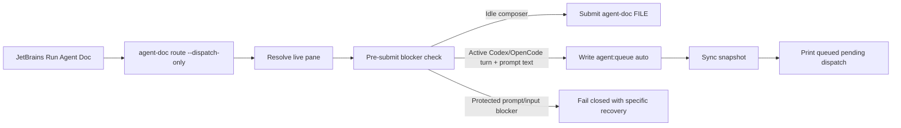
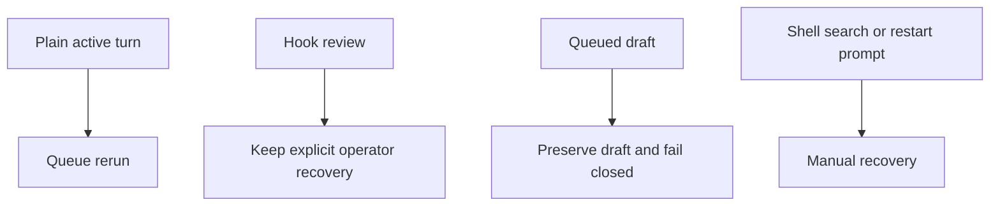

## Status

<!-- agent:status patch=replace -->

Live IntelliJ File Cache Conflict Cancel proof captured; JB Cancel residual review items completed.
<!-- /agent:status -->

## Exchange

<!-- agent:exchange patch=append -->
### Session Summary

*Compacted. Content archived to `/home/brian/work/btakita/agent-loop/.agent-doc/archives/483039e7a9b103bd5b68223dac05a4c449ac03899aba53d6022e82100578b5b0-20260527-230846.md`*

Compacted content:
- Archived 3 response topic(s): auto-done signal work; closeout repair; force-disk closeout repair
- Prior summary/context: ### Session Summary *Compacted. Content archived to `/home/brian/work/btakita/agent-loop/.agent-doc/archives/483039e7...
JB `Run Agent Doc` on tsift.md error
```
[sync] recovered live pane %20 for session 7910a62f via supervisor pid 324491
[sync] recovered live pane %6 for session b26b9957 via supervisor pid 270387
[sync] recovered live pane %15 for session 6cb2a9bf via supervisor pid 1411216
[sync] recovered live pane %21 for session tsift-v0 via supervisor pid 1465656
[sync] recovered live pane %3 for session 4602f467 via supervisor pid 249731
[sync] recovered live pane %4 for session 62fe1f41 via supervisor pid 249819
[sync] recovered live pane %16 for session be20dd6e via supervisor pid 2722653
resync: stash pane %16 is unregistered but still owns /home/brian/work/btakita/agent-loop/tasks/software/agent-loop.md — skipping kill
[route] debounce OK — file idle for 3.1s and typing indicator idle
[route] target tmux session: 0
Error: dispatch-only opencode reopen refused to inject into pane %21 for tasks/software/tsift.md because the pane still shows opencode active turn; restore an idle prompt and retry
```
#spec-test-build-install-commit-push #mermaid

### Re: JB Run Agent Doc on tsift.md — gpt-5

Fixed the Run Agent Doc failure path that produced:

`dispatch-only opencode reopen refused ... pane still shows opencode active turn`

Root cause: route could rediscover a live OpenCode or Codex pane after stash/supervisor recovery, then the final pre-submit blocker check saw an active turn and returned a persistent error. Because that late blocker happened after the normal authoritative busy-actor queue branch, JetBrains treated it as a hard route failure and saved route diagnostics instead of reporting a still-running state or queueing the rerun.

Now prompt-bearing dispatch-only reroutes that hit a plain active Codex/OpenCode turn before input is submitted queue the rerun in `agent:queue auto`, sync the snapshot, and print `queued pending dispatch`. Protected states such as hook review, queued drafts, permission prompts, shell search, and clean-exit restart prompts still fail closed with their explicit recovery path. JetBrains also classifies the older direct `pane still shows opencode active turn` blocker as `BUSY_RUNNING`, so older binaries no longer surface that specific state as a persistent IDE route failure.



Changed files:

- `src/agent-doc/src/route.rs`
- `src/agent-doc/src/route/tests.rs`
- `src/agent-doc/specs/07-session-tmux-commands.md`
- `src/agent-doc/editors/jetbrains/src/main/kotlin/com/github/btakita/agentdoc/TerminalUtil.kt`
- `src/agent-doc/editors/jetbrains/src/test/kotlin/com/github/btakita/agentdoc/TerminalUtilTest.kt`

Verification:

- `cargo test dispatch_active_turn_blockers_are_queueable_for_prompt_bearing_reroutes`
- `GRADLE_USER_HOME=/tmp/agent-doc-gradle ./gradlew test`
- `make check`
- `make tmux-ci`
- `make install`
- `printf '18\n' | agent-doc plugin install --local jetbrains`
- GitHub Actions CI run `26544448556`: `make check` passed and `make tmux-ci` passed.



Commit/push:

- `btakita/agent-doc@6b233e87116981d17fa397f24af545c2210091cc` pushed to `20260422/codex-agent-backend`.
- `btakita/agent-loop@3110abb96` pushed to `main` with the updated `src/agent-doc` submodule pointer.
- The local `agent-doc` binary and JetBrains plugin were installed; restart IntelliJ IDEA 2026.1 to load the updated plugin.
<!-- agent:boundary:01e0b85f -->
<!-- /agent:exchange -->
###
<!--
The completed queue item was not removed from the queue. #mermaid
#spec-test-build-install-commit-push
---
equityfundingsource.md had the full-document IPC duplicate corruption. Then a new full-document IPC deletion under the prompt corruption happened. Both several times while editing the prompt.
#spec-test-build-install-commit-push
---
Please review the agent-doc, claude, codex logs. What are #next-steps to fix bugs?
---
When I ran the last turn, #spec-test-build-install-commit-push was removed by agent-doc.
---
As I was typing into the comment below `/agent:exchange`, the full-document IPC corruption happened, then the duplicate line happened, then the full-document IPC corruption happened again.

In addition to diagnosing and fixing the issue, please provide a mermaid showing how the issue occurred and where in the agent-doc lifecycle the full-document IPC corruption can occur. Can we mathematically eliminate all possibility of the full-document IPC corruption from occurring?

#spec-test-build-install-commit-push
-->

<!-- agent:queue auto -->
---
JB `Run Agent Doc` on tsift.md error
```
[sync] recovered live pane %20 for session 7910a62f via supervisor pid 324491
[sync] recovered live pane %6 for session b26b9957 via supervisor pid 270387
[sync] recovered live pane %15 for session 6cb2a9bf via supervisor pid 1411216
[sync] recovered live pane %21 for session tsift-v0 via supervisor pid 1465656
[sync] recovered live pane %3 for session 4602f467 via supervisor pid 249731
[sync] recovered live pane %4 for session 62fe1f41 via supervisor pid 249819
[sync] recovered live pane %16 for session be20dd6e via supervisor pid 2722653
resync: stash pane %16 is unregistered but still owns /home/brian/work/btakita/agent-loop/tasks/software/agent-loop.md — skipping kill
[route] debounce OK — file idle for 3.1s and typing indicator idle
[route] target tmux session: 0
Error: dispatch-only opencode reopen refused to inject into pane %21 for tasks/software/tsift.md because the pane still shows opencode active turn; restore an idle prompt and retry
```
#spec-test-build-install-commit-push #mermaid
---
<!-- /agent:queue -->

## Backlog

<!-- agent:backlog -->
- [ ] [#already-applied-divergence] already_applied IPC path saves stale content_ours as snapshot, diverging HEAD from working tree — plan: tasks/agent-doc/plan-already-applied-snapshot-divergence.md
<!-- /agent:backlog -->

## Review

<!-- agent:review -->
- [/] [#snrun] [recommended] Implement tasks/agent-doc/plan-run-agent-doc-snappy-auto-remediation.md: make JB Run Agent Doc distinguish rescued-stash accepted-only proof misses, active-turn busy collisions, and stale starting projections; add route/plugin regressions plus live replay evidence.
<!-- /agent:review -->

<!-- agent:icebox -->
<!-- /agent:icebox -->

## Completed / Reaped

<!-- agent:done archive=tasks/agent-doc-bugs2.done.md -->

<!-- completed work archived in tasks/agent-doc-bugs2.done.md -->
<!-- /agent:done -->
