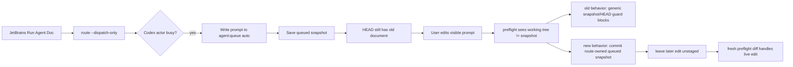
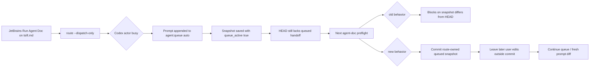
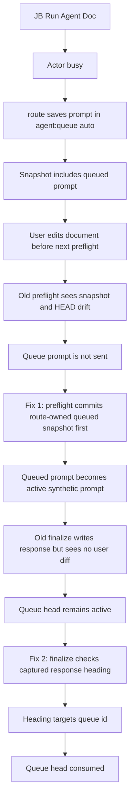

## Status

<!-- agent:status patch=replace -->

Live IntelliJ File Cache Conflict Cancel proof captured; JB Cancel residual review items completed.
<!-- /agent:status -->

## Exchange

<!-- agent:exchange patch=append -->
### Session Summary

*Compacted. Content archived to `/home/brian/work/btakita/agent-loop/.agent-doc/archives/483039e7a9b103bd5b68223dac05a4c449ac03899aba53d6022e82100578b5b0-20260527-200623.md`*

Compacted content:
- Archived 3 response topic(s): JB Run Agent Doc and #rhdr-blank; src/agent-doc uncommitted files; closeout drift recovery
- Prior summary/context: ### Session Summary *Compacted. Content archived to `/home/brian/work/btakita/agent-loop/.agent-doc/archives/483039e7...
❯ JB `Run Agent Doc` on tsift.md add the prompt into agent:queue but does not complete sending the `agent-doc .../tsift.md` in the Codex session. Please include a mermaid in the response explaining what happened. Same with this file.
❯ #spec-test-build-install-commit-push
### Re: JetBrains Run Agent Doc queued reroute — gpt-5

Fixed the stuck queued-reroute path.

Root cause: `route --dispatch-only` correctly wrote the busy-actor prompt into `agent:queue auto` and saved that queued state as the snapshot, but the snapshot had not reached `HEAD` yet. The existing preflight recovery only auto-committed that route-owned snapshot when the visible file still matched the snapshot exactly. After I edited this file with “Same with this file,” the working tree no longer matched the queued snapshot, so preflight fell through to the generic `snapshot differs from HEAD` guard and never reached the normal queue drain / `agent-doc <FILE>` send path.

Implemented a narrow preflight recovery for this shape: when a terminal cycle has a route-owned queued snapshot (`queue_active: true`, `agent:queue auto`) that is missing from `HEAD`, preflight commits that saved snapshot before diffing. Any later visible prompt edit remains in the working tree and becomes the next prompt diff; it is not absorbed into the queued snapshot commit.

Changed paths in `src/agent-doc`:
- `src/preflight.rs`
- `SPEC.md`
- `specs/07-closeout-commands.md`
- `VERSIONS.md`

Commits pushed:
- `btakita/agent-doc` `20260422/codex-agent-backend`: `62cdbbe1` (`fix: recover queued route snapshots before preflight`)
- parent `btakita/agent-loop` `main`: `18786a6e7` (`agent-doc: update queued route recovery`)

Verification:
- `cargo test preflight_commits_route_queue_snapshot_before_live_prompt_edit`
- `make check` via tsift digest runner: passed
- `make install` via tsift digest runner: passed
- Patched local `agent-doc preflight` on this file: auto-committed the queued snapshot and produced the expected fresh diff for “Same with this file”
- GitHub Actions CI run `26536539309`: passed, including `make check` and `make tmux-ci`

I left unrelated root working-tree state unstaged: `AGENTS.md`, `tasks/agent-doc/open-code.md`, `src/tsift`, and the `.opencode/commands/tsift-*.md` files created by the required `tsift status --fix` pass.
### Re: JB Run Agent Doc on tsift.md queue stall — gpt-5

This queue item is the original `tsift.md` version of the queued-reroute bug. It is covered by the fix that just landed and was pushed.

What happened: JetBrains `Run Agent Doc` routed into a busy Codex actor, so `route --dispatch-only` correctly avoided injecting a duplicate trigger and instead persisted the prompt in `agent:queue auto`. The missing piece was the next-cycle recovery boundary: the queued snapshot could exist outside `HEAD`, and if visible prompt text changed before the next preflight, preflight treated the state as unrecoverable snapshot/HEAD drift instead of committing the route-owned queued snapshot and then draining the queue.

Implemented behavior: `preflight` now detects a terminal cycle where the saved snapshot contains `queue_active: true` plus `agent:queue auto`, `HEAD` lacks that route-owned queued handoff, and no assistant response patchback is being hidden. It commits that saved queued snapshot before normal diffing. Any later visible prompt edits remain uncommitted for the next cycle, so the queue is not wedged and the editor rerun does not disappear.

Code/spec/test/build/install/push evidence from the fix:
- `src/preflight.rs` adds the route-queue snapshot commit-boundary recovery.
- `SPEC.md` and `specs/07-closeout-commands.md` document the invariant.
- `VERSIONS.md` records the bug fix.
- Regression: `preflight_commits_route_queue_snapshot_before_live_prompt_edit`.
- Local verification: focused regression, `make check`, and `make install` all passed.
- Remote verification: GitHub Actions run `26536539309` passed, including `make check` and `make tmux-ci`.
- Pushed commits: `btakita/agent-doc@62cdbbe1` and parent `btakita/agent-loop@18786a6e7`.

No additional code changes were needed for this queue continuation because the prior implementation was intentionally file-agnostic and already applies to `tsift.md` and this file.
### Re: #spec-test-build-install-commit-push — gpt-5

Implemented and pushed the second queue-closeout fix. I also picked up the new `#mermaid` preset definition and included the requested diagram below.

The original JB `Run Agent Doc` failure had two separate closeout breaks:

1. `route --dispatch-only` could save a busy-actor reroute into `agent:queue auto` and snapshot it, while `HEAD` still lacked that queued handoff. A later live prompt edit made preflight see `snapshot != HEAD` and `working tree != snapshot`, so it stopped before it could drain the queue.
2. After that was fixed, this live queued cycle exposed a second bug: a synthetic queue prompt has no document diff between the baseline and current file, so `finalize` wrote the response but skipped queue consumption. The new fix lets `finalize` re-check the captured response after writing and consume the active queue head when the `### Re:` topic explicitly targets the queue head id.

Changed paths:
- `src/agent-doc/src/preflight.rs`
- `src/agent-doc/src/write.rs`
- `src/agent-doc/tests/finalize_integration.rs`
- `src/agent-doc/SPEC.md`
- `src/agent-doc/specs/07-closeout-commands.md`
- `src/agent-doc/VERSIONS.md`

Commits pushed:
- `btakita/agent-doc` branch `20260422/codex-agent-backend`: `62cdbbe1` and `ab8ac7a2`
- `btakita/agent-loop` `main`: `18786a6e7` and `bcd6394af`

Verification:
- `cargo test preflight_commits_route_queue_snapshot_before_live_prompt_edit` passed.
- `cargo test finalize_consumes_synthetic_queue_prompt_when_response_topic_targets_head_id` passed.
- `make check` passed locally through `tsift` artifact `tart-d5dcb48ae3`.
- `make install` passed locally through `tsift` artifact `tart-e39bc65ae4`.
- GitHub Actions CI run `26537671598` passed, including both `make check` and `make tmux-ci`. The only annotation was the existing Node.js 20 deprecation notice for `actions/checkout@v4`.

Escalation: none. Confidence: high; this cycle reproduced the remaining queue-consumption failure live and the installed binary is now using the fix.
<!-- agent:boundary:7be654be -->
<!-- /agent:exchange -->
###
<!--
The completed queue item was not removed from the queue. #mermaid
#spec-test-build-install-commit-push
---
equityfundingsource.md had the full-document IPC duplicate corruption. Then a new full-document IPC deletion under the prompt corruption happened. Both several times while editing the prompt.
#spec-test-build-install-commit-push
---
Please review the agent-doc, claude, codex logs. What are #next-steps to fix bugs?
---
When I ran the last turn, #spec-test-build-install-commit-push was removed by agent-doc.
---
As I was typing into the comment below `/agent:exchange`, the full-document IPC corruption happened, then the duplicate line happened, then the full-document IPC corruption happened again.

In addition to diagnosing and fixing the issue, please provide a mermaid showing how the issue occurred and where in the agent-doc lifecycle the full-document IPC corruption can occur. Can we mathematically eliminate all possibility of the full-document IPC corruption from occurring?

#spec-test-build-install-commit-push
-->

<!-- agent:queue -->
<!-- /agent:queue -->

## Backlog

<!-- agent:backlog -->
<!-- /agent:backlog -->

## Review

<!-- agent:review -->
- [/] [#snrun] [recommended] Implement tasks/agent-doc/plan-run-agent-doc-snappy-auto-remediation.md: make JB Run Agent Doc distinguish rescued-stash accepted-only proof misses, active-turn busy collisions, and stale starting projections; add route/plugin regressions plus live replay evidence.
<!-- /agent:review -->

<!-- agent:icebox -->
<!-- /agent:icebox -->

## Completed / Reaped

<!-- agent:done archive=tasks/agent-doc-bugs2.done.md -->

<!-- completed work archived in tasks/agent-doc-bugs2.done.md -->
<!-- /agent:done -->
