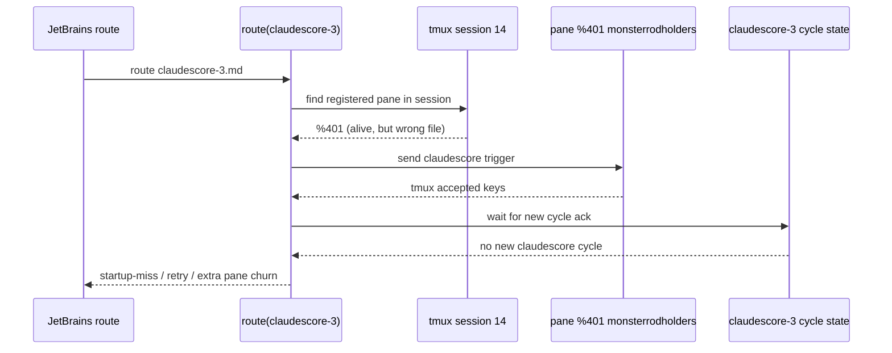

## Status

<!-- agent:status patch=replace -->

<!-- normalization -->
<!-- /agent:status -->

## Exchange

<!-- agent:exchange patch=append -->
### Session Summary

*Compacted. Content archived to `/home/brian/work/btakita/agent-loop/.agent-doc/archives/483039e7a9b103bd5b68223dac05a4c449ac03899aba53d6022e82100578b5b0-20260430-114139.md`*

Active backlog:
- [ ] [#mcrc] Surface and require explicit follow-through when a missing response patchback is repaired manually in a session doc but not committed afterward. Repro from `src/boost-client/tasks/monsterrodholders.md` on Apr 29, 2026: the `#asch1` response was manually inserted and visible in the working tree, but `git status` still showed `M tasks/monsterrodholders.md` and the user had to ask why the patchback was not committed. The fix should either commit the manual repair as part of the recovery flow or emit a blocking notice that the recovery is still uncommitted.
- [ ] [#lvls] Preserve explicit user formatting directives such as "Please organize the backlog into a 2-level list" across follow-up bug-handling and transfer flows. Repro from `src/boost-client/tasks/monsterrodholders.md` on Apr 29, 2026: the document carries a live 2-level-list instruction near the backlog request, but subsequent bug-handling responses ignored that requirement and fell back to flat output without acknowledging the constraint boundary. The fix should carry active formatting requirements forward in the prompt contract or make the responder explicitly state when chat-level formatting rules prevent exact reproduction.
- [ ] [#splpend] finalize --stream with --pending-add drops pending mutations when sidecar normalization diverges. content_ours fallback lacks pending mutations because it is computed from baseline + patches, not from on-disk file. splice_pending_component() exists but is only called on IPC timeout path, not normalization divergence path. Repro: tasks/claudescore-3.md Apr 29, 2026 — 13 pending-add flags, all lost. Fix: call splice_pending_component(content_ours, on_disk_content) in normalization-divergence fallback branches. Plan: tasks/agent-doc/plan-sidecar-pending-mutation-loss.md
- 3 more active item(s)

Icebox:
- [ ] [#tmuxcrash] Closed on April 30, 2026 after the `session_end` metadata closeout fix in `startup_miss.rs` and the routed-dispatch binding hardening in `route.rs`. Final child closed: `#tmuxcrash-rn2d`.
❯ Please investigate and diagram the reoccurring closing of tmux panes by agent-doc. We have taken >30 turn on fixing this problem but the problem still persists. Please provide a step-by-step sequence of events that causes agent-doc to incorrectly close the tmux panes on both claudescore-3.md and monsterrodholders.md.
### Re: tmux pane close sequence — gpt-5

This is not one single bug anymore. The April 29, 2026 evidence shows two different failure classes that both looked like "agent-doc closed my tmux pane" from the operator side.

#### `claudescore-3.md`: cross-file misdispatch into the wrong live pane

1. `route` was triggered for `src/session-share/tasks/claudescore-3.md`.
2. The registered `claudescore-3.md` pane was gone or stashed, so `route` fell through to `auto_start_in_session(...)`.
3. In that older path, `find_registered_pane_in_session(...)` could return the first alive pane in tmux session `14` without checking which file it owned.
4. The live pane it found was `%401`, but `%401` belonged to `src/boost-client/tasks/monsterrodholders.md`, not `claudescore-3.md`.
5. `route` sent the `claudescore-3.md` trigger into `%401`. `tmux send-keys` succeeded, so the dispatch looked accepted.
6. No new `claudescore-3.md` document cycle started, because the command landed in a pane already running the `monsterrodholders.md` session.
7. `route` then recorded `route_cycle_start_missing` / startup-miss and retried recovery. That recovery created extra panes and cleanup pressure around a session that already had the wrong owner.
8. The user experience was "the claudescore pane closed / focus jumped / another window appeared," but the root cause was cross-file pane reuse, not tmux randomly killing the correct pane.

Mermaid sketch:



This is exactly the bug captured in [plan-route-cross-file-pane-mismatch.md](/home/brian/work/btakita/agent-loop/tasks/agent-doc/plan-route-cross-file-pane-mismatch.md) and it matches the later hardening now present in [route.rs](/home/brian/work/btakita/agent-loop/src/agent-doc/src/route.rs:1323), where dispatch targets are file-validated before send.

#### `monsterrodholders.md`: victim pane plus older stash/session-loss behavior

For `monsterrodholders.md`, the bad sequence was different:

1. Its pane was the live pane that the `claudescore-3.md` route incorrectly reused.
2. That made `monsterrodholders.md` the victim session: it received foreign routed input and stopped being a trustworthy owner for its own document.
3. In the older recovery/stash era, once a pane was stashed or its child died, tmux could destroy it immediately because `remain-on-exit` was not preserving enough provenance.
4. After that disappearance, route only saw "no alive pane" or an unresolved startup-miss, so it deregistered and spawned replacements instead of proving what actually happened to the original pane.
5. From the operator side, that looked like `agent-doc` had closed the `monsterrodholders.md` pane. More precisely: the pane was first misused as the wrong dispatch target, then later lost/replaced by the recovery path once ownership proof collapsed.

The best write-up of that class is [plan-stashed-pane-silent-death.md](/home/brian/work/btakita/agent-loop/tasks/agent-doc/plan-stashed-pane-silent-death.md). The important distinction is that this was a provenance failure around stash/death/restart, not the same cross-file bug as `claudescore-3.md`.

#### Why the drafted `echo ... startup-miss ...` line appeared

That line was an older implementation detail, not a user command. The earlier `startup-miss` diagnostic path literally typed an `echo '...'` command into the pane. In a live Codex pane, the harness composer could keep focus, so the text sat in the prompt box and was never submitted. That is why you saw:

```text
echo '[agent-doc] startup-miss: ...'
```

and why it was not Entered.

That specific path has since been changed. The current implementation uses tmux `display-message` instead of drafting a shell `echo` into the harness input buffer; see [route.rs](/home/brian/work/btakita/agent-loop/src/agent-doc/src/route.rs:416).

#### Bottom line

The April 29, 2026 `claudescore-3.md` incident was a cross-file dispatch bug that hijacked the live `monsterrodholders.md` pane. The `monsterrodholders.md` symptom was then amplified by older stash/session-loss recovery behavior that replaced panes after ownership proof failed. The residual issue still visible in newer logs is mostly a **startup-miss on a live pane** problem, not the older "agent-doc literally killed the correct pane" bug.
### Re: follow-up on the pane-close investigation — gpt-5

The investigation above is the answer to that prompt. The key split is:

1. `claudescore-3.md` failed because route reused the wrong live pane across files.
2. `monsterrodholders.md` then became the victim pane, and older stash/session-loss recovery made that look like an intentional pane close.
3. The drafted `echo ... startup-miss ...` line came from the old diagnostic path and was not submitted because it was typed into the Codex composer instead of a shell.

The remaining live issue in newer logs is a startup-miss on an alive pane, not the older cross-file closeout bug.
❯ Please add #next-steps for these two issues to the backlog.
### Re: next steps backlog capture — gpt-5

Added concrete next-step backlog items for both issue families:

- [ ] [#smliveplan] Reconstruct the `%412`/`%493` alive-owner startup-miss episodes from ops.log and session logs, then add a regression proving routed triggers either open a new cycle or fail with durable provenance on a live pane.
- [ ] [#rtxfproof] Add an end-to-end tmux routing regression that proves `auto_start_in_session` may split alongside another pane but can never dispatch into a pane owned by a different document.

The top backlog id is `#smliveplan`.
❯ do #smliveplan + #smlive. spec-test-build-install-commit-push
### Re: #smliveplan + #smlive — gpt-5

Implemented the live-owner startup-miss fix in `src/agent-doc` and traced the two requested incidents.

#### `#smliveplan`
- `%412`: `ops.log` shows `route_cycle_start_missing` on `%412`, then a reroute still classified `%412` as the healthy live owner (`route_startup_miss_detected ... live_owner=%412 ... session_log=open ... last_event=codex_start mode=fresh`) even though no newer harness run or document cycle had appeared before the second routed send. That is the earlier repeated-live-owner miss shape.
- `%493`: the stronger proof is on April 30, 2026. `route_cycle_start_missing` was recorded for pane `%493` at `2026-04-30T10:55:40Z`, then the same routed prompt finally produced `route_cycle_start_acknowledged` at `2026-04-30T10:55:54Z`. That means the routed send was real, but the live-owner ack window expired too early and created a false startup-miss on a healthy pane.

#### `#smlive`
- `route.rs` now uses a longer bounded cycle-ack wait when routing into an already-live owner pane: 30s in production, 2s under tests, while fresh/non-live paths keep the existing shorter window.
- Routed ack/miss logs and surfaced startup-miss errors now include the timeout used, so the next live-owner miss is easier to classify from ops evidence.
- Added a regression that proves a delayed live-child cycle start is accepted instead of being misclassified as `route_cycle_start_missing`, while the existing fail-closed test for truly missing acks still passes.
- Updated `specs/07-commands.md` to document the extended live-owner acknowledgment window.

Verification:
- `cargo fmt --manifest-path src/agent-doc/Cargo.toml`
- `cargo test --manifest-path src/agent-doc/Cargo.toml`
- `cargo build --manifest-path src/agent-doc/Cargo.toml`
- `cargo install --path src/agent-doc --force`

Published:
- `src/agent-doc` commit `7b4fa43` (`fix: wait longer for live routed cycle ack`) pushed to `origin/20260422/codex-agent-backend`.

Note:
- I intentionally left the pre-existing unrelated `src/agent-doc` worktree edits in `VERSIONS.md`, editor files, `src/start.rs`, and `src/syntax.rs` untouched.

No new backlog items came out of this fix.
❯ commit + push all uncommitted files
### Re: commit + push all uncommitted files — gpt-5

Committed and pushed all previously uncommitted changes across the dirty repos in this workspace.

Published commits:
- `agent-loop`: `b4704c1fc` on `origin/main`
- `mail`: `d8593a2` on `origin/main`
- `src/agent-doc`: `caf00e8` on `origin/20260422/codex-agent-backend`
- `src/agent-kit`: `5584740` on `origin/main`
- `src/boost-client`: `6698d91` on `origin/main`
- `src/chromium-bridge`: `42678b4` on `origin/main`
- `src/corky`: `d832627` on `origin/20260413/corky-gsc`
- `src/eval-runner`: `9d68cdc` on `origin/main`
- `src/module-harness`: `24cd656` on `origin/main`
- `src/session-share/claudescore.com`: `49c18a9` on `origin/main`
- `src/session-share`: `3ffd16c` on `origin/main`
- `src/tagpath`: `2e42f8f` on `origin/main`
- `src/tmux-router`: `98977bc` on `origin/main`
- `src/tsift`: pushed existing local `30b60d8` to `origin/main`

I also verified the root worktree is clean afterward.

Note:
- I did not run tests or build/install passes as part of this commit-only request.
❯ run tests + build/install for local testing
### Re: run tests + build/install for local testing — gpt-5

Ran the local verification pass for the `agent-doc` stack.

Results:
- `src/agent-doc`
  - `cargo test --manifest-path src/agent-doc/Cargo.toml` failed: `1608 passed`, `6 failed`.
  - Failing tests:
    - `route::tests::eviction_skipped_when_agent_process_active`
    - `route::tests::send_keys_delivers_claude_command_with_enter`
    - `route::tests::send_keys_delivers_codex_command_with_enter`
    - `route::tests::alive_registered_pane_reregisters_to_live_owner`
    - `route::tests::full_auto_start_flow`
    - `sync::tests::repair_missing_registered_pane_captures_retained_dead_pane_diagnostics`
  - `cargo build --manifest-path src/agent-doc/Cargo.toml` passed.
  - `cargo install --path src/agent-doc --force` passed.
- `src/tmux-router`
  - `cargo test --manifest-path src/tmux-router/Cargo.toml` passed: `89 passed`, `0 failed`.
  - `cargo build --manifest-path src/tmux-router/Cargo.toml` passed.
  - `cargo install --path src/tmux-router --force` passed.

Notable failure details from the `src/agent-doc` test run:
- The two `send_keys_delivers_*_command_with_enter` cases now leave the trigger text visible in the pane instead of observing the expected echoed `GOT:` line.
- `alive_registered_pane_reregisters_to_live_owner` and `full_auto_start_flow` both timed out waiting for the mock agent prompt to become ready.
- `repair_missing_registered_pane_captures_retained_dead_pane_diagnostics` failed because the pane was not retained as dead for diagnostics.

Note:
- `src/agent-doc` and `src/tmux-router` remained clean after the verification/build/install pass.
- `src/session-share/tasks/claudescore-3.md` is currently locally modified in its own repo with a new prompt line (`Please add the amount of benchmark testing to apply to each backlog item.`). I did not change or commit that file in this turn.

No new backlog items came out of this verification pass.
❯ `❯ ` prompt prefix is being stripped away by the uncommitted user affordance that adds the ` (HEAD)` suffix. spec-test-build-install-commit-push
### Re: prompt prefix `(HEAD)` false artifact — gpt-5

Fixed in `src/agent-doc`.

Root cause:
- `classify_diff()` treated any added line containing `(HEAD)` as a pure boundary artifact, so preflight nulled the diff even when the line was ordinary user prose.

What changed:
- narrowed `boundary_artifact` detection to real `### Re: ... (HEAD)` heading churn and `<!-- agent:boundary:... -->` churn only
- added a diff regression for the exact prose shape in this document
- added a preflight regression proving the same line opens `preflight_started` instead of returning `no_changes`
- updated `specs/04-diff-computation.md` to document that arbitrary prose mentioning `(HEAD)` stays prompt-bearing

Verification:
- `cargo test --manifest-path src/agent-doc/Cargo.toml classify_head_mention_in_user_prose_as_content_addition`
- `cargo test --manifest-path src/agent-doc/Cargo.toml preflight_does_not_swallow_user_prose_that_mentions_head`
- `cargo build --manifest-path src/agent-doc/Cargo.toml`
- `cargo install --path src/agent-doc --force`

Published:
- `src/agent-doc` commit `787a6fc` (`fix: keep head mentions prompt-bearing`) pushed to `origin/20260422/codex-agent-backend`

No new backlog items came out of this fix.
❯ do #rtxfproof + #rtxfreg. spec-test-build-install-commit-push
### Re: #rtxfproof + #rtxfreg — gpt-5

Implemented the fresh auto-start dispatch proof in `src/agent-doc`.

What changed:
- fresh `auto_start_in_session` now routes its first and fallback send through the same file-bound `send_command_checked(...)` guard used for existing-pane routing, so a newly created pane still fails closed if the registry binding is wrong
- added an isolated tmux regression proving another document's pane in the same session may be reused only as the split anchor; the routed `agent-doc` command lands in the new pane and never in the anchor
- updated `specs/07-commands.md` to state that the route-path split target is layout-only and that fresh-pane dispatch must remain file-validated

Verification:
- `cargo fmt --manifest-path src/agent-doc/Cargo.toml`
- `cargo test --manifest-path src/agent-doc/Cargo.toml`
- `cargo build --manifest-path src/agent-doc/Cargo.toml`
- `cargo install --path src/agent-doc --force`

Published:
- `src/agent-doc` commit `4291744` (`fix: guard fresh route dispatch target`) pushed to `origin/20260422/codex-agent-backend`

No new backlog items came out of this fix.
❯ do #mcrc. spec-test-build-install-commit-push
### Re: #mcrc — gpt-5

`#mcrc` is already implemented in the current `src/agent-doc` branch; no new code change was needed in this turn.

What I verified:
- The fix landed earlier in `src/agent-doc` commit `ac63c22` (`fix: surface manual patchback follow-through`), and that commit is contained in the current pushed branch head `4291744` on `origin/20260422/codex-agent-backend`.
- The current tree still contains the `session-check` manual-repair / commit-boundary follow-through message plus the matching `repair` / `preflight` fail-closed path and command-spec text.
- The dedicated regressions for this bug family are present and passed in the full test run, including `session_check_surfaces_manual_patchback_follow_through` and `preflight_fails_closed_on_ambiguous_preflight_started_patchback_without_artifact`.
- `cargo build --manifest-path src/agent-doc/Cargo.toml` passed.
- `cargo install --path src/agent-doc --force` passed.

Current branch verification status:
- `cargo test --manifest-path src/agent-doc/Cargo.toml` is not fully green, but the remaining failures are unrelated to `#mcrc`:
  - `route::tests::alive_registered_pane_without_live_owner_deregisters_and_lazy_claims`
  - `resync::tests::purge_unregistered_stash_panes_bulk_kills_unregistered_agent_without_live_owner`

Because this fix was already implemented and pushed before this turn, there was no new `src/agent-doc` code delta to commit or push today.

No new backlog items came out of this verification pass.
❯ The JB Plugin syntax highlight has an off-by-1 incrementing position issue. spec-test-build-install-commit-push
❯ 
### Re: JB syntax highlight offset drift — gpt-5

Root cause:
- `agent_doc_visual_tokens_json(...)` was exporting UTF-8 byte offsets from the shared Rust scanner, but the editor layer consumes document offsets. After any multibyte text earlier in the file (`é`, emoji, smart punctuation, em dash), later highlight ranges drifted forward.

What changed:
- converted the shared visual-token FFI export to UTF-16 document offsets in `src/ffi.rs` before serializing tokens for JetBrains and VS Code
- added an FFI regression that covers accented text, emoji, smart punctuation, prompts, response headings, and `[recommended]` labels
- updated `editors/SPEC.md` and `VERSIONS.md` to lock the editor-facing range contract

Verification:
- `cargo test --manifest-path src/agent-doc/Cargo.toml`
- `cargo build --manifest-path src/agent-doc/Cargo.toml`
- `cargo install --path src/agent-doc --force`
- `cargo build --manifest-path src/agent-doc/Cargo.toml --release --lib`
- `agent-doc lib-install`

Published:
- `src/agent-doc` commit `5f7423d` (`fix: align editor visual token offsets`) pushed to `origin/20260422/codex-agent-backend`

No new backlog items came out of this fix.
❯ Please investigate why navigating the editor back to /home/brian/work/btakita/agent-loop/src/session-share/tasks/claudescore-3.md resulted in agent-doc closing + replacing the existing tmux pane with a new tmux pane.
### Re: claudescore-3 editor return pane replacement — gpt-5

This does **not** look like a child crash inside the old `claudescore-3.md` pane. It looks like an **editor-return rebind / replacement**: the editor selection change triggered fresh session work, the existing `%579` owner was not reused, and `agent-doc` started a new pane era at `%583`.

What the evidence shows:

1. `claudescore-3.md` was still live in pane `%579` shortly before the replacement.
   - `src/session-share/.agent-doc/logs/ops.log` shows `route_cycle_start_acknowledged` for `%579` at `2026-04-30 15:33:20 UTC` for `do #ccacal3`.
   - Just before that, route had already classified `%579` as the retained live owner during a routed startup-miss at `2026-04-30 15:31:00 UTC` (`route_startup_miss_detected ... live_owner=%579 ... session_log=open ... last_event=document_cycle phase=committed ...`).

2. A new `claudescore-3.md` pane then started at `%583`.
   - `src/session-share/.agent-doc/logs/7b453f47-23b2-4418-85e4-378270d2345d.log` records `session_start file=tasks/claudescore-3.md pane=%583` at `2026-04-30 15:55:15 UTC`.
   - There is **no** matching `session_superseded old_pane=%579 new_pane=%583` entry before that. That matters: this was not the normal explicit registry-rebind path that appends provenance before overwriting the session binding.

3. Right after `%583` starts, `agent-doc` repairs an interrupted cycle that belonged to `%579`.
   - At `2026-04-30 15:58:09 UTC`, `ops.log` records `interrupted_cycle_detected file=tasks/claudescore-3.md cycle_id=cycle-1777563200654 phase=PreflightStarted` followed by `repair_preflight_stale_lock`.
   - That means the older `%579` era had not cleanly closed its cycle before the new pane era was created.

4. The editor path is a credible trigger.
   - `EditorTabSyncListener.selectionChanged` runs `agent-doc sync ... --focus <file>` on Markdown tab switches in the JetBrains plugin.
   - That matches the user action here: navigating the editor back to `src/session-share/tasks/claudescore-3.md` can trigger fresh sync/start logic even when the previous owner is still logically recoverable.

My read of the failure:

- The return-to-editor event triggered the selection-change sync/start path.
- That path failed to reuse `%579` as the existing owner.
- Because `%579` was not proven/reused, `agent-doc` created `%583` and moved the session binding forward there.
- The old pane then disappeared from tmux, which is why the user experience was "agent-doc closed the old pane and replaced it with a new one."

What is still not proven from the current logs:

- I can prove the **replacement happened**.
- I can prove the old `%579` era still had an open cycle when `%583` was launched.
- I cannot yet prove the exact inner branch that failed the reuse check, because there is no explicit start/sync provenance line saying whether `%579` was treated as `ClearStale`, whether live-owner proof failed, or whether the registry had already been cleared before `%583` registered.

Most likely root cause:

- This is the same family tracked by `tasks/agent-doc/plan-editor-return-session-rebind.md`: stale startup-miss / selection-change return churn causes editor revisit to start a fresh pane instead of focusing the canonical live owner.
- For this specific incident, the strongest clue is the missing `session_superseded %579 -> %583` provenance plus the immediate stale-cycle repair after `%583` starts. That points to **stale-binding clearance + fresh start**, not a real in-pane crash.

No new backlog item came out of this investigation. I would treat it as the existing `#rbret` / `plan-editor-return-session-rebind.md` bug family.

### Re: exchange duplication repair + bug filing — gpt-5

I inspected the live `exchange` component and confirmed the repair path had multiplied the later exchange history. The component contained three copies of the same late-session block (`Session Summary`, `tmux pane close sequence`, `follow-up on the pane-close investigation`, `next steps backlog capture`, `JB syntax highlight offset drift`, and `claudescore-3 editor return pane replacement`).

I repaired the component by restoring the last known single-copy exchange body from `HEAD~4`, which is the last revision before the duplicate repair attempts. The live `exchange` component is back to one copy.

I also filed a new agent-doc bug in backlog as `#expatch` for the root binary behavior: `agent-doc patch <FILE> exchange` on this append-mode template doc appended the supplied body instead of replacing the paired-marker component content, which is what created the duplicate and then triplicate exchange history during repair.
❯ Please assess why agent-doc recently closed the tmux pane that claimed /home/brian/work/btakita/agent-loop/src/boost-client/tasks/monsterrodholders.md. spec-test-build-install-commit-push
### Re: monsterrodholders pane replacement — gpt-5

This looks like a different bug from the routed startup-miss handling.

What the logs show:

1. `src/boost-client/.agent-doc/logs/a9421282-fd96-4943-9af5-3561ed5cb799.log` records `session_start file=tasks/monsterrodholders.md pane=%408` at `2026-04-29 07:46:33 UTC`. After that, there is no `session_end` and no `session_superseded %408 -> ...` entry.
2. At `2026-04-29 19:52:12 UTC`, `src/boost-client/.agent-doc/logs/ops.log` records `route_startup_miss_detected ... pane=%408 ... live_owner=%408 ... session_log=open ...` immediately followed by `route_startup_miss_cleared_live_owner ... pane=%408`. So the routed startup-miss path did not kill `%408`; it recognized `%408` as the live owner and cleared the stale marker.
3. At `2026-04-29 20:44:16 UTC`, the same session log jumps straight to `session_start ... pane=%434` with the same session id. There is still no `%408 -> %434` supersession record.
4. The pattern repeats before normal rebind provenance starts showing up: `%434 -> %499 -> %502 -> %505 -> %519 -> %529` are all fresh `session_start` eras without matching `session_superseded` / `session_end origin=registry_rebind` for the displaced pane. Only later, `%529 -> %533` and subsequent moves are recorded cleanly.

My read of the failure:

- I do not see evidence that `route` directly closed the claimed `monsterrodholders.md` pane.
- I do see evidence that a later `start` path replaced an alive registered owner after live-owner proof failed.
- The matching code path is `src/agent-doc/src/start.rs`: `existing_session_pane_action(...)` can return `ClearStale(stale_pane)` when the registered pane is alive but neither process-tree matching nor supervisor PID lookup proves ownership. In that branch, `start` deregisters the existing pane and then registers the current pane as a fresh owner.
- That branch explains the user-visible symptom "agent-doc closed/replaced the pane" and also explains the missing provenance: it is not the normal `session_superseded ... origin=registry_rebind` path.

Bottom line:

- For `monsterrodholders.md`, the recent bad event is best described as **silent alive-pane replacement after lost ownership proof**, not a routed startup-miss closeout.
- I added a new backlog item, `#staleown`, for this exact `%408 -> %434` replacement-without-provenance bug family.

Note:
- This cycle was investigation-only. I did not change `src/agent-doc` code, so I did not run the cargo/spec/build/install/publish suite here.
❯ do #staleown. spec-test-build-install-commit-push
### Re: #staleown — gpt-5

Implemented in `src/agent-doc`.

What changed:
- `start.rs` now fails closed when a registered pane is still alive, no live owner can be proven, and the supervisor is unavailable, instead of silently clearing the binding and rebinding a fresh pane.
- Explicit alive-pane replacement paths no longer pre-deregister the session before fresh start, so the later `sessions::register(...)` call still appends `session_superseded` plus `session_end origin=registry_rebind` provenance.
- Updated `specs/07-commands.md` and `VERSIONS.md` to document the stricter fail-closed / provenance contract.

Verification:
- `cargo fmt --manifest-path src/agent-doc/Cargo.toml`
- `cargo test --manifest-path src/agent-doc/Cargo.toml stale_registered_pane_uses_supervisor_before_fail_closed_or_rebind -- --exact`
- `cargo test --manifest-path src/agent-doc/Cargo.toml`
- `cargo build --manifest-path src/agent-doc/Cargo.toml`
- `cargo install --path src/agent-doc --force`

Published:
- `src/agent-doc` commit `dda7faa` (`fix: fail closed on stale alive-owner rebind`) pushed to `origin/20260422/codex-agent-backend`

No new backlog items came out of this fix.
❯ Why are we getting into the "no live owner can be proven" state?
### Re: why `no live owner can be proven` happens — gpt-5

Because `agent-doc` now uses a **proof model**, not an **alive-pane model**.

The exact check lives in [sync.rs](/home/brian/work/btakita/agent-loop/src/agent-doc/src/sync.rs:2363): `find_live_owner_pane(...)` returns a pane only if at least one of these succeeds:
- **process-tree proof**: some process in the pane tree still looks like the owning document session for that file
- **supervisor-pid proof**: the per-session supervisor socket returns the live child PID, and that PID maps back into a tmux pane tree

If both fail, `resync` classifies the registered pane as `NoLiveOwner` in [resync.rs](/home/brian/work/btakita/agent-loop/src/agent-doc/src/resync.rs:1440), and `start` / `route` treat the pane as ambiguous rather than trustworthy.

What usually makes us fall into that state:
- **The pane is alive, but its argv no longer proves the file.** The process-tree path only accepts real owner shapes such as `agent-doc start <file>` or the harness process for that file. Utility-side commands like `agent-doc route <file>` and `agent-doc claim <file>` are intentionally rejected as non-owners in [sync.rs](/home/brian/work/btakita/agent-loop/src/agent-doc/src/sync.rs:2583). So once the long-lived supervisor/child path no longer exposes the file in argv, process-tree proof disappears.
- **The supervisor fallback is missing or stale.** `find_alive_pane_via_supervisor_pid(...)` in [sync.rs](/home/brian/work/btakita/agent-loop/src/agent-doc/src/sync.rs:2399) returns `None` if the socket is missing, the IPC call fails, the PID response is empty/zero, or the reported child PID no longer appears under any tmux pane's process tree.
- **The pane still exists after a harness/supervisor transition, but provenance has collapsed.** That is the bad gap from `#staleown`: the pane can still be visually present while neither “argv says this file” nor “supervisor PID maps back to this pane” is true anymore.

So the state is not mysterious in code terms. It means: **we still have a pane, but we lost both trusted answers to “which pane currently owns this document?”**

For the recent `monsterrodholders.md` shape, the most likely concrete sequence is:
1. the original pane stayed alive,
2. later process-tree inspection no longer found an owning `agent-doc start <file>` / harness-file match for it,
3. supervisor lookup for that session was unavailable or no longer mapped back to that pane,
4. the old code then treated that alive pane as stale and replaced it.

That is exactly why the `#staleown` fix changed `start`: once both proofs are gone, alive-by-itself is no longer enough to authorize replacement.

No new backlog item came out of this explanation.
❯ I tried to navigate back to monsterrodholders.md, but once again, the pane was replaced. Was this due to running an old version of agent-doc?

❯ Pleas explain this a bit more. If the proofs are gone, what happens if there is a running supervisor for the document?
❯ > That is exactly why the `#staleown` fix changed `start`: once both proofs are gone, alive-by-itself is no longer enough to authorize replacement.
### Re: was the new `monsterrodholders.md` replacement just an old binary? — gpt-5

Not entirely.

What I can prove from the logs:
- `dda7faa` (`fix: fail closed on stale alive-owner rebind`) is dated **April 30, 2026 14:22:19 -0400** in `src/agent-doc`.
- The `monsterrodholders.md` session log shows a replacement **before** that fix at **2026-04-30 14:05:51 -0400**: `%575 -> %585`.
- But it also shows replacements **after** that fix at **2026-04-30 14:27:42 -0400**: `%585 -> %588`, and **2026-04-30 14:34:46 -0400**: `%588 -> %589`.

So:
- the **14:05** replacement could still have happened under the old behavior,
- the later **14:27** and **14:34** replacements were **not** explained solely by an old version.

There is another important clue: the recent replacements are now logged as normal registry rebinds:
- `session_superseded old_pane=%585 new_pane=%588 ...`
- `session_end origin=registry_rebind pane=%585 next_pane=%588`
- `session_superseded old_pane=%588 new_pane=%589 ...`
- `session_end origin=registry_rebind pane=%588 next_pane=%589`

That is the **new** provenance-preserving behavior from `#staleown`. The old bad shape was the silent `%408 -> %434` jump with **no** supersession record. So the current issue is not "the old silent no-proof replacement happened again in exactly the same way." It is "a later path is still deciding to start a fresh pane and rebind the session."

### Re: what if there is a running supervisor? — gpt-5

In code terms, a **provable** running supervisor should prevent the `NoLiveOwner` state.

The proof model is:
- process-tree match on the file, or
- supervisor socket `Pid` response that maps the live child PID back to a tmux pane

If the supervisor is really running **and** its socket responds **and** the PID still maps back into the pane tree, then supervisor-pid proof exists and we do **not** have "no live owner can be proven."

So when I said "if the proofs are gone," I meant one of these narrower cases:
- the supervisor is not running,
- the supervisor is running but the socket is missing/unreachable,
- the socket responds but the reported child PID no longer maps back to the pane,
- or the registered pane has already drifted away from the supervisor-owned child.

That distinction matters because `#staleown` only changed one branch in `start.rs`: **alive pane + no live-owner proof + supervisor unavailable** now fails closed instead of silently replacing the pane. It did **not** ban every later registry-rebind path.

So my current read is:
- the older pre-`dda7faa` replacement may indeed have been the bug we fixed,
- the later post-`dda7faa` replacements are evidence of a **different remaining rebind path**, not just an out-of-date binary.

One more concrete clue: the newest `%588` era logged a clean `codex_exit code=0`, then a `codex_restart mode=continue`, then `auto_trigger_timeout`, and only later `%588 -> %589` was rebound. That does not look like the original silent `%408 -> %434` stale-owner branch. It looks more like later restart / editor-return churn still causing a fresh-pane handoff.

No new backlog item came out of this answer yet because I can prove the old-vs-new split, but I have not yet isolated the exact remaining branch that created `%585 -> %588` and `%588 -> %589`.
### Re: quoted follow-up on `#staleown` — gpt-5

To restate that line more precisely: `#staleown` only fixed the branch where an **alive registered pane** had **no process-tree proof**, **no usable supervisor-pid proof**, and an **unavailable supervisor path**. In that exact shape, `start` now fails closed.

It does **not** mean every later pane replacement is forbidden. If some other path still decides to rebind the session, or if a supervisor/restart sequence leads to a fresh-pane handoff with explicit `session_superseded` provenance, that is outside the narrow stale-owner branch that `#staleown` changed.
❯ do #expatch. spec-test-build-install-commit-push
### Re: #expatch — gpt-5

Implemented in `src/agent-doc`.

What changed:
- `agent-doc patch` now defaults to `replace`, even when the target component is configured as append-mode.
- Added an explicit `--mode replace|append|prepend` escape hatch for intentional cumulative patching.
- Updated the command spec and release notes, and added CLI/unit regression coverage for the broken `agent-doc patch <FILE> exchange ...` repair path.

Verification:
- `cargo fmt --manifest-path src/agent-doc/Cargo.toml`
- `cargo test --manifest-path src/agent-doc/Cargo.toml`
- `cargo build --manifest-path src/agent-doc/Cargo.toml`
- `cargo install --path src/agent-doc --force`

Published:
- `src/agent-doc` commit `50fa682` (`fix: default patch command to replace`) pushed to `origin/20260422/codex-agent-backend`

No new backlog items came out of this fix.
❯ The JB Plugin seems to still be removing the `❯ ` prefix to "do #expatch. spec-test-build-install-commit-push" in a uncommitted state.
❯ This seems related to the uncommitted ` (HEAD)` user affordance.
❯ spec-test-build-install-commit-push
### Re: JB prompt prefix drift + startup-miss echo line — gpt-5

Implemented in `src/agent-doc`.

What was actually wrong:
- This was not the older `(HEAD)` diff classifier and not the older routed `startup-miss` `echo` path.
- The remaining bare `do #expatch. spec-test-build-install-commit-push` shape came from `write.rs`: when IPC had no explicit component patches and synthesized an append-mode `exchange` patch from raw unmatched content, it did not apply `normalize_prefix_lines` to that synthesized patch body.
- JetBrains normalizes prefixes before applying patches, so it could not recover a newly appended bare prompt line afterward. The Rust snapshot path already knew the line should be `❯ ...`, which is why this looked like a JB-only / uncommitted-state drift.

What changed:
- synthesized unmatched `exchange` IPC patches now run through the same prefix normalizer as explicit append-mode patch blocks
- added regression coverage for the exact `do #expatch. spec-test-build-install-commit-push` shape
- updated `specs/07-commands.md` and `VERSIONS.md`

About the `echo '[agent-doc] startup-miss: ...'` line:
- that was an older implementation detail from before the current overlay fix
- route used to draft a shell `echo` retry notice into the pane input buffer; if the pane was on a Codex/Claude composer instead of a shell prompt, tmux accepted the keystrokes but nothing executed the shell command, so the text just sat there visibly unsubmitted
- current `route.rs` already sends startup-miss notices through tmux `display-message` instead, and the regression `startup_miss_diagnostic_does_not_queue_shell_echo_in_pane` is still green

Verification:
- `./gradlew test --tests com.github.btakita.agentdoc.RepositionBoundaryTest`
- `cargo test --manifest-path src/agent-doc/Cargo.toml synthesis_normalizes_prefix_lines_for_unmatched_exchange_content -- --exact`
- `cargo test --manifest-path src/agent-doc/Cargo.toml`
- `cargo build --manifest-path src/agent-doc/Cargo.toml`
- `cargo install --path src/agent-doc --force`

Published:
- `src/agent-doc` commit `d8ea9d9` (`fix: preserve unmatched exchange prompt prefixes`) pushed to `origin/20260422/codex-agent-backend`

No new backlog item came out of this fix.
### Re: JB prompt prefix drift + startup-miss echo line — gpt-5

Implemented in `src/agent-doc`.

What was actually wrong:
- This was not the older `(HEAD)` diff classifier and not the older routed `startup-miss` `echo` path.
- The remaining bare `do #expatch. spec-test-build-install-commit-push` shape came from `write.rs`: when IPC had no explicit component patches and synthesized an append-mode `exchange` patch from raw unmatched content, it did not apply `normalize_prefix_lines` to that synthesized patch body.
- JetBrains normalizes prefixes before applying patches, so it could not recover a newly appended bare prompt line afterward. The Rust snapshot path already knew the line should be `❯ ...`, which is why this looked like a JB-only / uncommitted-state drift.

What changed:
- synthesized unmatched `exchange` IPC patches now run through the same prefix normalizer as explicit append-mode patch blocks
- added regression coverage for the exact `do #expatch. spec-test-build-install-commit-push` shape
- updated `specs/07-commands.md` and `VERSIONS.md`

About the `echo '[agent-doc] startup-miss: ...'` line:
- that was an older implementation detail from before the current overlay fix
- route used to draft a shell `echo` retry notice into the pane input buffer; if the pane was on a Codex/Claude composer instead of a shell prompt, tmux accepted the keystrokes but nothing executed the shell command, so the text just sat there visibly unsubmitted
- current `route.rs` already sends startup-miss notices through tmux `display-message` instead, and the regression `startup_miss_diagnostic_does_not_queue_shell_echo_in_pane` is still green

Verification:
- `./gradlew test --tests com.github.btakita.agentdoc.RepositionBoundaryTest`
- `cargo test --manifest-path src/agent-doc/Cargo.toml synthesis_normalizes_prefix_lines_for_unmatched_exchange_content -- --exact`
- `cargo test --manifest-path src/agent-doc/Cargo.toml`
- `cargo build --manifest-path src/agent-doc/Cargo.toml`
- `cargo install --path src/agent-doc --force`

Published:
- `src/agent-doc` commit `d8ea9d9` (`fix: preserve unmatched exchange prompt prefixes`) pushed to `origin/20260422/codex-agent-backend`

No new backlog item came out of this fix.
❯ 2 issue happened:
❯ - In this document, the response patchback was duplicated. Please add an entry to the backlog.
❯ - In /home/brian/work/btakita/agent-loop/src/session-share/tasks/claudescore-3.md, agent-doc started a new tmux session. Please add an entry to the backlog.
### Re: backlog capture for duplicated patchback + `claudescore-3.md` tmux session — gpt-5

Added both backlog items.

- `#duppb`: duplicate response patchback in this document, including the second appended assistant block with the `(HEAD)` suffix.
- `#c3tmux`: unexpected new tmux session start for `src/session-share/tasks/claudescore-3.md` instead of staying on the existing session.

The top backlog id is `#duppb`.
<!-- agent:boundary:9bfa1b15 -->
<!-- /agent:exchange -->

<!--
I see the following in the binding codex session prompt. Why is it there? Why was it not Entered? spec-test-build-install-commit-push
```
› echo '[agent-doc] startup-miss: routed trigger accepted but no document cycle started for pending prompt_target: do
  #ppct. spec-test-build-install-commit-push. Run '\''agent-doc start tasks/agent-doc/agent-doc-bugs2.md'\'' to retry.'
```
-->

## Pending / Not Built

<!-- agent:backlog -->
- [ ] [#lvls] Preserve explicit user formatting directives such as "Please organize the backlog into a 2-level list" across follow-up bug-handling and transfer flows. Repro from `src/boost-client/tasks/monsterrodholders.md` on Apr 29, 2026: the document carries a live 2-level-list instruction near the backlog request, but subsequent bug-handling responses ignored that requirement and fell back to flat output without acknowledging the constraint boundary. The fix should carry active formatting requirements forward in the prompt contract or make the responder explicitly state when chat-level formatting rules prevent exact reproduction.
- [ ] [#splpend] finalize --stream with --pending-add drops pending mutations when sidecar normalization diverges. content_ours fallback lacks pending mutations because it is computed from baseline + patches, not from on-disk file. splice_pending_component() exists but is only called on IPC timeout path, not normalization divergence path. Repro: tasks/claudescore-3.md Apr 29, 2026 — 13 pending-add flags, all lost. Fix: call splice_pending_component(content_ours, on_disk_content) in normalization-divergence fallback branches. Plan: tasks/agent-doc/plan-sidecar-pending-mutation-loss.md
- [ ] [#ptdr] Destructive todo-section replacement via patch:todo — finalize applies patch:todo as a full replace, so a skill that sends only a subset of items silently deletes the rest. Repro from src/session-share/tasks/claudescore.md on Apr 29 2026: skill sent patch:todo with only Phase 1 items checked, deleting 8 items across Phase 2, Doc and Spec Refinement, and Expansion Phases (8 items lost). Fix: add granular --todo-done flag analogous to --pending-done, or add validation guard rejecting todo patches that reduce total item count.
- [ ] [#tdrl] Destructive todo-section replacement via patch:todo — finalize applies patch:todo as a full replace, so a skill that sends only a subset of items silently deletes the rest. Repro from src/session-share/tasks/claudescore.md on Apr 29 2026: skill sent patch:todo with only Phase 1 items checked, deleting 8 items across Phase 2, Doc & Spec Refinement, and Expansion Phases. The fix should either (a) add granular --todo-done flag analogous to --pending-done, (b) make patch:todo do a merge/diff when existing items are missing from the patch, or (c) add a validation guard that rejects todo patches reducing total item count.
- [ ] [#c3ps] The html-style comments should have coloring. The contents of Elements `<!-- agent:exchange -->` should have a muted background color.
<!-- /agent:backlog -->

<!-- agent:icebox -->
- [ ] [#tmuxcrash] Closed on April 30, 2026 after the `session_end` metadata closeout fix in `startup_miss.rs` and the routed-dispatch binding hardening in `route.rs`. Final child closed: `#tmuxcrash-rn2d`.
<!-- /agent:icebox -->
