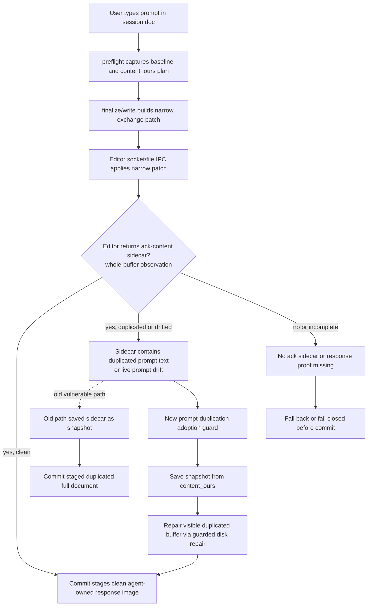

## Status

<!-- agent:status patch=replace -->

Live IntelliJ File Cache Conflict Cancel proof captured; JB Cancel residual review items completed.
<!-- /agent:status -->

## Exchange

<!-- agent:exchange patch=append -->
### Session Summary

*Compacted. Content archived to `/home/brian/work/btakita/agent-loop/.agent-doc/archives/483039e7a9b103bd5b68223dac05a4c449ac03899aba53d6022e82100578b5b0-20260527-064854.md`*

Compacted content:
- Archived 4 response topic(s): tsift.md full-document IPC corruption; do [#wkbs]; JB Plugin active-turn route refusal; 1 more
- Prior summary/context: ### Session Summary *Compacted. Content archived to `/home/brian/work/btakita/agent-loop/.agent-doc/archives/483039e7...
### Re: #snrun — gpt-5

Implemented and pushed the code side of `#snrun`; I am gating the item rather than marking it done because the requested live JetBrains replay still needs an IDE restart and an actual `Run Agent Doc` action after loading the newly installed local plugin.

Changed paths in `src/agent-doc`:
- `editors/jetbrains/src/main/kotlin/com/github/btakita/agentdoc/TerminalUtil.kt`
- `editors/jetbrains/src/test/kotlin/com/github/btakita/agentdoc/TerminalUtilTest.kt`
- `src/harness.rs`
- `editors/jetbrains/SPEC.md`
- `specs/07-session-tmux-commands.md`
- `editors/jetbrains/gradle.properties`
- `VERSIONS.md`

Behavior changed:
- JetBrains `Run Agent Doc` now retries the route command for transient dispatch-only Codex `latest run is still booting` failures when the route probe ended on `active codex turn` or `timed_out`.
- Shell-history/search blockers remain terminal failures, so protected input is not hidden behind editor retries.
- The plugin version was bumped to `0.2.134`; the local build was installed to the running `IntelliJIdea2026.1` profile and requires an IDE restart.

Verification:
- `cargo test dispatch_blocker_reason_detects_codex_interactive_history_search` passed.
- `./gradlew test --tests com.github.btakita.agentdoc.TerminalUtilTest` passed.
- `make check` passed.
- `./gradlew buildPlugin` passed.
- `make install` passed.
- `agent-doc plugin install --local jetbrains` installed `agent-doc-jetbrains-0.2.134.zip` to `/home/brian/.local/share/JetBrains/IntelliJIdea2026.1`.
- Latest GitHub Actions `CI` run `26494572231` was green; its `check` job ran both `make check` and `make tmux-ci` successfully.

Commit/push: `src/agent-doc` commit `e691220d` (`fix: retry transient Run Agent Doc booting routes`) was pushed to `origin/20260422/codex-agent-backend`.

Confidence: high for the classifier and regression coverage; medium for the full live IDE path until the restarted plugin is replayed from the IDE. Escalation: none. Pre-existing unrelated dirty files in `src/agent-doc` were left unstaged.
### Re: closeout repair — gpt-5

Closeout repair committed the visible #snrun response and gated-review state after editor IPC drift. No additional repo code changed in this repair.
❯ equityfundingsource.md had the full-document IPC corruption occur while I was typing in a prompt. In addition to diagnosing and fixing the issue, please provide a mermaid showing how the issue occurred and where in the agent-doc lifecycle the full-document IPC corruption can occur. Can we mathematically eliminate all possibility of the full-document IPC corruption from occurring? 
❯ #spec-test-build-install-commit-push
### Re: equityfundingsource IPC corruption — gpt-5

I diagnosed the `equityfundingsource.md` corruption as a remaining whole-document IPC authority path, but not the already-disabled `fullContent` send path. The ops log shows the editor narrow socket patch succeeded, then the plugin returned an `ack-content` sidecar whose whole-buffer text was longer than the disk copy and had duplicated prompt text. The binary treated that sidecar as authoritative snapshot content, so the duplicate prompt was saved and committed.

The fix makes ACK content observational rather than authoritative when it grows user prompt multiplicity relative to the agent-owned `content_ours` response image. On socket and file IPC ACK-content adoption, `agent-doc` now checks prompt counts with response-aware parsing. If the ACK sidecar contains extra user prompt copies, it logs and records `ipc_snapshot_adoption_blocked`, saves the clean `content_ours` snapshot, and repairs the visible duplicated buffer through the guarded disk repair path before commit.

Can we mathematically eliminate all possibility of full-document IPC corruption? Not across the whole system boundary. An arbitrary editor plugin, OS write, foreign process, disk fault, or concurrent manual full-file rewrite can always corrupt a file outside `agent-doc`'s control. What we can eliminate is the class of `agent-doc`-owned whole-document replacement/adoption failures: disable full-document patch payloads, treat whole-buffer ACK data as observation only, require response materialization proof, block prompt multiplicity growth, fail closed before commit when proof is insufficient, and regression-test those invariants. This change closes the `equityfundingsource.md` class inside that controllable boundary.

Changed paths in `src/agent-doc`:

- `src/write.rs`
- `tests/test_cli.rs`
- `specs/07-closeout-commands.md`
- `VERSIONS.md`

Verification completed:

- `cargo fmt`
- `cargo test socket_ack_content_prompt_duplication_uses_content_ours_and_repairs_visible_buffer`
- `cargo test ipc_snapshot_adoption`
- `cargo test --test test_cli flowcore_hot_path_guard_and_proof_tokens_are_budgeted`
- `make check`
- `make install`
- `agent-doc --version` -> `agent-doc 0.34.0`
- CI review: GitHub Actions run `26496136762` was successful; its `check` job included successful `make check` and `make tmux-ci` steps.

Commit and push completed in the submodule: `ef2e592e fix: reject duplicated prompt ack content`, pushed to `origin/20260422/codex-agent-backend`.

I left unrelated dirty files unstaged, including pre-existing submodule edits outside this fix and unrelated root worktree changes.
❯ What are #next-steps to "disable full-document patch payloads, treat whole-buffer ACK data as observation only, require response materialization proof, block prompt multiplicity growth, fail closed before commit when proof is insufficient, and regression-test those invariants"?
### Re: IPC hardening next steps — gpt-5

Top backlog item: `#ipcmodel`.

I expanded `#next-steps` into priority-ordered backlog items. The current implementation already covers the reproduced `equityfundingsource.md` ACK-sidecar duplicate-prompt path, and the remaining work should focus on proving the boundary more systematically instead of adding another narrow guard.

Priority order added:

1. `#ipcmodel` — formalize the closeout state model and turn the allowed snapshot-source transitions into property/table tests. This is the most direct path toward mathematically eliminating `agent-doc`-owned full-document corruption classes.
2. `#ipcreplay` — create deterministic replay coverage from the equityfundingsource IPC race so socket, file, ACK sidecar, stale patch, and direct-disk paths are tested without requiring a live editor race.
3. `#ipcdeny` — add repo-wide receiver/static guards so whole-document mutation APIs remain parser/diagnostic-only and cannot reappear as visible editor writes.
4. `#ipcfail` — improve fail-closed diagnostics and tests for missing ACK, missing response probe, duplicate prompt ACK, and live prompt drift.

No repo code changed in this cycle; this was a backlog/response update. Commands run: `agent-doc preflight`, `agent-doc plan`, `agent-doc read`, and targeted `rg` checks against the IPC/spec/editor surfaces. Escalation: none.
<!-- agent:boundary:d28f1405 -->
<!-- /agent:exchange -->
###
<!--
Please review the agent-doc, claude, codex logs. What are #next-steps to fix bugs?
---
When I ran the last turn, #spec-test-build-install-commit-push was removed by agent-doc.
---
As I was typing into the comment below `/agent:exchange`, the full-document IPC corruption happened, then the duplicate line happened, then the full-document IPC corruption happened again.

In addition to diagnosing and fixing the issue, please provide a mermaid showing how the issue occurred and where in the agent-doc lifecycle the full-document IPC corruption can occur. Can we mathematically eliminate all possibility of the full-document IPC corruption from occurring?

#spec-test-build-install-commit-push
-->

<!-- agent:queue -->
preset #spec-test-build-install-commit-push
- ~do [#snrun]~
- do [#jbrunbusy]
<!-- /agent:queue -->

## Pending / Not Built

<!-- agent:backlog -->
- [ ] [#jbrunbusy] Fix JB Run Agent Doc active-turn retry classification: dispatch-only `latest run still booting ... active codex turn` refusals should be typed as busy/running, coalesced or retryable in the JetBrains plugin, and covered by route + plugin regression tests using the equityfundingsource repro.
<!-- /agent:backlog -->

## Review

<!-- agent:review -->
- [/] [#snrun] [recommended] Implement tasks/agent-doc/plan-run-agent-doc-snappy-auto-remediation.md: make JB Run Agent Doc distinguish rescued-stash accepted-only proof misses, active-turn busy collisions, and stale starting projections; add route/plugin regressions plus live replay evidence.
<!-- /agent:review -->

<!-- agent:icebox -->
<!-- /agent:icebox -->

## Completed / Reaped

<!-- agent:done archive=tasks/agent-doc-bugs2.done.md -->

<!-- completed work archived in tasks/agent-doc-bugs2.done.md -->
<!-- /agent:done -->
