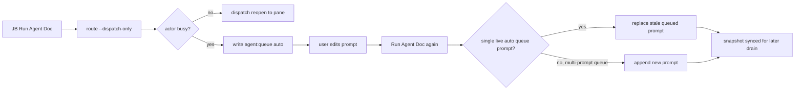

## Status

<!-- agent:status patch=replace -->

Live IntelliJ File Cache Conflict Cancel proof captured; JB Cancel residual review items completed.
<!-- /agent:status -->

## Exchange

<!-- agent:exchange patch=append -->
### Session Summary

*Compacted. Content archived to `/home/brian/work/btakita/agent-loop/.agent-doc/archives/483039e7a9b103bd5b68223dac05a4c449ac03899aba53d6022e82100578b5b0-20260527-222330.md`*

Compacted content:
- Archived 1 response topic(s): #ocdsp
- Prior summary/context: ### Session Summary *Compacted. Content archived to `/home/brian/work/btakita/agent-loop/.agent-doc/archives/483039e7...
When I restarted agent-doc on tsift.md, then ran JB `Run Agent Doc`, the dispatch had an error.
#spec-test-build-install-commit-push #mermaid

### Re: queued Run Agent Doc prompt update — gpt-5

Fixed the queued JB `Run Agent Doc` rerun case.

Root cause: `route --dispatch-only` already knew how to avoid exact duplicate queued prompts, but if the prompt text changed while an active turn was still busy, the route queue code did not treat the existing single `agent:queue auto` item as a supersedable editor rerun. The stale queue prompt could remain behind the active turn instead of tracking the edited prompt.

Change made: `enqueue_route_dispatch_prompt` now replaces the sole live prompt in an `agent:queue auto` component when a later rerun supplies edited text. It still appends to multi-prompt queues, so explicit user-authored batches are preserved. Route diagnostics now include `superseded=true/false` for this branch.

Changed paths:
- `src/agent-doc/src/route.rs`
- `src/agent-doc/src/route/tests.rs`
- `src/agent-doc/README.md`
- `src/agent-doc/SPEC.md`
- `src/agent-doc/specs/08-session-routing.md`
- `src/agent-doc/editors/jetbrains/SPEC.md`
- `src/agent-doc/VERSIONS.md`

Verification:
- `cargo test route_enqueue_dispatch_prompt` passed.
- `make check` passed, including the default suite and deterministic SimWorld budget.
- `cargo install --path .` completed and replaced the local `agent-doc` binary.
- Latest GitHub Actions `CI` run `26540718037` is green, including the `Run make tmux-ci` step.

Commits:
- `src/agent-doc`: `e76919c1 fix: supersede queued run agent doc prompt`
- superproject: `4d59ff074 agent-doc: update queued rerun prompt handling`

The push is intentionally after this binary-owned session closeout, so the session document stays out of the manual implementation commits.
<!-- agent:boundary:e0e6b1c3 -->
<!-- /agent:exchange -->
###
<!--
The completed queue item was not removed from the queue. #mermaid
#spec-test-build-install-commit-push
---
equityfundingsource.md had the full-document IPC duplicate corruption. Then a new full-document IPC deletion under the prompt corruption happened. Both several times while editing the prompt.
#spec-test-build-install-commit-push
---
Please review the agent-doc, claude, codex logs. What are #next-steps to fix bugs?
---
When I ran the last turn, #spec-test-build-install-commit-push was removed by agent-doc.
---
As I was typing into the comment below `/agent:exchange`, the full-document IPC corruption happened, then the duplicate line happened, then the full-document IPC corruption happened again.

In addition to diagnosing and fixing the issue, please provide a mermaid showing how the issue occurred and where in the agent-doc lifecycle the full-document IPC corruption can occur. Can we mathematically eliminate all possibility of the full-document IPC corruption from occurring?

#spec-test-build-install-commit-push
-->

<!-- agent:queue auto -->
---
When I restarted agent-doc on tsift.md, then ran JB `Run Agent Doc`, the dispatch had an error.
#spec-test-build-install-commit-push #mermaid
---
<!-- /agent:queue -->

## Backlog

<!-- agent:backlog -->
<!-- /agent:backlog -->

## Review

<!-- agent:review -->
- [/] [#snrun] [recommended] Implement tasks/agent-doc/plan-run-agent-doc-snappy-auto-remediation.md: make JB Run Agent Doc distinguish rescued-stash accepted-only proof misses, active-turn busy collisions, and stale starting projections; add route/plugin regressions plus live replay evidence.
<!-- /agent:review -->

<!-- agent:icebox -->
<!-- /agent:icebox -->

## Completed / Reaped

<!-- agent:done archive=tasks/agent-doc-bugs2.done.md -->

<!-- completed work archived in tasks/agent-doc-bugs2.done.md -->
<!-- /agent:done -->
