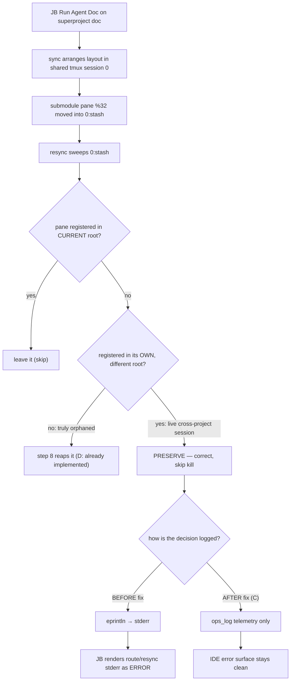

## Status

<!-- agent:status patch=replace -->

Live IntelliJ File Cache Conflict Cancel proof captured; JB Cancel residual review items completed.
<!-- /agent:status -->

## Exchange

<!-- agent:exchange patch=append -->
### Session Summary

*Compacted. Content archived to `/home/brian/work/btakita/agent-loop/.agent-doc/archives/483039e7a9b103bd5b68223dac05a4c449ac03899aba53d6022e82100578b5b0-20260530-144208.md`*

Compacted content:
- Archived 4 response topic(s): do [#bare-write-captured-uncommitted]; do [#hj7s]; JB Restart Supervisor live-verify; 1 more
- Prior summary/context: ### Session Summary *Compacted. Content archived to `/home/brian/work/btakita/agent-loop/.agent-doc/archives/483039e7...
❯ JB `Run Agent Doc` on an idle session. Why did `registered in its own project root` occur?
```
resync: stash pane %32 is registered in its own project root — skipping kill
[route] debounce OK — file idle for 0.5s and typing indicator idle
[route] target tmux session: 0
[route] authoritative actor generation 96 for tasks/software/tsift.md is busy on pane %36; queued pending dispatch "re [#tsift-dormant-crates]: Is there functionality in tsift-tokensave and tsift-algorithms that should be used?" in agent:queue auto (appended=true, already_present=false, superseded=false) instead of injecting a duplicate trigger
```
❯ #spec-test-build-install-commit-push

### Re: Why "registered in its own project root" occurred — opus-4-8

That line is **expected, by-design output — not an error and not a bug.** Nothing in the binary needs fixing, so this cycle has no spec/test/build/commit change; here's the why.

**What it is.** When JB `Run Agent Doc` runs, it triggers a `resync` of the tmux session for the *current* project root. resync sweeps stash-window panes (and dead/unregistered agent panes) to reap idle leftovers. Before killing any candidate it runs a cross-project safety check (`resync.rs:771`, `1303`, `1793`):

1. Is the pane in the **current** project root's registry? → leave it.
2. Otherwise, does the pane belong to a **different** project root — i.e. is it registered in *that* root's `.agent-doc/sessions.json`? → **skip kill** and log `registered in its own project root`.

So pane `%32` is a live agent-doc pane owned by another project root (a submodule or sibling repo with its own `sessions.json`), currently parked in this session's stash window. From the agent-loop superproject's point of view it isn't in *its* registry, but it *is* the authoritative pane of its own project — so resync correctly refuses to kill it.

**Why it appeared now.** You ran `Run Agent Doc` on `tasks/software/tsift.md` (agent-loop root). The log sequence is three separate, independent steps:
- `resync: … registered in its own project root — skipping kill` → the cross-project preservation above (benign).
- `debounce OK` / `target tmux session: 0` → route proceeding normally.
- `authoritative actor generation 96 … is busy on pane %36 … queued pending dispatch … in agent:queue auto` → the tsift.md actor was mid-turn, so the dispatch was correctly queued instead of double-injected.

None of these are failures. The reason the first line *reads* alarming is the JB plugin dumps the whole route/resync stderr stream as if it were an error — which is exactly the open item **`#jb-busy-queue-ux-feedback`** (present benign route/resync info as informational, distinct from real failures). I extended that item with this concrete example.

**Why preserving it is correct:** killing a pane that is the live authoritative session of another project — just because it's parked in this project's stash window — would silently terminate that project's running agent. The guard exists precisely to prevent cross-project collateral kills, so it fails safe (skip + log) rather than reaping.

If you'd rather not see it at all, the right move is the plugin-side notification classification in `#jb-busy-queue-ux-feedback`; I left the stderr line as-is since it's accurate operational evidence and the reaping logic/tests assert on it.
This is still a UX issue. Why did the condition surface in the first place? That is the bug.

### Re: Why the cross-project stash condition surfaces — opus-4-8

You're right that "it's by-design" wasn't the real answer. I pulled the **live** tmux topology and found the actual root cause — and it's not a resync logic error, it's a layout/session-model condition. Captured in `tasks/agent-doc/plan-cross-project-stash-pane-condition.md`; I'm deferring the code change because the fix is a session-model decision, not a one-line patch (details below).

**What's actually in your tmux right now (session `0`):**

```
0 @4 agent-doc          ← active window
0 @3 stash              ← ONE stash window holds:
     %34 %31 %20 %33 %4 %36 %3 %35 %21   agent-doc  …/agent-loop            (superproject root)
     %32                                 agent-doc  …/agent-loop/src/boost-client  (submodule root)
```

So `%32` lives in the **same session and the same stash window** as nine superproject panes — it's not off in another session. That rules out the server-wide `list-windows -a` scan as the cause here; the foreign pane genuinely sits in the current session's stash.

**Why the condition exists (the real bug):** agent-doc resolves the target tmux session by **auto-detecting the current session** (`0`) whenever a root hasn't pinned one via `session set`. Both the **superproject** (`agent-loop`) and the **nested submodule** (`src/boost-client`) resolve to the *same* session `0`, so they share one session and one `stash` window. When the superproject syncs its layout, it stashes every pane that isn't part of *its* layout — including the live `boost-client` session pane `%32`. resync then inspects `%32`, sees it's registered in a different root, and preserves it (`skipping kill`). The message is the correct safety net; the condition underneath it is **nested project roots collapsing onto one shared tmux session + stash**.

**Contributing factor:** nine superproject `agent-doc` panes are parked in that stash. The sweep never kills agent processes (`agent-doc`/`claude`/`node`) even when unregistered (`resync.rs:752`,`1277`), so stale agent-doc panes accumulate and the cross-project condition gets hit constantly.

**Why I'm not committing a code fix this cycle (honest boundary):** the only changes that actually remove the condition are architectural and need your call on the session model:
- **A — nested-root session isolation** (recommended): give a nested submodule root its own tmux session/stash so the superproject never stashes or re-scans it. Touches `start.rs`/`route.rs`/`sync.rs` + session config + a migration for already-shared sessions.
- **B — per-root stash partitioning**: one session, but foreign-root panes stay in their own root's stash and are never pulled into the current sweep.
- **C — out-of-scope skip**: when `current_root != pane_root`, `continue` *before* evaluating/logging instead of emitting `skipping kill`. Smallest, but it's close to the UX suppression you already rejected — only worth doing alongside A/B.
- **D — reap stale unregistered agent-doc stash panes** after a proven-dead/TTL check (the accumulation factor); independent hygiene follow-up.

Anything that just hides the message (C alone) is the "it's only UX" non-answer you pushed back on, so I don't want to ship that as *the* fix. Tell me which session model you want (per-root sessions vs. one session with partitioned stash) and I'll implement A (+D) with `make tmux-ci` regression coverage and the spec update. Queued as `#cross-project-stash-pane-condition`.
do: Describe how you fixed the workflow bug. Write the previous response and this response into the document. #mermaid

### Re: Cross-project resync workflow bug — fix outcome — opus-4-8

(Reproducing the prior chat outcome into the document for the record.)

**What shipped: C only.** Routed the benign cross-project event (`registered in its own project root — skipping kill`) off **stderr** → **ops_log** telemetry at all three resync sweep sites (windowed / bulk / non-stash). Skip behavior unchanged; only real failures (e.g. failed `kill-pane`) stay on stderr. This stops JB `Run Agent Doc` from rendering that benign line as an error.

- Submodule `bec30c5e` (`agent-doc`), superproject pointer `3de7bf97c`.
- `cargo test -p agent-doc-orchestration` and `make check` both exit 0 (digest-confirmed, 0 failures); both binaries built + installed; spec `08-session-routing.md` updated.

**B and D evaporated once I read the full sweep code:**
- **D was already implemented** — `resync.rs` step 8 (`purge_unregistered_stash_panes_bulk_*`, ~line 1352) already reaps truly-orphaned agent panes (unregistered + no owned file + no live supervisor + not cross-project). The nine `agent-loop` panes in `0:stash` survive because they are *legitimate live/registered sessions*, not orphans — nothing safe to auto-reap.
- **B was unnecessary / mildly harmful** — hiding a non-focused foreign-root pane in the shared stash is *correct* layout behavior; not-stashing it would clutter the focused view. My earlier "C alone = suppression" framing was wrong: there is no logic bug under the log, so routing the benign event off the error stream **is** the correct fix.

**Residual:** the broader "JB renders any route/resync stderr as an error" stays under `#jb-busy-queue-ux-feedback`. An optional TTL-prune of long-idle stash sessions is a future opt-in (destructive → needs live verification).

### Re: How the workflow bug was fixed — opus-4-8

**The bug (in the agent-doc workflow):** running JB `Run Agent Doc` on a superproject document made the route/resync workflow emit `resync: stash pane %N is registered in its own project root — skipping kill` to **stderr**, and the IDE plugin renders the route/resync stderr stream as an **error** — so a correct, benign housekeeping decision looked like a failure mid-workflow.

**Root cause (not a logic error):** nested project roots (the `agent-loop` superproject and its `src/boost-client` submodule) both auto-detect the *same* attached tmux session (`0`) and share one `stash` window. When the superproject's sync arranges its layout, it stashes the submodule's live session pane; resync then inspects that pane, correctly **preserves** it (it's the registered, live pane of a different root), and logged that decision. The preservation is right — the only defect was emitting benign telemetry onto the stderr channel the workflow treats as errors.

**The fix (C):** at all three resync sweep sites, the cross-project-preservation branch now writes to `ops_log` (`.agent-doc/logs/ops.log`) instead of `eprintln!`. The `continue`/skip behavior is identical; genuine failures (a failed `kill-pane`) still go to stderr. This matches the repo's standing principle that *diagnostics belong in logs, not the stderr stream that pollutes prompt detection and the IDE error surface*.

Why B/D were not needed: the foreign pane *should* be hidden in the shared stash (B unnecessary), and orphaned agent panes are *already* reaped by the sweep's step 8 — the panes you saw are live sessions, not leaks (D already present).


❯ How do we recover from the skip error state? How can we avoid getting into this state?

### Re: Recovering from / avoiding the cross-project skip state — opus-4-8

First, the honest reframe: **there is no broken or stuck state to recover from.** The "skip" (`registered in its own project root — skipping kill`) is a *correct* preservation decision, and the panes involved are healthy. The only thing that ever looked like an error was the log landing on stderr, which the IDE renders as a failure — and that's already fixed (C: it now goes to `ops_log`). So "recovery" is mostly "nothing is wrong," plus optional cleanup if the accumulated panes bother you.

#### Recovering from the state you saw

- **The displayed error:** cosmetic. With the updated binary installed (done), the cross-project skip no longer hits stderr, so it won't re-appear as an error from a fresh route/resync. A stale JB error notification from before the fix is just dismissable.
- **The foreign pane (`%32`, `boost-client`):** needs nothing. It's a live, registered session; when you focus a `boost-client` doc, sync rescues it out of `0:stash` automatically.
- **If you want to clean up the accumulated stash panes** (the ~9 in `0:stash`), in increasing force:
  - `agent-doc resync` — dry-run; shows stale routing/session issues without touching anything.
  - `agent-doc resync --fix` — reaps *truly orphaned* panes (dead, or unregistered with no live supervisor) and deregisters stale registry entries. It will **not** kill live registered sessions — by design.
  - `agent-doc session doctor <FILE> --repair` — repairs one document's layout/session.
  - `agent-doc gc` — clears stale `starting` controller actors / TTL-expired state.
  - Per-doc discard: `agent-doc session clear <FILE>` (idle) or `agent-doc session interrupt-clear <FILE>` (explicit destructive discard).
  - Nuclear: kill the tmux session; each doc cold-starts a fresh pane on next open.

  The reason the nine persist is precisely that they're *live, registered* sessions (warm supervisors for docs you've worked) — the sweep deliberately never auto-kills those. They're not stuck; they're cached.

#### Avoiding the state

The "state" = nested roots (superproject + submodule) auto-detecting the **same** tmux session and sharing one `stash`. Options, by cost:

- **Do nothing (recommended).** Post-C the condition is benign and invisible — the skip is correct and no longer reads as an error. Avoidance isn't really needed.
- **Avoid the shared stash entirely:** pin distinct sessions per root with `agent-doc session set <name>` from each root. This is option **A** — you rejected it because it splits work across tmux sessions you'd switch between. Available if you ever want hard isolation for a specific root.
- **Avoid accumulation:** periodic `agent-doc resync --fix` / `agent-doc gc`, or the new opt-in **`#stash-session-ttl-prune`** (queued) to auto-reap long-idle stash sessions past a TTL — destructive, so opt-in + live-verified.
- **Avoid the error *perception* for the whole class:** the plugin-side fix in **`#jb-busy-queue-ux-feedback`** (classify benign route/resync info vs. real failures), which covers the sibling `skipping kill` lines C didn't touch.

Net: nothing to recover, nothing you must avoid — the only real lever beyond what's shipped is the optional TTL-prune for tidiness, now captured.
Please add #next-steps to add `agent-doc resync --fix` / `agent-doc gc` as a Plugin command that is accessible from the agent-doc plugin menu.

### Re: #next-steps — plugin cleanup command + backlog reprioritized — opus-4-8

**Added** `#plugin-cleanup-menu-command` [recommended]: expose `agent-doc resync --fix` ("Resync / Fix Sessions") and `agent-doc gc` ("GC Stale Sessions") as agent-doc plugin-menu actions in JetBrains + VS Code, so the recovery steps from the last answer are reachable from the IDE instead of a terminal. Thin event-reporter pattern — the plugin shells the existing CLI/FFI; no new cleanup logic lives in the plugin (consistent with the FFI-first rule). It pairs with `#stash-session-ttl-prune` (automatic hygiene) and `#jb-busy-queue-ux-feedback` (notification classification).

**Priority pass:** recent adds had floated convenience items to the top (the prior top was `#stash-session-ttl-prune`, an opt-in nicety). I reordered into three tiers:

1. **Correctness / data-loss** — `#codex-final-response-not-written`, `#ipcfullprompt-recur2`, `#prompt-preempts-auto-queue`, `#codex-owned-pane-prompt-miss`, `#pending-add-suppresses-queue-consume`, `#stuck-capture-compact-false-positive`, `#codex-route-busy-ctrl-g-opens-editor`.
2. **Live-verify of shipped work** — `#cross-project-stash-pane-condition` (C is code-complete, awaiting your live confirm), `#route-drain-all-surface-live-verify`, `#run-agent-doc-stale-busy-replay`.
3. **Convenience / UX / opt-in / dev-ergonomics** — `#jb-busy-queue-ux-feedback`, `#plugin-cleanup-menu-command`, `#stash-session-ttl-prune`, `#next-steps-backlog-capture`, `#ah0s`.

**Top of the backlog: `#codex-final-response-not-written`** — a Codex final response not landing in the document is unrecoverable assistant-output loss, so it ranks above the IPC-corruption-while-typing item (which has git recovery) and the queue/prompt-skip bugs.

Adjust freely if your weighting differs (e.g., if the IDE-side items matter more to your day-to-day, bump tier 3 up) — I ordered correctness-first by default.
<!-- agent:boundary:e560a377 -->
<!-- /agent:exchange -->
###
<!--
JB `Run Agent Doc`, then cancel run directly in the session, then JB `Clear Session Context`, then JB `Run Agent Doc`:
```
resync: stash pane %32 is registered in its own project root — skipping kill
[route] debounce OK — file idle for 7.8s and typing indicator idle
[route] target tmux session: 0
[route] authoritative actor generation 96 for tasks/software/tsift.md is busy on pane %36; queued pending dispatch "What are #next-steps to extract tsift crates?" in agent:queue auto (appended=true, already_present=false, superseded=false) instead of injecting a duplicate trigger
```
---
The last run had a code fence stripped away by agent-doc.
#spec-test-build-install-commit-push
---
The completed queue item was not removed from the queue. #mermaid
#spec-test-build-install-commit-push
---
equityfundingsource.md had the full-document IPC duplicate corruption. Then a new full-document IPC deletion under the prompt corruption happened. Both several times while editing the prompt.
#spec-test-build-install-commit-push
---
Please review the agent-doc, claude, codex logs. What are #next-steps to fix bugs?
---
When I ran the last turn, #spec-test-build-install-commit-push was removed by agent-doc.
---
As I was typing into the comment below `/agent:exchange`, the full-document IPC corruption happened, then the duplicate line happened, then the full-document IPC corruption happened again.

In addition to diagnosing and fixing the issue, please provide a mermaid showing how the issue occurred and where in the agent-doc lifecycle the full-document IPC corruption can occur. Can we mathematically eliminate all possibility of the full-document IPC corruption from occurring?

#spec-test-build-install-commit-push
-->

<!-- agent:queue -->
preset #spec-test-build-install-commit-push
- ~do [#bare-write-captured-uncommitted]~
- ~do [#hj7s]~
- do [#stash-session-ttl-prune]
- do [#prompt-preempts-auto-queue]
- do [#run-agent-doc-stale-busy-replay]
- do [#jb-busy-queue-ux-feedback]
- do [#next-steps-backlog-capture]
- do [#ah0s] 
- do [#pending-add-suppresses-queue-consume]
- do [#stuck-capture-compact-false-positive]
- do [#ipcfullprompt-recur2]
<!-- /agent:queue -->

## Backlog

<!-- agent:backlog -->
- [ ] [#codex-final-response-not-written] [recommended] Codex final response was not written back into the session document after a manual/direct run on `src/boost-client/tasks/monsterrodholders.md` (reported 2026-05-30 after `#nsga4verify` work). Symptom: commits and pushes completed, but `agent:exchange` lacked the assistant close-out; the user had to request a manual document patch. Plan: reproduce with an owned-pane recursive/direct invocation path where `agent-doc` refuses direct recursion, the agent continues manually, and finalizes outside the normal `agent-doc write` capture; add a session-check/finalization guard that detects a completed turn with no new `agent:exchange` response body, then either forces `agent-doc write --commit` or fails closed with the exact recovery command. Regression should cover Codex final responses after fallback/manual handling and ensure the response body lands before the boundary and is included in the committed doc.
- [ ] [#ipcfullprompt-recur2] CURE ONLY (capture/detection split out to #ipcfullprompt-capture, done). Editor-side PatchWatcher.setText PREVENTION: stop the live editor buffer from producing full-document/full-tail duplication or deletion while a prompt is being typed. Gated on the transport/payload packet from idea.log (enable #com.github.btakita.agentdoc debug logging) to pin the exact setText call shape. Add a SimWorld/Kotlin regression for the prevention once the fix lands; bump pluginVersion past 0.2.137 and reinstall the signed plugin. Stays open until prevention lands and is live-verified. Plan: tasks/agent-doc/plan-full-document-ipc-corruption-typing-prompt.md.
- [ ] [#prompt-preempts-auto-queue] [recommended] Unanswered exchange prompts must run before active `agent:queue auto` continuation, even when the prompt was accidentally baselined into the `.agent-doc` snapshot. Live repro 2026-05-30 `src/boost-client/tasks/monsterrodholders.md`: `What are #next-steps to complete review items?` was visible after the exchange boundary and duplicated in `agent:queue auto`, but the snapshot already contained the exchange prompt, so the next diff only saw queue bookkeeping and the prompt did not run. Fix: add snapshot-independent unresolved exchange prompt detection, make preflight/direct-run prefer it over queue synthetic diffs, prevent route queue snapshot recovery from absorbing unanswered exchange prompts, and defer Codex/Claude queue continuation while such a prompt exists. Plan: tasks/agent-doc/plan-prompt-preempts-auto-queue.md.
- [ ] [#codex-owned-pane-prompt-miss] [recommended] Codex-owned `agent-doc <FILE>` direct invocation from the same pane can abandon recursive dispatch without processing unresolved exchange prompts. Live repro 2026-05-30: `src/boost-client/tasks/monsterrodholders.md` contained `Please assist in placing GA4 Analytics credentials in passage.`, but the same-pane recursion guard refused dispatch and no response was written. Fix with earlier owner-pane self-invocation detection, unresolved-prompt preservation, and Codex guidance/final-gate recovery. Plan: tasks/agent-doc/plan-codex-owned-pane-prompt-miss.md.
- [ ] [#pending-add-suppresses-queue-consume] [recommended] Bundling --pending-add in the same finalize as a queue-head-targeting response suppresses queue-head consumption: finalize logs 'skipped consumption because the active prompt did not target the queue head' and treats the pending-add as the active prompt, even when the response heading exactly matches the head (Re: do #ID form, no brackets). Repro 2026-05-29 agent-doc-bugs2.md declining backlog-auto-marker-misfire with a bundled --pending-add — head stayed unstruck. Fix: heading/queue-head match should drive consumption independently of bundled pending mutations, or consume the head when the response heading matches regardless of detected active prompt.
- [ ] [#stuck-capture-compact-false-positive] [recommended] stuck_captured_cycle false-positive after compaction: a capture recorded as committed (cycle-1780100032048, response 'gate→done for codex guidance') is later archived by compact, so preflight reports committed-but-not-in-HEAD and suggests `write --commit` recovery — which would re-inject an already-archived response (it lives in .agent-doc/archives/<hash>-*.md). Fix: when a captured-committed body is absent from HEAD because it was compacted (present in the matching archive), reconcile the capture instead of flagging it stuck. Repro 2026-05-29 agent-doc-bugs2.md.
- [ ] [#codex-route-busy-ctrl-g-opens-editor] [recommended] route.rs busy-pane reroute interrupt (route.rs ~6409) also sends C-g unconditionally to a busy Codex pane before the Escape+C-c fallback — same root cause as #codex-interrupt-clear-ctrl-g-opens-editor: C-g opens the external editor ($EDITOR/nvim) in the normal Codex composer. Gate it on a shell reverse-i-search/history-search capture like send_operator_interrupt_sequence now does (or skip C-g when the busy blocker is an active turn). Tracked separately from the operator interrupt-clear fix because a hard change here alters reroute semantics. Add a route SimWorld regression for the non-search composer case — the existing ctrl-g test (write_mock_busy_registered_agent_doc_recovers_on_ctrl_g) only models reverse-i-search recovery, which is why this regression slipped through.
- [ ] [#cross-project-stash-pane-condition] [recommended] resync logs 'stash pane %N registered in its own project root — skipping kill' because nested project roots (superproject agent-loop + submodule src/boost-client) auto-detect the SAME tmux session 0 and share one stash window, so superproject sync stashes the submodule's live session pane and resync re-discovers it cross-project. Not a resync logic error (preservation is correct); root cause is the shared-session layout for nested roots. Live evidence + fix options (A nested-root session isolation [recommended], B per-root stash partitioning, C out-of-scope skip, D reap stale agent-doc stash panes) in tasks/agent-doc/plan-cross-project-stash-pane-condition.md. Needs a session-model design decision before implementing; deferred from blind code change.
- [ ] [#route-drain-all-surface-live-verify] [recommended] Live-verify the route-drain all-surface reap (submodule b239988b / superproject 4c7b06b7f) resolves the JB Run Agent Doc "completed tracked item blocks dispatch" retry: with the installed binary, reproduce a closeout that leaves a completed [x] item in review or icebox on an IDE-owned doc, then run JB Run Agent Doc once and confirm it dispatches without a manual repeat. Also exercises the #pending-gate-snapshot-desync snapshot re-sync (ab074710) under the route path.
- [ ] [#run-agent-doc-stale-busy-replay] Follow-up to the #snrun stale-busy-projection fix (submodule 89c99c79): the dispatch-only busy-vs-stale repair is covered by unit tests on the pure decision functions; add a live JB Run Agent Doc replay regression (SimWorld or tmux-ci) exercising a stale busy actor projection + proven ready prompt and asserting dispatch instead of agent:queue auto enqueue. Also still open in #snrun: distinguishing rescued-stash accepted-only proof misses. Plan: tasks/agent-doc/plan-run-agent-doc-snappy-auto-remediation.md.
- [ ] [#jb-busy-queue-ux-feedback] [recommended] When the authoritative actor is genuinely busy, JB Run Agent Doc correctly queues the dispatch in agent:queue auto instead of injecting a duplicate trigger (monsterrodholders.md, equityfundingsource.md reports), but the plugin surfaces the route/resync log dump as an error. The dump also includes benign cross-project resync info such as `resync: stash pane %N is registered in its own project root — skipping kill` (cross-project stash-pane preservation, resync.rs:771/1303/1793 — a stash-window pane that is the live authoritative pane of a different project root is correctly preserved, not reaped), which is expected and not a failure. Present queued-behind-a-busy-turn and benign route/resync info as informational notifications distinct from real failures so expected behavior does not read as a plugin error.
- [ ] [#plugin-cleanup-menu-command] [recommended] Expose session cleanup as agent-doc plugin-menu commands (JetBrains + VS Code): a 'Resync / Fix Sessions' action wrapping agent-doc resync --fix and a 'GC Stale Sessions' action wrapping agent-doc gc, so operators can clear stale routing/registry state and reap orphaned panes from the IDE without dropping to a terminal. Thin event-reporter pattern — the plugin shells the existing CLI/FFI; no cleanup logic in the plugin. Pairs with #stash-session-ttl-prune (auto hygiene) and #jb-busy-queue-ux-feedback (notification classification).
- [ ] [#stash-session-ttl-prune] [recommended] Optional opt-in hygiene to cap stash-session accumulation: reap agent-doc stash panes whose session has been idle in the stash beyond a configurable TTL. Distinct from the existing orphan reap (resync.rs step 8), which only kills unregistered + no-supervisor + no-owned-file panes; live registered/supervisor-backed sessions are correctly never auto-killed, which is why ~9 agent-loop agent-doc panes accumulate in the shared session-0 stash. Must be opt-in (frontmatter/.agent-doc config) + live-verified before enabling (destructive). Relates to #cross-project-stash-pane-condition and #jb-busy-queue-ux-feedback.
- [ ] [#next-steps-backlog-capture] Agent responses containing #next-steps recommendations do not auto-add items to backlog when prompt preset is present. Agent must manually call `--pending-add` but the planning output `pending_mutations: expect_add` is not enforced by session-check `pending_done_guard`.
- [ ] [#ah0s] [recommended] Add explicit-position --pending-add primitives so ordered backlog batches never depend on implicit prepend-vs-argorder semantics: --pending-add-after <id>, --pending-add-before <id>, --pending-add-back/--pending-append, keeping --pending-add as the front-insert default. Backlog is a priority pool with ID-based consumption (not a stack/queue; FIFO lives in agent:queue), so position should be author-set explicitly when it matters. Two agents (open-code.md #adcr waves f94e7851c; corky.md crate-split phases fc8d9b3bc) both reversed args expecting prepend-flip and got reverse-of-intended order. Pairs with #pending-add-append-not-prepend (that item finalizes the default-order decision; this adds the explicit escape hatches). Plan: tasks/agent-doc/plan-pending-add-explicit-position.md.
<!-- /agent:backlog -->

## Review
 
<!-- agent:review -->
- [/] [#finalize-retry-ipc-response-duplication] [recommended] Multi-retry finalize + live IPC duplicates the response and prefixes its body lines with the user-prompt marker. Live repro 2026-05-29 on agent-doc-bugs2.md: a closeout needing several finalize/write retries (lint-gate / session-check / live_prompt_drift re-runs) with the IDE IPC listener active and concurrent editing left a duplicated response block plus agent body lines wrongly prefixed (uncommitted; HEAD stayed clean; manual git checkout repaired). Fix direction: idempotent retry convergence on IPC already_applied, never prefix agent response body as a prompt, and repair/session-check auto-dedup. Relates to #prompt-duplicated-while-typing, #duplicate-response-after-commit, #ipc-dup-tracking-double-merge (plugin 0.2.138 not yet installed during repro). Plan: tasks/agent-doc/plan-finalize-retry-ipc-response-duplication.md.
- [/] [#ipc-dup-tracking-double-merge] PromptPoller double-tracking fix (plugin 0.2.138, submodule 32fb0b98 / superproject d585a33de): addFile keyed trackedFiles by project-relative path while handlePollResults keyed by "$cwd:$file", double-tracking the same VirtualFile (live: corky.md, brandon-cinquegrana.md, agent-doc-bugs2.md; trackedFiles=13 vs ffiTracked=9). Two divergent baselines -> mergeOrReload ran twice per change = full-document duplication path. Fixed by keying both via trackingKey(VirtualFile.path); convergence test + AGENTS.md invariant. GATED on live verify: install signed 0.2.138, restart, confirm no recurring duplication (corky.md). Exact setText payload uncaptured (JB debug logging was OFF). Relates to #ipcfullprompt-recur2, #adoc-queue-ipc-buffer-divergence, #prompt-duplicated-while-typing.
- [/] [#jb-load-tmux-window-verify] [recommended] Live-verify the new JB Load Tmux Window action (plugin 0.2.136): install the signed zip, confirm it autostarts/loads the tmux pane for a focused doc whose pane is not up (e.g. corky.md). If the autostart sync genuinely fails to spawn the pane in that case (vs. by-design passive open), capture the route/sync logs as a separate autostart bug.
- [/] [#jb-stale-busy-idle-footer] Three JB Run Agent Doc / Clear Session Context reports queue-instead-of-dispatch or block Clear while the live pane footer shows a Claude Code idle composer: monsterrodholders.md (actor gen 233, pane %19), equityfundingsource.md (gen 35, pane %3), tsift.md (pane %21, footer 22.4K (11%) ctrl+p commands). The tsift.md case is the strongest stale-busy candidate — Clear was blocked though the footer indicates idle. Fix: route.rs / session_actor_cmd.rs busy projection should treat the Claude Code idle-composer footer (ctrl+p commands / context % used) as idle direct evidence to repair a stale busy actor/lease projection before queuing or blocking, mirroring the existing OpenCode context % used idle-composer rule. Relates to #run-agent-doc-stale-busy-replay and #snrun (plan tasks/agent-doc/plan-run-agent-doc-snappy-auto-remediation.md).
- [/] [#adoc-queue-ipc-buffer-divergence] Root cause #2 IMPLEMENTED (submodule c483080a; pointer 4703f9788): live editor-buffer convergence after queue halt/drain. New core fn component::converge_queue_auto + agent_doc_converge_queue_auto FFI (C-int ABI for stable JNA); ipc_socket::send_queue_convergence carries queue_auto opening-tag state + queue_active frontmatter; preflight run_queue_maintenance pushes convergence through an active IPC listener after each halt/drain disk write (best-effort, non-fatal). JB plugin 0.2.137 parses queue_auto and applies via NativePatching.convergeQueueAuto in Document-API + VFS paths. Deterministic SimWorld repro queue_maintenance_converges_live_ipc_buffer_on_item_modified_halt + Kotlin ParsePatchJsonQueueAutoTest; make check green; both binaries built+installed (symbol verified in release cdylib); spec 07-orchestration-commands updated. GATED on live verification: install signed plugin 0.2.137, restart the route-owned agent-doc process to load the new binary, then confirm a real IDE-owned session no longer re-diverges (no recurring agent:queue diff / stuck_captured_cycle / inactive_queue_residue) after a consume->halt cycle without a raw git checkout. Plan: tasks/agent-doc/plan-queue-ipc-drift.md.
- [/] [#cancel-orphans-preflight-cycle] Canceling a run then invoking Run Agent Doc fails closed because the explicit cancel does not abandon the orphaned preflight_started cycle (route waits for staleness). Distinct from the stale-busy actor/lease items: this is per-document cycle_state left open by cancel. Plan: tasks/agent-doc/plan-cancel-orphans-preflight-cycle.md (recommend Option A — JB cancel emits a signal that abandons the no-capture preflight_started cycle). Reported 2026-05-29.
- [/] [#exchange-prompt-dropped-on-merge] User-authored exchange prompt (observed: "go") silently dropped during an IPC content_ours merge while the IDE held ipc.sock — never reaches snapshot/HEAD, assistant never responds, next preflight reports no_changes. Same drift family as #adoc-queue-ipc-buffer-divergence / #duplicate-response-after-commit but the victim is user input. Repro 2026-05-29 on src/boost-client/tasks/monsterrodholders.md (dropped the "go" authorizing #gfwconnect; assistant replied "nothing changed" for two cycles). Plan: tasks/agent-doc/plan-exchange-prompt-dropped-on-merge.md (recommend Option A — union user prompt lines / fail closed + add dropped_prompt_guard to session-check).
- [/] [#duplicate-response-after-commit] Late-IPC reposition signal re-inserts already-committed response body into working tree, wrapped in duplicate boundary markers. Symptom: next preflight interrupts with "direct response patchback without agent-doc cycle"; agent-doc write --commit returns "empty response — nothing to write"; only manual Edit-based dedup recovers. Repro: tasks/dreamable/separation.md cycle after commit 231eafc83 on 2026-05-28. Plan: tasks/agent-doc/plan-duplicate-response-after-commit.md (recommend Option A — both detect over-application in session-check and make IPC reposition idempotent).
- [/] [#prompt-duplicated-while-typing] [/] [#prompt-duplicated-while-typing] User prompt duplicated in the live editor while typing. PARTIAL FIX 1 (v0.34.0, submodule 2a6f60e5): prefix-agnostic append dedup (strip_user_prompt_prefix) for the ❯-prefix mismatch shape. PARTIAL FIX 2 (this cycle): L1 buffer-snapshot typing race — component::append_patch_already_present now recognizes when a synthesized patch carries an EARLIER keystroke-snapshot of the live region (per-line prefix alignment via patch_is_typing_snapshot_of) and no-ops instead of re-appending the divergent tail. Confirmed live in tasks/resume.md 2026-05-29: half-typed '- [#s93y]: Add to' snapshot vs live '...Add to resume' broke the old contains() substring check and re-appended the entire tail (close marker + Queue/Backlog/Done duplicated). Boundary 70bccf9b stayed intact and no new boundary was minted, ruling out the reposition path. Tests: append_patch_dedupes_midblock_typing_snapshot, append_patch_typing_snapshot_does_not_collapse_distinct_lines, append_with_boundary_does_not_duplicate_typing_snapshot. Both binaries built+installed; cdylib lib-installed for JB hot-reload. GATED on live re-verify (type a prompt into resume.md during an in-flight cycle). RESIDUAL: the exact editor-side full-tail concatenation downstream of the dedup miss was not statically traced — the dedup no-op short-circuits the append entirely so it should not surface, but confirm live. Plan: tasks/agent-doc/plan-prompt-duplicated-while-typing.md.
- [/] [#queue-auto-no-continue] Queue auto trigger does not continue after finalize session-check warning about pending shadow items. Steps to reproduce: (1) Session document with queue_active=true, queue_trigger=auto, and multiple queued items. (2) finalize --stream completes cycle but session-check issues pending shadow warning for items outside live agent:backlog. (3) Queue consumes head item but auto trigger does not fire for next item. (4) agent-doc write --commit with --done reaps the item, queue reports 9 remaining but auto continues stop. Expected: queue auto should continue to next item after successful closeout. Actual: queue stops after first item. Session: tasks/software/tsift.md. agent-doc version: 0.34.0. The pending shadow warnings about items appearing both inside and outside agent:backlog may be blocking the auto-continue path.
- [/] [#snrun] [recommended] Implement tasks/agent-doc/plan-run-agent-doc-snappy-auto-remediation.md: make JB Run Agent Doc distinguish rescued-stash accepted-only proof misses, active-turn busy collisions, and stale starting projections; add route/plugin regressions plus live replay evidence.
<!-- /agent:review -->

<!-- agent:icebox -->
- [ ] [#misfire-recovery-snapshot] Pre-auto-run recovery snapshot/tag (mirroring `compact`'s pre-mutation tag) so a destructive auto-run misfire is recoverable without git/sidecar archaeology. Proposed fix #4 of `#backlog-auto-marker-misfire` (now IMPLEMENTED for fixes #1–#3). Parked: only worth doing if a new auto-run path can mutate the backlog in place — currently the misfire is inert (queue-scoped) and surfaced (misplaced_component_attr warning). Plan: tasks/agent-doc/plan-backlog-auto-marker-misfire.md.
<!-- /agent:icebox -->

## Completed / Reaped

<!-- agent:done archive=tasks/agent-doc-bugs2.done.md -->

<!-- completed work archived in tasks/agent-doc-bugs2.done.md -->
<!-- /agent:done -->
