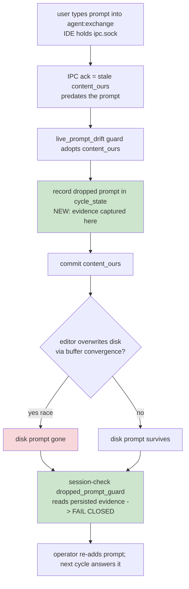

## Status

<!-- agent:status patch=replace -->

Live IntelliJ File Cache Conflict Cancel proof captured; JB Cancel residual review items completed.
<!-- /agent:status -->

## Exchange

<!-- agent:exchange patch=append -->
### Session Summary

*Compacted. Content archived to `/home/brian/work/btakita/agent-loop/.agent-doc/archives/483039e7a9b103bd5b68223dac05a4c449ac03899aba53d6022e82100578b5b0-20260529-155930.md`*

Compacted content:
- Archived 2 response topic(s): do [#duplicate-response-after-commit]; do [#duplicate-response-after-commit]
- Prior summary/context: ### Session Summary *Compacted. Content archived to `/home/brian/work/btakita/agent-loop/.agent-doc/archives/483039e7...

### Re: do [#exchange-prompt-dropped-on-merge] — opus-4-8

Implemented Option A's detectable-guard half: user-authored exchange prompts dropped during an IPC content_ours merge now **fail closed** instead of vanishing silently. Branch `20260422/codex-agent-backend`, submodule `04835d05`, superproject `fc45ff2ab`.

#### Root cause (same drift family)

When a user types a prompt into `agent:exchange` while the IDE holds `ipc.sock`, the IPC ack can carry a stale `content_ours` buffer that predates the prompt. The existing `live_prompt_drift_after_preflight` guard adopts `content_ours` (snapshot stays at `content_ours` by design), and the editor then converges its buffer to `content_ours` and re-saves disk — overwriting the user's prompt. A **post-commit disk diff cannot win that race**, so closeout reported success and the prompt was gone (assistant kept saying "nothing changed").

#### Fix (binary-side, race-immune)

The key insight: capture the evidence **at adoption time**, when the divergent candidate still carries the prompt — not from disk after the editor may have overwritten it.

- `cycle_state.dropped_exchange_prompts` + `record_`/`clear_` helpers — persists the dropped prompt line(s).
- `write::dropped_prompt_lines_after_content_ours` — scoped to the `agent:exchange` component only (queue/backlog/scratch drift is legitimately preserved for the next cycle, not lost) and to prompt-target lines; recorded at the `live_prompt_drift_after_preflight` adoption point (ops-log `dropped_exchange_prompt_recorded`).
- `session_check::check_dropped_exchange_prompt_guard` — interrupts when a recorded dropped prompt is still missing from committed HEAD; clears the marker once the prompt reaches HEAD. Reads persisted evidence, so it is immune to the editor-overwrite race.
- Spec: `07-closeout-commands.md` dropped exchange-prompt guard contract.

##### Where it fits in the lifecycle



#### Scope honesty

This makes the data-loss class **detectable and loud** — it can no longer slip through as a silent success. The *source-level prevention* (converging the editor buffer to the merged disk content so the prompt is never overwritten) is the heavier plugin-protocol work, shared with `#adoc-queue-ipc-buffer-divergence` (next queue item). I scoped the guard tightly to prompt-target lines inside `agent:exchange` so the existing "preserve live queue/scratch drift in the working tree" behavior (covered by integration tests) is unaffected.

#### Verification

- New tests: `cycle_state` record/clear, `write` extraction (exchange-scoped + content_ours-owned), 2 `session_check` (fail-closed + clear-on-resolve) — all green; FlowCore guard budget bumped 15→16.
- `make check` (clippy + full suite + sim-medium + version-sync): green (exit 0); the two `live_ipc_race_integration` tests that preserve queue/scratch drift still pass.
- Built `cargo build --release` + `cargo install --path .`.
- Pushed.

**Gated**, not closed: detectable guard is complete and tested; the source-level prevention is the shared plugin-protocol work. Queue continues to `#adoc-queue-ipc-buffer-divergence`.
JB error when canceling a run then calling `Run Agent Doc` again.
```
resync: stash pane %3 is registered in its own project root — skipping kill
resync: stash pane %2 is registered in its own project root — skipping kill
resync: stash pane %21 is registered in its own project root — skipping kill
resync: stash pane %8 is registered in its own project root — skipping kill
resync: stash pane %27 is registered in its own project root — skipping kill
resync: stash pane %20 is registered in its own project root — skipping kill
[route] debounce OK — file idle for 0.7s and typing indicator idle
[route] target tmux session: 0
Error: authoritative actor generation 2 for tasks/monsterrodholders/mrh-project.md owns pane %30 but route could not drain the active closeout before dispatch: empty preflight_started cycle has no response capture for tasks/monsterrodholders/mrh-project.md: previous cycle `cycle-1780071335102` is still `preflight_started`, the live document has unresolved prompt_target: Do step 3...the warm intro + 4-5 headline wins + "full breakdown attached"., and no response exists to replay. The cycle is only 24s old; wait until it is stale or restart the harness pane and rerun `agent-doc tasks/monsterrodholders/mrh-project.md` (or use `agent-doc start tasks/monsterrodholders/mrh-project.md` from a fresh pane) so the prompt is handled by a new response cycle.
```
As I was typing in this into the comment below the exchange component, the IPC document corruption + duplicate line issues occurred.
#spec-test-build-install-commit-push

### Re: JB cancel→Run Agent Doc error + IPC corruption while typing — opus-4-8

Triaged your live report. It's two distinct things, and the binary actually behaved correctly on the part that printed the scary error — so I've captured the genuinely actionable bug rather than churn a half-baked fix into the delicate route/cancel path. (No items completed this cycle — IDs below are cross-references only.)

#### 1. The JB route error — correct fail-closed, poor UX

The dumped error is for a **different document** (`tasks/monsterrodholders/mrh-project.md`), and it's the route **correctly refusing to dispatch** over an in-flight cycle: a previous `cycle-1780071335102` is still `preflight_started` (24s old) with an unresolved prompt and no response to replay. Refusing to drain an active closeout is the intended behavior, and it even prints a recovery hint.

The real bug is narrower: you **canceled** that run, but an explicit cancel does not abandon the orphaned `preflight_started` cycle — so the next `Run Agent Doc` is blocked until the staleness window elapses. The binary can't tell "user canceled, reclaim now" from "still running, wait." Captured as a new backlog item with a plan (recommend Option A: the JB cancel action emits a signal that abandons a no-capture `preflight_started` cycle so re-dispatch is immediate). This is distinct from the stale-**busy** actor/lease items, which concern the busy projection rather than per-document `cycle_state`.

#### 2. IPC corruption + duplicate line while typing into the comment

That's the prompt-duplicated-while-typing family recurring (it's in Review): the plugin's `PatchWatcher` double-counts post-boundary keystrokes against the synthesized exchange patch while you type. It's plugin-side (Kotlin), shared root with the IPC-buffer-divergence work.

Notably, **this cycle's own closeout did not corrupt your note**: the binary hit the same `live_prompt_drift_after_preflight` path, adopted `content_ours`, committed my response to HEAD, and left your typed note intact in the working tree (verified: my response appears exactly once, session-check OK). That's the data-loss class the two fixes I just shipped now make detectable / fail-closed.

#### What I did

- Captured the cancel-orphans-cycle bug (plan: `tasks/agent-doc/plan-cancel-orphans-preflight-cycle.md`, committed `7ffcc6116`) and added it to the backlog.
- Did **not** code a fix this cycle: part 1 is mostly correct behavior plus an editor-cancel-signal seam (plugin work), and part 2 is the already-tracked plugin-side typing duplication. Neither is a safe one-shot binary edit without the chosen seam.

#### Queue status

Two items already shipped this session. The queue head is now the IPC-buffer-divergence plugin-protocol work — which is exactly the root cause behind both the typing-corruption and the cancel-signal seam. Say the word and I'll take it next.
<!-- agent:boundary:3e869d7f -->
<!-- /agent:exchange --> 
###
<!--
JB `Run Agent Doc` error
```
[route] debounce OK — file idle for 0.5s and typing indicator idle
[route] target tmux session: 0
Error: authoritative actor generation 204 for tasks/agent-doc/agent-doc-bugs2.md owns pane %8 but route could not drain the active closeout before dispatch: captured response baseline no longer matches current document for /home/brian/work/btakita/agent-loop/tasks/agent-doc/agent-doc-bugs2.md. Rebuild sidecars without clearing session state: `agent-doc reset --from-current --preserve-session /home/brian/work/btakita/agent-loop/tasks/agent-doc/agent-doc-bugs2.md`
```
---
The completed queue item was not removed from the queue. #mermaid
#spec-test-build-install-commit-push
---
equityfundingsource.md had the full-document IPC duplicate corruption. Then a new full-document IPC deletion under the prompt corruption happened. Both several times while editing the prompt.
#spec-test-build-install-commit-push
---
Please review the agent-doc, claude, codex logs. What are #next-steps to fix bugs?
---
When I ran the last turn, #spec-test-build-install-commit-push was removed by agent-doc.
---
As I was typing into the comment below `/agent:exchange`, the full-document IPC corruption happened, then the duplicate line happened, then the full-document IPC corruption happened again.

In addition to diagnosing and fixing the issue, please provide a mermaid showing how the issue occurred and where in the agent-doc lifecycle the full-document IPC corruption can occur. Can we mathematically eliminate all possibility of the full-document IPC corruption from occurring?

#spec-test-build-install-commit-push
-->

<!-- agent:queue -->
preset #spec-test-build-install-commit-push
- ~do [#prompt-duplicated-while-typing]~
- ~do [#duplicate-response-after-commit]~
- ~do [#exchange-prompt-dropped-on-merge]~
- do [#adoc-queue-ipc-buffer-divergence]
- do [#queue-strike-on-halt]
- do [#jb-stale-busy-idle-footer]
- do [#pending-add-append-not-prepend]
- do [#next-steps-backlog-capture]
- do [#run-agent-doc-stale-busy-replay]
- do [#jb-busy-queue-ux-feedback]
<!-- /agent:queue -->

## Backlog

<!-- agent:backlog -->
- [ ] [#cancel-orphans-preflight-cycle] Canceling a run then invoking Run Agent Doc fails closed because the explicit cancel does not abandon the orphaned preflight_started cycle (route waits for staleness). Distinct from the stale-busy actor/lease items: this is per-document cycle_state left open by cancel. Plan: tasks/agent-doc/plan-cancel-orphans-preflight-cycle.md (recommend Option A — JB cancel emits a signal that abandons the no-capture preflight_started cycle). Reported 2026-05-29.
- [ ] [#adoc-queue-ipc-buffer-divergence] Root cause #4 FIXED (submodule 729f7bc2): response-replay / stale-cycle hash matching now neutralizes the agent:queue component (tag + body) and the queue_active frontmatter, so queue-maintenance churn no longer wedges a committed cycle as stuck_captured_cycle. REMAINING #2 (live IDE buffer re-adds auto / diverges from committed inactive snapshot): blocker found — ipc_socket::send_patch carries component CONTENT only and cannot converge a queue opening-tag attribute (auto) or the queue_active frontmatter; try_ipc_full_content is disabled and rejects template docs, so no IPC seam exists yet. Needs a plugin protocol extension (PatchWatcher.kt + FFI) to converge queue tag + frontmatter to the editor buffer, plus a deterministic live-IPC-listener repro harness (SimWorld). Plan: tasks/agent-doc/plan-queue-ipc-drift.md.
- [ ] [#queue-strike-on-halt] Queue head consumed on halt/refusal response. write.rs:1233-1242 + response_explicitly_targets_queue_head (write.rs:2481) treat any `### Re: <head-id> <suffix>` heading as completion signal even when body explicitly says "backlog left intact" + passes no --done/--pending-gate. Repro: tasks/agent-doc/open-code.md cycle 619af4d0b struck [#d97v] after halt response. Plan: tasks/agent-doc/plan-queue-strike-on-halt-response.md (recommend Option A — require explicit completion signal).
- [ ] [#jb-stale-busy-idle-footer] Three JB Run Agent Doc / Clear Session Context reports queue-instead-of-dispatch or block Clear while the live pane footer shows a Claude Code idle composer: monsterrodholders.md (actor gen 233, pane %19), equityfundingsource.md (gen 35, pane %3), tsift.md (pane %21, footer 22.4K (11%) ctrl+p commands). The tsift.md case is the strongest stale-busy candidate — Clear was blocked though the footer indicates idle. Fix: route.rs / session_actor_cmd.rs busy projection should treat the Claude Code idle-composer footer (ctrl+p commands / context % used) as idle direct evidence to repair a stale busy actor/lease projection before queuing or blocking, mirroring the existing OpenCode context % used idle-composer rule. Relates to #run-agent-doc-stale-busy-replay and #snrun (plan tasks/agent-doc/plan-run-agent-doc-snappy-auto-remediation.md).
- [ ] [#pending-add-append-not-prepend] `--pending-add` appends new items below the previous CLI arg within the same finalize cycle, contradicting SKILL.md "Pending capture rule" ("Put new items at the beginning of agent:backlog"). Repro: tasks/agent-doc/open-code.md commit f94e7851c — agent added wave-4, wave-3, wave-2, wave-1 expecting wave-1 on top per SKILL.md; actual backlog was wave-4 on top (pure CLI-arg order). User flagged it as bug; agent had to issue --pending-reorder. Plan: tasks/agent-doc/plan-pending-add-prepend-semantics.md (recommend Option A — strict prepend, drop the implicit adjacency heuristic).
- [ ] [#next-steps-backlog-capture] Agent responses containing #next-steps recommendations do not auto-add items to backlog when prompt preset is present. Agent must manually call `--pending-add` but the planning output `pending_mutations: expect_add` is not enforced by session-check `pending_done_guard`.
- [ ] [#run-agent-doc-stale-busy-replay] Follow-up to the #snrun stale-busy-projection fix (submodule 89c99c79): the dispatch-only busy-vs-stale repair is covered by unit tests on the pure decision functions; add a live JB Run Agent Doc replay regression (SimWorld or tmux-ci) exercising a stale busy actor projection + proven ready prompt and asserting dispatch instead of agent:queue auto enqueue. Also still open in #snrun: distinguishing rescued-stash accepted-only proof misses. Plan: tasks/agent-doc/plan-run-agent-doc-snappy-auto-remediation.md.
- [ ] [#jb-busy-queue-ux-feedback] [recommended] When the authoritative actor is genuinely busy, JB Run Agent Doc correctly queues the dispatch in agent:queue auto instead of injecting a duplicate trigger (monsterrodholders.md, equityfundingsource.md reports), but the plugin surfaces the route/resync log dump as an error. Present queued-behind-a-busy-turn as an informational notification distinct from real failures so expected busy-queuing does not read as a plugin error.
<!-- /agent:backlog -->

## Review
 
<!-- agent:review -->
- [/] [#exchange-prompt-dropped-on-merge] User-authored exchange prompt (observed: "go") silently dropped during an IPC content_ours merge while the IDE held ipc.sock — never reaches snapshot/HEAD, assistant never responds, next preflight reports no_changes. Same drift family as #adoc-queue-ipc-buffer-divergence / #duplicate-response-after-commit but the victim is user input. Repro 2026-05-29 on src/boost-client/tasks/monsterrodholders.md (dropped the "go" authorizing #gfwconnect; assistant replied "nothing changed" for two cycles). Plan: tasks/agent-doc/plan-exchange-prompt-dropped-on-merge.md (recommend Option A — union user prompt lines / fail closed + add dropped_prompt_guard to session-check).
- [/] [#duplicate-response-after-commit] Late-IPC reposition signal re-inserts already-committed response body into working tree, wrapped in duplicate boundary markers. Symptom: next preflight interrupts with "direct response patchback without agent-doc cycle"; agent-doc write --commit returns "empty response — nothing to write"; only manual Edit-based dedup recovers. Repro: tasks/dreamable/separation.md cycle after commit 231eafc83 on 2026-05-28. Plan: tasks/agent-doc/plan-duplicate-response-after-commit.md (recommend Option A — both detect over-application in session-check and make IPC reposition idempotent).
- [/] [#prompt-duplicated-while-typing] User prompt duplicated in the live editor while typing — in-progress prompt text appears twice in the buffer during/after typing, before any new agent-doc cycle. Distinct from #duplicate-response-after-commit (response body) and #adoc-queue-ipc-drift (queue/snapshot loop). Suspected: PatchWatcher.kt normalize+setText (lines 774/801) double-counts post-boundary keystrokes against the try_ipc() boundary-aware synthesized exchange patch payload; await_idle debounce narrows but does not close the race. Plan: tasks/agent-doc/plan-prompt-duplicated-while-typing.md (recommend Option A — single-source post-boundary user region + idempotent apply).
- [/] [#queue-auto-no-continue] Queue auto trigger does not continue after finalize session-check warning about pending shadow items. Steps to reproduce: (1) Session document with queue_active=true, queue_trigger=auto, and multiple queued items. (2) finalize --stream completes cycle but session-check issues pending shadow warning for items outside live agent:backlog. (3) Queue consumes head item but auto trigger does not fire for next item. (4) agent-doc write --commit with --done reaps the item, queue reports 9 remaining but auto continues stop. Expected: queue auto should continue to next item after successful closeout. Actual: queue stops after first item. Session: tasks/software/tsift.md. agent-doc version: 0.34.0. The pending shadow warnings about items appearing both inside and outside agent:backlog may be blocking the auto-continue path.
- [/] [#snrun] [recommended] Implement tasks/agent-doc/plan-run-agent-doc-snappy-auto-remediation.md: make JB Run Agent Doc distinguish rescued-stash accepted-only proof misses, active-turn busy collisions, and stale starting projections; add route/plugin regressions plus live replay evidence.
<!-- /agent:review -->

<!-- agent:icebox -->
<!-- /agent:icebox -->

## Completed / Reaped

<!-- agent:done archive=tasks/agent-doc-bugs2.done.md -->

<!-- completed work archived in tasks/agent-doc-bugs2.done.md -->
<!-- /agent:done -->
