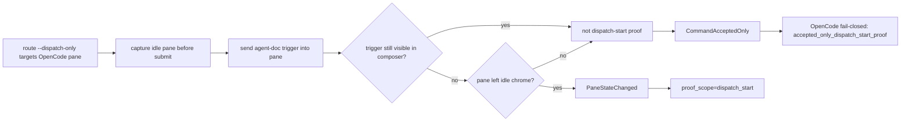

## Status

<!-- agent:status patch=replace -->

Live IntelliJ File Cache Conflict Cancel proof captured; JB Cancel residual review items completed.
<!-- /agent:status -->

## Exchange

<!-- agent:exchange patch=append -->
### Session Summary

*Compacted. Content archived to `/home/brian/work/btakita/agent-loop/.agent-doc/archives/483039e7a9b103bd5b68223dac05a4c449ac03899aba53d6022e82100578b5b0-20260527-221004.md`*

Compacted content:
- Archived 6 response topic(s): #spec-test-build-install-commit-push; #odsp2; #finovrwr; 3 more
- Prior summary/context: ### Session Summary *Compacted. Content archived to `/home/brian/work/btakita/agent-loop/.agent-doc/archives/483039e7...

### Re: #ocdsp — gpt-5

`#ocdsp` is complete. I did not make another code edit in this cycle because the OpenCode dispatch-start proof implementation is already present in the agent-doc codebase:

- `src/agent-doc/src/route.rs` has `RoutedDispatchStartTracker::OpenCodePane`, captures the pane before direct submit, waits for the trigger to leave the composer, and treats the pane leaving idle chrome as dispatch-start proof.
- `src/agent-doc/src/flow/routed_reopen.rs` has `RoutedDispatchStartProof::PaneStateChanged` with `proof=pane_state_changed proof_scope=dispatch_start` and accepts it where accepted-only proof would fail closed for OpenCode.
- `src/agent-doc/SPEC.md` and `src/agent-doc/specs/07-session-tmux-commands.md` document the OpenCode proof requirement.
- `src/agent-doc/src/route/tests.rs` covers drafted-trigger rejection, successful pane-state proof, and accepted-only OpenCode failure.

Verification completed:

- `make check` from the repo root passed for `instruction-files`, `src/agent-doc`, and `src/corky`.
- `make install` in `src/agent-doc` passed, replacing `/home/brian/.cargo/bin/agent-doc` and installing `libagent_doc-0.34.0.so`.
- `agent-doc --version` reports `agent-doc 0.34.0`.
- Latest GitHub workflow check: the repo has `Agent Doc`, not `CI`. Run `26541236108` failed with empty `tmux-ci` and `check` jobs, no steps, and `gh run view --log-failed` returned `log not found`; I am classifying that as an external CI-start blocker rather than a code or tmux regression.

Preflight warning surfaced: the post-exchange HTML comment contains prompt preset/directive text and is preserved as a non-executable note. Move that text into `agent:exchange` or `agent:queue` if it should run in a later cycle.
<!-- agent:boundary:b8cfb080 -->
<!-- /agent:exchange -->
###
<!--
The completed queue item was not removed from the queue. #mermaid
#spec-test-build-install-commit-push
---
equityfundingsource.md had the full-document IPC duplicate corruption. Then a new full-document IPC deletion under the prompt corruption happened. Both several times while editing the prompt.
#spec-test-build-install-commit-push
---
Please review the agent-doc, claude, codex logs. What are #next-steps to fix bugs?
---
When I ran the last turn, #spec-test-build-install-commit-push was removed by agent-doc.
---
As I was typing into the comment below `/agent:exchange`, the full-document IPC corruption happened, then the duplicate line happened, then the full-document IPC corruption happened again.

In addition to diagnosing and fixing the issue, please provide a mermaid showing how the issue occurred and where in the agent-doc lifecycle the full-document IPC corruption can occur. Can we mathematically eliminate all possibility of the full-document IPC corruption from occurring?

#spec-test-build-install-commit-push
-->

<!-- agent:queue auto -->
preset #spec-test-build-install-commit-push #mermaid
- do [#ocdsp]
---
JB `Run Agent Doc` on this document did not run agent-doc in the Codex console.
#spec-test-build-install-commit-push #mermaid
<!-- /agent:queue -->

## Backlog

<!-- agent:backlog -->
<!-- /agent:backlog -->

## Review

<!-- agent:review -->
- [/] [#snrun] [recommended] Implement tasks/agent-doc/plan-run-agent-doc-snappy-auto-remediation.md: make JB Run Agent Doc distinguish rescued-stash accepted-only proof misses, active-turn busy collisions, and stale starting projections; add route/plugin regressions plus live replay evidence.
<!-- /agent:review -->

<!-- agent:icebox -->
<!-- /agent:icebox -->

## Completed / Reaped

<!-- agent:done archive=tasks/agent-doc-bugs2.done.md -->

<!-- completed work archived in tasks/agent-doc-bugs2.done.md -->
<!-- /agent:done -->
