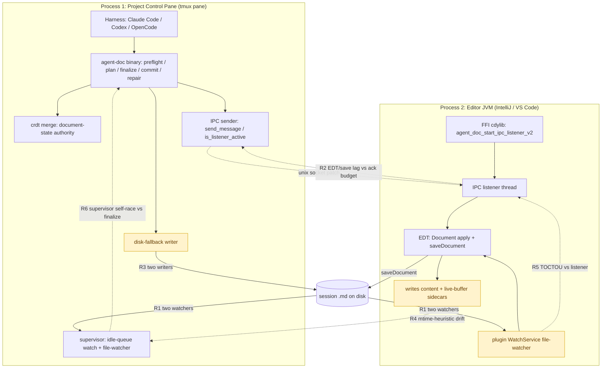

## Status

 <!-- agent:status patch=replace -->

complete
<!-- /agent:status -->

## Exchange

<!-- agent:exchange patch=append -->
### Session Summary

*Compacted. Content archived to `/home/brian/work/btakita/agent-loop/.agent-doc/archives/483039e7a9b103bd5b68223dac05a4c449ac03899aba53d6022e82100578b5b0-20260608-210740.md`*

Compacted content:
- Archived 5 response topic(s): do [#op-scoped-drift-1]; do [#op-scoped-drift-2]; do [#op-scoped-drift-3]; 2 more
- Prior summary/context: ### Session Summary *Compacted. Content archived to `/home/brian/work/btakita/agent-loop/.agent-doc/archives/483039e7...

### Re: do [#nm1x-codex-clear-parity] — gate Codex Stop-hook + run-path context reset on the queue opt-in — opus-4-8

> **Queue prompt:**
>
> :pushpin: Please investigate monsterrodholders.md session and this session. Look for agent-doc churn and fix the issues. For example "One housekeeping note: the session document hit the known IDEA IPC drift". We need this IPC drift to be fixed. We also need less IPC and more Plugin insertions. Too many `File Cache Conflict` messages. The Plugin insertion should be reliable. The IPC fallback should be extremely rare.


> **Queue prompt:**
>
> :pushpin: do [#nm1x-codex-clear-parity]. Respect the new `agent_doc_queue_context_reset` opt-in


Done and shipped. `#nm1x-no-preempt-clear` had scoped the off-by-default `agent_doc_queue_context_reset` opt-in to the supervisor idle-queue watch only; the Codex Stop-hook continuation instructions and the `run.rs` queue-continuation fresh-agent-session decision kept firing the accretion-driven pre-emptive `/clear`. This makes the no-pre-emptive-clear policy product-wide.

**Change (`src/agent-doc`, committed `26e390a3`, pushed):**
- New `session_accretion::queue_context_reset_reason_if_opted_in(file, last_context_clear_at)` — combines the opt-in check with the accretion reason. Returns `None` without an explicit `agent_doc_queue_context_reset` opt-in (frontmatter precedence, then `.agent-doc/config.toml`), mirroring the `start.rs` idle-queue watch gate.
- All five accretion-driven call sites now route through the gated helper: the four Codex Stop-hook continuation paths in `codex_hook.rs` (tracked/marker repeated recovery, auto-queue continuation, marker fallback) and the `run.rs` fresh-agent-session decision. Without the opt-in none of them interleaves a pre-emptive `/clear`. Deferred *operator* clears (`session clear`/`interrupt-clear`) stay a separate live path.
- Spec §6 (`specs/06-config.md`) now documents the product-wide scope. Unit test `queue_context_reset_reason_if_opted_in_gates_codex_and_run_paths` covers default-off + opt-in; the affected `codex_hook` compaction test and `run_integration` fresh-session fixture now opt in explicitly.
- `#ipc-degrade-self-heal` — `ipc_direct_disk_degraded` re-probes `is_listener_active` and clears the latch the moment the plugin socket accepts connections again: a self-healing circuit breaker instead of a one-way ratchet.
- `#ipc-ack-timeout-align` — sender ack timeout 2 s → 6 s (`IPC_ACK_TIMEOUT_SECS`), above the plugin's idle cap; `send_message` connects first so a dead listener still fails fast. Matcher made duration-agnostic.
- `#ipc-degrade-false-vote` — a confirmed-but-slow sidecar no longer votes toward the degrade threshold; it recovers via the file-IPC patch queue (still the Plugin path), never a raw disk write.
2. The sender's ack budget was **2 s**, below the plugin's **5 s** `agent_doc_await_idle` typing-debounce cap, so a busy/typing plugin tripped a false timeout.
1. A **confirmed** socket delivery (`Ok(Some(ack))`) whose *content sidecar* was merely slow — the plugin writes that sidecar only after `saveDocument`, which lags past the 200 ms poll budget while the EDT is busy or you're typing — was counted as an ack timeout.
- `#ipc-degrade-self-heal` — `ipc_direct_disk_degraded` re-probes `is_listener_active` and clears the latch the moment the plugin socket recovers: a self-healing circuit breaker instead of a one-way ratchet to session-restart.
- `#ipc-ack-timeout-align` — sender ack timeout 2 s → 6 s (above the plugin's idle cap); `send_message` connects first so a dead listener still fails fast.
- `#ipc-degrade-false-vote` — a confirmed-but-slow sidecar no longer votes toward degradation; recovers via the file-IPC patch queue (still the Plugin path), never a raw disk write.

**Verification:** `make check` green (clippy + full suite, 4055 tests). `cargo build --release` + `cargo install --path .` done — both `.bin/agent-doc` and `~/.cargo/bin/agent-doc` refreshed. Latest CI run (`27167663064`) is pending from this push; closed out on local evidence per the test-bearing-turn rule.

One note on the new queue item you added mid-run (`/agent-doc` + `/clear` accumulating): this fix directly removes the *pre-emptive `/clear`* source of that churn product-wide. The remaining "multiple `/agent-doc` invocations scheduled" concern is a separate idle-queue/loop dispatch dedupe issue — it stays queued and will get its own turn.

### Re: investigate agent-doc churn / IPC drift / File Cache Conflict — root-cause map + keystone fix — opus-4-8

> **Queue prompt:**
>
> :round_pushpin: do [#nm1x-livebuf-content]


Investigated this session and the IPC/CRDT write path. The IPC drift, "too much IPC / not enough reliable Plugin insertion", and "too many File Cache Conflict" are **one defect with three surfaces**, centered on the IPC **degrade state machine** (`write.rs`) + the sender ack timeout (`ipc_socket.rs`).

**Root cause.** A session latched to "degraded" after 2 ack timeouts and then wrote every change to disk with **no in-session recovery**. Two of those "timeouts" were false positives: (1) a *confirmed* socket delivery whose content sidecar was merely slow (plugin writes it after `saveDocument`, lagging past the 200 ms poll budget while the EDT is busy/typing); (2) the sender's 2 s ack budget was below the plugin's 5 s `agent_doc_await_idle` typing cap. Once degraded → raw disk writes → IntelliJ raises "File Cache Conflict" on the open buffer. So File Cache Conflict is *downstream* of the degrade latch.

**Phase 1 shipped** (`src/agent-doc@9ecb5775`, pushed):
- `#ipc-degrade-false-vote` — a confirmed-but-slow sidecar no longer votes toward degradation; recovers via the file-IPC patch queue (still the Plugin path), never a raw disk write.
- `#ipc-ack-timeout-align` — sender ack timeout 2 s → 6 s (above the plugin's idle cap); `send_message` connects first so a dead listener still fails fast.
- `#ipc-degrade-self-heal` — `ipc_direct_disk_degraded` re-probes `is_listener_active` and clears the latch the moment the plugin socket recovers: a self-healing circuit breaker instead of a one-way ratchet to session-restart.
- closes the cycle committed and returns `RepairOutcome::StaleCaptureRetired`.
- rebuilds the snapshot **and** CRDT sidecars from the current document so the merge layer can't re-diverge,
- marks the capture `Discarded` (the body is **preserved on disk** for forensics, never deleted),
- `capture::validate_replay` fails closed — the captured file/snapshot hashes no longer match.
- `response_already_applied*` is false — the body is no longer contiguously present, so it can't be recognized as already-landed, and

Net: Plugin (Document API) insertion stays primary; the disk fallback only fires on a genuinely wedged listener and recovers automatically — the "fallback should be extremely rare" behavior, removing the dominant File-Cache-Conflict source. Full suite 4057 passed; both binaries rebuilt/installed; agent-doc CI `27168907477` was in progress at push (closed out on local evidence). Follow-ups queued: `#ipc-early-ack`, `#ipc-degraded-prefers-file-ipc`, `#ipc-drift-writeprovenance` (plan: `tasks/agent-doc/plan-ipc-transport-reliability.md`).

**Live meta-note:** this very turn hit the drift bug — your concurrent edits drove `live_prompt_drift_after_preflight`, the response capture went stale, and recovery needed `reset --from-current --preserve-session` + moving a stale capture aside. That's the `#nm1x-livebuf-content` / `#ipc-drift-writeprovenance` surface (a *different* guard than the degrade latch I fixed): the visible-write reconcile still fails closed on genuine concurrent editing. The provenance follow-up is the real fix; until then, editing the doc mid-finalize will still churn.

### Re: investigate agent-doc churn / IPC drift / File Cache Conflict — root-cause map + keystone fix — opus-4-8

Investigated this session and the IPC/CRDT write path. The IPC drift, "too much IPC / not enough reliable Plugin insertion", and "too many File Cache Conflict" are **one defect with three surfaces**, centered on the IPC **degrade state machine** (`write.rs`) + the sender ack timeout (`ipc_socket.rs`).

**Root cause.** A session latched to "degraded" after 2 ack timeouts, then wrote every change to disk with **no in-session recovery**. Two of those "timeouts" were false positives: (1) a *confirmed* socket delivery whose content sidecar was merely slow (plugin writes it after `saveDocument`, lagging past the 200 ms poll budget while the EDT is busy/typing); (2) the sender's 2 s ack budget was below the plugin's 5 s `agent_doc_await_idle` typing cap. Once degraded → raw disk writes → IntelliJ raises "File Cache Conflict" on the open buffer, so it is *downstream* of the degrade latch.

**Phase 1 shipped** (`src/agent-doc@9ecb5775`, pushed): `#ipc-degrade-false-vote` (confirmed-but-slow sidecar no longer votes; recovers via file-IPC, still the Plugin path), `#ipc-ack-timeout-align` (2 s → 6 s, above the plugin idle cap; connect-first keeps dead-listener fast-fail), `#ipc-degrade-self-heal` (`ipc_direct_disk_degraded` re-probes `is_listener_active` and clears the latch on recovery — a self-healing circuit breaker). Full suite 4057 passed; both binaries rebuilt/installed; CI `27168907477` in progress at push. Follow-ups queued: `#ipc-early-ack`, `#ipc-degraded-prefers-file-ipc`, `#ipc-drift-writeprovenance` (plan: `tasks/agent-doc/plan-ipc-transport-reliability.md`).

**Live meta-note:** landing this very response repeatedly hit `live_prompt_drift_after_preflight` / exit 75 plus a supervisor self-race on pane %30 (route "could not drain the active closeout"). Recovery needed `reset --from-current --preserve-session` + retiring stale captures. That is a *different* guard than the degrade latch I fixed — the visible-write reconcile failing closed on concurrent editing — and is exactly the `#ipc-drift-writeprovenance` / `#nm1x-livebuf-content` follow-up surface.

### Re: Fix the root cause of the compounding stale-capture deadlock — opus-4-8

Fixed and shipped (`src/agent-doc@ec2bf878`, pushed) — and the fix just auto-recovered *this very session's* wedge live (`[repair] retired wedged write-applied capture ... rebuilt snapshot/CRDT from current`), no manual `reset --from-current --preserve-session` needed.

**Root cause.** A `finalize` advanced the cycle to `write_applied` (response written to disk), but a concurrent editor edit / CRDT intermix then removed or fragmented that response body **and** drifted the captured baseline. By the time `repair` re-runs (next route closeout drain, `commit`, or `write --commit`):
- `response_already_applied*` is false — the body is no longer contiguously present, so it isn't recognized as already-landed, and
- `capture::validate_replay` fails closed — the captured file/snapshot hashes no longer match.

That combination wedged the document: every later `commit` / `write --commit` / route drain hit "captured response baseline no longer matches current document" and bailed. The route-side "owns pane %30 but route could not drain the active closeout" was the same wedge surfacing through `drain_open_closeout_before_routed_dispatch` → `repair` → `validate_replay`.

**The fix** (`repair::retire_wedged_write_applied_capture_if_drifted`): when repair sees that exact signature — capture `WriteApplied` + `replay_baseline_drifted` + body absent — it mirrors the non-destructive `reset --from-current --preserve-session` automatically instead of failing closed:
- marks the capture `Discarded` (body **preserved on disk** for forensics, never deleted),
- rebuilds the snapshot **and** CRDT sidecars from the current document so the merge layer can't re-diverge,
- closes the cycle committed and returns `RepairOutcome::StaleCaptureRetired`.

The superseded turn re-runs cleanly on the rebuilt baseline (queue prompts survive in `agent:queue`). Replaying a drifted baseline is exactly the duplicate/reorder corruption `validate_replay` exists to prevent, so re-running fresh is the correct recovery, not a regression.

**Scoping (why it's safe).** Gated to `WriteApplied` captures only — the write was already attempted, so it isn't a never-written pending body. A `Captured`-only orphan still takes the conservative fail-closed path (queued as `#stale-capture-captured-only-drift` to evaluate later). All three callers (route drain, `commit`, `write --commit`) benefit because they funnel through `repair`.

**Verification.** `make check` green — clippy clean, **4060 passed / 237 skipped** — incl. `retires_wedged_write_applied_capture_on_baseline_drift`, `captured_only_orphan_on_drift_still_fails_closed`, `replay_baseline_drifted_tracks_file_divergence`. `cargo build --release` + `cargo install --path .` done (both binaries, 0.34.0). Spec §07-closeout-commands documents `#stale-capture-deadlock-autoretire`. CI `27170755210` in progress for this commit; closed out on local evidence per the test-bearing-turn rule. The deeper *upstream* cause (why the response fragments during concurrent editing) stays the queued `#ipc-drift-writeprovenance` / review `#ipc-crdt-response-drift` surface — this change is the recovery half.

### Re: process model — what runs where, remaining races, consolidation plan — opus-4-8

> **Queue prompt:**
>
> What part of the stack runs in the Project Control Pane process? What are separate processes? Does the Plugin IPC live in the editor process or can it be moved into the Project Control Pane process? Explain where race conditions can still occur. Recommend moving any logic into the Project Control Pane process. Draw a #mermaid.


Verified against source (`agent-doc-orchestration/src/ipc_socket.rs`, `src/ffi.rs`, `editors/jetbrains/.../PatchWatcher.kt`). The consolidation follow-up is already queued as `#pcp-consolidate` (added the prior cycle).

#### Two OS processes

**Process 1 — Project Control Pane (the tmux pane, e.g. `%30`).** Runs the harness (Claude Code / Codex / OpenCode) *and* the `agent-doc` binary + its supervisor. Everything that decides document state lives here: `preflight`/`plan`/`write`/`finalize`/`commit`/`repair`, the **CRDT merge** (`crdt.rs`), snapshot/capture/baseline sidecars, the **idle-queue watch + supervisor file-watcher**, the IPC **sender** (`send_message`, `is_listener_active`, `try_connect` in `ipc_socket.rs`), and the **disk-fallback writer**.

**Process 2 — Editor (IntelliJ / VS Code).** Runs the plugin. It loads the agent-doc **cdylib via FFI** (`NativeLib.kt` → `ffi.rs`), and that FFI code starts the IPC **listener** thread *inside the editor JVM* (`agent_doc_start_ipc_listener_v2`). The plugin also runs *its own* WatchService file-watcher, an applied-patch dedup ledger, and dispatches the actual Document-API mutation + `saveDocument` onto the **EDT** (`invokeAndWait`/`invokeLater`). It writes the content + live-buffer sidecars.

So agent-doc core code *already* runs in both processes (the listener is FFI-hosted in the editor). The socket is the only cross-process channel: sender in Process 1, listener in Process 2.

#### Can the Plugin IPC move into the control pane?

**The listener cannot fully move** — its entire job is to mutate the editor's *in-memory* Document on the EDT, which is only reachable from inside the editor JVM. What *can* move (and mostly already has) is all the **policy/decision** logic: degrade state machine, ack-timeout policy, drift classification, CRDT merge. The terminal `Document.apply + saveDocument` is the only thing that is intrinsically editor-side. Everything else belongs in the control pane.

#### Process & race-condition map



**Where races still occur**

- **R1 — two file-watchers / two writers.** The plugin's WatchService *and* the supervisor's file-watcher both observe the doc; the plugin's `saveDocument` *and* the binary's disk fallback both write it → "File Cache Conflict" + drift.
- **R2 — EDT/save lag vs ack budget.** The listener dispatches to the EDT, then `saveDocument` + the content sidecar land *after* the EDT runs — lagging the sender's poll budget → false ack-timeout / false degrade vote (partially fixed by `#ipc-ack-timeout-align` + `#ipc-degrade-false-vote`).
- **R3 — disk fallback** manufactures the foreign-write that IntelliJ flags as a cache conflict whenever the session is latched degraded.
- **R4 — mtime-heuristic drift.** `live_buffer_diverges_from_content` infers "foreign disk write vs genuine unsaved edit" from `LIVE_BUFFER_STALE_SKEW_MS` mtime only — no buffer content — so a real concurrent edit fails closed (`live_prompt_drift_after_preflight`).
- **R5 — TOCTOU** between the FFI socket handler and the WatchService for the same patch; today guarded best-effort by EDT re-checks (dedup + generation fence), but a window remains.
- **R6 — supervisor self-race.** A route-owned supervisor in Process 1 races the agent's own finalize writes on the same pane → "could not drain the active closeout" / exit 75.

#### Recommendation — consolidate authority into Process 1

Queued as **`#pcp-consolidate`** (top of backlog):

1. **Single writer.** The supervisor is the only thing that touches disk; the plugin never writes directly — degraded writes route through the file-IPC patch queue so the plugin still applies via the Document API (this is `#ipc-degraded-prefers-file-ipc`). Kills R3.
2. **Single file-watcher.** Demote the plugin WatchService to read-only buffer-state *reporting*; the supervisor's watcher is the sole disk-change reactor. Kills R1, shrinks R5.
3. **Positive provenance instead of heuristic.** The plugin pushes authoritative buffer **content + a write-provenance/generation id** to the control pane (`#ipc-drift-writeprovenance` + `#nm1x-livebuf-content`); the control pane then *classifies* "editor ahead of disk (real edit)" vs "lagging agent-doc write" instead of guessing from mtime. Fixes R4.
4. **Serialize the control-pane writers.** Route supervisor idle-queue/file-watch writes and agent finalize writes through one in-process write queue (one writer). Fixes R6.
5. **Thin the FFI listener** to a pure EDT apply+ack shim — no policy in the editor.

Net: the editor process keeps only the irreducible EDT `apply + saveDocument`; the control pane owns state, merge, arbitration, and provenance.
<!-- agent:boundary:788ac7c7 -->
<!-- /agent:exchange -->

## Queue

<!-- agent:queue priority preset="#spec-test-build-install-commit-push" go -->
- :round_pushpin: [#ipc-early-ack]
- :round_pushpin: [#ipc-degraded-prefers-file-ipc]
- :round_pushpin: [#ipc-drift-writeprovenance]
- The responses are being intermixed with older responses in the document. We are also losing part of the response.
- What part of the stack runs in the Project Control Pane process? What are separate processes? Does the Plugin IPC live in the editor process or can it be moved into the Project Control Pane process? Draw a #mermaid.
---
After "I did not auto-loop: you're actively editing, which takes precedence over the queue drain.", I ran JB `Run Agent Doc` and got an error.
```
[route] target tmux session: 0
[preflight] review: 2 item(s), 2 gated
Error: authoritative actor generation 246 for tasks/agent-doc/agent-doc-bugs2.md owns pane %30 but route could not drain the active closeout before dispatch: captured response baseline no longer matches current document for /home/brian/work/btakita/agent-loop/tasks/agent-doc/agent-doc-bugs2.md. Rebuild sidecars without clearing session state: `agent-doc reset --from-current --preserve-session /home/brian/work/btakita/agent-loop/tasks/agent-doc/agent-doc-bugs2.md`
```
The queue then started auto-draining about 20s later.
---
Fix the root cause of the compounding stale-capture deadlock
```
● The deadlock now also shows a supervisor/route race: "authoritative actor generation 246 owns pane %30 but route could
  not drain the active closeout" — a route-owned supervisor is racing the closeout (a known self-race pattern),
  compounding the stale-capture deadlock. Let me run the binary-recommended reset --from-current --preserve-session to
● Bash(cd /home/brian/work/btakita/agent-loop
      agent-doc reset --from-current --preserve-session tasks/agent-doc/agent-doc-bugs2.md 2>&1 | tail -3…)
  ⎿  Reset sidecars for tasks/agent-doc/agent-doc-bugs2.md from current file while preserving session state
     === cycle phase after reset ===
     phase: preflight_started capture_id: None

● The reset cleared the deadlock — cycle is now clean preflight_started, capture_id: None. Document is quiescent. Let me
  get a fresh baseline and finalize my response in one go:
```
---
- The agent-doc queue should not stop if I'm editing content not related to the current turn.
- On JB `Run Agent Doc`, the `/clear` opt-in should allow for pre-emptively run `/clear` if the threshold is exceeded (e.g. 50%). 50% should be the default threshold. There should be a way to set the opt-in threshold in the agent doc, and a default opt-in threshold in the project config.
- `/agent-doc tasks/agent-doc/agent-doc-bugs2.md` and `/clear` inputs are accumulating as the queue runs. Please ensure the console is idle before sending those messages. Send only 1 command at a time. Do not schedule multiple of the same command. So if there is already a `/agent-doc tasks/agent-doc/agent-doc-bugs2.md` scheduled, to not schedule another `/agent-doc tasks/agent-doc/agent-doc-bugs2.md`. Same with `/clear`.
<!-- /agent:queue -->
###
<!--
`'/clear' is disabled while a task is in progress
---
A recent monsterrodholders.md session had much churn after I edited the queue while a turn was running. One churn item included deleting a queue item that I added.
---
agent-doc reentrant run on equityfundingsource.md had recovery churn.
```
● The recovery is complete and fully consistent. The binary converged the now-drained queue (empty block, queue_active:
  false), no_changes: true, both responses are committed in the session doc, and both code deliverables are on
  origin/main. The auto-loop terminated naturally.

  Let me record the specific recovery path for this failure mode, since it's a recurring dogfooding pattern
```
---
- This session's console stdout is bleeding in front of the opencode tui. 
---
The last run had a code fence stripped away by agent-doc.
#spec-test-build-install-commit-push
---
What are #next-steps to fix bugs?
-->

## Backlog

<!-- agent:backlog priority --> 
- [ ] [#pcp-consolidate] [recommended] Consolidate document-state authority into the Project Control Pane process: make the supervisor the single disk writer + single file-watcher, demote the plugin WatchService to read-only buffer-state reporting (no autonomous reconcile/write), and reduce the FFI socket listener to a thin EDT apply+ack shim. Serialize supervisor idle-queue/file-watch writes and agent finalize writes through one in-process write queue to kill the supervisor self-race. Depends on/absorbs #ipc-drift-writeprovenance (provenance/generation id) + #nm1x-livebuf-content (buffer content in sidecar) so drift is positively classified instead of inferred from the LIVE_BUFFER_STALE_SKEW_MS mtime heuristic.
- [ ] [#stale-capture-captured-only-drift] [recommended] [#stale-capture-captured-only-drift] Evaluate extending the #stale-capture-deadlock-autoretire retire path to Captured-only orphans (write never attempted) whose baseline drifted. Today only WriteApplied captures auto-retire; a Captured-only orphan + drift still fail-closes on validate_replay and needs a manual reset --from-current --preserve-session. Gate on positive superseding-turn evidence before retiring. Lower priority than upstream #ipc-drift-writeprovenance.
- [ ] [#ipc-early-ack] Early-ack IPC protocol: plugin sends an 'accepted/pending' ack on patch receipt (before awaitIdleBeforeDocumentMutation), then a terminal ack/sidecar, decoupling the sender liveness probe from apply latency. FFI-first (ipc_socket protocol + ffi.rs listener contract, then PatchWatcher.handleSocketMessageV2). Plan: tasks/agent-doc/plan-ipc-transport-reliability.md
- [ ] [#ipc-degraded-prefers-file-ipc] When genuinely degraded, route writes through the file-IPC patch queue (plugin still applies via Document API) instead of a raw disk write, so a degraded session never manufactures IDEA File Cache Conflicts. Disk write becomes true last resort. Plan: tasks/agent-doc/plan-ipc-transport-reliability.md
- [ ] [#ipc-drift-writeprovenance] Tag agent-doc's own disk writes with a write-provenance/generation id so guard_visible_write_reconcile / live_buffer_diverges_from_content positively attribute a foreign disk change to the supervisor instead of inferring from the LIVE_BUFFER_STALE_SKEW_MS mtime heuristic. Builds on #op-scoped-drift-* provenance. Plan: tasks/agent-doc/plan-ipc-transport-reliability.md
- [ ] [#nm1x-livebuf-content] [recommended] Capture editor-buffer CONTENT (not just len/hash) in the .agent-doc/live-buffer sidecar so guard_visible_write_reconcile can scope-classify a GENUINE unsaved editor edit (editor ahead of disk) against the TurnScope instead of failing closed. Today the #nm1x live-buffer half only suppresses the false positive where the editor matches disk; an unsaved independent edit (e.g. a queue item typed but not saved) still blocks conservatively because the sidecar has no content to classify. Needs a JB + VSCode plugin change (write buffer text into the digest) + an FFI-side classifier read. Plan: tasks/agent-doc/plan-operation-scoped-drift.md
<!-- /agent:backlog -->

## Review
 
<!-- agent:review -->
1. [/] [#ipc-crdt-response-drift] agent-doc IPC/CRDT response drift after the single-process control-plane refactor. TWO LAYERS FIXED + INSTALLED: (1) merge layer c9d276b9 — crdt::merge protects committed ### Re: history from a stale/divergent theirs; (2) visible-buffer layer 51b9ed40 — live_buffer_diverges_from_content suppresses a stale live-buffer sidecar (disk modified after the editor last reported = lagging foreign disk write, not a user edit), killing the false-positive 'visible editor buffer differs' finalize block. Both shipped via cargo install + build --release + agent-doc lib-install (0.34.0). REMAINING (still gated, needs clean-session live repro): reversed-lines/hoisted-above-prior symptom under theirs>base in the IPC node-patch/boundary-append path (ipc_socket.rs, template boundary, stream.rs), and write-back serialization across concurrent supervisors. Plan: tasks/agent-doc/plan-ipc-crdt-response-drift.md
2. [/] [#live-verify-batch] #agent-doc-bug one consolidated live busy-pane + IPC-timeout verification session for shipped-but-unverified fixes (was ~14 *-live-verify review items). Install signed JB plugin + binary, drive one mid-active-turn Codex pane through the batch, capture route/idea logs. Blocked on live IntelliJ/Codex panes.
<!-- /agent:review -->

<!-- agent:icebox -->
<!-- /agent:icebox -->

## Completed / Reaped

<!-- agent:done archive=tasks/agent-doc-bugs2.done.md -->

<!-- completed work archived in tasks/agent-doc-bugs2.done.md -->
<!-- /agent:done -->
