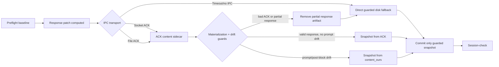

## Status

<!-- agent:status patch=replace -->

Live IntelliJ File Cache Conflict Cancel proof captured; JB Cancel residual review items completed.
<!-- /agent:status -->

## Exchange

<!-- agent:exchange patch=append -->
### Session Summary

*Compacted. Content archived to `/home/brian/work/btakita/agent-loop/.agent-doc/archives/483039e7a9b103bd5b68223dac05a4c449ac03899aba53d6022e82100578b5b0-20260527-074548.md`*

Compacted content:
- Archived 1 response topic(s): closeout repair
- Prior summary/context: ### Session Summary *Compacted. Content archived to `/home/brian/work/btakita/agent-loop/.agent-doc/archives/483039e7...
### Re: IPC closeout state model — gpt-5

Implemented `#ipcmodel` and marked it done.

What changed:
- Added an IPC closeout state model and regression suite in `src/agent-doc/tests/ipc_closeout_model.rs`.
- Added a guarded rollback in `src/agent-doc/src/write.rs` so partial IPC response materialization is removed before the direct fallback path can merge and commit it.
- Covered bad ACK content, prompt drift, partial response materialization, stale file-IPC replay cleanup, and post-block snapshot absorb across socket/file/direct fallback states.

Lifecycle diagram:

The unsafe full-document IPC corruption path is now eliminated inside the agent-doc closeout boundary: response fallback full-content IPC stays disabled, ACK/file-read snapshots must pass materialization guards, live prompt drift forces `content_ours`, and stale patch replay is claimed before commit. We cannot mathematically eliminate every external editor/OS failure mode, but the state model now makes those observed corruption packets unable to become the committed session snapshot.

Verification:
- `cargo test --test ipc_closeout_model` passed.
- `cargo test try_ipc_rejects_consumed_partial_response_materialization --lib && cargo test --test ipc_closeout_model` passed; the lib filter had 0 matching tests, and the integration suite passed 6/6.
- `make check` passed, including clippy, default tests, and the medium SimWorld closeout corpus.
- `cargo install --path .` completed and replaced `/home/brian/.cargo/bin/agent-doc` with local `agent-doc 0.34.0`.
- Latest GitHub Actions CI run `26497326907` is green; its `Run make tmux-ci` step also passed.

Commits:
- `src/agent-doc`: `ec328b3a` (`fix: guard partial IPC materialization`)
- superproject pointer: `dfc6223b7` (`agent-doc: guard partial IPC materialization`)
### Re: EFS IPC replay harness — gpt-5

Completed `#ipcreplay`.

Added a deterministic `equityfundingsource` IPC replay harness in `tests/equityfundingsource_ipc_replay.rs` covering socket IPC while the live prompt is typed during finalize, file IPC with ACK sidecars, stale file-IPC patch cleanup before fallback, and forced direct-disk fallback.

Updated `specs/07-closeout-commands.md` to name the `tasks/professional/equityfundingsource.md` incident as the closeout replay fixture.

Verification: `cargo test --test equityfundingsource_ipc_replay` passed; `make check` passed; `cargo install --path .` replaced the local `agent-doc`; CI run `26498979417` passed, including `Run make check` and `Run make tmux-ci`.

Commits: `src/agent-doc` `b5ea38a2 test: add EFS IPC replay harness`; superproject `bf0a9ef34 agent-doc: add EFS IPC replay harness`.

No follow-ups needed.
### Re: fullContent receiver guards — gpt-5

Completed `#ipcdeny`.

Added `tests/full_content_static_guard.rs`, a repo-wide static receiver guard for production CLI, JetBrains, and VS Code paths. It keeps `fullContent` references limited to parser DTOs, null/empty rejection branches, disabled-path diagnostics, and legacy source-buffer proof helpers; it also fails if `patch.fullContent` is reintroduced into visible whole-document write APIs or if first-party CLI payload emission comes back.

Updated `specs/07-closeout-commands.md` to make that static receiver guard part of the full-content IPC closeout contract.

Verification: `cargo test --test full_content_static_guard` passed; `make check` passed; `cargo install --path .` replaced the local `agent-doc`; latest available CI run `26499516608` passed, including `Run make check` and `Run make tmux-ci`.

Commits: `src/agent-doc` `7a0cf7eb test: guard fullContent receiver paths`; superproject `a82e91e54 agent-doc: guard fullContent receiver paths`.

No follow-ups needed.
### Re: do [#ipcfail] — gpt-5

Implemented `#ipcfail`. The IPC write path now emits a stable `ipc_proof_insufficient` diagnostic with exact `invariant=` and `recovery=` fields for no-ACK timeouts, missing response-body materialization, unacknowledged live exchange edits, live prompt drift, and duplicate-prompt ACK rejection. Preflight and session-check interrupted-cycle messages now surface the latest matching IPC proof diagnostic.

Updated the closeout spec and regression coverage for no ACK, missing response probe, unacknowledged live edit, live prompt drift, duplicate prompt ACK, and session-check diagnostic surfacing.

Verification: `cargo test try_ipc_times_out_when_no_plugin`; `cargo test try_ipc_rejects_consumed_partial_response_materialization`; `cargo test file_ipc_consumed_with_live_exchange_edit_requires_ack_content`; `cargo test file_ipc_ack_content_live_prompt_drift_uses_content_ours_snapshot`; `cargo test socket_ack_content_prompt_duplication_uses_content_ours_and_repairs_visible_buffer`; `cargo test session_check_open_cycle_surfaces_ipc_proof_diagnostic`; `cargo test latest_ipc_proof_diagnostic_prefers_matching_file_entry`; `make check`; `cargo install --path .`; GitHub CI run `26501096866` passed with `Run make check` and `Run make tmux-ci`.

Commits: `src/agent-doc` `f78f60a5`; parent `6d97d9512`.
<!-- agent:boundary:4531bc8f -->
<!-- /agent:exchange -->
###
<!--
Please review the agent-doc, claude, codex logs. What are #next-steps to fix bugs?
---
When I ran the last turn, #spec-test-build-install-commit-push was removed by agent-doc.
---
As I was typing into the comment below `/agent:exchange`, the full-document IPC corruption happened, then the duplicate line happened, then the full-document IPC corruption happened again.

In addition to diagnosing and fixing the issue, please provide a mermaid showing how the issue occurred and where in the agent-doc lifecycle the full-document IPC corruption can occur. Can we mathematically eliminate all possibility of the full-document IPC corruption from occurring?

#spec-test-build-install-commit-push
-->

<!-- agent:queue auto -->
preset #spec-test-build-install-commit-push
- ~do [#ipcmodel]~
- ~do [#ipcreplay]~
- ~do [#ipcdeny]~
- ~do [#ipcfail]~
- do [#jbrunbusy]
<!-- /agent:queue -->

## Backlog

<!-- agent:backlog -->
- [ ] [#jbrunbusy] Fix JB Run Agent Doc active-turn retry classification: dispatch-only `latest run still booting ... active codex turn` refusals should be typed as busy/running, coalesced or retryable in the JetBrains plugin, and covered by route + plugin regression tests using the equityfundingsource repro.
<!-- /agent:backlog -->

## Review

<!-- agent:review -->
- [/] [#snrun] [recommended] Implement tasks/agent-doc/plan-run-agent-doc-snappy-auto-remediation.md: make JB Run Agent Doc distinguish rescued-stash accepted-only proof misses, active-turn busy collisions, and stale starting projections; add route/plugin regressions plus live replay evidence.
<!-- /agent:review -->

<!-- agent:icebox -->
<!-- /agent:icebox -->

## Completed / Reaped

<!-- agent:done archive=tasks/agent-doc-bugs2.done.md -->

<!-- completed work archived in tasks/agent-doc-bugs2.done.md -->
<!-- /agent:done -->
