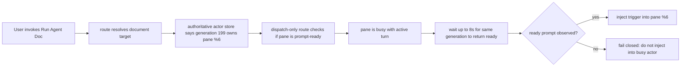
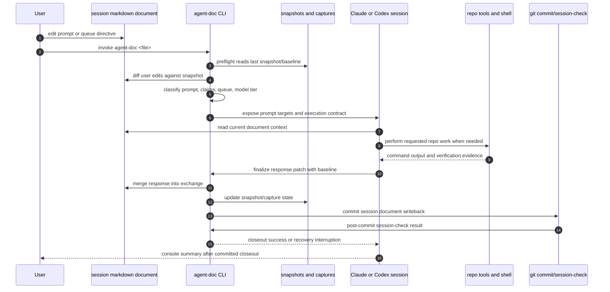
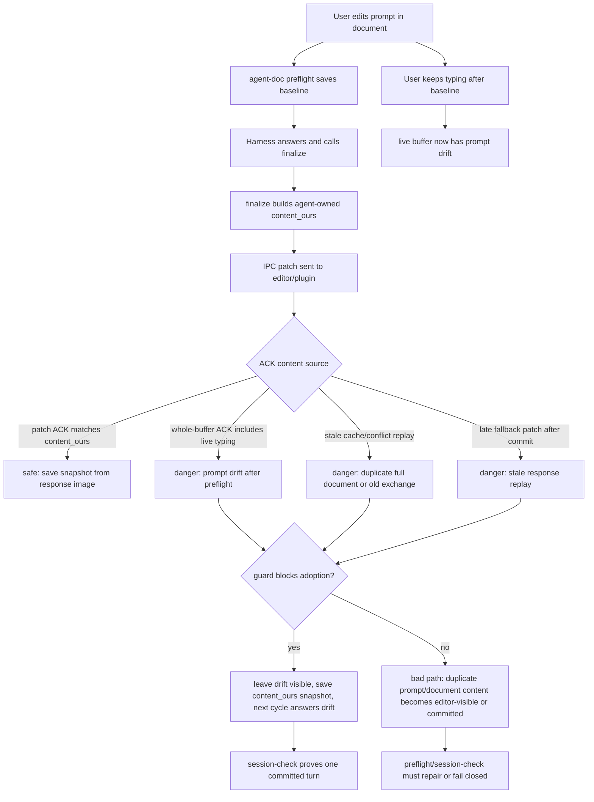
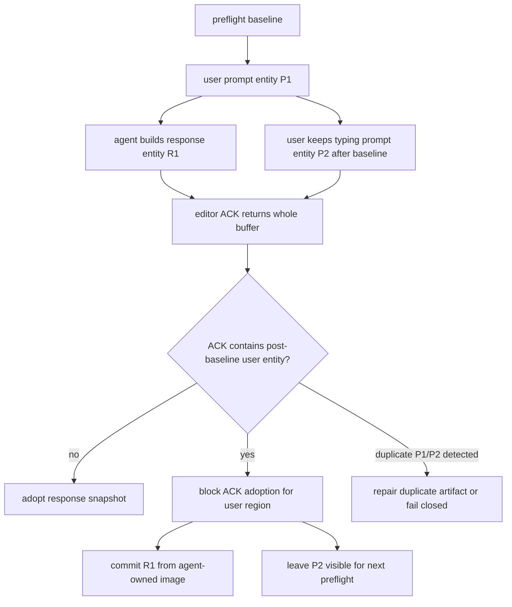
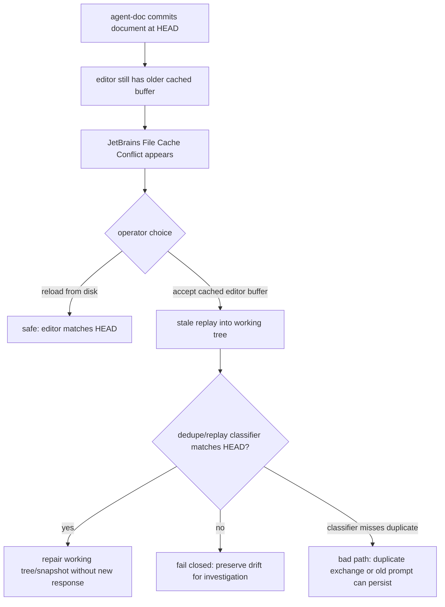
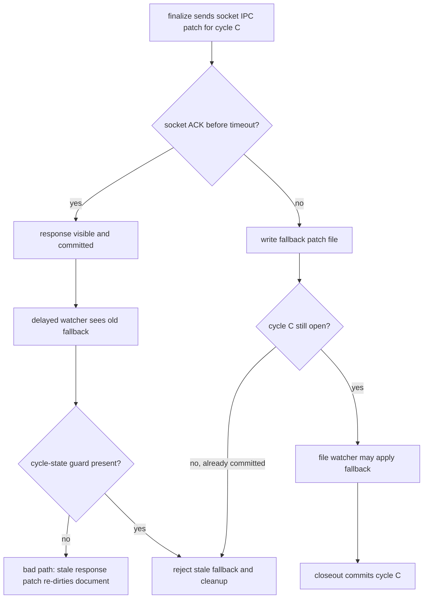

## Status

<!-- agent:status patch=replace -->

Live IntelliJ File Cache Conflict Cancel proof captured; JB Cancel residual review items completed.
<!-- /agent:status -->

## Exchange

<!-- agent:exchange patch=append -->
### Session Summary

*Compacted. Content archived to `/home/brian/work/btakita/agent-loop/.agent-doc/archives/483039e7a9b103bd5b68223dac05a4c449ac03899aba53d6022e82100578b5b0-20260527-142516.md`*

Compacted content:
- Archived 5 response topic(s): IPC closeout state model; EFS IPC replay harness; fullContent receiver guards; 2 more
- Prior summary/context: ### Session Summary *Compacted. Content archived to `/home/brian/work/btakita/agent-loop/.agent-doc/archives/483039e7...
❯ do [#0ep7]. #spec-test-build-install-commit-push
### Re: #0ep7 — gpt-5

Implemented `#0ep7`.

Changed paths:
- `src/agent-doc/src/capture.rs`: terminal capture updates now refresh the active capture `file_hash` and `snapshot_hash` from the recovered document/snapshot when a capture reaches `committed`, so a JB cancel recovery does not leave stale replay sidecars behind.
- `src/agent-doc/src/preflight.rs`: added `preflight_recovers_jb_cache_conflict_cancel_orphaned_capture_once`, covering the visible already-present response plus orphaned pending/capture sidecar shape. It proves one recovery commit, pending sidecar removal, terminal capture state, refreshed hashes, one response heading, balanced queue scaffold, and green `session-check`.
- `src/agent-doc/specs/07-closeout-commands.md`: specified the JB File Cache Conflict cancel recovery invariant.

Verification:
- `cargo test preflight_recovers_jb_cache_conflict_cancel_orphaned_capture_once -- --nocapture`
- `cargo test jb_cache_conflict -- --nocapture`
- `cargo test mark_committed_updates_capture_state -- --nocapture`
- `make check`
- `make install`
- `agent-doc --version` -> `agent-doc 0.34.0`
- GitHub Actions CI run `26503616492` is green; its `Run make tmux-ci` step succeeded.

Commits prepared before session closeout:
- `src/agent-doc`: `98a81c06` (`fix: retire jb cancel orphaned captures`)
- parent repo: `f46839242` (`agent-doc: update submodule for jb cancel recovery`)

❯ Push is intentionally after this binary-owned session closeout so the session response commit is included with the pushed parent branch.
### Re: Run Agent Doc busy actor block — gpt-5

The block was on the routing side, before any prompt text was injected. `agent-doc route` found that generation `199` was the authoritative actor for this document and owned pane `%6`, then waited for that same generation to return to a dispatch-ready prompt. It did not become ready within the 8 second dispatch-only recovery window, so the route failed closed instead of sending a second trigger into a busy active turn.



That guard is intentional: dispatch-only routing can reuse an authoritative actor only when the live pane proves it can consume input. Without that prompt-ready proof, injecting would risk mixing a new `agent-doc` trigger into an in-flight response.
❯ Please diagram the lifecycle of an active turn with agent-doc processes and with the Claude/Codex session.
### Re: active turn lifecycle — gpt-5

Here is the active-turn lifecycle with the ownership boundary between `agent-doc` and the live Claude/Codex session.



The important boundary is that `agent-doc` owns the document lifecycle: preflight, baseline selection, diff classification, response merge, snapshot/capture state, commit, and `session-check`. Claude or Codex owns the live reasoning/tool turn between `plan` and `finalize`. A response that only appears in the console is not complete; it becomes part of the turn only when `finalize` writes it into the document and commits that state.
❯ Why does agent-doc think the turn is running when the agent console is idle?
### Re: idle console versus running turn — gpt-5

`agent-doc` is not asking whether the pane looks visually quiet. For dispatch-only routing, it asks a stricter question: does the authoritative actor for this document still own the pane, and can the live pane prove it is at a harness-specific dispatch-ready prompt for the same generation?

So an apparently idle console can still fail as "busy" when `agent-doc` cannot prove prompt readiness. Common cases are:

- the pane is idle at text that does not match the expected Claude/Codex ready prompt;
❯ Can we have a more robust solution than reading the console state? Are hooks available or some file based IPC that agent-doc can read instead?
- the authoritative actor store still points at a generation that never completed its closeout handshake;
❯ If a previous turn did not complete, can agent-doc close out the previous turn without any conflicts?
- the pane is waiting in a sub-state that looks quiet to a human, such as a tool/approval/recovery boundary;
❯ Can we queue further dispatches? Perhaps we should make the agent:queue mechanism a central part of agent-doc dispatch? Where dispatched prompts can be added to an item on a queue? Can we ensure multiple dispatches for a document don't exceed 1 with this on-demand queuing?
- the route is looking at a stale or wrong actor projection and fails closed rather than injecting into a possibly active turn.
❯ Can we make the system more robust by using the queue mechanism? Can dispatch "self-heal" by routing a mis-routed dispatch to an existing claiming tmux pane/Supervisor or launch a new tmux pane/Supervisor?

The error wording is the key detail: "did not return to a dispatch-ready prompt" is not proof that tokens were streaming. It means route had an authoritative actor for the document, but prompt-readiness proof did not arrive within the wait window, so it refused to send another trigger. The existing `#snrun` review item is aimed at splitting those cases apart so the UI can distinguish real active-turn collisions from stale actor/proof-miss states.

❯ As I was typing in this prompt, the duplicate document content was injected by agent-doc, corrupting the document. Please create a mermaid diagraming the failure cases that occurred.
### Re: robust dispatch and duplicate IPC failure modes — gpt-5

Yes: the more robust design is to stop treating console text as the primary source of truth. The prompt-ready check should be a final safety barrier, not the authority model. The authority model should be durable and typed:

- controller actor state: document, pane, harness, generation, supervisor socket, lifecycle state;
- supervisor lifecycle IPC: `starting`, `busy`, `ready`, `waiting_input`, `blocked`, `closed`;
- Codex hooks where available: `UserPromptSubmit` tracks the active document and `Stop` can materialize a valid single assistant closeout;
- closeout state files: cycle/capture state, response probe, snapshot hash, baseline hash;
- a durable per-document dispatch queue/lease so reroutes become ordered work instead of direct pane injection attempts.

❯ Can we have similar hooks on Claude and Open Code? Should agent-doc consider using Pi for fuller control over the harness?

So: yes, hooks and file/socket IPC are available, but the important rule is that no single channel should be trusted as whole-document authority. Console readiness, supervisor state, hook state, cycle state, and IPC ACK content need to agree on a typed transition. If they disagree, route should fail closed or enqueue, not inject.

For an incomplete previous turn, `agent-doc` can close it out without conflict only when it can prove the missing closeout is exactly one assistant response for the still-current cycle. That means the response body probe is present, the baseline/cycle id still match, there is no live user prompt drift after preflight, and the candidate is not transcript-shaped duplicate content. If those proofs are missing, it must not silently close the previous turn; it should preserve the visible drift and force the next `preflight` / `finalize` recovery path.

Queueing is the right direction. I would make dispatch single-flight per document:

1. editor or CLI dispatch asks the controller for the authoritative document lease;
2. if a turn is active, append the requested reopen/prompt to durable `agent:queue` or a queue-backed dispatch record;
❯ Append to the document agent:queue and activate queue. Add agent:queue to the document if missing. Should we deprecate the inline document mode?
3. do not inject a second prompt into the pane;
4. after committed closeout, the Stop hook or supervisor asks `agent-doc` to continue the next queue head;
5. if the queue head does not advance after a continuation, fail closed to avoid a loop.

Self-healing should also route through that lease. A misrouted dispatch can rebind to an existing claiming supervisor when the actor store, pane, harness, and generation prove ownership. It can launch a new pane only when the previous owner is dead, closed, unreachable, or explicitly stale. It should not treat an apparently idle pane as safe when the actor store still says another live generation owns the document.



The concrete failure class you saw is the bad path through `whole-buffer ACK` or stale replay while live typing changed the document after preflight. The invariant that eliminates it is: IPC ACK content is an observation, not authority. Authority must remain the agent-owned response image plus explicit proof that no user-owned drift or duplicate prompt material was absorbed. This is exactly the kind of behavior I would fold into the existing `#snrun` route/replay review item rather than split into a second competing routing task.

❯ Re "whole-buffer ACK includes live typing": Can we identify the live typing surface so "danger: prompt drift after preflight" does not duplicate the old snapshot of the prompt? Do we need to create a document entity for the user prompt areas, where the user content is not modified by agent-doc at all?

Re "stale cache/conflict replay": Could you diagram the intended reason(s) for the replay? Could you also diagram the failure cases?

Re "late fallback patch after commit": Could you diagram the intended reason(s) for the replay? Could you also diagram the failure cases?

### Re: hooks queue surfaces and replay diagrams — gpt-5

Claude and OpenCode can have analogous control points, but not the same native hook shape as Codex today. Codex has `UserPromptSubmit` and `Stop`, so `agent-doc` can observe both prompt submission and end-of-turn payloads. Claude Code has the `/agent-doc` Skill entrypoint and shell closeout path. OpenCode has the installed command wrapper and direct `finalize`/`session-check` path. The current spec explicitly treats Claude Code and OpenCode dispatch-only proof as weaker than Codex prompt-submit proof, so the robust path is a common adapter layer:

- native hooks where the harness exposes them;
- supervisor lifecycle IPC where `agent-doc` owns the child process;
- PTY/screen-state observation as a fallback proof surface;
- cycle/capture/session-check state as the closeout authority.

If by "Pi" you mean fuller PTY/process integration, yes, but only as a transport/control layer. Owning the child PTY gives better resize, stdin, output, permission-prompt, and lifecycle control. It still must not become semantic authority for response completion; the semantic authority remains the document cycle, response probe, snapshot, and commit/session-check boundary.

For dispatch queueing: yes, route should append to `agent:queue`, create the component when absent, activate it with `auto` or `queue_active`, and then rely on normal queue-head consumption. I would not deprecate inline document mode immediately. Keep inline exchange prompts as the interactive human surface, but make programmatic reroutes and repeated dispatches queue-backed. Longer term, inline mode can become a compatibility/import path that materializes into typed prompt entities.

For live typing, the missing abstraction is an owned user-prompt entity. `agent-doc` needs to distinguish user-owned regions from agent-owned response regions, not just compare whole buffers. The durable shape should be closer to `prompt_entity{id, component, range/hash, owner=user, answered_by_cycle?}` and `response_entity{id, cycle, owner=agent}`. Then `agent-doc` can say: "this ACK includes a user entity created after my baseline; preserve it for the next cycle and never duplicate or overwrite it."



The intended stale cache/conflict replay reason is editor safety: JetBrains may still hold an older buffer/cache view and offer conflict resolution when disk changed underneath it. Accepting the conflict can replay that stale editor buffer into the visible document. That is acceptable only if the replay is recognized as already-committed content or repaired before commit.



Late fallback patch replay has a different intended reason. It exists so an IPC timeout can still deliver a response through a file-watcher path if the socket path failed. The failure is when that fallback arrives after the same cycle already committed.



The duplicate late-fallback question is the same case twice: intended replay is only for still-open cycles; after `Committed`, every fallback for that cycle is stale and must be rejected by cycle id before it can touch the visible document or snapshot.
### Re: stale cache/conflict replay — gpt-5

The stale cache/conflict replay diagram in the previous response is the intended model: the replay exists because an editor may hold an older cached buffer after disk changed; accepting that buffer replays it into the working tree. The safe path is to classify it as already-committed replay and repair without a new response. The failure path is accepting the stale buffer as authoritative and letting duplicate exchange or old prompt material survive into snapshot/commit state.

### Re: late fallback patch after commit — gpt-5

The late fallback patch diagram in the previous response covers both repeated late-fallback prompts. The fallback is valid only while the cycle is still open after socket IPC did not complete. Once the cycle is `Committed`, the same patch id/cycle id is stale and must be rejected and cleaned up before it can mutate the editor buffer, snapshot, or working tree.
<!-- agent:boundary:588136b1 -->
<!-- /agent:exchange -->
###
<!--
JB `Run Agent Doc` error. The agent session was idle. Please draw a mermaid showing why the block happened on the agent-doc side.
```
resync: stash pane %1 is registered in its own project root — skipping kill
[route] debounce OK — file idle for 14.2s and typing indicator idle
[route] target tmux session: 0
Error: authoritative actor generation 199 for tasks/agent-doc/agent-doc-bugs2.md owns pane %6 but dispatch-only route will not inject a new trigger because the authoritative actor is busy did not return to a dispatch-ready prompt in the current generation after waiting 8s. Wait for the active turn to finish before rerouting this document.
```
---
equityfundingsource.md had the full-document IPC duplicate corruption. Then a new full-document IPC deletion under the prompt corruption happened. Both several times while editing the prompt.
#spec-test-build-install-commit-push
---
Please review the agent-doc, claude, codex logs. What are #next-steps to fix bugs?
---
When I ran the last turn, #spec-test-build-install-commit-push was removed by agent-doc.
---
As I was typing into the comment below `/agent:exchange`, the full-document IPC corruption happened, then the duplicate line happened, then the full-document IPC corruption happened again.

In addition to diagnosing and fixing the issue, please provide a mermaid showing how the issue occurred and where in the agent-doc lifecycle the full-document IPC corruption can occur. Can we mathematically eliminate all possibility of the full-document IPC corruption from occurring?

#spec-test-build-install-commit-push
-->

<!-- agent:queue -->
preset #spec-test-build-install-commit-push
- ~do [#ipcmodel]~
- ~do [#ipcreplay]~
- ~do [#ipcdeny]~
- ~do [#ipcfail]~
- ~do [#jbrunbusy]~
<!-- /agent:queue -->

## Backlog

<!-- agent:backlog -->
<!-- /agent:backlog -->

## Review

<!-- agent:review -->
- [/] [#snrun] [recommended] Implement tasks/agent-doc/plan-run-agent-doc-snappy-auto-remediation.md: make JB Run Agent Doc distinguish rescued-stash accepted-only proof misses, active-turn busy collisions, and stale starting projections; add route/plugin regressions plus live replay evidence.
<!-- /agent:review -->

<!-- agent:icebox -->
<!-- /agent:icebox -->

## Completed / Reaped

<!-- agent:done archive=tasks/agent-doc-bugs2.done.md -->

<!-- completed work archived in tasks/agent-doc-bugs2.done.md -->
<!-- /agent:done -->
