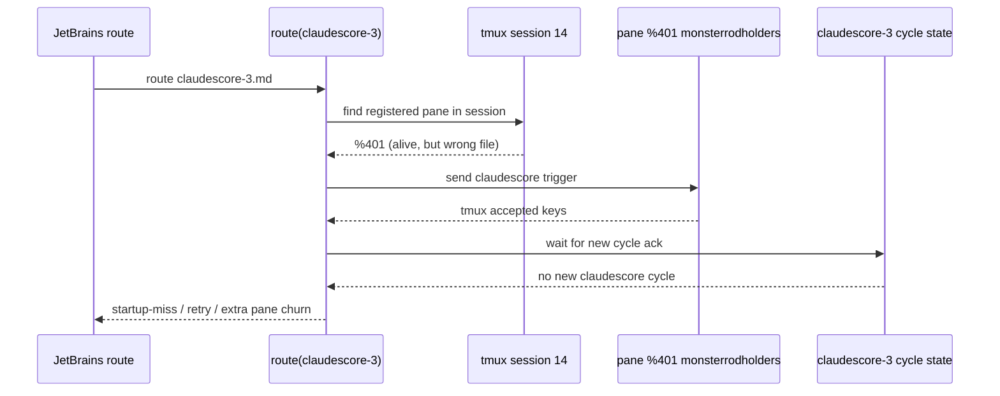

## Status

<!-- agent:status patch=replace -->

<!-- normalization -->
<!-- /agent:status -->

## Exchange

<!-- agent:exchange patch=append -->
### Session Summary

*Compacted. Content archived to `/home/brian/work/btakita/agent-loop/.agent-doc/archives/483039e7a9b103bd5b68223dac05a4c449ac03899aba53d6022e82100578b5b0-20260430-114139.md`*

Active backlog:
- [ ] [#mcrc] Surface and require explicit follow-through when a missing response patchback is repaired manually in a session doc but not committed afterward. Repro from `src/boost-client/tasks/monsterrodholders.md` on Apr 29, 2026: the `#asch1` response was manually inserted and visible in the working tree, but `git status` still showed `M tasks/monsterrodholders.md` and the user had to ask why the patchback was not committed. The fix should either commit the manual repair as part of the recovery flow or emit a blocking notice that the recovery is still uncommitted.
- [ ] [#lvls] Preserve explicit user formatting directives such as "Please organize the backlog into a 2-level list" across follow-up bug-handling and transfer flows. Repro from `src/boost-client/tasks/monsterrodholders.md` on Apr 29, 2026: the document carries a live 2-level-list instruction near the backlog request, but subsequent bug-handling responses ignored that requirement and fell back to flat output without acknowledging the constraint boundary. The fix should carry active formatting requirements forward in the prompt contract or make the responder explicitly state when chat-level formatting rules prevent exact reproduction.
- [ ] [#splpend] finalize --stream with --pending-add drops pending mutations when sidecar normalization diverges. content_ours fallback lacks pending mutations because it is computed from baseline + patches, not from on-disk file. splice_pending_component() exists but is only called on IPC timeout path, not normalization divergence path. Repro: tasks/claudescore-3.md Apr 29, 2026 — 13 pending-add flags, all lost. Fix: call splice_pending_component(content_ours, on_disk_content) in normalization-divergence fallback branches. Plan: tasks/agent-doc/plan-sidecar-pending-mutation-loss.md
- 3 more active item(s)

Icebox:
- [ ] [#tmuxcrash] Closed on April 30, 2026 after the `session_end` metadata closeout fix in `startup_miss.rs` and the routed-dispatch binding hardening in `route.rs`. Final child closed: `#tmuxcrash-rn2d`.
❯ Please investigate and diagram the reoccurring closing of tmux panes by agent-doc. We have taken >30 turn on fixing this problem but the problem still persists. Please provide a step-by-step sequence of events that causes agent-doc to incorrectly close the tmux panes on both claudescore-3.md and monsterrodholders.md.
### Re: tmux pane close sequence — gpt-5

This is not one single bug anymore. The April 29, 2026 evidence shows two different failure classes that both looked like "agent-doc closed my tmux pane" from the operator side.

#### `claudescore-3.md`: cross-file misdispatch into the wrong live pane

1. `route` was triggered for `src/session-share/tasks/claudescore-3.md`.
2. The registered `claudescore-3.md` pane was gone or stashed, so `route` fell through to `auto_start_in_session(...)`.
3. In that older path, `find_registered_pane_in_session(...)` could return the first alive pane in tmux session `14` without checking which file it owned.
4. The live pane it found was `%401`, but `%401` belonged to `src/boost-client/tasks/monsterrodholders.md`, not `claudescore-3.md`.
5. `route` sent the `claudescore-3.md` trigger into `%401`. `tmux send-keys` succeeded, so the dispatch looked accepted.
6. No new `claudescore-3.md` document cycle started, because the command landed in a pane already running the `monsterrodholders.md` session.
7. `route` then recorded `route_cycle_start_missing` / startup-miss and retried recovery. That recovery created extra panes and cleanup pressure around a session that already had the wrong owner.
8. The user experience was "the claudescore pane closed / focus jumped / another window appeared," but the root cause was cross-file pane reuse, not tmux randomly killing the correct pane.

Mermaid sketch:



This is exactly the bug captured in [plan-route-cross-file-pane-mismatch.md](/home/brian/work/btakita/agent-loop/tasks/agent-doc/plan-route-cross-file-pane-mismatch.md) and it matches the later hardening now present in [route.rs](/home/brian/work/btakita/agent-loop/src/agent-doc/src/route.rs:1323), where dispatch targets are file-validated before send.

#### `monsterrodholders.md`: victim pane plus older stash/session-loss behavior

For `monsterrodholders.md`, the bad sequence was different:

1. Its pane was the live pane that the `claudescore-3.md` route incorrectly reused.
2. That made `monsterrodholders.md` the victim session: it received foreign routed input and stopped being a trustworthy owner for its own document.
3. In the older recovery/stash era, once a pane was stashed or its child died, tmux could destroy it immediately because `remain-on-exit` was not preserving enough provenance.
4. After that disappearance, route only saw "no alive pane" or an unresolved startup-miss, so it deregistered and spawned replacements instead of proving what actually happened to the original pane.
5. From the operator side, that looked like `agent-doc` had closed the `monsterrodholders.md` pane. More precisely: the pane was first misused as the wrong dispatch target, then later lost/replaced by the recovery path once ownership proof collapsed.

The best write-up of that class is [plan-stashed-pane-silent-death.md](/home/brian/work/btakita/agent-loop/tasks/agent-doc/plan-stashed-pane-silent-death.md). The important distinction is that this was a provenance failure around stash/death/restart, not the same cross-file bug as `claudescore-3.md`.

#### Why the drafted `echo ... startup-miss ...` line appeared

That line was an older implementation detail, not a user command. The earlier `startup-miss` diagnostic path literally typed an `echo '...'` command into the pane. In a live Codex pane, the harness composer could keep focus, so the text sat in the prompt box and was never submitted. That is why you saw:

```text
echo '[agent-doc] startup-miss: ...'
```

and why it was not Entered.

That specific path has since been changed. The current implementation uses tmux `display-message` instead of drafting a shell `echo` into the harness input buffer; see [route.rs](/home/brian/work/btakita/agent-loop/src/agent-doc/src/route.rs:416).

#### Bottom line

The April 29, 2026 `claudescore-3.md` incident was a cross-file dispatch bug that hijacked the live `monsterrodholders.md` pane. The `monsterrodholders.md` symptom was then amplified by older stash/session-loss recovery behavior that replaced panes after ownership proof failed. The residual issue still visible in newer logs is mostly a **startup-miss on a live pane** problem, not the older "agent-doc literally killed the correct pane" bug.
### Re: follow-up on the pane-close investigation — gpt-5

The investigation above is the answer to that prompt. The key split is:

1. `claudescore-3.md` failed because route reused the wrong live pane across files.
2. `monsterrodholders.md` then became the victim pane, and older stash/session-loss recovery made that look like an intentional pane close.
3. The drafted `echo ... startup-miss ...` line came from the old diagnostic path and was not submitted because it was typed into the Codex composer instead of a shell.

The remaining live issue in newer logs is a startup-miss on an alive pane, not the older cross-file closeout bug.
❯ Please add #next-steps for these two issues to the backlog.
### Re: next steps backlog capture — gpt-5

Added concrete next-step backlog items for both issue families:

- [ ] [#smliveplan] Reconstruct the `%412`/`%493` alive-owner startup-miss episodes from ops.log and session logs, then add a regression proving routed triggers either open a new cycle or fail with durable provenance on a live pane.
- [ ] [#rtxfproof] Add an end-to-end tmux routing regression that proves `auto_start_in_session` may split alongside another pane but can never dispatch into a pane owned by a different document.

The top backlog id is `#smliveplan`.
❯ do #smliveplan + #smlive. spec-test-build-install-commit-push
### Re: #smliveplan + #smlive — gpt-5

Implemented the live-owner startup-miss fix in `src/agent-doc` and traced the two requested incidents.

#### `#smliveplan`
- `%412`: `ops.log` shows `route_cycle_start_missing` on `%412`, then a reroute still classified `%412` as the healthy live owner (`route_startup_miss_detected ... live_owner=%412 ... session_log=open ... last_event=codex_start mode=fresh`) even though no newer harness run or document cycle had appeared before the second routed send. That is the earlier repeated-live-owner miss shape.
- `%493`: the stronger proof is on April 30, 2026. `route_cycle_start_missing` was recorded for pane `%493` at `2026-04-30T10:55:40Z`, then the same routed prompt finally produced `route_cycle_start_acknowledged` at `2026-04-30T10:55:54Z`. That means the routed send was real, but the live-owner ack window expired too early and created a false startup-miss on a healthy pane.

#### `#smlive`
- `route.rs` now uses a longer bounded cycle-ack wait when routing into an already-live owner pane: 30s in production, 2s under tests, while fresh/non-live paths keep the existing shorter window.
- Routed ack/miss logs and surfaced startup-miss errors now include the timeout used, so the next live-owner miss is easier to classify from ops evidence.
- Added a regression that proves a delayed live-child cycle start is accepted instead of being misclassified as `route_cycle_start_missing`, while the existing fail-closed test for truly missing acks still passes.
- Updated `specs/07-commands.md` to document the extended live-owner acknowledgment window.

Verification:
- `cargo fmt --manifest-path src/agent-doc/Cargo.toml`
- `cargo test --manifest-path src/agent-doc/Cargo.toml`
- `cargo build --manifest-path src/agent-doc/Cargo.toml`
- `cargo install --path src/agent-doc --force`

Published:
- `src/agent-doc` commit `7b4fa43` (`fix: wait longer for live routed cycle ack`) pushed to `origin/20260422/codex-agent-backend`.

Note:
- I intentionally left the pre-existing unrelated `src/agent-doc` worktree edits in `VERSIONS.md`, editor files, `src/start.rs`, and `src/syntax.rs` untouched.

No new backlog items came out of this fix.
❯ commit + push all uncommitted files
### Re: commit + push all uncommitted files — gpt-5

Committed and pushed all previously uncommitted changes across the dirty repos in this workspace.

Published commits:
- `agent-loop`: `b4704c1fc` on `origin/main`
- `mail`: `d8593a2` on `origin/main`
- `src/agent-doc`: `caf00e8` on `origin/20260422/codex-agent-backend`
- `src/agent-kit`: `5584740` on `origin/main`
- `src/boost-client`: `6698d91` on `origin/main`
- `src/chromium-bridge`: `42678b4` on `origin/main`
- `src/corky`: `d832627` on `origin/20260413/corky-gsc`
- `src/eval-runner`: `9d68cdc` on `origin/main`
- `src/module-harness`: `24cd656` on `origin/main`
- `src/session-share/claudescore.com`: `49c18a9` on `origin/main`
- `src/session-share`: `3ffd16c` on `origin/main`
- `src/tagpath`: `2e42f8f` on `origin/main`
- `src/tmux-router`: `98977bc` on `origin/main`
- `src/tsift`: pushed existing local `30b60d8` to `origin/main`

I also verified the root worktree is clean afterward.

Note:
- I did not run tests or build/install passes as part of this commit-only request.
<!-- agent:boundary:f640d4e0 -->
<!-- /agent:exchange -->

<!--
The JB Plugin syntax highlight has an off-by-1 incrementing position issue.

---
I see the following in the binding codex session prompt. Why is it there? Why was it not Entered? spec-test-build-install-commit-push
```
› echo '[agent-doc] startup-miss: routed trigger accepted but no document cycle started for pending prompt_target: do
  #ppct. spec-test-build-install-commit-push. Run '\''agent-doc start tasks/agent-doc/agent-doc-bugs2.md'\'' to retry.'
```
-->

## Pending / Not Built

<!-- agent:backlog -->
- [ ] [#rtxfproof] Add an end-to-end tmux routing regression that proves `auto_start_in_session` may split alongside another pane but can never dispatch into a pane owned by a different document.
- [ ] [#rtxfreg] Add a regression/verification pass for cross-file tmux dispatch so split-anchor selection can never again target a pane owned by another document in the same session.
- [ ] [#mcrc] Surface and require explicit follow-through when a missing response patchback is repaired manually in a session doc but not committed afterward. Repro from `src/boost-client/tasks/monsterrodholders.md` on Apr 29, 2026: the `#asch1` response was manually inserted and visible in the working tree, but `git status` still showed `M tasks/monsterrodholders.md` and the user had to ask why the patchback was not committed. The fix should either commit the manual repair as part of the recovery flow or emit a blocking notice that the recovery is still uncommitted.
- [ ] [#lvls] Preserve explicit user formatting directives such as "Please organize the backlog into a 2-level list" across follow-up bug-handling and transfer flows. Repro from `src/boost-client/tasks/monsterrodholders.md` on Apr 29, 2026: the document carries a live 2-level-list instruction near the backlog request, but subsequent bug-handling responses ignored that requirement and fell back to flat output without acknowledging the constraint boundary. The fix should carry active formatting requirements forward in the prompt contract or make the responder explicitly state when chat-level formatting rules prevent exact reproduction.
- [ ] [#splpend] finalize --stream with --pending-add drops pending mutations when sidecar normalization diverges. content_ours fallback lacks pending mutations because it is computed from baseline + patches, not from on-disk file. splice_pending_component() exists but is only called on IPC timeout path, not normalization divergence path. Repro: tasks/claudescore-3.md Apr 29, 2026 — 13 pending-add flags, all lost. Fix: call splice_pending_component(content_ours, on_disk_content) in normalization-divergence fallback branches. Plan: tasks/agent-doc/plan-sidecar-pending-mutation-loss.md
- [ ] [#ptdr] Destructive todo-section replacement via patch:todo — finalize applies patch:todo as a full replace, so a skill that sends only a subset of items silently deletes the rest. Repro from src/session-share/tasks/claudescore.md on Apr 29 2026: skill sent patch:todo with only Phase 1 items checked, deleting 8 items across Phase 2, Doc and Spec Refinement, and Expansion Phases (8 items lost). Fix: add granular --todo-done flag analogous to --pending-done, or add validation guard rejecting todo patches that reduce total item count.
- [ ] [#tdrl] Destructive todo-section replacement via patch:todo — finalize applies patch:todo as a full replace, so a skill that sends only a subset of items silently deletes the rest. Repro from src/session-share/tasks/claudescore.md on Apr 29 2026: skill sent patch:todo with only Phase 1 items checked, deleting 8 items across Phase 2, Doc & Spec Refinement, and Expansion Phases. The fix should either (a) add granular --todo-done flag analogous to --pending-done, (b) make patch:todo do a merge/diff when existing items are missing from the patch, or (c) add a validation guard that rejects todo patches reducing total item count.
- [ ] [#c3ps] The html-style comments should have coloring. The contents of Elements `<!-- agent:exchange -->` should have a muted background color.
<!-- /agent:backlog -->

<!-- agent:icebox -->
- [ ] [#tmuxcrash] Closed on April 30, 2026 after the `session_end` metadata closeout fix in `startup_miss.rs` and the routed-dispatch binding hardening in `route.rs`. Final child closed: `#tmuxcrash-rn2d`.
<!-- /agent:icebox -->
