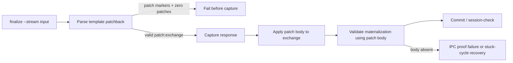
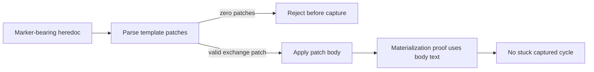
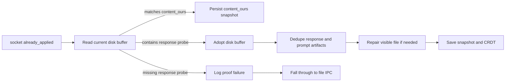

## Status

<!-- agent:status patch=replace -->

Live IntelliJ File Cache Conflict Cancel proof captured; JB Cancel residual review items completed.
<!-- /agent:status -->

## Exchange

<!-- agent:exchange patch=append -->
### Session Summary

*Compacted. Content archived to `/home/brian/work/btakita/agent-loop/.agent-doc/archives/483039e7a9b103bd5b68223dac05a4c449ac03899aba53d6022e82100578b5b0-20260527-233459.md`*

Compacted content:
- Archived 1 response topic(s): JB Run Agent Doc on tsift.md
- Prior summary/context: ### Session Summary *Compacted. Content archived to `/home/brian/work/btakita/agent-loop/.agent-doc/archives/483039e7...
### Re: do [#h9g0] — gpt-5

Implemented `#h9g0`.

The closeout proof now treats a template patch response as materialized by the body it applies, not by the wrapper comments. That means `stuck_captured_cycle` and IPC sidecar validation can recognize a response written through the boundary/template path even though committed `HEAD` contains only the visible exchange body.

The stream write path also now fails before response capture if patch markers are present but parse to zero patch blocks. Plain patch-free responses can still log the `0 template patches found` warning, but marker-bearing malformed input no longer gets captured and later reported as a stuck cycle.



Changed paths:
- `src/agent-doc/src/write.rs`
- `src/agent-doc/src/flow/closeout.rs`
- `src/agent-doc/specs/07-closeout-commands.md`

Verification:
- `cargo test stuck_captured_cycle_ignores_committed_template_patch_body_in_head`
- `cargo test materialization`
- `cargo test marker_bearing_zero_patch_parse_is_rejected_before_capture`
- `cargo test patch_wrapped_response_is_materialized_by_visible_patch_body`
- `cargo test malformed_patchback_is_rejected_instead_of_appended_as_unmatched`
- `cargo test stream_ipc_timeout_commit_removes_fallback_patch_file`
- `make check`
- `make install`
- GitHub Actions CI run `26545667145`: `make check` passed; `make tmux-ci` passed.

Commit/push:
- `btakita/agent-doc@0410445b30a58667837a3bcab7facb14ef67357a` pushed to `20260422/codex-agent-backend`.
- Root submodule pointer commit `cecf6e98d` is ready in `btakita/agent-loop`; this closeout will be pushed with the session-document commit.
### Re: do [#zeb5] — gpt-5

Closed `#zeb5` with the `#h9g0` implementation.

`#zeb5` was the narrower form of the same failure: `finalize --stream` could report `0 template patches found` and then let marker-bearing heredoc input enter response capture, producing a later stuck-cycle warning. The write path now rejects marker-bearing zero-patch parses before capture, while valid `<!-- patch:exchange -->` responses are validated by the materialized patch body instead of by wrapper comments.



No additional code changes were needed beyond `btakita/agent-doc@0410445b30a58667837a3bcab7facb14ef67357a`.

Verification already completed for that commit:
- `cargo test stuck_captured_cycle_ignores_committed_template_patch_body_in_head`
- `cargo test materialization`
- `cargo test marker_bearing_zero_patch_parse_is_rejected_before_capture`
- `cargo test patch_wrapped_response_is_materialized_by_visible_patch_body`
- `cargo test malformed_patchback_is_rejected_instead_of_appended_as_unmatched`
- `cargo test stream_ipc_timeout_commit_removes_fallback_patch_file`
- `make check`
- `make install`
- GitHub Actions CI run `26545667145`: `make check` passed; `make tmux-ci` passed.
### Re: do [#already-applied-divergence] — gpt-5

Implemented `#already-applied-divergence`.

The socket `already_applied` path no longer saves stale `content_ours` when the live editor buffer has already applied the response. It now verifies the current disk buffer contains the materialized response-body probe, adopts that disk buffer as the snapshot when proven, runs response-block and prompt-artifact dedupe first, and repairs the visible file to the same deduped content when needed. If the disk buffer does not contain the response probe, it refuses to save stale `content_ours` and falls through to file IPC with an explicit proof diagnostic.



Changed paths:
- `src/agent-doc/src/write.rs`
- `src/agent-doc/specs/07-closeout-commands.md`

Key coverage added/updated:
- `try_ipc_already_applied_socket_adopts_disk_when_response_is_present`
- `try_ipc_already_applied_socket_dedupes_duplicate_response_before_snapshot`
- `already_applied_socket_missing_disk_response_requests_file_fallback`

Verification:
- `cargo test already_applied_socket`
- `cargo test socket_ack_content_prompt_duplication_uses_content_ours_and_repairs_visible_buffer`
- `cargo test response_already_in_current`
- `cargo test ipc_snapshot_dedupes_extra_prompt_copy_against_before_content`
- `make check`
- `make tmux-ci`
- `make install` (`agent-doc 0.34.0` installed)
- GitHub Actions CI run `26546620702`: `make check` passed; `make tmux-ci` passed.

Commit/push:
- `btakita/agent-doc@2409025bdca63fc62a7ee3836f32e9898ee35a93` pushed to `20260422/codex-agent-backend`.
- Root submodule pointer commit `adbf1a3aa` is ready in `btakita/agent-loop`; this closeout will be pushed with the session-document commit.
<!-- agent:boundary:910cb145 -->
<!-- /agent:exchange -->
###
<!--
JB `Run Agent Doc` on tsift.md error:
```
Session is still running for tasks/software/tsift.md. Pane %21 is busy (agent-doc). Wait for the turn to finish, then retry Clear Session Context. Use Refresh and retry if the pane has returned to an idle prompt, or Interrupt and clear to discard the running turn. Latest pane output: 22.4K (11%) ctrl+p commands
```
---
The completed queue item was not removed from the queue. #mermaid
#spec-test-build-install-commit-push
---
equityfundingsource.md had the full-document IPC duplicate corruption. Then a new full-document IPC deletion under the prompt corruption happened. Both several times while editing the prompt.
#spec-test-build-install-commit-push
---
Please review the agent-doc, claude, codex logs. What are #next-steps to fix bugs?
---
When I ran the last turn, #spec-test-build-install-commit-push was removed by agent-doc.
---
As I was typing into the comment below `/agent:exchange`, the full-document IPC corruption happened, then the duplicate line happened, then the full-document IPC corruption happened again.

In addition to diagnosing and fixing the issue, please provide a mermaid showing how the issue occurred and where in the agent-doc lifecycle the full-document IPC corruption can occur. Can we mathematically eliminate all possibility of the full-document IPC corruption from occurring?

#spec-test-build-install-commit-push
-->

<!-- agent:queue -->
<!-- /agent:queue -->

## Backlog

<!-- agent:backlog -->
- [ ] [#next-steps-backlog-capture] Agent responses containing #next-steps recommendations do not auto-add items to backlog when prompt preset is present. Agent must manually call `--pending-add` but the planning output `pending_mutations: expect_add` is not enforced by session-check `pending_done_guard`.
<!-- /agent:backlog -->

## Review
 
<!-- agent:review -->
- [/] [#snrun] [recommended] Implement tasks/agent-doc/plan-run-agent-doc-snappy-auto-remediation.md: make JB Run Agent Doc distinguish rescued-stash accepted-only proof misses, active-turn busy collisions, and stale starting projections; add route/plugin regressions plus live replay evidence.
<!-- /agent:review -->

<!-- agent:icebox -->
<!-- /agent:icebox -->

## Completed / Reaped

<!-- agent:done archive=tasks/agent-doc-bugs2.done.md -->

<!-- completed work archived in tasks/agent-doc-bugs2.done.md -->
<!-- /agent:done -->
