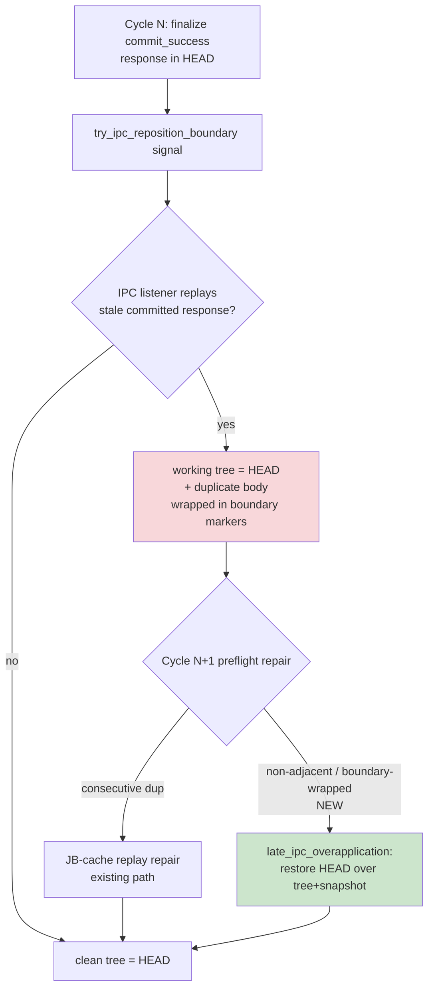

## Status

<!-- agent:status patch=replace -->

Live IntelliJ File Cache Conflict Cancel proof captured; JB Cancel residual review items completed.
<!-- /agent:status -->

## Exchange

<!-- agent:exchange patch=append -->
### Session Summary

*Compacted. Content archived to `/home/brian/work/btakita/agent-loop/.agent-doc/archives/483039e7a9b103bd5b68223dac05a4c449ac03899aba53d6022e82100578b5b0-20260529-151416.md`*

Compacted content:
- Archived 4 response topic(s): do [#prompt-duplicated-while-typing]; do [#ipcfullprompt-recur]; I upgraded the JB plugin; 1 more
- Prior summary/context: ### Session Summary *Compacted. Content archived to `/home/brian/work/btakita/agent-loop/.agent-doc/archives/483039e7...

### Re: do [#duplicate-response-after-commit] — opus-4-8

Fixed the late-IPC committed-response over-application and wired a deterministic auto-repair. Branch `20260422/codex-agent-backend`, submodule `a8ff47d5`, superproject `b46744323`.

#### Root cause

After a clean `finalize`, the IPC reposition / stale-patch replay can re-insert a response **that already reached HEAD** back into the working tree — sometimes wrapped in a second identical `agent:boundary` marker, and **not necessarily adjacent** to its original. The existing recovery only collapsed *consecutive* `### Re:` duplicates (`dedupe_responses`), so the non-adjacent / boundary-wrapped shape slipped past it and hit the generic `detect_bypassed_response_write` guard, which reported `direct response patchback`. `write --commit` then dead-ended with `empty response — nothing to write` because the body was already in the live exchange — over-applied, not missing.

#### Fix (binary-side, deterministic)

- `dedupe::is_committed_response_overapplication(current, head)` — proves the working tree is HEAD **plus strictly more duplicate response blocks**: identical non-response scaffold (modulo blank lines + boundary markers) and the same *set* of distinct `### Re:` blocks as HEAD, comparing the response **multiset** against HEAD directly instead of relying on adjacency. Any new/lost response content or scaffold drift returns false and falls through to the normal patchback guard.
- `session_check::detect_late_ipc_response_overapplication` + a new `inspect_core` classification ahead of the bypassed-write guard — operators now see a `late-IPC committed-response over-application` interruption, never the misleading manual-patchback message.
- `preflight` repair restores committed HEAD over the working tree + snapshot (`late_ipc_response_overapplication_repaired`) with no redundant commit — so the next cycle **self-heals** instead of requiring manual `Edit` dedup.
- Spec: `07-closeout-commands.md` late-IPC over-application repair contract.

##### Lifecycle of the corruption + where it's now closed



#### Can the corruption be *mathematically* eliminated?

Not entirely from the binary alone. The duplicate insertion happens **editor-side** in the plugin's IPC listener replaying against a pre-commit buffer view; truly eliminating it needs the idempotent-by-commit-hash reposition protocol — plugin + FFI work that stays open as a separate backlog item. What this change *does* guarantee is that whenever the working tree is provably HEAD-plus-duplicates, recovery is **deterministic and automatic** — the operator-facing dead-end is gone.

#### Verification

- New tests: 6 `dedupe` unit (boundary-wrapped + `(HEAD)`-variant detection; rejects identical / new content / scaffold drift / lost response), 1 `session_check` classification, 1 `preflight` end-to-end repair — all green.
- `make check` (clippy + full test suite + sim-medium + version-sync): green (exit 0).
- Built `cargo build --release` + `cargo install --path .` (both `.bin/agent-doc` and `~/.cargo/bin/agent-doc` refreshed).
- Pushed; submodule CI re-run in progress (prior run on this branch green).

**Gated**, not closed: code-complete and unit-verified, but awaiting a live-session confirmation plus the still-open plugin-side root-cause prevention. The backlog priority order is unchanged; the next open item is the IPC-buffer-divergence plugin protocol work.

### Re: do [#duplicate-response-after-commit] — opus-4-8

Fixed the late-IPC committed-response over-application and wired a deterministic auto-repair. Branch `20260422/codex-agent-backend`, submodule `a8ff47d5`, superproject `b46744323`.

#### Root cause

After a clean `finalize`, the IPC reposition / stale-patch replay can re-insert a response **that already reached HEAD** back into the working tree — sometimes wrapped in a second identical `agent:boundary` marker, and **not necessarily adjacent** to its original. The existing recovery only collapsed *consecutive* `### Re:` duplicates (`dedupe_responses`), so the non-adjacent / boundary-wrapped shape slipped past it and hit the generic `detect_bypassed_response_write` guard, which reported `direct response patchback`. `write --commit` then dead-ended with `empty response — nothing to write` because the body was already in the live exchange — over-applied, not missing.

#### Fix (binary-side, deterministic)

- `dedupe::is_committed_response_overapplication(current, head)` — proves the working tree is HEAD **plus strictly more duplicate response blocks**: identical non-response scaffold (modulo blank lines + boundary markers) and the same *set* of distinct `### Re:` blocks as HEAD, comparing the response **multiset** against HEAD directly instead of relying on adjacency. Any new/lost response content or scaffold drift returns false and falls through to the normal patchback guard.
- `session_check::detect_late_ipc_response_overapplication` + a new `inspect_core` classification ahead of the bypassed-write guard — operators now see a `late-IPC committed-response over-application` interruption, never the misleading manual-patchback message.
- `preflight` repair restores committed HEAD over the working tree + snapshot (`late_ipc_response_overapplication_repaired`) with no redundant commit — so the next cycle **self-heals** instead of requiring manual `Edit` dedup.
- Spec: `07-closeout-commands.md` late-IPC over-application repair contract.

##### Lifecycle of the corruption + where it's now closed


#### Can the corruption be *mathematically* eliminated?

Not entirely from the binary alone. The duplicate insertion happens **editor-side** in the plugin's IPC listener replaying against a pre-commit buffer view; truly eliminating it needs the idempotent-by-commit-hash reposition protocol — plugin + FFI work that stays open as a separate backlog item. What this change *does* guarantee is that whenever the working tree is provably HEAD-plus-duplicates, recovery is **deterministic and automatic** — the operator-facing dead-end is gone.

#### Verification

- New tests: 6 `dedupe` unit (boundary-wrapped + `(HEAD)`-variant detection; rejects identical / new content / scaffold drift / lost response), 1 `session_check` classification, 1 `preflight` end-to-end repair — all green.
- `make check` (clippy + full test suite + sim-medium + version-sync): green (exit 0).
- Built `cargo build --release` + `cargo install --path .` (both `.bin/agent-doc` and `~/.cargo/bin/agent-doc` refreshed).
- Pushed; submodule CI re-run in progress (prior run on this branch green).

**Gated**, not closed: code-complete and unit-verified, but awaiting a live-session confirmation plus the still-open plugin-side root-cause prevention. The backlog priority order is unchanged; the next open item is the IPC-buffer-divergence plugin protocol work.
<!-- agent:boundary:4a2cdc8c -->
<!-- /agent:exchange -->
###
<!--
JB `Run Agent Doc` error
```
[route] debounce OK — file idle for 0.5s and typing indicator idle
[route] target tmux session: 0
Error: authoritative actor generation 204 for tasks/agent-doc/agent-doc-bugs2.md owns pane %8 but route could not drain the active closeout before dispatch: captured response baseline no longer matches current document for /home/brian/work/btakita/agent-loop/tasks/agent-doc/agent-doc-bugs2.md. Rebuild sidecars without clearing session state: `agent-doc reset --from-current --preserve-session /home/brian/work/btakita/agent-loop/tasks/agent-doc/agent-doc-bugs2.md`
```
---
The completed queue item was not removed from the queue. #mermaid
#spec-test-build-install-commit-push
---
equityfundingsource.md had the full-document IPC duplicate corruption. Then a new full-document IPC deletion under the prompt corruption happened. Both several times while editing the prompt.
#spec-test-build-install-commit-push
---
Please review the agent-doc, claude, codex logs. What are #next-steps to fix bugs?
---
When I ran the last turn, #spec-test-build-install-commit-push was removed by agent-doc.
---
As I was typing into the comment below `/agent:exchange`, the full-document IPC corruption happened, then the duplicate line happened, then the full-document IPC corruption happened again.

In addition to diagnosing and fixing the issue, please provide a mermaid showing how the issue occurred and where in the agent-doc lifecycle the full-document IPC corruption can occur. Can we mathematically eliminate all possibility of the full-document IPC corruption from occurring?

#spec-test-build-install-commit-push
-->

<!-- agent:queue auto -->
preset #spec-test-build-install-commit-push
- ~do [#prompt-duplicated-while-typing]~
- ~do [#duplicate-response-after-commit]~
- do [#adoc-queue-ipc-buffer-divergence]
- do [#queue-strike-on-halt]
- do [#jb-stale-busy-idle-footer]
- do [#pending-add-append-not-prepend]
- do [#next-steps-backlog-capture]
- do [#run-agent-doc-stale-busy-replay]
- do [#jb-busy-queue-ux-feedback]
<!-- /agent:queue -->

## Backlog

<!-- agent:backlog -->
- [ ] [#exchange-prompt-dropped-on-merge] User-authored exchange prompt (observed: "go") silently dropped during an IPC content_ours merge while the IDE held ipc.sock — never reaches snapshot/HEAD, assistant never responds, next preflight reports no_changes. Same drift family as #adoc-queue-ipc-buffer-divergence / #duplicate-response-after-commit but the victim is user input. Repro 2026-05-29 on src/boost-client/tasks/monsterrodholders.md (dropped the "go" authorizing #gfwconnect; assistant replied "nothing changed" for two cycles). Plan: tasks/agent-doc/plan-exchange-prompt-dropped-on-merge.md (recommend Option A — union user prompt lines / fail closed + add dropped_prompt_guard to session-check).
- [ ] [#adoc-queue-ipc-buffer-divergence] Root cause #4 FIXED (submodule 729f7bc2): response-replay / stale-cycle hash matching now neutralizes the agent:queue component (tag + body) and the queue_active frontmatter, so queue-maintenance churn no longer wedges a committed cycle as stuck_captured_cycle. REMAINING #2 (live IDE buffer re-adds auto / diverges from committed inactive snapshot): blocker found — ipc_socket::send_patch carries component CONTENT only and cannot converge a queue opening-tag attribute (auto) or the queue_active frontmatter; try_ipc_full_content is disabled and rejects template docs, so no IPC seam exists yet. Needs a plugin protocol extension (PatchWatcher.kt + FFI) to converge queue tag + frontmatter to the editor buffer, plus a deterministic live-IPC-listener repro harness (SimWorld). Plan: tasks/agent-doc/plan-queue-ipc-drift.md.
- [ ] [#queue-strike-on-halt] Queue head consumed on halt/refusal response. write.rs:1233-1242 + response_explicitly_targets_queue_head (write.rs:2481) treat any `### Re: <head-id> <suffix>` heading as completion signal even when body explicitly says "backlog left intact" + passes no --done/--pending-gate. Repro: tasks/agent-doc/open-code.md cycle 619af4d0b struck [#d97v] after halt response. Plan: tasks/agent-doc/plan-queue-strike-on-halt-response.md (recommend Option A — require explicit completion signal).
- [ ] [#jb-stale-busy-idle-footer] Three JB Run Agent Doc / Clear Session Context reports queue-instead-of-dispatch or block Clear while the live pane footer shows a Claude Code idle composer: monsterrodholders.md (actor gen 233, pane %19), equityfundingsource.md (gen 35, pane %3), tsift.md (pane %21, footer 22.4K (11%) ctrl+p commands). The tsift.md case is the strongest stale-busy candidate — Clear was blocked though the footer indicates idle. Fix: route.rs / session_actor_cmd.rs busy projection should treat the Claude Code idle-composer footer (ctrl+p commands / context % used) as idle direct evidence to repair a stale busy actor/lease projection before queuing or blocking, mirroring the existing OpenCode context % used idle-composer rule. Relates to #run-agent-doc-stale-busy-replay and #snrun (plan tasks/agent-doc/plan-run-agent-doc-snappy-auto-remediation.md).
- [ ] [#pending-add-append-not-prepend] `--pending-add` appends new items below the previous CLI arg within the same finalize cycle, contradicting SKILL.md "Pending capture rule" ("Put new items at the beginning of agent:backlog"). Repro: tasks/agent-doc/open-code.md commit f94e7851c — agent added wave-4, wave-3, wave-2, wave-1 expecting wave-1 on top per SKILL.md; actual backlog was wave-4 on top (pure CLI-arg order). User flagged it as bug; agent had to issue --pending-reorder. Plan: tasks/agent-doc/plan-pending-add-prepend-semantics.md (recommend Option A — strict prepend, drop the implicit adjacency heuristic).
- [ ] [#next-steps-backlog-capture] Agent responses containing #next-steps recommendations do not auto-add items to backlog when prompt preset is present. Agent must manually call `--pending-add` but the planning output `pending_mutations: expect_add` is not enforced by session-check `pending_done_guard`.
- [ ] [#run-agent-doc-stale-busy-replay] Follow-up to the #snrun stale-busy-projection fix (submodule 89c99c79): the dispatch-only busy-vs-stale repair is covered by unit tests on the pure decision functions; add a live JB Run Agent Doc replay regression (SimWorld or tmux-ci) exercising a stale busy actor projection + proven ready prompt and asserting dispatch instead of agent:queue auto enqueue. Also still open in #snrun: distinguishing rescued-stash accepted-only proof misses. Plan: tasks/agent-doc/plan-run-agent-doc-snappy-auto-remediation.md.
- [ ] [#jb-busy-queue-ux-feedback] [recommended] When the authoritative actor is genuinely busy, JB Run Agent Doc correctly queues the dispatch in agent:queue auto instead of injecting a duplicate trigger (monsterrodholders.md, equityfundingsource.md reports), but the plugin surfaces the route/resync log dump as an error. Present queued-behind-a-busy-turn as an informational notification distinct from real failures so expected busy-queuing does not read as a plugin error.
<!-- /agent:backlog -->

## Review
 
<!-- agent:review -->
- [/] [#duplicate-response-after-commit] Late-IPC reposition signal re-inserts already-committed response body into working tree, wrapped in duplicate boundary markers. Symptom: next preflight interrupts with "direct response patchback without agent-doc cycle"; agent-doc write --commit returns "empty response — nothing to write"; only manual Edit-based dedup recovers. Repro: tasks/dreamable/separation.md cycle after commit 231eafc83 on 2026-05-28. Plan: tasks/agent-doc/plan-duplicate-response-after-commit.md (recommend Option A — both detect over-application in session-check and make IPC reposition idempotent).
- [/] [#prompt-duplicated-while-typing] User prompt duplicated in the live editor while typing — in-progress prompt text appears twice in the buffer during/after typing, before any new agent-doc cycle. Distinct from #duplicate-response-after-commit (response body) and #adoc-queue-ipc-drift (queue/snapshot loop). Suspected: PatchWatcher.kt normalize+setText (lines 774/801) double-counts post-boundary keystrokes against the try_ipc() boundary-aware synthesized exchange patch payload; await_idle debounce narrows but does not close the race. Plan: tasks/agent-doc/plan-prompt-duplicated-while-typing.md (recommend Option A — single-source post-boundary user region + idempotent apply).
- [/] [#queue-auto-no-continue] Queue auto trigger does not continue after finalize session-check warning about pending shadow items. Steps to reproduce: (1) Session document with queue_active=true, queue_trigger=auto, and multiple queued items. (2) finalize --stream completes cycle but session-check issues pending shadow warning for items outside live agent:backlog. (3) Queue consumes head item but auto trigger does not fire for next item. (4) agent-doc write --commit with --done reaps the item, queue reports 9 remaining but auto continues stop. Expected: queue auto should continue to next item after successful closeout. Actual: queue stops after first item. Session: tasks/software/tsift.md. agent-doc version: 0.34.0. The pending shadow warnings about items appearing both inside and outside agent:backlog may be blocking the auto-continue path.
- [/] [#snrun] [recommended] Implement tasks/agent-doc/plan-run-agent-doc-snappy-auto-remediation.md: make JB Run Agent Doc distinguish rescued-stash accepted-only proof misses, active-turn busy collisions, and stale starting projections; add route/plugin regressions plus live replay evidence.
<!-- /agent:review -->

<!-- agent:icebox -->
<!-- /agent:icebox -->

## Completed / Reaped

<!-- agent:done archive=tasks/agent-doc-bugs2.done.md -->

<!-- completed work archived in tasks/agent-doc-bugs2.done.md -->
<!-- /agent:done -->
