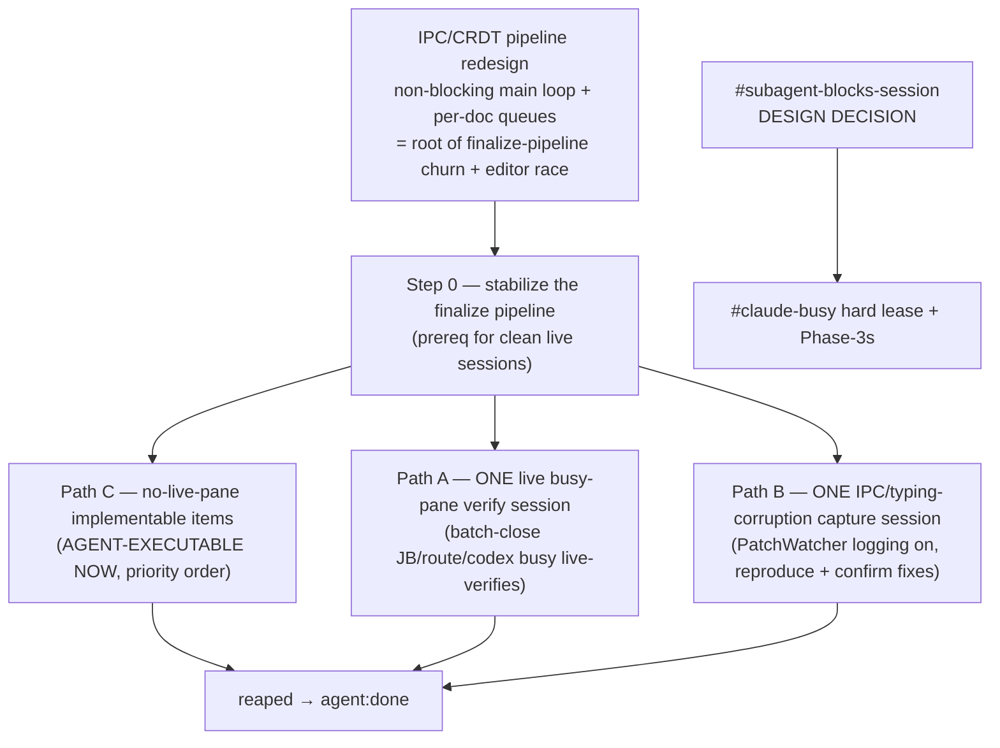

# Auto-DAG: completion plan for agent-doc-bugs2.md backlog + review items

**Goal (`/goal`-style):** complete all *presently actionable* review items in this
document. This file has **no dated gates** (unlike monsterrodholders.md) — only
**work gates**. The problem was ordering; this is the work graph.

**How to use this file:** run the agent through it top-to-bottom. Path C is
agent-executable now (no live pane). Path A/B need one operator live session each
to batch-close many items at once. **Any discovery or status change during the
work updates THIS file** (move items between paths, mark done, add edges).

**Future feature (the real ask):** make this a 1st-class `agent-doc` capability —
an `auto-dag` planner that emits this graph (mermaid + nested list) for any
session document, across Claude / Codex / OpenCode, emulating Claude Code `/goal`.
Tracked as `#auto-dag-first-class` (see end).

## Work graph (mermaid)

## Nested list (executable order)

### Step 0 — finalize-pipeline stabilization (prerequisite for clean live sessions)
The live editor-buffer race blocks finalize and corrupts live verification. Fix
the root before the live sessions so Path A/B don't fight the pipeline.
- `#queue-edit-lost-during-finalize-crdt` — IPC drift guard drops a concurrent queue add (plan: plan-queue-edit-lost-during-finalize-crdt.md)
- `#finalize-divergence-orphans-committed-head` — consume diverges, head left unstruck
- `#finalize-visible-buffer-ipc-timeout-race` (10) — IntelliJ-vs-agent visible-buffer race
- **ROOT:** IPC/CRDT pipeline redesign — non-blocking main loop + per-document queues (the user's architecture question). Collapses this whole step.

### Path C — agent-executable now (no live pane, priority order)
Pure code/test/doc items the agent can complete + reap without an operator session.
- `#writer-emits-deprecated-queue-active-false` (1) — commit-boundary queue_active→queue:start/stop normalization (plan-writer-emits-deprecated-queue-active.md)
- `#backlog-queue-sync-pending-add-amplification` — decouple capture from queue promotion
- `#free-text-head-answer-match-too-literal` — looser/positional queue-head match
- `#per-cycle-protocol-output-overhead` (5) — trim per-cycle binary output (Phase 1 done)
- `#pending-bare-hash-id` (14) — accept leading bare `#<id>` in `--pending-add`
- `#backlog-priority-attribute` (60) — priority attr ordering for backlog/queue
- `#lr-actor-10-wire-callers` (37), `#lr-queue-patchback-miss` (38) — lazily-rs caller wiring
- `#cancel-orphans-preflight-cycle` (72) — cancel must abandon orphaned preflight cycle
- `#dedup-prompt-normalize` (18), `#queue-head-provenance` (15), `#route-busy-diagnostic-name-owner` (16), `#clear-busy-pane-guard` (17) — diagnostics/dedup
- `#recover-ownership-command` (28) — `agent-doc recover` command

### Path A — one live busy-pane verification session (operator-gated, batch)
Run once with a live busy pane; batch-close the live-verifies. (#jkvs is the batch anchor, "after Step 0".)
- `#jb-busy-reopen-auto-drain-when-idle` (6), `#jb-fix-document-finish-turn-live-verify` (12), `#jb-monsterrod-route-ready-wait-stall` (13), `#jbrunstallreg` (33), `#jb-busy-queue-deadlock-live-verify` (54), `#jb-run-agent-doc-busy-feedback-live-verify` (57), `#jb-load-tmux-window-verify` (70)
- `#route-reaps-idle-fresh-start` (34), `#route-busy-wrong-owner-diagnostic` (35), `#route-starting-timeout-poll-recovery` (40), `#route-drain-all-surface-live-verify` (61), `#stash-pane-promote-on-focus` (64)
- `#codex-owned-pane-stop-hook-live-verify` (52), `#codex-owned-pane-prompt-miss(-followups)` (58/63), `#codex-owned-pane-auto-queue-stuck` (59), `#codex-final-response-(repeat/live-verify)` (31/62)
- `#opencode-jb-stall` (30), `#opencode-preset-not-dispatched` (32), `#opencode-active-turn-reopen-auto-retry-on-idle` (56)
- `#clear-stops-running-process` (65), `#queue-consume-ipc-timeout-live-verify` (7), `#recovery-drift-apply-live-verify` (55), `#jb-tsift-pane-sync` (36)

### Path B — one IPC/typing-corruption capture session (operator-gated, batch)
Enable PatchWatcher logging, reproduce the typing/IPC corruption, confirm fixes. (#6cmx anchor, "after Step 0".)
- `#jb-cache-cancel-response-outside-exchange` (9), `#ipcfullprompt-recur2` (67), `#finalize-retry-ipc-response-duplication` (68), `#ipc-dup-tracking-double-merge` (69), `#adoc-queue-ipc-buffer-divergence` (71), `#prompt-duplicated-while-typing` (73/25), `#jb-compact-malformed-response-commit` (66), `#opencode-stdout-bleed-tui` (22)

### Blocked on a design decision
- `#subagent-blocks-session` (39) — decide first; unblocks `#claude-busy-status-during-active-turn` hard lease + `#autoloop-command-preemption` Phase 3.

### Likely already done — verify + reap (quick wins to cut the count)
Marked IMPLEMENTED/shipped in their text; confirm and reap.
- `#autoloop-command-preemption` (3, Ph1/2a/2b done — only Ph3 gated), `#jb-fix-document-finish-turn` (12, "ALREADY IMPLEMENTED"), `#codex-upgrade-restart-cross-doc-focus` (41, shipped), `#jb-settext-payload-log` (42, implemented), `#ipc-dup-tracking-double-merge` (69, plugin 0.2.138 shipped), item 8 (two bugs fixed+shipped)

### Misc / read-on-first-touch (short-hash, unclassified)
`#xgme`(8) `#appe`(15) `#kz2g`(16) `#engt`(17) `#54pz`(18) `#kdey`(19) `#ka9v`(20) `#xwad`(21) `#424b`(22) `#sxjj`(23) `#5qhn`(24) `#gyma`(25) `#ec9k`(28) `#img-review`(29) `#weqq`(42) `#6qfn`(43) `#v819`(44) `#wy0y`(45) `#qasm`(46) `#submodule-response-commit-proof`(47) `#6cmx`(48) `#jkvs`(49) `#j0k8`(50) `#free-text-queue-skip-diagnostic`(51) `#t41j`(53) `#snrun`(75) `#queue-auto-no-continue`(74) — classify into A/B/C on first touch and move them here-above.

## Completed this session (already reaped)
`#backlog-id-user-rename-revert` ✓ · `#autoloop-command-preemption` Ph1/2a/2b ✓ · queue-aware compaction (`#no-compact-prompt-during-queue-drain`) ✓ · `#claude-busy` turn-active marker ✓

## `#auto-dag-first-class` (the feature behind this file)
Promote this hand-built graph to an `agent-doc auto-dag <FILE>` command that:
parses backlog/review items, infers edges from `Related/overlaps/gated-on/Path`
markers + plan-file links + live-verify vs implementable classification, and
emits both this mermaid and nested list. Harness-agnostic (Claude/Codex/OpenCode),
the agent-doc analogue of Claude Code `/goal`. Re-runnable so the graph stays live
as items close.
