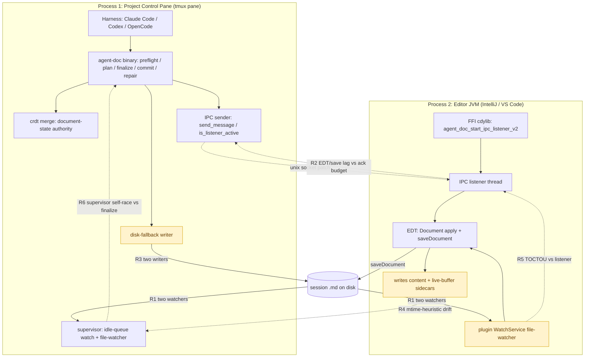

# agent-doc Process & Race-Condition Map

Reference extracted from the `agent-doc-bugs2` session (2026-06-08). Describes the
two-process model, the remaining concurrency races, and the consolidation plan
(`#pcp-consolidate`). Verified against `agent-doc-orchestration/src/ipc_socket.rs`,
`src/ffi.rs`, and `editors/jetbrains/.../PatchWatcher.kt`.

## Two OS processes

**Process 1 — Project Control Pane (the tmux pane, e.g. `%30`).** Runs the harness
(Claude Code / Codex / OpenCode) *and* the `agent-doc` binary + its supervisor.
Everything that decides document state lives here: `preflight` / `plan` / `write` /
`finalize` / `commit` / `repair`, the **CRDT merge** (`crdt.rs`), snapshot / capture /
baseline sidecars, the **idle-queue watch + supervisor file-watcher**, the IPC
**sender** (`send_message`, `is_listener_active`, `try_connect` in `ipc_socket.rs`),
and the **disk-fallback writer**.

**Process 2 — Editor (IntelliJ / VS Code).** Runs the plugin. It loads the agent-doc
**cdylib via FFI** (`NativeLib.kt` → `ffi.rs`), and that FFI code starts the IPC
**listener** thread *inside the editor JVM* (`agent_doc_start_ipc_listener_v2`). The
plugin also runs *its own* WatchService file-watcher, an applied-patch dedup ledger,
and dispatches the actual Document-API mutation + `saveDocument` onto the **EDT**
(`invokeAndWait` / `invokeLater`). It writes the content + live-buffer sidecars.

agent-doc core code *already* runs in both processes (the listener is FFI-hosted in
the editor). The socket is the only cross-process channel: sender in Process 1,
listener in Process 2.

## Can the Plugin IPC move into the control pane?

The listener **cannot fully move** — its entire job is to mutate the editor's
*in-memory* Document on the EDT, which is only reachable from inside the editor JVM.
What *can* move (and mostly already has) is all the **policy / decision** logic:
degrade state machine, ack-timeout policy, drift classification, CRDT merge. The
terminal `Document.apply + saveDocument` is the only thing that is intrinsically
editor-side. Everything else belongs in the control pane.

## Process & race-condition map

## Where races still occur

- **R1 — two file-watchers / two writers.** The plugin's WatchService *and* the
  supervisor's file-watcher both observe the doc; the plugin's `saveDocument` *and*
  the binary's disk fallback both write it → "File Cache Conflict" + drift.
- **R2 — EDT/save lag vs ack budget.** The listener dispatches to the EDT, then
  `saveDocument` + the content sidecar land *after* the EDT runs — lagging the
  sender's poll budget → false ack-timeout / false degrade vote (partially fixed by
  `#ipc-ack-timeout-align` + `#ipc-degrade-false-vote`).
- **R3 — disk fallback** manufactures the foreign-write that IntelliJ flags as a
  cache conflict whenever the session is latched degraded.
- **R4 — mtime-heuristic drift.** `live_buffer_diverges_from_content` infers "foreign
  disk write vs genuine unsaved edit" from `LIVE_BUFFER_STALE_SKEW_MS` mtime only — no
  buffer content — so a real concurrent edit fails closed
  (`live_prompt_drift_after_preflight`).
- **R5 — TOCTOU** between the FFI socket handler and the WatchService for the same
  patch; today guarded best-effort by EDT re-checks (dedup + generation fence), but a
  window remains.
- **R6 — supervisor self-race.** A route-owned supervisor in Process 1 races the
  agent's own finalize writes on the same pane → "could not drain the active
  closeout" / exit 75.

## Recommendation — consolidate authority into Process 1 (`#pcp-consolidate`)

1. **Single writer.** The supervisor is the only thing that touches disk; the plugin
   never writes directly — degraded writes route through the file-IPC patch queue so
   the plugin still applies via the Document API (`#ipc-degraded-prefers-file-ipc`).
   Kills R3.
2. **Single file-watcher.** Demote the plugin WatchService to read-only buffer-state
   *reporting*; the supervisor's watcher is the sole disk-change reactor. Kills R1,
   shrinks R5.
3. **Positive provenance instead of heuristic.** The plugin pushes authoritative
   buffer **content + a write-provenance/generation id** to the control pane
   (`#ipc-drift-writeprovenance` + `#nm1x-livebuf-content`); the control pane then
   *classifies* "editor ahead of disk (real edit)" vs "lagging agent-doc write"
   instead of guessing from mtime. Fixes R4.
4. **Serialize the control-pane writers.** Route supervisor idle-queue/file-watch
   writes and agent finalize writes through one in-process write queue (one writer).
   Fixes R6.
5. **Thin the FFI listener** to a pure EDT apply+ack shim — no policy in the editor.

Net: the editor process keeps only the irreducible EDT `apply + saveDocument`; the
control pane owns state, merge, arbitration, and provenance.
