# Session: Build Party

## User

<!-- agent:exchange -->
*Transfer from tasks/recruit/robert-ross.md*

## Build Party — LiveKit Repo Evaluation (5 repos)

| Repo | Stars | Category | Build Party Relevance |
|------|-------|----------|----------------------|
| [livekit-examples/livestream](https://github.com/livekit-examples/livestream) | 246 | Streaming starter | **High** — Watch Party shell, stage-summon, OBS ingress |
| [livekit/agents](https://github.com/livekit/agents) | 9,935 | Agent framework | **Very High** — Nova/Echo/Flare personas |
| [python-agents-examples](https://github.com/livekit-examples/python-agents-examples) | 262 | Agent examples | **High** — 70+ examples: content filter, RAG, multi-agent |
| [dev-day-demos](https://github.com/livekit-examples/dev-day-demos) | 9 | Multi-agent demos | **High** — Silent moderation agent = Echo blueprint |
| [AOSSIE-Org/Resonate](https://github.com/AOSSIE-Org/Resonate) | 337 | Discord alternative | **Medium** — Room browsing, scheduling, role-based mod |

### Strategic synthesis

1. **Start with `livestream`** — Watch Party shell with stage-summon UX, OBS ingress, sub-100ms WebRTC
2. **Wire `agents` on top** — three agents in one room:
   - **Nova** = RAG voice agent + LLM content filter + Q&A queue
   - **Echo** = silent observer emitting `highlight.detected` RPCs
   - **Flare** = Echo event consumer + LiveKit Egress API clip trigger
3. **Community layer** from Resonate — room browsing, scheduling, role-based permissions

**Greenfield gap:** Co-build rooms (shared code editor + LiveKit room) are genuinely new.

### Mermaid diagram — Miguel's LiveKit agent course

```mermaid
graph TD
    PRE["Prerequisites"]
    subgraph PRE_ITEMS["Setup"]
        P1["Python 3.12+, uv, livekit-agents 1.4+"]
        P2["Accounts: LiveKit Cloud, Deepgram"]
        P3["Env: LIVEKIT_URL, API keys, DEEPGRAM_API_KEY"]
    end
    subgraph MOD1["Module 1: LiveKit Fundamentals"]
        M1A["Rooms, Participants, Tracks"]
        M1B["Events: track_subscribed, track_muted"]
        M1C["Lab: Connect to room, log track events"]
    end
    subgraph MOD2["Module 2: Agent Framework"]
        M2A["Worker/Job model, JobContext"]
        M2B["Agent class, AgentSession, VAD"]
        M2C["Lab: Echo agent via TTS"]
    end
    subgraph MOD3["Module 3: STT with Deepgram"]
        M3A["deepgram.STT model nova-3"]
        M3B["VAD + turn detection pipeline"]
        M3C["Lab: Full voice loop"]
    end
    subgraph MOD4["Module 4: Multi-User Transcription"]
        M4A["Per-participant AudioStream + STT"]
        M4B["Transcripts keyed by identity"]
        M4C["Lab: 2-person room labeled transcripts"]
    end
    subgraph MOD5["Module 5: Build Party Agent Nova"]
        M5A["Shared ChatContext from all speakers"]
        M5B["Q&A moderator + data channel"]
        M5C["Lab: Agent answers any participant"]
    end
    subgraph CAP["Capstone: Deploy + Test"]
        C1["Run worker against LiveKit Cloud"]
        C2["Join as 2+ participants"]
        C3["Verify labeled transcripts + responses"]
    end
    PRE --> PRE_ITEMS --> MOD1 --> MOD2 --> MOD3 --> MOD4 --> MOD5 --> CAP
```

transfer mermaid diagram into build-party-course-diagram.md
### Re: transfer mermaid diagram (HEAD)

Done. Created `tasks/dreamable/build-party-course-diagram.md` with the full mermaid diagram for Miguel's LiveKit agent course.
<!-- agent:boundary:6cff56c5 -->
<!-- /agent:exchange -->
