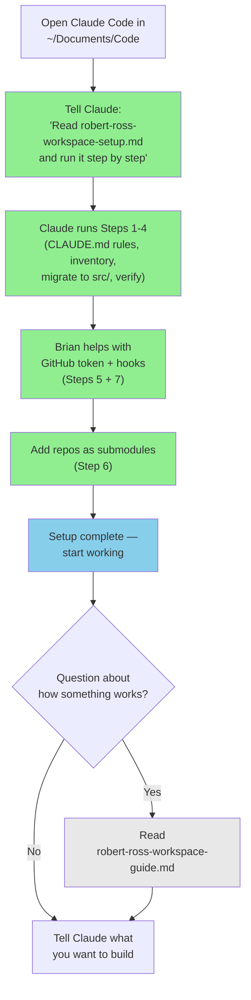

# Claude Code Kit for Robert Ross

| Field | Value |
|---|---|
| **Name** | Claude Code Kit |
| **Source** | README.md |
| **Version** | 1.0.0 |
| **Last Updated** | 2026-04-26 |
| **Purpose** | Entry point and table of contents for Rob's Claude Code onboarding kit |
| **Audience** | Robert Ross |

This kit gets you from zero to productive with Claude Code in `~/Documents/Code`.

## What's inside

| File | What it is | When to use |
|------|-----------|-------------|
| [Workspace Setup Plan](robert-ross-workspace-setup.md) | One-shot runnable plan | **Start here.** Tell Claude Code to read and run this file. |
| [Workspace Guide](robert-ross-workspace-guide.md) | Reference + quick reference | Concepts, diagrams, day-to-day prompts. Come back when you have questions. |
| [SPEC.md](SPEC.md) | Environment spec | Declarative description of what your setup should look like. For health checks. |
| [Tasks README](example-tasks-readme.md) | tasks/ folder guide | Explains what goes in tasks/, with examples and cleanup prompts. |
| [Example Session](example-session.md) | Annotated transcript | Shows what a real Claude Code interaction looks like. |

## How the two files work together

**Legend:** green = run in Claude Code, blue = done, gray = reference

## Getting started

1. Open Claude Code in `~/Documents/Code`
2. Tell Claude: **"Read robert-ross-workspace-setup.md and run it step by step."**
3. Claude executes each step, pausing for your confirmation
4. Ask Brian if you have questions at any step

## After setup

Use the **Quick Reference** table in Section 11 of the guide for day-to-day prompts. To check that your environment is set up correctly, tell Claude: "Read SPEC.md and verify my environment matches."

## Questions?

Ask Brian — he's available on the call or via Slack.
