# Claude Code Workflow — Robert Ross

| Field | Value |
|---|---|
| **Name** | Claude Code Workflow Guide |
| **Source** | robert-ross-workspace-guide.md |
| **Version** | 1.0.0 |
| **Last Updated** | 2026-04-26 |
| **Purpose** | Complete reference for Rob's Claude Code workflow — concepts, prompts, and troubleshooting |
| **Audience** | Robert Ross |

> **Start here:** This guide is long. Read these sections first, then use the rest as reference:
> 1. **Section 1** — How It Works (the mental model)
> 2. **Section 4** — Things to Watch For (permission prompts, gotchas)
> 3. **Section 11** — Quick Reference (day-to-day prompts table)
> 4. **Section 12** — Troubleshooting (when something goes wrong)
>
> Everything else is here when you need it — don't read cover to cover.

Everything is driven from Claude Code. You type what you want in plain English; Claude handles git, directories, and files.

Your workspace: `~/Documents/Code` (already set up with a `CLAUDE.md`).

### Workspace layout

```
~/Documents/Code/
├── CLAUDE.md              ← workspace-level preferences
├── src/                   ← all projects live here (submodules + local)
│   ├── SessionShare/      ← submodule: ClaudeScore/SessionShare
│   ├── scoring-api/       ← submodule: ClaudeScore/scoring-api
│   └── landing-page/      ← local experiment
└── tasks/                 ← planning docs, session files, notes
    ├── claudescore/       ← planning docs for CloudScore work
    └── build-party/       ← planning docs for Build Party
```

- **`src/`** — code projects. Both submodules (linked to GitHub) and local experiments.
- **`tasks/`** — planning, notes, and session documents. Not code.

---

## 1. How It Works

You open Claude Code and talk to it. Claude does the rest.

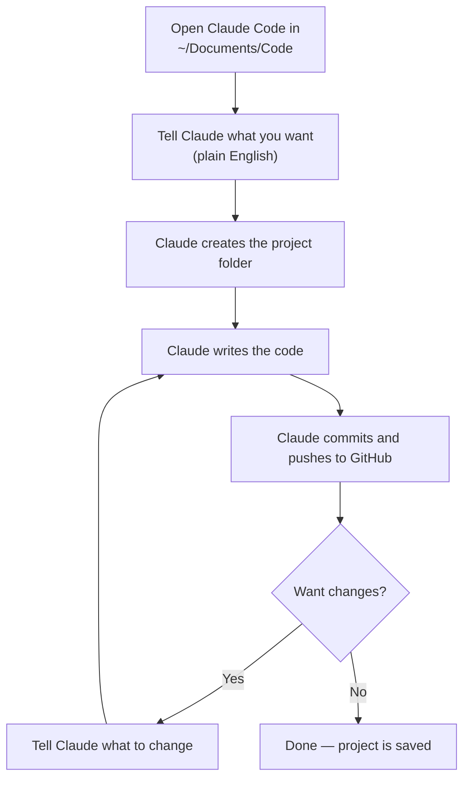

**You never need to type terminal commands.** Claude handles:
- Creating directories
- Initializing git repos
- Writing and editing code
- Committing changes
- Pushing to GitHub

**Important: each session starts fresh.** Claude doesn't automatically remember previous conversations. Your files, plans, and CLAUDE.md persist (they're saved to disk), but the conversation itself resets. To pick up where you left off, point Claude at your plan or ask it to check recent changes:

> "Read my scoring dashboard plan — where did we leave off?"
>
> "What did I work on last? Check recent git commits."

---

## Migrating from a flat layout

If your workspace currently has projects directly in `~/Documents/Code/` (no `src/` or `tasks/` folders), migrate everything in one shot. Open Claude Code and say:

> "Organize my workspace. Move all project folders into src/ and create a tasks/ folder."

Claude will:
1. Create `~/Documents/Code/src/` and `~/Documents/Code/tasks/`
2. Move each project folder into `src/` (using `git mv` for submodules, plain `mv` for local folders)
3. Update any submodule paths in `.gitmodules`
4. Commit the reorganization
5. Push

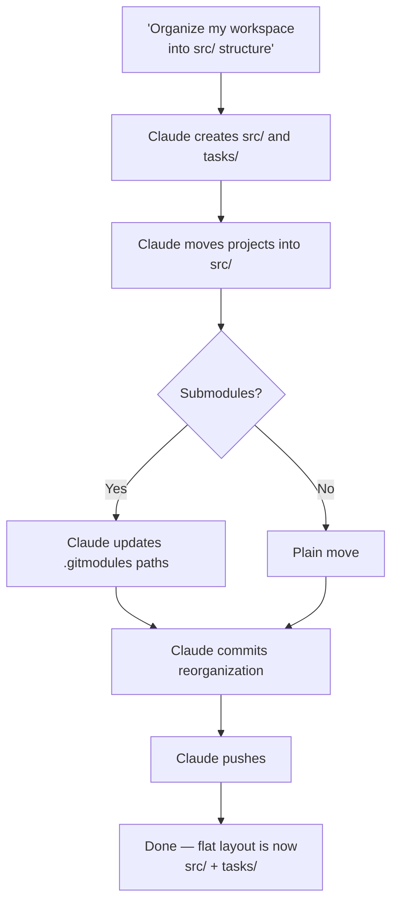

**What if something breaks?** Tell Claude:

> "Something doesn't look right after the move — fix it."

Claude will check submodule links, fix any broken paths, and re-commit.

**Do this before adding new projects** so you don't end up with a mixed layout (some in root, some in `src/`).

---

## 2. Starting a New Project

Open Claude Code in `~/Documents/Code` and say something like:

> "Create a new project called 'landing-page' — it's a simple website with a contact form."

Claude will:
1. Create `~/Documents/Code/src/landing-page/`
2. Set up the project structure
3. Write the code
4. Commit everything to git

### For bigger projects (submodule)

> "Create a new project called 'scoring-api' as its own GitHub repo."

Claude will:
1. Create a private GitHub repo (using your personal access token)
2. Add it as a git submodule under `~/Documents/Code/src/scoring-api/`
3. Set up the project
4. Commit and push

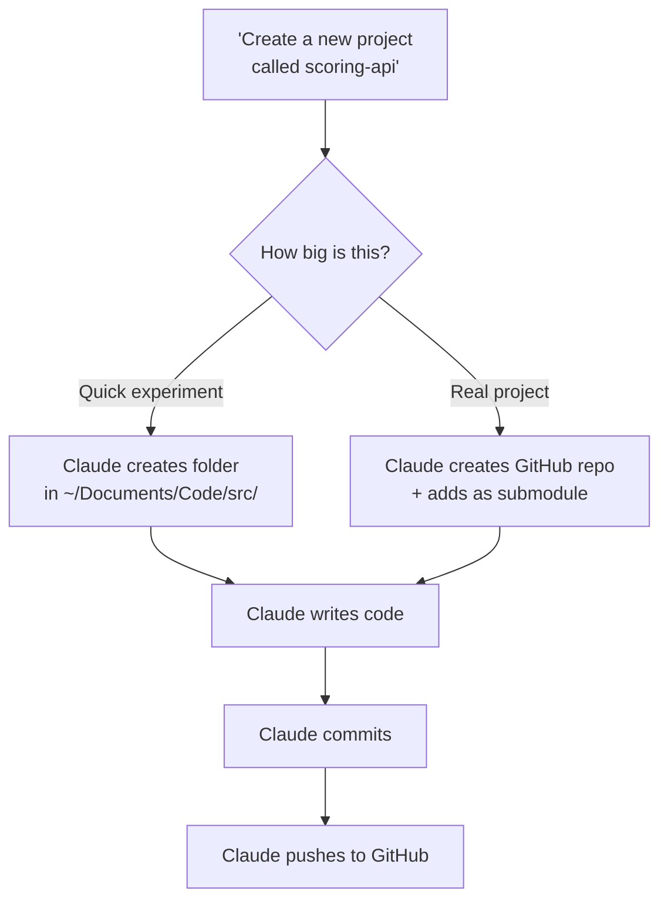

### Adding an existing GitHub repo

For repos that already exist on GitHub (like `ClaudeScore/SessionShare`):

> "Add the ClaudeScore/SessionShare repo as a submodule in my workspace."

Claude will:
1. Clone the repo as a submodule under `~/Documents/Code/src/SessionShare/`
2. Create a project-level `CLAUDE.md` if one doesn't exist
3. Commit the submodule link in the parent repo
4. Push

You can also bring in multiple repos at once:

> "Add these GitHub repos as submodules: ClaudeScore/SessionShare, ClaudeScore/scoring-api, ClaudeScore/rubrics."

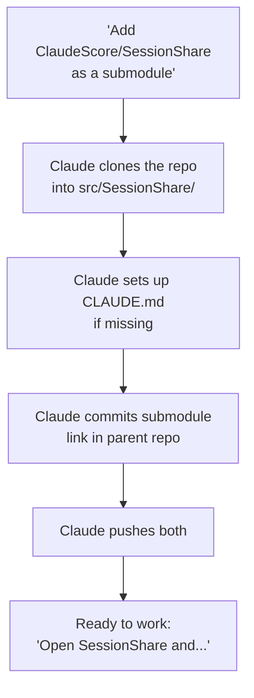

### Decision: local folder vs. submodule

You don't need to decide upfront. Start local. If it grows, tell Claude:

> "This project is getting serious — move it to its own GitHub repo."

Claude will create the repo and convert it to a submodule.

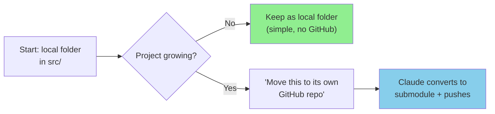

---

## 3. Day-to-Day Workflow

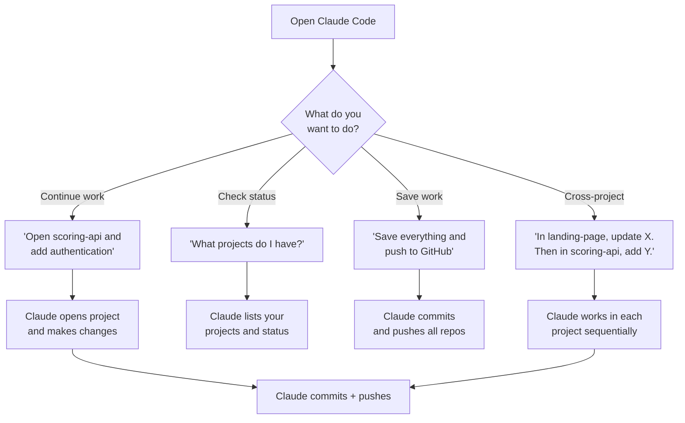

### Continuing work on an existing project

> "Open the scoring-api project and add user authentication."

Claude navigates to the right directory and picks up where you left off.

### Checking what you have

> "What projects do I have? Show me what's in my Code directory."

### Saving your work

Claude commits automatically when it finishes a task. But you can also say:

> "Save everything and push to GitHub."

### Working across projects

> "In the landing-page project, update the contact form email. Then in scoring-api, add a health check endpoint."

---

## 4. Things to Watch For

### Permission prompts — "Allow Claude to..."

Claude Code asks permission before running commands or editing files. You'll see prompts like:

```
Allow Claude to run: git push origin main? (y/n)
Allow Claude to edit: src/scoring-api/server.js? (y/n)
```

**What's safe to always allow:**
- Reading files (`cat`, `ls`, `git log`, `git status`)
- Running tests or build commands
- Editing files in your `src/` projects
- Git commits

**Read carefully before allowing:**
- Anything with `rm`, `delete`, or `force` in it
- Commands that push to remote (`git push`)
- Installing packages (`npm install`, `pip install`)
- Anything touching files outside `~/Documents/Code`

**Pre-approving commands you always allow:** If you get tired of saying yes to the same safe command:

> "Always allow read commands without asking"
>
> "Pre-approve git commits"

Claude will update your permissions so those prompts stop appearing.

**If you're unsure:** Just say no. Claude will explain what it was trying to do and suggest an alternative. You can always change your mind.

### Claude might ask you to confirm destructive actions

If Claude needs to delete files, force-push, or make breaking changes, it will ask first. Say yes or no.

### Submodule commits need two saves

When you work in a submodule project, Claude needs to save twice — once inside the project, once in the parent `~/Documents/Code` repo. Claude handles this automatically, but if something looks out of sync, say:

> "Commit everything — both the project and the parent repo."

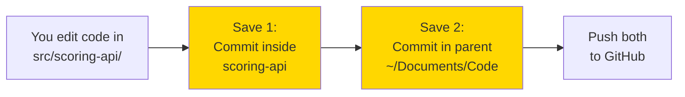

### Uncommitted changes from a previous session

If you stopped mid-task last time, Claude might see leftover changes. It will tell you. You can say:

> "Commit what's there and start fresh."

or

> "Throw away those changes and start over."

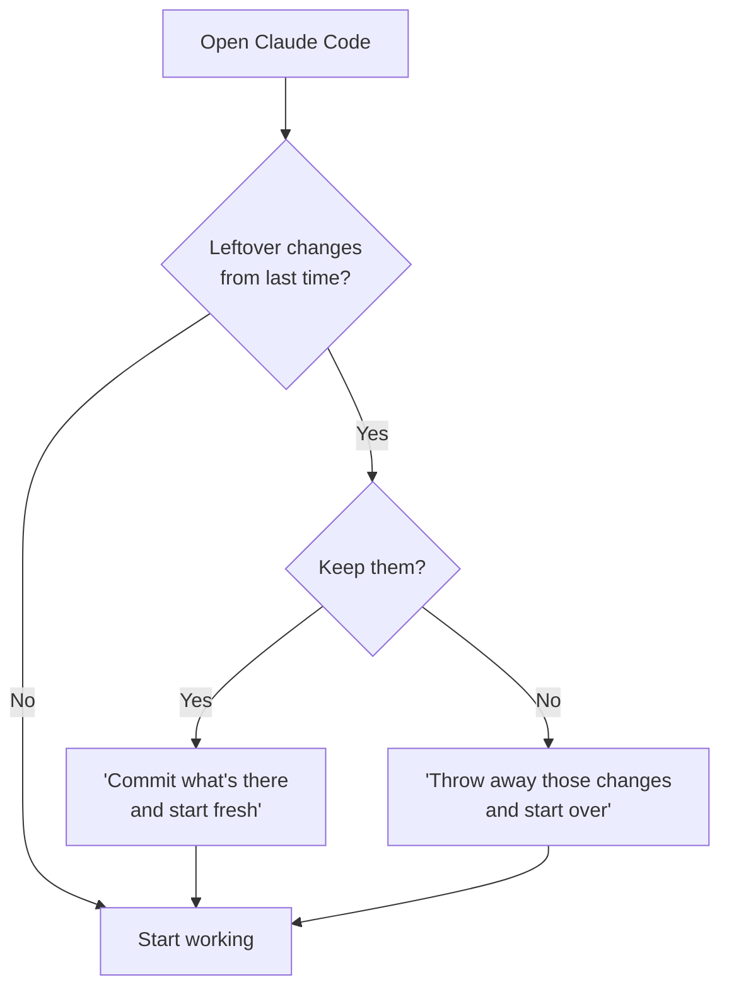

---

## 5. Git Concepts (Reference)

You don't need to memorize these — Claude handles them. But for context:

| What Claude does | What it's called | Google Docs analogy |
|------------------|-----------------|---------------------|
| Saves a snapshot of your work | Commit | Saving a named version |
| Uploads to GitHub | Push | Syncing to the cloud |
| Downloads latest from GitHub | Pull | Opening a shared doc |
| Creates a copy of someone's project | Clone | "Make a copy" |
| Makes a parallel version to experiment | Branch | Duplicating a doc to try edits |
| Combines two versions | Merge | Accepting/rejecting suggested edits |

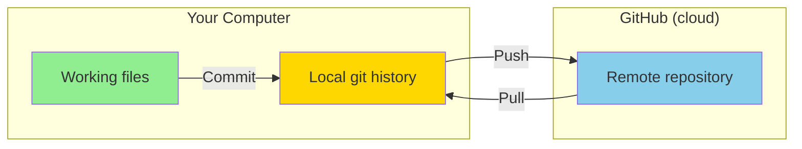

**The flow:** You edit files → Claude commits (saves a snapshot) → Claude pushes (uploads to GitHub). When you start a new session, Claude pulls (downloads latest) so you're up to date.

---

## 6. Skills, Plugins, and Hooks

Claude Code can be extended with **skills** (reusable instructions), **MCP plugins** (external tool integrations), and **hooks** (automated actions). You manage these yourself — Brian won't know what plugins you need.

### Skills — reusable instructions for Claude

A skill is a markdown file that teaches Claude how to do something specific. They live in `~/.claude/skills/`.

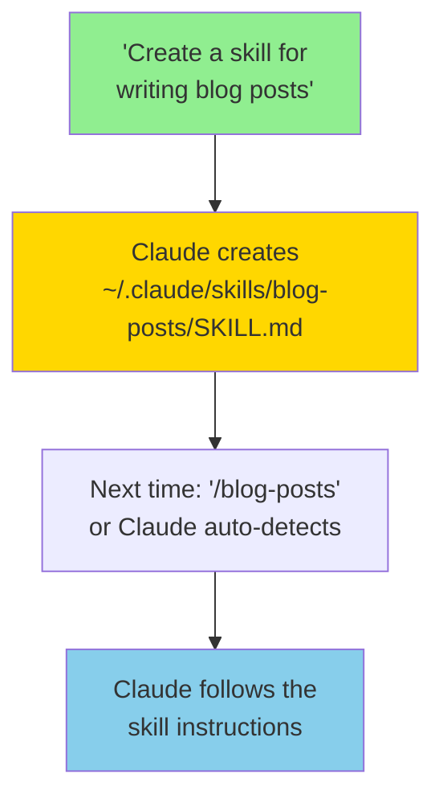

**Creating a skill:**

> "Create a skill called 'meeting-notes' that formats my meeting notes with attendees, action items, and next steps."

Claude creates `~/.claude/skills/meeting-notes/SKILL.md` with the instructions.

**Using a skill:**

> "/meeting-notes" or just describe what you want — Claude finds the matching skill automatically.

**Browsing available skills:**

> "What skills do I have installed?"

**Installing community skills:**

> "Install the skill from github.com/someone/cool-skill"

### MCP Plugins — connect Claude to external tools

MCP (Model Context Protocol) plugins let Claude talk to external services like Figma, databases, APIs, etc.

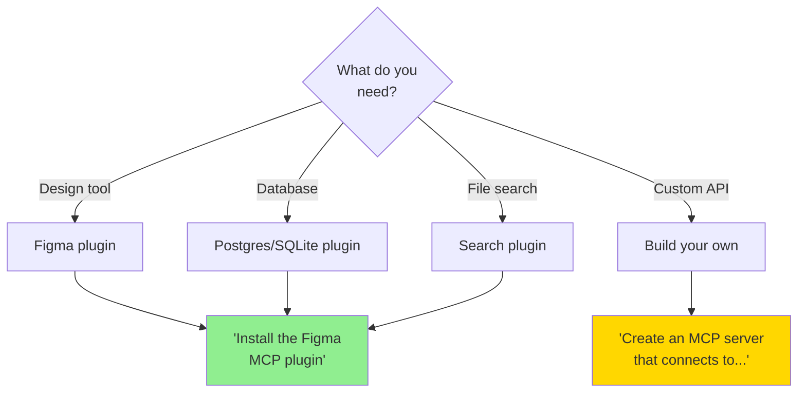

**Installing a plugin:**

> "Install the Figma MCP plugin" or "Add an MCP server for my Postgres database"

Claude adds the plugin to `~/.claude/settings.json` and configures it.

**Checking installed plugins:**

> "What MCP plugins do I have?"

**Plugin resources:**
- Claude Code docs: search for "MCP servers" in the Claude Code documentation
- Community plugins: search GitHub for "claude-code mcp"

### Hooks — automated actions

Hooks run shell commands automatically when Claude does certain things (before/after tool calls, on session start, etc.). Think of them as "if this, then that" rules for your coding environment.

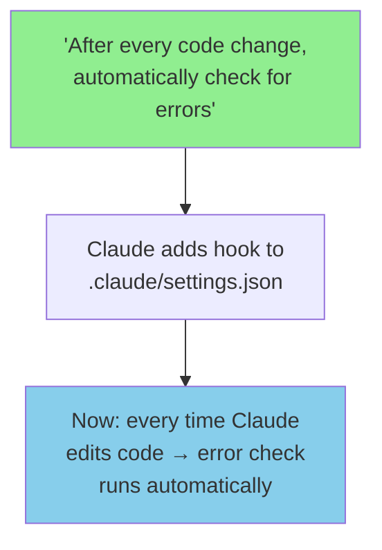

**Creating a hook — just describe what you want in plain language:**

> "After every file edit, automatically check for code errors"
>
> *(A "linter" is a tool that scans code for mistakes and style issues — like spell-check for code.)*

> "Automatically save a snapshot of my work every time I say 'done'"

> "When I start a new Claude session, show me a summary of what I was working on last"

> "After Claude finishes writing code, run the project to make sure it still works"

> "When Claude creates a new file, automatically add it to version control"

**Viewing hooks:**

> "What hooks do I have configured?"
>
> "Explain what each of my hooks does"

### Managing your setup over time

As you add skills, plugins, and hooks, your Claude Code setup becomes personalized. To keep track:

> "Show me my full Claude Code setup — skills, plugins, hooks, and CLAUDE.md rules"

> "Export my setup so I can replicate it on another machine"

To regenerate this guide based on your current setup:

> "Read robert-ross-workspace-guide.md and update it to reflect my current skills, plugins, hooks, and workspace layout"

Claude will read the guide, compare it to your actual `~/.claude/` configuration and workspace structure, and rewrite the sections that are out of date.

### Keeping settings.json current

Your `~/.claude/settings.json` is where plugins, hooks, and permissions live. When you install new plugins or add hooks, Claude updates this file automatically. To verify it's correct:

> "Show me my settings.json — is everything configured properly?"

> "Compare my settings.json against SPEC.md — anything missing or outdated?"

If you've manually edited the file or something seems off:

> "Validate my settings.json — check for syntax errors or conflicting entries"

When adding a new harness component (a new skill, plugin, or hook), Claude will:
1. Add the entry to `settings.json`
2. Verify it loads without errors
3. Update SPEC.md to reflect the change (so future health checks know about it)

If you've added something outside of Claude (manually or from another tool), reconcile it:

> "I added a new plugin manually — check settings.json and update SPEC.md to match"

---

## 7. Exploring Git Repos

Your workspace includes submodules like `SessionShare` that are actively developed. Staying current with upstream changes and understanding recent work is a regular part of the workflow.

### Pulling latest changes

> "Pull the latest for all my submodules"

or for a specific repo:

> "Pull the latest for SessionShare"

Claude will fetch upstream changes, update the submodule pointer, and commit the update in the parent repo.

### Browsing recent activity

> "What changed in SessionShare this week?"
>
> "Show me the last 10 commits in SessionShare with summaries"
>
> "Who's been working on SessionShare and what did they do?"

Claude will run git log commands and summarize the activity for you.

### Understanding decisions and architecture

> "Read the CLAUDE.md in SessionShare and explain the project structure"
>
> "What decisions were made recently in SessionShare? Check commit messages and any planning docs"
>
> "How do the rubrics work in SessionShare? Walk me through the flow"

### Checking test runs and CI status

> "Did the tests pass on the latest SessionShare commit?"
>
> "Run the tests in SessionShare and tell me what's passing and failing"
>
> "Check GitHub Actions for SessionShare — any recent failures?"

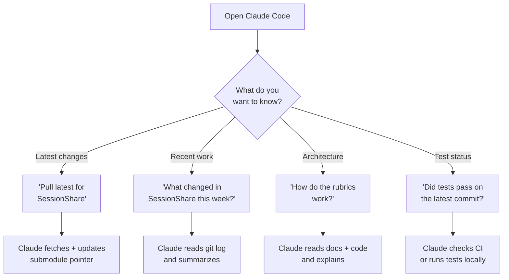

### Staying in sync across sessions

Each time you start a new session, get current:

> "Pull all submodules and give me a quick summary of what's new since I last worked"

Claude will pull, diff against your last commit, and highlight what's new.

---

## 8. Investigating External Repos

Beyond the repos in your workspace, you'll often want to explore other GitHub repos to understand how they work and whether they align with business objectives you've defined in `~/Documents/Code`.

### Exploring a repo's purpose and architecture

> "Look at github.com/org/repo-name — what does it do and how is it structured?"
>
> "Clone org/repo-name into src/ and explore it — give me a summary of the architecture"

Claude will clone the repo (or browse it on GitHub), read through key files (README, CLAUDE.md, main entry points), and explain the structure.

### Evaluating repos against business objectives

Reference your objectives from `~/Documents/Code` to frame the exploration:

> "Look at github.com/org/some-tool — does it help with [objective from my planning docs]?"
>
> "I have a goal to build X (see tasks/claudescore/strategy.md). Are there repos that do something similar?"

Claude will read your planning docs, explore the target repo, and assess alignment.

### Building a research summary

> "Investigate these 3 repos and compare them: org/repo-a, org/repo-b, org/repo-c. Which one fits our scoring pipeline best?"

Claude creates a comparison table with architecture, activity level, license, and fit assessment.

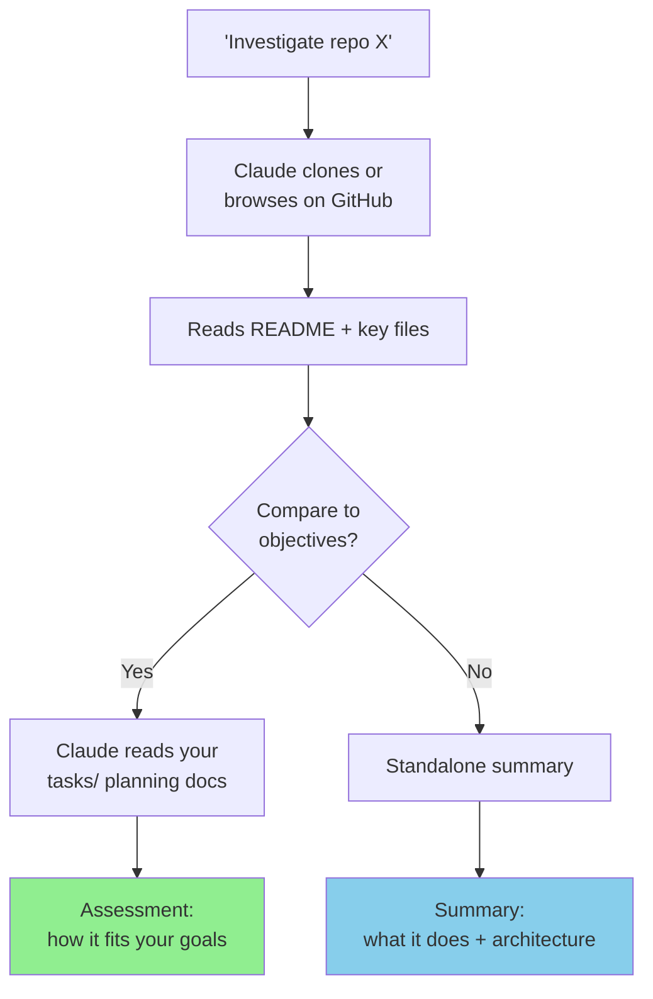

### Forking and experimenting

> "Fork org/interesting-tool into my GitHub and add it as a submodule — I want to experiment with it"

Claude will fork the repo to your account, add it as a submodule in `src/`, and you can start exploring and modifying.

---

## 9. Plugin Lifecycle — Adding, Reconciling, and Auditing

As your workflow evolves, you'll add new skills, MCP plugins, and hooks. Managing these efficiently prevents token waste and keeps your environment maintainable.

### Adding new plugins to your workflow

> "Install the X MCP plugin"
>
> "Create a skill for Y"

After installing, verify it works:

> "Test the new X plugin — make sure it connects properly"

### Reconciling new plugins with your existing setup

When you add something new, check for overlap or conflicts with what you already have:

> "I just added the X plugin. Does it overlap with anything I already have? Should I remove or reconfigure anything?"
>
> "Compare my current skills — are any of them doing the same thing?"

Claude will read your `~/.claude/settings.json`, list all configured plugins and skills, and flag duplicates or conflicts.

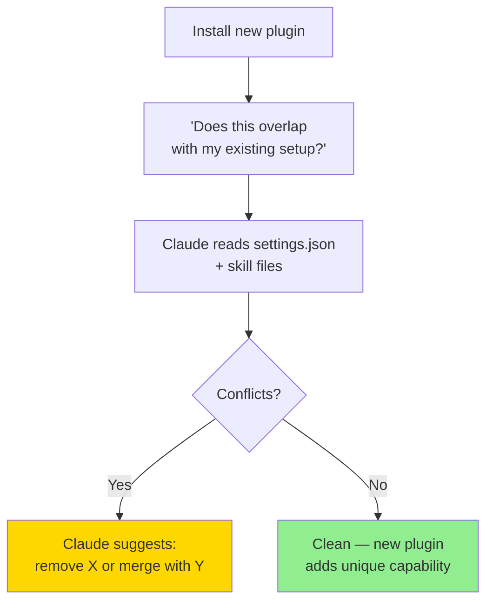

### Auditing for token efficiency

Every skill, plugin, and hook that loads adds to your token usage. Periodic audits keep things lean:

> "Audit my Claude Code setup for token efficiency"
>
> "Which of my skills are actually being used? Which ones am I never invoking?"
>
> "How much context do my CLAUDE.md files add up to? What could be trimmed?"

Claude will measure:
- **Skills**: which ones you invoke vs. which are dormant
- **MCP plugins**: which ones are loaded but never called
- **Hooks**: which ones fire and which are dead weight
- **CLAUDE.md files**: total token footprint and candidates for trimming

### Streamlining recommendations

After an audit, ask Claude to act on the findings:

> "Remove the skills I haven't used in a month"
>
> "Consolidate my CLAUDE.md — it's gotten too long"
>
> "Disable plugins I don't use but keep them in config so I can re-enable later"

### Maintenance schedule

A good cadence:

| Frequency | Action | What to say |
|-----------|--------|-------------|
| Weekly | Pull latest submodules | "Pull all submodules" |
| Monthly | Audit skills + plugins | "Audit my setup for token efficiency" |
| After installs | Reconcile | "Does this overlap with my existing tools?" |
| Quarterly | Full review | "Full review of my Claude Code environment — what's working, what's dead weight?" |

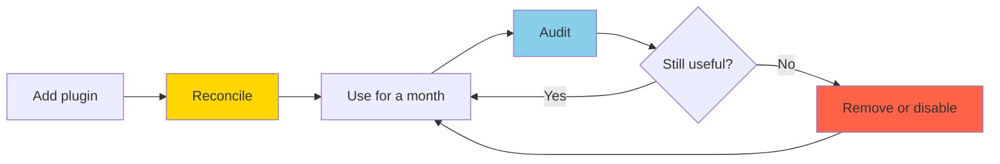

---

## 10. Plan Documents — Building, Running, and Tracking Work

A plan document is a markdown file in `tasks/` where you define what needs to happen, track progress, and let Claude execute the steps. No plugins required — Claude Code handles plan documents natively using plain markdown.

### Creating a plan

> "Create a plan for building the scoring dashboard"
>
> "Make a planning doc for the build party launch — break it into phases"

Claude creates a file like `tasks/claudescore/scoring-dashboard-plan.md` with:
- A clear goal statement
- Steps broken into phases or numbered items
- Checkboxes (`- [ ]`) for tracking completion

### Interrogating a plan

Ask Claude about an existing plan without changing it:

> "Read my scoring dashboard plan — where did we leave off?"
>
> "What's the status of the build party plan? What's done and what's remaining?"
>
> "Does my plan for X make sense? Are there gaps or missing steps?"

Claude reads the plan file, summarizes progress, and answers your questions.

### Modifying a plan

> "Add a step to the scoring dashboard plan: integrate with the rubrics API"
>
> "Reorder the build party plan — move the design phase before the API work"
>
> "The requirements changed — update my plan to include mobile support"

Claude edits the plan file directly, preserving your existing notes and checked items.

### Running a plan (executing steps)

Tell Claude to work through the plan:

> "Do the next step in the scoring dashboard plan"
>
> "Execute phase 2 of the build party plan"
>
> "Work through my plan — do as much as you can"

Claude reads the plan, identifies the next unchecked item(s), does the implementation work, and marks them complete.

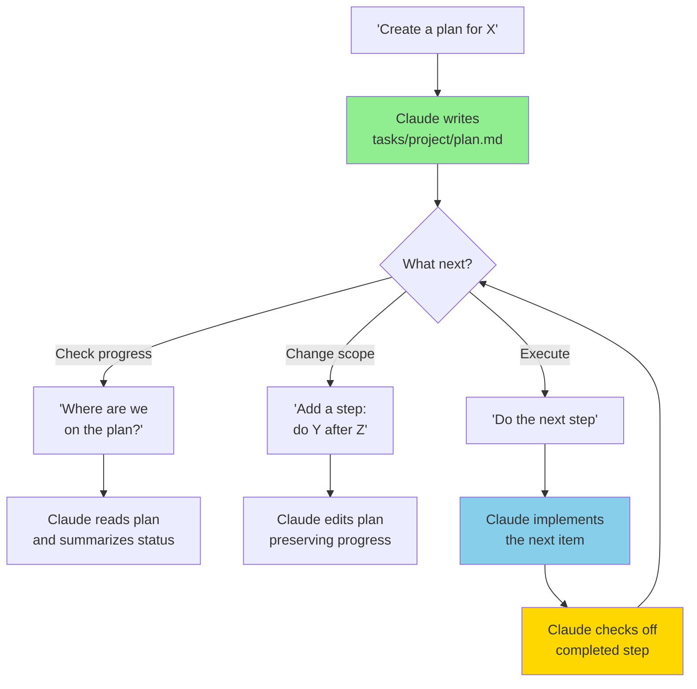

### Plan structure (what Claude generates)

A typical plan looks like:

```markdown
# Scoring Dashboard Plan

## Goal
Build a dashboard showing real-time scoring metrics.

## Phase 1: Data Layer
- [x] Set up database schema
- [x] Create API endpoints for scores
- [ ] Add WebSocket for live updates

## Phase 2: UI
- [ ] Dashboard layout component
- [ ] Score cards with charts
- [ ] Filtering by date range

## Notes
- Rubrics API returns scores in batches of 100
- Dashboard should refresh every 30 seconds
```

### Optional: enhanced planning with plugins

The native approach (plain markdown + Claude) handles most planning needs. For more structured orchestration — like dependency graphs between tasks, automated sequencing, or multi-agent plan execution — you can optionally install a plugin:

> "Install the orba/superpowers plugin"

Plugins like `orba/superpowers` add capabilities such as:
- Automated task dependency resolution (if step B depends on step A, it runs A first)
- Parallel execution of independent tasks
- Progress dashboards and reporting
- Integration with project management tools

You don't need these to get started. The plain markdown approach works immediately. Add orchestration plugins later if you find yourself managing complex multi-step plans with dependencies.

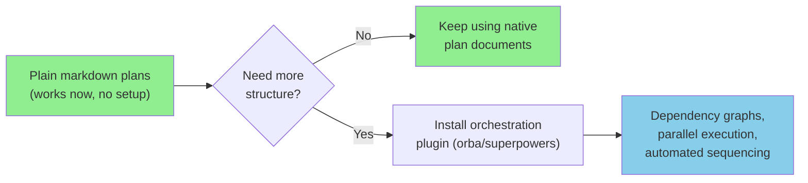

---

## 11. Quick Reference

Day-to-day prompts for common tasks. Just say these to Claude Code.

| What you want | What to say |
|---------------|-------------|
| New project | "Create a new project called 'my-thing'" |
| Add existing repo | "Add ClaudeScore/whatever as a submodule" |
| Save work | "Save everything and push to GitHub" |
| Continue work | "Open the scoring-api project and..." |
| Create a plan | "Create a plan for build party launch" |
| Check plan status | "Where are we on the scoring dashboard plan?" |
| Run next plan step | "Do the next step in the scoring dashboard plan" |
| Check status | "What projects do I have?" |
| Pull latest | "Pull all submodules" |
| Recent activity | "What changed in SessionShare this week?" |
| Explore external repo | "Look at github.com/org/repo — what does it do?" |
| Create a skill | "Create a skill called 'X' that does Y" |
| Install a plugin | "Install the Figma MCP plugin" |
| Audit setup | "Audit my setup for token efficiency" |
| Reconcile plugins | "Does this new plugin overlap with my existing tools?" |
| Check settings.json | "Validate my settings.json" |
| Pick up where I left off | "Read my plan and tell me what's next" |
| Optimize workflow | "Review my sessions — what patterns can we automate?" |
| Clean up tasks | "Review tasks/ — what's done or stale?" |
| Check setup | "Show me my Claude Code setup" |
| Update this guide | "Read robert-ross-workspace-guide.md and update it" |
| Environment health check | "Read SPEC.md and verify my environment matches" |

---

## 12. Troubleshooting

Common issues and how to fix them — just describe the problem to Claude.

### Claude can't push to GitHub

> "I'm getting a permission error when pushing"

Usually means the personal access token expired or wasn't set up. Claude will check `gh auth status` and walk you through re-authenticating.

### Submodule is out of sync

> "SessionShare seems out of date" or "I'm getting submodule errors"

Claude will run `git submodule update --init --recursive` and fix any broken pointers. If the remote has diverged, Claude will show you what changed and ask whether to pull.

### Claude doesn't know about a project

> "Open my scoring-api project" → Claude says it doesn't exist

The project might not be in `src/`. Tell Claude:

> "List everything in my src/ folder" — then "Add scoring-api as a submodule"

### A skill isn't working

> "The meeting-notes skill isn't doing anything"

Claude will check if the skill file exists, whether it has valid content, and whether it's being loaded. Common fix: the skill file has a typo or is in the wrong directory.

### "I broke something"

> "Something went wrong — show me what changed recently and help me fix it"

Claude will run `git log` and `git diff` to show what changed. Options:
- Undo the last commit: "Undo the last commit but keep the changes"
- Throw everything away: "Reset to the last good state"
- Just the last file: "Revert changes to [filename]"

### Claude "forgot" what we were working on

Claude Code doesn't automatically remember previous sessions. Each time you open Claude Code, start fresh. To pick up where you left off:

> "Read my scoring dashboard plan — where did we leave off?"

Or if you want a general status:

> "What's the state of my workspace? Show me recent changes and any uncommitted work"

Your `CLAUDE.md` rules and plans persist across sessions (they're files). Your conversation doesn't.

### Environment seems wrong

> "Read SPEC.md and verify my environment matches"

This runs a health check against every section of the spec. Claude reports what matches and what's drifted, and offers to fix issues it can handle automatically.

---

## 13. Working Across Sessions

Claude Code starts fresh each session — it doesn't carry over conversation from last time. But your files, plans, git history, and CLAUDE.md all persist. Here's how to maintain continuity.

### Picking up where you left off

> "Read my scoring dashboard plan and tell me what's next"
>
> "Show me my recent git commits — what was I working on?"
>
> "Check tasks/ for any active plans and summarize their status"

### Referencing work from previous sessions

Your plans and notes serve as session memory. When you finish a working session, tell Claude to capture the state:

> "Update my plan with what we accomplished today and what's next"

Next session, Claude reads that updated plan and knows exactly where things stand.

### Cross-project context

If work in one project depends on decisions made in another:

> "Read the API design notes in tasks/claudescore/ — I need to make the landing page match those decisions"

Claude reads the referenced notes and applies that context to the current work.

### Session review and harness optimization

Periodically review how you're using Claude Code to identify workflow improvements:

> "Review my recent sessions — what patterns do you see? Am I repeating myself anywhere?"
>
> "Based on my usage, what skills or hooks would save me time?"
>
> "I keep doing X manually — can you create a skill or hook to automate it?"

Claude will look at your git history, CLAUDE.md rules, and installed skills to suggest optimizations:
- **Repeated prompts** → create a skill so you can invoke it with one command
- **Manual steps after every commit** → add a hook to automate them
- **Forgetting to do X** → add a CLAUDE.md rule as a reminder

### Monthly optimization check

> "Audit my Claude Code workflow. Look at my recent commits, my skills, and my settings. What's working well? What should I change?"

Claude will analyze:
- Which skills you actually use vs. which are dormant
- Whether your CLAUDE.md rules match your actual habits
- If there are patterns in your work that a new skill or hook could streamline
- Token usage — are loaded plugins and skills worth their cost?

---

## 14. Automation Setup Plan (Reference)

Setting up Rob's machine so Claude Code can manage everything without terminal commands.

### Phase 1: CLAUDE.md workspace instructions (ready now)

Your `~/Documents/Code/CLAUDE.md` tells Claude how to behave. Recommended contents:

```markdown
## Workspace Layout
- All projects go under ~/Documents/Code/src/ (submodules and local experiments)
- Planning docs, session files, and notes go under ~/Documents/Code/tasks/
- Never put code projects directly in ~/Documents/Code/ root

## Project Scaffolding
- When I say "new project", create a folder in ~/Documents/Code/src/
- Ask me if it should be a submodule (its own GitHub repo) or local-only
- Always create a CLAUDE.md inside new projects with the project description
- Commit and push after creating the project structure

## Planning Docs
- When I say "plan [topic]" or "notes for [topic]", create a file under ~/Documents/Code/tasks/
- Group by project: tasks/claudescore/, tasks/build-party/, etc.
- Planning docs are markdown — not code

## Adding Existing Repos
- When I say "add [repo]", clone it as a submodule under ~/Documents/Code/src/
- If I give a GitHub URL or org/repo name, use that directly
- Create a project-level CLAUDE.md if the repo doesn't have one
- After adding, commit the submodule link and push

## My Preferences
- Explain what you're doing step by step
- When in doubt, ask before doing something permanent
- Remind me to save (commit) before switching to a different project
```

### Phase 2: GitHub personal access token (one-time, ~5 min)

For Claude to create repos and push on your behalf. Brian walks you through this on Zoom:

1. Go to **github.com → Settings → Developer settings → Personal access tokens → Fine-grained tokens**
2. Name: `claude-code-automation`
3. Resource owner: select your org (ClaudeScore) or personal account
4. Repository access: "All repositories"
5. Permissions: Contents (read + write), Administration (read + write for creating repos)
6. Generate → copy the token
7. Tell Claude: "Store this token for GitHub access" — Claude saves it to `~/.config/gh/` or a `.env` file

### Phase 3: Claude Code hooks (one-time, ~15 min)

Hooks let Claude auto-run setup steps. Brian installs these on Rob's machine:

- **On new project**: auto-create `CLAUDE.md` from template, auto-init git
- **On submodule add**: auto-commit parent repo after submodule clone
- **On session start**: auto-pull latest from all submodule remotes

### Phase 4: Workspace bootstrap script (one-time, ~30 min)

A script that sets up everything from scratch on a new machine. Brian builds this:

1. Install Claude Code + `gh` CLI
2. Configure git identity + GitHub auth
3. Clone `robert-code` repo
4. Initialize all submodules
5. Set up CLAUDE.md + hooks

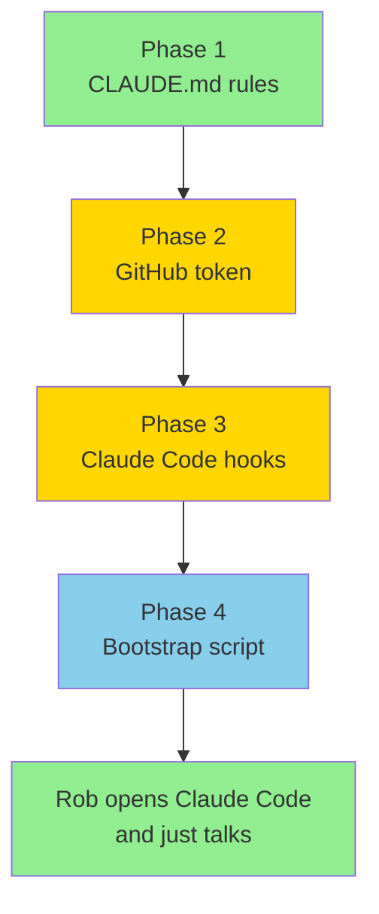

**Legend:** green = ready now, yellow = needs Zoom walkthrough, blue = Brian builds

### Future: voice-to-Claude pipeline

Combine with Cube ACR recordings → transcription → Claude Code. Say what you want on a call, Claude builds it.

---

## 15. Next Steps

- [ ] Review and customize `~/Documents/Code/CLAUDE.md` with scaffolding + existing-repo rules (Phase 1)
- [ ] Zoom session: set up GitHub personal access token on Rob's machine (Phase 2)
- [ ] Zoom session: install Claude Code hooks for auto-scaffolding (Phase 3)
- [ ] Brian builds bootstrap script for fresh-machine setup (Phase 4)
- [ ] Add existing repos: `ClaudeScore/SessionShare` and others as submodules
- [ ] FigJam integration — view Mermaid diagrams from Claude inside FigJam
- [ ] Build party "GitHub 101" course — these diagrams become course material
