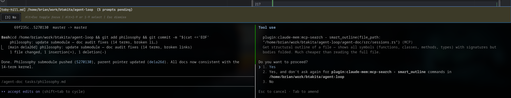

## JetBrains Plugin — Alt+Enter Keybinding Fix

**Issue:** Alt+Enter stopped opening Agent Doc Actions popup after adding self-disabling `update()` logic.

**Root cause:** Self-disabling was unnecessary — it was added to work around a "Replace with" spellcheck bug that turned out to be an IDEA bug, not caused by our plugin.

**Key discovery:** After clean reinstall (uninstall → restart → install → restart), "Replace with" worked fine. The ActionPromoter was never the cause of that bug.

### Resolution

- **Removed self-disabling** — `AgentDocPopupAction.update()` now just checks `.md` extension
- **Re-added ActionPromoter** — `AgentDocActionPromoter.kt` with `promote()` to put Agent Doc first for `.md` files (required for Alt+Enter to win over IDEA's `ShowIntentionActions`)
- **Removed `com.intellij.modules.lang` dependency** — no longer needed without HighlightInfo

### Files changed

| File | Change |
|------|--------|
| `AgentDocActionPromoter.kt` | Re-created with `promote()` logic |
| `AgentDocPopupAction.kt` | Simplified — removed HighlightInfo/severity check |
| `plugin.xml` | Re-added `<actionPromoter>` registration |

### Commits

- **Submodule** `ccf03d7` — re-add ActionPromoter, simplify popup action
- **Parent** `59d702b` — updated submodule pointer

### Lessons

1. **ActionPromoter is required** for Alt+Enter — without it, IDEA's `ShowIntentionActions` wins the shortcut silently
2. **"Replace with" is an IDEA bug** — per-file, not caused by our plugin, confirmed by clean reinstall test
3. **Plugin caching** — structural changes (new classes) require uninstall → restart → install → restart
4. **Markdown HighlightInfo** — `.md` files are saturated with INFORMATION-severity highlights for syntax elements; any filter that checks for HighlightInfo presence will always trigger

## User

commit root

## Assistant

**Committed** (`08b1ecd`). Root repo clean — 3 task files staged and committed: `plan.md` (compaction), `robert-ward.md`, `toby-hill.md`.

## User

When I select a Prompt from the plugin and the command in en route to tmux...I want it to disappear right away.
The prompt seems to remain, or is retriggered to pop up again by the polling...after the user selects the response and before the poll sends the answered state back to the plugin.

## Assistant

**Fixed.** Two issues in `PromptPoller.kt`:

1. **Memory visibility race** — `currentPromptKey`, `answeredPromptKey`, and `activePromptQueue` were modified by the EDT (button click) but read by the executor thread with no visibility guarantee. The executor could see stale values and re-show a prompt that was already answered. Fix: `@Volatile` on all three fields.

2. **No cooldown after answering** — Even with correct visibility, the poll cycle runs every 1.5s and could re-show before `agent-doc prompt --answer` completes. Fix: 2-second cooldown (`lastAnswerTimeMs`) — after answering any prompt, `handlePollResults()` skips showing new prompts until the cooldown expires.

I want to show other prompts, because they do appear, right away. Just want to avoid reshowing the already answered prompt. So it would be better to not have a cooldown.

**Changes:** `PromptPoller.kt` — added `@Volatile` to 3 fields, added `lastAnswerTimeMs` + `ANSWER_COOLDOWN_MS`, cooldown check in `handlePollResults()`, timestamp set in `answerPrompt()`.

**Commits:** Submodule `46d617f`, parent `b2ccd64`.

**Install:** Uninstall → restart → install from `build/distributions/` → restart (structural change: new field).

## Assistant

**Removed the cooldown.** You're right — the cooldown suppressed ALL prompts for 2s, but other pending prompts should show immediately. The `answeredPromptKey` already filters out only the specific answered prompt.

Fix now relies solely on:
1. `@Volatile` on 3 cross-thread fields (memory visibility)
2. `answeredPromptKey` grace period (suppresses only the answered prompt until Claude processes it)

**Commits:** Submodule `f1e71f1`, parent `4e83b80`. Plugin rebuilt.

## User

Let's try it out.

## Assistant

Plugin zips ready at `agent-doc/editors/jetbrains/build/distributions/`:
- `agent-doc-jetbrains-0.1.0.zip` (unsigned)
- `agent-doc-jetbrains-0.1.0-signed.zip` (signed)

Install: IDEA -> Settings -> Plugins -> gear -> "Install Plugin from Disk..." -> select zip -> restart.

Simple reinstall + restart should suffice (field removal, no new classes). Test by submitting a document to trigger a permission prompt, then answer it — panel should dismiss instantly and not reappear.

## User

plugin.md was claimed by the right tmux pane.
I moved plugin.md to the left editor side.
Ran Claim for Tmux pane.
The right tmux pane got swapped with another pane that was not even running a claude session.

Please just run the claim plugin.md on the left tmux pane.
If the newly selected file on the right editor side is claimed by a tmux session, switch the right tmux pane to that session.
If the newslif selected file on the right editor side is not claimed by a tmux session, keep the existing right side tmux pane.

The prompt should display truncated text for option 2. If it would extend beyond the length of the screen. At all costs, the buttons for the 3 options should be visible in the prompt.
 

## Assistant

**Two fixes:**

### 1. Layout: don't swap non-session panes

Root cause: `layout.rs` broke out ANY pane not in the wanted set, including non-Claude panes (shells, other tools). Now it loads the session registry and only breaks out panes that are registered sessions. Non-session panes are left in place.

**Change:** `agent-doc/src/layout.rs` — load `sessions::load()`, build `session_panes` set, add `session_panes.contains()` check before `break_pane()`. Binary reinstalled.

**Commit:** Submodule `46bf84c`, parent `317e7d7`.

### 2. Prompt panel: truncate long buttons, cap height

From the screenshot: option 2 ("Yes, and don't ask again for plugin:claude-mem:mcp-search - smart_outline commands in /home/brian/work/btakita/agent-loop") was so long that buttons [1] and [2] were pushed off-screen — only [3] No was visible.

**Changes:** `PromptPanel.kt`:
- `maxLabelLen` reduced from 80 to 45 chars (full label still in tooltip on hover)
- Panel height capped at 30% of window (was uncapped — tall panels overflowed)

**Commit:** Submodule `5ab29be`, parent `f0650e3`. Plugin rebuilt.

## User

commit and push

## Assistant

**Pushed.** Agent-doc submodule had 8 unpushed commits (`a34c328`..`5ab29be`) — all pushed to `main` on origin. Parent submodule pointer was already current.

Commits pushed:
- `ccf03d7` — re-add ActionPromoter, simplify popup action
- `46d617f` — prompt panel re-show race condition fix
- `f1e71f1` — remove cooldown, keep @Volatile + answeredPromptKey
- `46bf84c` — only break out registered session panes during layout
- `5ab29be` — truncate prompt buttons to 45 chars, cap panel height

## User

