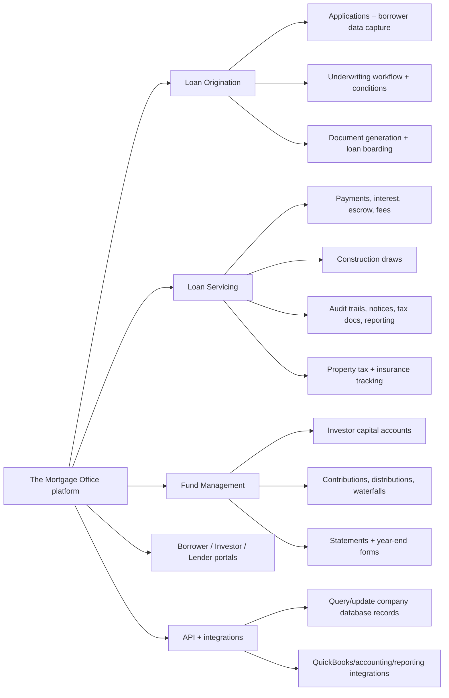
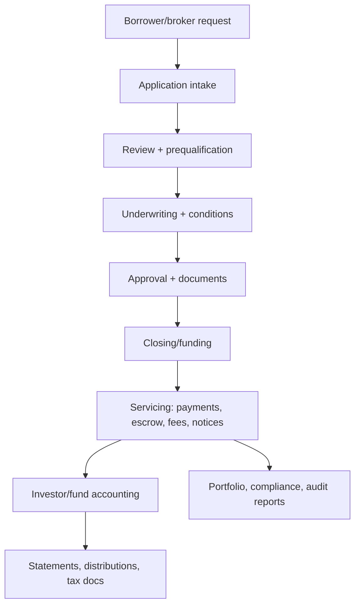
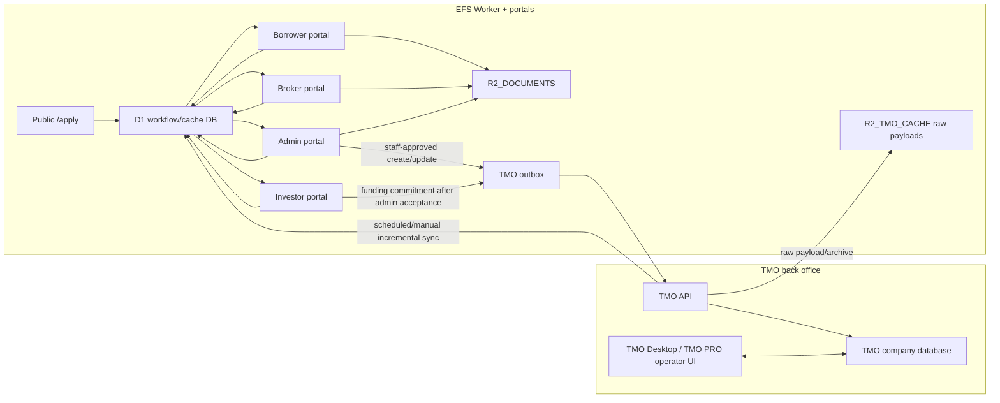
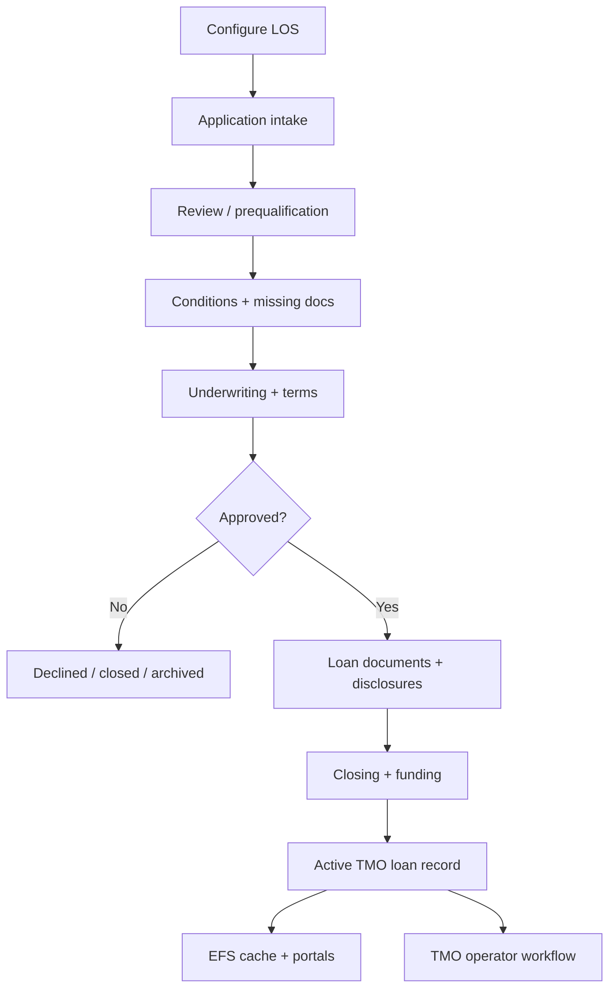
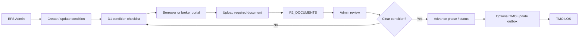
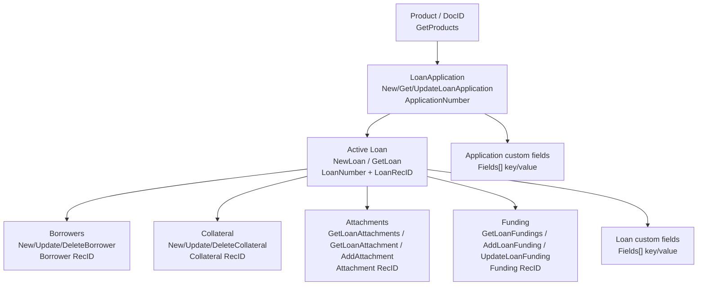
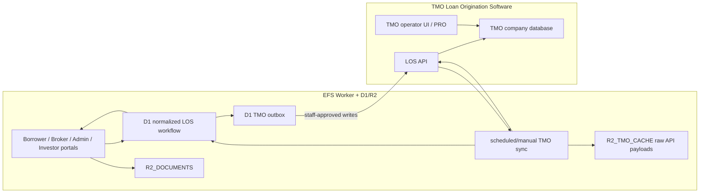
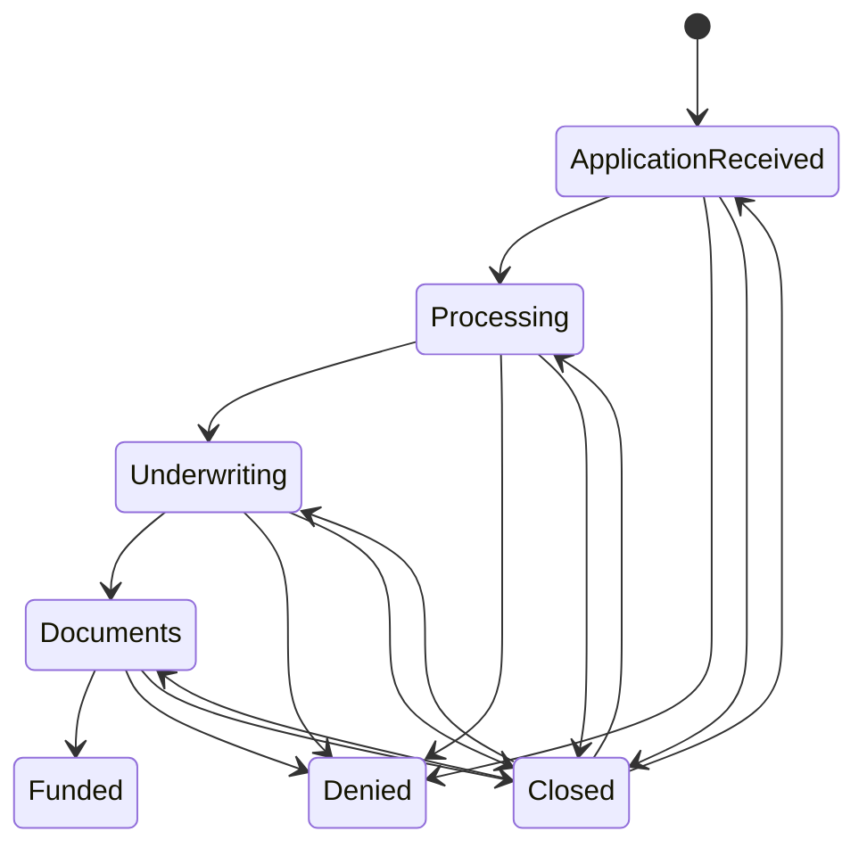

## Status

<!-- agent:status patch=replace -->

Transferred EFS demo context: demo from workers.dev, show /apply + admin application-leads + role portal entry points, and frame next build around TMO LOS intake/status/docs/cache with custom domain, Resend, Google Workspace, TMO access, Dropbox, and legal approvals as demo asks.
<!-- /agent:status -->

## Exchange

<!-- agent:exchange patch=append -->
❯ What are #next-steps for the demo with judith-krug?
### Re: Judith demo next steps — gpt-5

For the Judith demo, keep the agenda narrow: show the working EFS portal layer, then use the TMO LOS discussion to explain where the next integration/replacement work starts. Do not make this a broad TMO-servicing replacement pitch; EFS is using TMO LOS/API, so the near-term story is intake, status, documents, cache, and staff-reviewed writeback.

#### Demo Objective

The demo should answer three questions for Judith:

1. **Can she see real progress?** Show the live-ish workers.dev site, `/apply`, admin lead review, and role-specific portal entry points.
2. **Does the workflow match her business?** Borrower applies, broker submits/refers, admin reviews, investors see approved deals, and TMO remains the LOS back office while EFS owns the branded workflow.
3. **What decisions unblock the next phase?** Domain/email/Google/TMO/Dropbox/legal approvals, then broker backend and TMO LOS inventory.

#### Before The Demo

- Use `https://equityfundingsource.brian-takita.workers.dev` as the demo URL unless custom-domain cutover is explicitly approved before the call.
- Smoke-test the public path: home, funded deals, `/apply`, contact, and footer email.
- Smoke-test the admin path: Cloudflare Access login, application lead list, lead detail/update, and staff notification state.
- Prepare one clean sample lead and one or two portal examples. If any route still has fixture/static data, say that directly instead of letting Judith infer it is TMO-backed.
- Have screenshots ready as fallback in case Cloudflare Access, network, or login interrupts the live demo.

#### Demo Flow

1. **Public site:** brand, current navigation, funded-deal/public trust surface, and `/apply`.
2. **Application lead:** submit or show a sample prequalification lead and explain that it lands in D1 for admin review.
3. **Admin review:** show how staff can review status, lead state, and next action without relying on live TMO during page load.
4. **Portal overview:** show borrower, broker, and investor surfaces at a high level, with clear labels for what is production-backed versus planned/TMO-backed.
5. **TMO LOS boundary:** explain that the next replacement layer is TMO Loan Origination: application reference, loan number, statuses, documents/attachments, conditions, funding, and sync cache.
6. **Decision close:** ask for the approvals/access needed to finish the next build increment.

#### Ask Judith / Robert For These Decisions

- Confirm whether the workers.dev demo can remain the temporary production URL until domain cutover is intentionally scheduled.
- Approve an EFS-owned sending domain for Resend so lead notifications stop using testing-mode sender/recipient values.
- Provide Google Workspace admin credentials when they want real Google SSO/calendar/email integration.
- Restore or provide TMO LOS access for inventory: products, custom fields, statuses, condition phases, document templates, screenshots/exports, and sample loans.
- Confirm Dropbox folder structure, naming conventions, duplicate-file policy, and sanitized sample documents.
- Review/approve funded-deal images, copy, lien-position wording, and legal/disclosure language.

#### Recommended Next Build Order After Demo

1. Finish demo hardening and capture Judith's corrections.
2. Inventory actual TMO LOS usage (`#xt4d`) before implementing more TMO writeback assumptions.
3. Finish broker backend so the existing broker UI does not overstate functionality.
4. Build document checklist / upload-token / admin review around real EFS document workflows.
5. Add staff-approved TMO LOS outbox writes and cache refreshes.
6. Only then consider broader replacement pieces such as condition automation or document generation.

Closeout evidence: changed path is this session document only. Commands used included `tsift status`, `tsift status --fix`, `agent-doc --version`, `agent-doc preflight/read/plan`, linked-doc `sed` reads, `tsift --envelope search`, and this `agent-doc finalize`. Verification is source-review only; no code changed and no tests were run. Confidence is high on the demo agenda and medium on exact route/data readiness until the pre-demo smoke-test backlog item is completed. No escalation was used.

### Re: closeout repair — gpt-5

The substantive demo next-steps answer is captured above, and the concrete pre-demo follow-ups are already in the backlog. This note only reopens the binary-owned closeout after the live document buffer normalized status/backlog content after the first commit.

### Re: transferred EFS demo material — gpt-5

Transferred the demo-relevant material from the main EFS document into this demo document as working demo context.

#### Current Demo State

- Demo URL remains `https://equityfundingsource.brian-takita.workers.dev` until custom-domain cutover is intentionally approved.
- `/apply` public prequalification is deployed and writes D1-backed `application_leads` for admin review.
- Admin review is available behind Cloudflare Access on `/login/access-callback` using `ACCESS_TEAM_DOMAIN` / `ACCESS_AUD`.
- Logged-out navigation currently exposes Borrower Login, Apply for a Loan, Broker Portal, and Investor Portal, with Broker Portal placed between Apply and Investor.
- Public site/footer email is `info@equityfundingsource.com`.
- Application lead notifications still use Resend testing-mode values until an EFS-owned sending domain is verified.
- Custom-domain cutover is deferred; do not demo `equityfundingsource.com` as the live app URL unless that changes before the call.

#### Demo Framing To Carry Forward

The TMO story should stay focused on Loan Origination, not loan servicing replacement. The relevant next build surface is: application intake, normalized statuses, borrower/broker documents, condition/checklist workflow, local D1/R2 cache, and staff-reviewed TMO LOS writeback. The broad servicing/fund-accounting parts of TMO should be treated as out of scope unless Judith explicitly expands the project.

#### Demo Asks

- Confirm workers.dev is acceptable as the temporary demo/production URL.
- Approve custom-domain timing separately from the demo.
- Verify an EFS-owned Resend sending domain.
- Provide Google Workspace admin credentials for real Google SSO/calendar/email integration.
- Restore or provide TMO LOS access/screenshots/exports for products, custom fields, statuses, conditions, templates, and sample loans.
- Confirm Dropbox folder structure and sanitized sample document flow.
- Review funded-deal images, copy, lien-position wording, and legal/disclosure language.

Existing demo backlog items already cover the concrete pre-demo work, so I did not add duplicates here.

> **[TRANSFER from /home/brian/work/btakita/agent-loop/tasks/professional/equityfundingsource.md]** (2026-05-28T15:47:44Z)
>
### Session Summary

*Compacted. Content archived to `/home/brian/work/btakita/agent-loop/.agent-doc/archives/71b0db3f68b7c54571017f333b0989d1db07efa4e5ecf5ec73437e2e857072ad-20260527-155257.md`*

Compacted content:
- Archived 2 response topic(s): Broker Portal header order; deploy
- Prior summary/context: ### Session Summary *Compacted. Content archived to `/home/brian/work/btakita/agent-loop/.agent-doc/archives/71b0db3f...
❯ Please analyze TMO's featureset, offerings, and workflow from public docs. Diagram the offerings.
❯ Analyze how the TMO desktop would fit into the workflow of the existing system.
### Re: TMO public-doc analysis — gpt-5

Short version: TMO is best treated as the accounting/servicing-grade system of record for loan, servicing, fund, and investor-account mechanics. The EFS app should remain the branded, role-specific workflow layer in front of it: public intake, borrower/broker/investor UX, admin review, R2 document handling, notifications, and cache-first portal reads.

#### Public TMO offering map

TMO's public product pages group the platform into three core packages: loan origination, loan servicing, and fund management. The top-level product page positions it as a configurable full-lifecycle system of record for origination through servicing/reporting, with borrower/investor portals, automated payments/escrow/fees/distributions, audit trails, and configurable workflows. The servicing page adds the operational details EFS cares about: payment processing, interest/escrow/fee calculations, borrower and investor portals, QuickBooks integration, communication storage, intelligent document generation, tax docs, email/SMS payment notices, tax/insurance tracking, construction draws, and custom letters. The fund-management page covers investor capital, contributions/distributions, waterfalls, pools/partners, statements, electronic transfers, and tax reporting.

The public API docs matter because they show TMO is not only a desktop UI. They describe JSON web services for querying and modifying company databases at `https://api.themortgageoffice.com`. Their 2026 changelog also points in the right direction for EFS sync: `GetLoans`, `GetLoanFunding`, attachments, history, trust-ledger, event-journal, lender-history, and related endpoints have been gaining timestamp/audit fields and filters. That supports incremental polling/change-feed style integration even if outbound webhooks are not available.

#### Public-doc workflow

That maps closely to the current EFS business model: borrower application or broker deal enters the same internal review path; admin moves it through Application Received, Processing, Underwriting, Documents, Funded, plus denial/close states; approved/open loans become investor opportunities; investors commit funds; accepted funds become positions and distributions.

#### Fit With The Existing EFS System

Recommended boundary:

- **TMO owns** loan numbers, servicing math, payment schedules, interest/escrow/fee calculations, construction draw accounting, investor/funding records where EFS chooses to mirror them, official notices/statements/tax docs, and audit/accounting-grade reports.
- **EFS owns** public prequalification, branded borrower/broker/investor UX, secure borrower messaging, local admin review, application leads, investor opportunity publishing, accreditation/onboarding, R2 document storage, document intelligence review, notification history, stale/sync indicators, and user-facing workflow state.
- **The integration owns** ID mapping, TMO cache rows, raw payload archives, sync batches, and an outbox for writes that must replay to TMO when TMO/API access is unavailable.

For current EFS code/planning, this means the existing D1/R2 cache-first plan is the right shape. Portal pages should not require live TMO calls during request handling. Instead, scheduled/manual sync pulls TMO loan/funding/document/payment-schedule state into D1/R2, and portal writes that must affect TMO should be staff-approved then queued/replayed. That matches the current PRD requirement that investor/admin read APIs use the local TMO cache and that TMO-dependent writes use a D1 outbox.

#### TMO Desktop / PRO Role

Public docs now describe TMO PRO as the web-based successor to the older desktop product, while the system-requirements page still documents the desktop environment: Windows desktop OS, Office, SQL Server for SQL-server installs, internet access, and an MS Word COM add-in for notice/mail-merge behavior. So I would not make the EFS Worker depend on a desktop machine being online. Treat Desktop/PRO as an internal EFS operator console, not as customer-facing infrastructure.

Where Desktop/PRO fits:

- **Daily operations console:** Judith/Robert can continue using TMO for servicing, loan maintenance, reports, notices, statements, construction draws, insurance/tax tracking, and special accounting workflows.
- **Exception handler:** if an API gap exists, EFS should surface the pending action in Admin and let staff complete it in TMO Desktop/PRO, then sync the result back.
- **Validation source:** during `#xt4d`, capture screenshots/exports/status fields from the actual EFS TMO account so the EFS status mapper and field mapper match their real configuration rather than generic TMO marketing docs.
- **Not a portal replacement:** TMO has borrower/investor/lender portal modules, but EFS is already building branded portals. Running both customer-facing portal stacks will create duplicate messaging, document, and status surfaces unless EFS explicitly chooses TMO's portals for a subset of users.

#### Integration Implications

1. Keep **staff approval before TMO writeback**. AI extraction can prefill candidate fields, but only admin-approved changes should call TMO borrower/loan/lender/application endpoints.
2. Prefer **TMO API + incremental sync** over desktop automation. Public API docs show timestamp/audit-filter progress; existing local docs already cover `NewLoanApplication`, `GetLoans`, `GetLoan`, `GetLoanFundings`, `AddLoanFunding`, attachments, borrowers, lenders, and updates.
3. Keep **R2 as the portal document source of truth** for uploads and downloads. Sync selected artifacts to TMO attachments or Dropbox only when needed; do not make borrowers/investors wait on TMO attachment availability.
4. Resolve the **webhook question** with Mortgage Office support. If webhooks exist, add a signed Worker endpoint. If not, tighten polling to timestamp-filtered 5-15 minute sync plus an admin "sync now" button.
5. Decide whether EFS will use **TMO investor/lender portal offerings** at all. TMO's enhanced Lender Portal includes document publishing, statement delivery, and expanded investment offerings; those overlap with the EFS investor portal, so the product decision should be explicit.

#### Sources Checked

- Public TMO product overview: https://www.themortgageoffice.com/products/
- Public TMO loan origination page: https://www.themortgageoffice.com/products/loan-origination-software/
- Public TMO loan servicing page: https://www.themortgageoffice.com/products/loan-servicing-software/
- Public TMO fund management page: https://www.themortgageoffice.com/products/fund-management-software/
- Public TMO PRO announcement: https://www.themortgageoffice.com/applied-business-software-inc-announces-release-of-the-mortgage-office-pro/
- Public TMO Desktop/Web requirements: https://services.themortgageoffice.com/specs.aspx
- Public TMO API docs: https://developers.themortgageoffice.com/
- Public enhanced lender portal note: https://www.themortgageoffice.com/resources/new-lender-portal/
- Public automated insurance tracking note: https://www.themortgageoffice.com/resources/automated-insurance-tracking-with-tmo/
- Local EFS context: `src/equityfundingsource-dev/docs/business-logic.md`, `src/equityfundingsource-dev/prds/equity-funding-source-lending-portal-prd.md`, `src/equityfundingsource-dev/docs/tmo-webhooks-question.md`, and local `docs/TMO/*.md` endpoint notes.

Closeout evidence: changed path is this session document only; no code changed. Commands used included `tsift status`, `tsift status --fix`, `agent-doc preflight/read/plan`, public-doc web/curl checks, local `rg`/`sed` inspection, `git status`, and this `agent-doc finalize`. Verification is source-review only; no test suite was run because there were no code changes. Confidence is high on public TMO offering/workflow shape, medium on EFS-specific TMO module usage until the EFS TMO inventory backlog item is finished. No escalation was used.
❯ EFS is using TMO for Loan Origination and API access...meaning the cache then replacement feature set would be focused on Loan Origination.
❯ Please expand the detail of the TMO Loan Origination process. Include diagrams.
### Re: TMO Loan Origination process — gpt-5

Yes. If EFS is only using TMO's Loan Origination Software module plus API access, the cache-then-replacement plan should narrow around the LOS workflow: application intake, borrower/property/loan data, statuses, conditions, documents, active-loan creation, attachments, and funding records. Loan servicing, borrower payments, escrow/payment schedules, and fund-management features should stay out of the replacement scope unless Judith explicitly expands the project later.

#### TMO LOS process, expanded

TMO's public LOS material describes the process as application through underwriting, approval, documentation, funding, and direct transition into servicing. The older public Loan Origination page adds useful specifics: online application portal, borrower document upload/messaging/status, credit pulls, e-signature, custom workflow, document generation, pipeline/forecasting, URLA, HMDA, and Mortgage Call Report support. The newer knowledge-base articles show the operational layer behind that marketing summary: configurable loan statuses, condition tracking, borrower profiles, user personas, workflow automation, custom document templates, and Lightning Docs integration.

For EFS, I would model the process as these layers:

1. **LOS configuration before data flow**
   - Pull TMO Products with `GetProducts` and store the selected product `DocID`; do not hardcode loan products.
   - Inventory EFS's actual TMO custom field IDs, status list, condition groups, condition phases, document templates, user/persona assignments, and any Lightning Docs setup.
   - Treat TMO statuses as configurable. Public TMO docs say statuses can be edited to match the business, with `Application Received`, `Closed`, and `Unassigned` having special system behavior. Local support correspondence also shows the API status values are not fully aligned with the docs, so EFS should keep a normalized local status model and map to TMO carefully.

2. **Application intake**
   - Borrower direct path: EFS `/apply` or borrower portal captures borrower, contact, property, loan request, entity, and uploaded document data.
   - Broker path: broker submits a deal on behalf of a borrower; EFS stores broker submitter identity separately from borrower identity.
   - EFS writes the canonical portal submission into D1 first, stores original documents in `R2_DOCUMENTS`, and then queues or performs the TMO LOS write.
   - TMO write choices:
     - `NewLoanApplication` creates a TMO application and returns a Loan Application Reference Number.
     - `IsSendPortalInvite` should normally be false if EFS is the borrower-facing portal.
     - `IsCreateNewLoanFromLoanApplication` should be treated as an explicit workflow choice, not a default, because TMO separates LoanApplication from active Loan.

3. **Review and prequalification**
   - EFS Admin reviews the submitted package, requested amount, collateral, borrower/entity details, broker details, and uploaded docs.
   - The borrower/broker-facing status should remain EFS-normalized: `Application Received`, `Processing`, `Underwriting`, `Documents`, `Funded`, with `Denied`, `Closed`, and `Unassigned` as special states.
   - TMO's `GetLoanApplication` can refresh the application object by reference number, but EFS should not depend on live TMO reads during page rendering.

4. **Conditions and missing documents**
   - TMO condition tracking supports condition groups, individual conditions, condition phases, responsible parties, dates, borrower-portal document requests, condition document attachments, and condition reports.
   - Public examples mention phases such as `Prior to Docs`, `Prior to Funding`, and `Prior to Closing`.
   - EFS should mirror this as a first-class local checklist: condition name, phase, required party, due/ordered/received/cleared dates, required document type, R2 document linkage, TMO condition reference if available, and admin notes.
   - This is a strong replacement wedge: EFS can replace the borrower/broker-facing condition experience first while still letting staff reconcile with TMO in the back office.

5. **Underwriting and terms**
   - TMO's loan object carries the more detailed loan/collateral/borrower structure: `LoanNumber`, `DocID`, application dates, loan amount and terms, borrower array, collateral array, encumbrances, broker fees, categories, and custom fields.
   - EFS should separate "application review data" from "active loan data." Until a loan is approved, the EFS record can be an application/deal. After approval, it maps to a TMO active loan by `LoanNumber` and TMO record IDs.
   - Collateral updates require the active loan context. Robert's endpoint notes say collateral requires `GetLoan` first so EFS can obtain `LoanRecID`, and updates/deletes require the collateral `RecID` from the loan response.

6. **Approval, documents, and closing package**
   - TMO can generate/customize documents using TMO fields and custom fields; the knowledge base documents a Word add-in / Fields Dictionary pattern and optional Lightning Docs integration.
   - EFS should not try to replace this immediately. The practical sequence is:
     - EFS stores uploaded docs and extracted fields.
     - Admin approves extracted fields.
     - TMO gets the approved loan/application/borrower/collateral updates.
     - Staff generates closing docs in TMO or Lightning Docs until EFS has a complete, reviewed document-generation replacement.
   - If Lightning Docs is enabled, TMO can prefill available loan data into a Lightning Docs interview and pull generated docs back into TMO attachments.

7. **Funding and active loan state**
   - Once approved/closed, TMO active loans are keyed by `LoanNumber`.
   - Funding lender/investor information is attached through the LOS funding endpoints (`GetLoanFundings`, `AddLoanFunding`, `UpdateLoanFunding`) and/or the TMO UI.
   - EFS investor commitments should remain local until admin acceptance. On acceptance, EFS can call `AddLoanFunding` when configured and store the returned TMO reference.
   - EFS should not add borrower payment UI right now. Robert's requirements say EFS does not service loans online and borrowers pay by check or wire.

#### TMO object model EFS should cache

Minimum cache tables/read models should cover:

- TMO application reference number, EFS application/deal ID, borrower user ID, broker submitter ID, normalized EFS status, raw TMO application status, last sync time, stale flag, and raw payload R2 key.
- TMO `LoanNumber`, `LoanRecID`, product `DocID`, borrower RecIDs, collateral RecIDs, attachment RecIDs, funding RecIDs, and checksums/timestamps for sync.
- Field mapping rows for TMO custom fields: TMO field key, EFS semantic field, direction, value transform, review requirement, and last verified date.
- Condition/checklist rows, even if TMO does not expose full condition APIs, because conditions are central to the origination replacement path.

#### Cache-then-replacement architecture, narrowed to LOS

The replacement plan should proceed in this order:

1. **Cache TMO LOS reads**
   - Pull `GetLoanApplication`, `GetLoan`, `GetLoanAttachments`, `GetLoanAttachment`, `GetLoanFundings`, and timestamp-based loan changes where available.
   - Store raw payloads in `R2_TMO_CACHE` and normalized read models in D1.
   - Portals read D1/R2 only and show stale/missing sync state instead of blocking on TMO.

2. **Own the borrower/broker-facing workflow**
   - EFS owns intake, uploads, secure messages, missing-document checklist, status explanations, and notifications.
   - TMO remains the official LOS record for staff until replacement confidence is high.

3. **Add staff-approved command outbox**
   - Admin approval creates outbox operations for `NewLoanApplication`, `UpdateLoanApplication`, `NewLoan`, `UpdateLoan`, borrower/collateral updates, attachments, and funding.
   - Every operation stores payload, idempotency key, retry count, last error, TMO response, and audit event.

4. **Replace LOS subdomains gradually**
   - First replacement candidate: EFS-native application/deal intake and document checklist.
   - Second: condition tracking and status automation.
   - Third: field extraction/review and TMO writeback.
   - Later: document generation, if EFS wants to replace TMO/Lightning Docs document prep.
   - Last or never in current scope: servicing math, borrower payments, escrow, tax docs, and investor accounting.

#### Practical status rule

The status model should be local-first because TMO's LOS API status behavior is inconsistent with its public docs and support has already confirmed odd behavior in testing. Use this policy:

- EFS normalized status is the borrower/broker/admin display source of truth.
- TMO raw status is stored separately as integration evidence.
- Status changes that must reach TMO go through the staff-approved outbox.
- If TMO rejects a status value, EFS keeps the local status, records the TMO error, and exposes an admin reconciliation task.

#### Sources and confidence

Public sources checked: TMO Loan Origination product page, legacy TMO Loan Origination page, TMO Loan Origination knowledge-base index, condition tracking, workflow automation, loan statuses, borrower profiles, custom documents, Lightning Docs, and the public TMO API docs at https://developers.themortgageoffice.com/.

Local EFS context checked: `src/equityfundingsource-dev/docs/business-logic.md`, `src/equityfundingsource-dev/prds/equity-funding-source-lending-portal-prd.md`, `src/equityfundingsource-dev/docs/TMO/create-loanapplication.md`, `get-loanapplication.md`, `update-loanapplication.md`, `new-loan.md`, `get-loans-by-timestamp.md`, and local EFS/TMO correspondence confirming EFS uses only TMO LOS endpoints.

Closeout evidence: changed path is this session document only. Commands used included `tsift status`, `tsift status --fix`, `agent-doc --version`, `agent-doc preflight/read/plan`, public TMO web checks, `tsift --envelope search`, local `rg`/`sed` inspection, `git status`, and this `agent-doc finalize`. Verification is source review only; no test suite was run because no code changed. Confidence is high that the replacement scope should focus on LOS intake/status/conditions/documents/funding; confidence is medium on exact EFS-specific TMO field/status mapping until backlog item `#xt4d` inventories the live EFS TMO account.
❯ Please transfer demo material in this document into equityfundingsource-demo.md
### Re: transfer demo material — gpt-5

Transferred the demo-relevant material into `tasks/professional/equityfundingsource-demo.md`.

What moved over as demo context:

- workers.dev remains the demo URL until custom-domain cutover is intentionally approved.
- `/apply` public prequalification and D1-backed `application_leads` admin review are the main live demo path.
- Cloudflare Access, Resend testing-mode notification values, Google Workspace credentials, TMO LOS access, Dropbox/sample-doc flow, and funded-deal/legal approval are now explicit demo asks.
- The TMO discussion is framed around Loan Origination only: intake, statuses, documents, conditions/checklists, local D1/R2 cache, and staff-reviewed TMO LOS writeback.

I did not duplicate backlog items because the demo document already has the concrete pre-demo work items: smoke test, demo script, demo-safe credentials/data, and Judith/Robert decision asks.

Closeout evidence: updated `tasks/professional/equityfundingsource-demo.md` via `agent-doc write --commit` and closed this source document via `agent-doc write --commit`. Commands used included `tsift status`, `tsift status --fix`, `agent-doc --version`, `agent-doc preflight`, `agent-doc session-check`, `git diff`, `rg`, `sed`, `agent-doc transfer --help`, `agent-doc extract --help`, and the two `agent-doc write --commit` calls. Verification is document/source review only; no code changed and no tests were run. Confidence is high that the demo-specific summary landed in the demo document. No escalation was used.
Please also transfer the content in this document's exchange to equityfundingsource-demo.md
<!-- agent:boundary:322f0a73 -->
<!-- /agent:exchange -->

## Queue

<!-- agent:queue -->
<!-- /agent:queue -->

## Backlog

<!-- agent:backlog -->
- [ ] [#pctc] Before Judith demo, smoke-test the workers.dev demo path: public home, /apply, borrower login, broker portal entry, investor portal entry, and admin application-leads review.
- [ ] [#m83y] Prepare a short Judith demo script: public site -> Apply lead -> admin lead review -> portal role overview -> TMO LOS cache/replacement boundary -> decisions needed.
- [ ] [#t447] Create or verify demo-safe credentials/data for Judith: Cloudflare Access admin path, borrower/broker/investor examples, realistic application lead, and screenshots as fallback.
- [ ] [#hz0m] Ask Judith/Robert for demo decisions: custom-domain timing, EFS Resend sending domain, Google Workspace admin credentials, TMO LOS access/screenshots, Dropbox folder/sample docs, and funded-deal/legal approval.
<!-- /agent:backlog -->

## Icebox

<!-- agent:icebox -->

<!-- /agent:icebox -->
