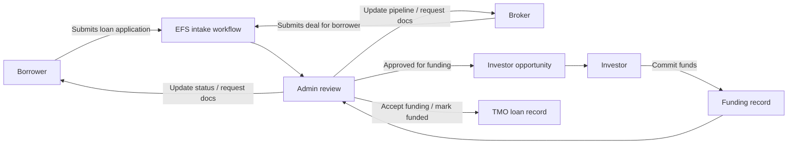
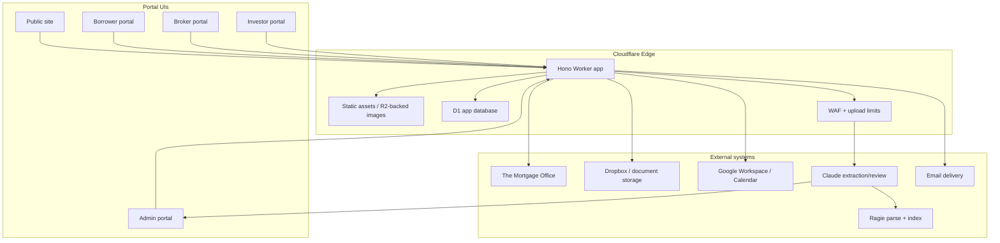
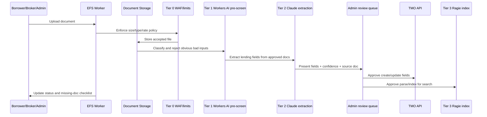
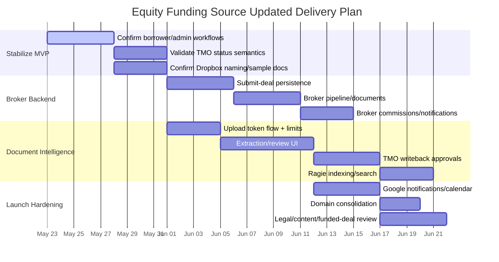

## Status

<!-- agent:status patch=replace -->
25 pages deployed with form backend (D1 + R2 + email). Document pipeline architecture: Tier 0-3 (WAF -> Workers AI -> Claude -> Ragie).
<!-- /agent:status -->

## Exchange

<!-- agent:exchange patch=append -->
### Session Summary

*Compacted. Content archived to `/home/brian/work/btakita/agent-loop/.agent-doc/archives/71b0db3f68b7c54571017f333b0989d1db07efa4e5ecf5ec73437e2e857072ad-20260523-022522.md`*

Compacted content:
- Archived 2 response topic(s): EFS progress, demo, and hours; Bun test coverage
- Prior summary/context: ### Session Summary *Compacted. Content archived to `/home/brian/work/btakita/agent-loop/.agent-doc/archives/71b0db3f...
❯ What is your current understanding of the project requirements?
❯ Please create an updated PRD with mermaid diagrams.
### Re: Updated EFS PRD — gpt-5

My current understanding is that Equity Funding Source is no longer just a public website rebuild. The project is a Cloudflare-hosted lending portal and automation layer around Judith's private real estate lending business, with TMO remaining the loan system of record for now.

The deployed work is already a functional MVP in several areas: public Home/About pages, role-based auth, borrower loan application and document flows, investor available-deal/funding flows, admin loan/deal/lender/user management, D1-backed app data, Cloudflare Worker deployment, and some TMO-facing integrations such as status sync and `AddLoanFunding`. The remaining gap is the original automation promise: broker backend, reviewed AI extraction into TMO fields, Google Workspace/calendar notifications, full document intelligence, production hardening, and online presence/domain cleanup.

Below is an updated PRD that treats the current app as the baseline and separates built scope from the next required product increments.

#### Product Requirements Document

**Product:** Equity Funding Source Lending Portal  
**Version:** 2026-05-23 updated PRD  
**Primary customer:** Judith Krug / Equity Funding Source  
**Primary users:** EFS admin staff, borrowers, brokers, investors  
**Platform:** Hono + Cloudflare Workers, D1, R2/assets, Dropbox or document storage, TMO API, optional Google Workspace, Claude/Workers AI/Ragie document pipeline

#### 1. Problem Statement

EFS needs a modern owned system that replaces fragmented website/forms/vendor workflows with a single controlled portal for borrower intake, broker submissions, investor opportunities, staff review, document handling, and follow-up automation.

The system must reduce manual chasing and duplicate data entry while preserving the TMO workflow Judith already depends on. It should also improve the public brand position around investors, brokers, and borrowers, with investors and brokers prioritized more strongly than the original borrower-heavy site.

#### 2. Goals

- Present EFS as a credible California private real estate lending arranger with updated brand/copy, investor-first CTAs, and correct business facts.
- Let borrowers submit loan applications, upload documents, and track application status.
- Let brokers submit deals on behalf of borrowers and track deal pipeline status.
- Let admins review borrower applications and broker deals through one internal workflow.
- Let admins publish approved/open loans as investor opportunities.
- Let investors review available deals, commit funds, and track accepted positions.
- Keep TMO as the operational loan/servicing source of truth where practical.
- Add an AI-assisted document pipeline for extraction, classification, review, and search, with staff approval before TMO writes.
- Add notifications and document-chasing workflows once Google Workspace/admin credentials are available.
- Keep hosting, source, data, and credentials owned by Judith/EFS.

#### 3. Non-Goals

- Do not replace TMO in the immediate phase unless Judith explicitly moves to a custom loan servicing replacement.
- Do not let AI write directly to TMO without staff review and approval.
- Do not expose investor-only diligence documents to borrowers or brokers.
- Do not treat broker submissions as borrower-owned loans; broker submitter identity and borrower identity must remain separate.
- Do not launch domain consolidation or public SEO cleanup without Judith approval.

#### 4. Current Baseline

**Already built / demoable:**

- Public Home and About pages.
- Role-based signup/login for borrower, investor, broker, and admin.
- Borrower dashboard, new loan application, loan/application status, documents, profile/settings, and notifications UI/API.
- Admin loan application management, loan detail, status change, deal publish/close, funding approval, lender request management, user management, platform settings, and TMO loan views.
- Investor available deals, deal detail, funding commitment, TMO `AddLoanFunding`, lender account request, My Positions, and related dashboards.
- Broker portal screens and navigation.
- D1 migrations covering unified users, notifications, loans, document types, investment deals, lender requests, funds, payment schedule, and user status.
- Local Bun test coverage and `bun run check` harness from the prior cycle.

**Built but needs production validation:**

- TMO calls depend on credentials, exact TMO status semantics, and live API behavior.
- Dropbox/document behavior depends on final folder naming, duplicate-file handling, and sample document confirmation.
- Investor lender account flow currently routes requests to EFS/admin rather than directly creating TMO lender accounts.

**Not yet built / not complete:**

- Broker backend: submit-deal persistence, TMO-backed pipeline, commissions, broker documents, and broker notifications.
- OCR/TMO field extraction: document parsing, field review UI, approval, and writeback to TMO.
- Google Workspace/calendar notification integration.
- Full Tier 0-3 document pipeline: WAF/upload limits -> Workers AI pre-screen -> Claude review/extraction -> Ragie parse/index.
- Admin dashboard for document pipeline and extraction review.
- Token-based document upload links.
- Domain consolidation and old site redirects.
- Online presence cleanup, testimonials, email drip templates, and final logo asset conversion.

#### 5. Personas And Role Boundaries

- **Borrower:** submits their own loan application, uploads required documents, tracks status, receives document/status notifications.
- **Broker:** submits a deal on behalf of a borrower, uploads borrower/deal documents, tracks pipeline, receives missing-document and commission notifications.
- **Admin:** reviews submissions, updates statuses, requests documents, publishes investor opportunities, approves funding, manages users/lenders/settings, and controls TMO sync.
- **Investor:** views curated approved deals, reviews diligence materials, commits funds, tracks accepted positions, distributions, statements, and tax documents.

#### 6. Core User Stories

**Borrower**

- As a borrower, I can create an account and submit a new loan application.
- As a borrower, I can upload required and supplemental documents for a loan.
- As a borrower, I can see application status and reasons when action is needed.
- As a borrower, I can update my profile/contact details.

**Broker**

- As a broker, I can submit a borrower deal without becoming the borrower owner.
- As a broker, I can see each submitted deal in My Pipeline with status and missing-document state.
- As a broker, I can upload deal documents and respond to EFS requests.
- As a broker, I can view commission state after a deal funds.

**Admin**

- As an admin, I can review borrower applications and broker deals in a unified queue.
- As an admin, I can update status through Application Received, Processing, Underwriting, Documents, and Funded, plus Denied, Closed, and Unassigned.
- As an admin, I can publish approved/open loans as investor opportunities.
- As an admin, I can approve or reject investor funding commitments.
- As an admin, I can review extracted document fields before any TMO write.
- As an admin, I can manage users, lender account requests, settings, and notification templates.

**Investor**

- As an investor, I can view available deals curated by EFS.
- As an investor, I can open a deal, review summary metrics and diligence documents, and commit funds.
- As an investor, I can track accepted positions and distribution/payment history.
- As an investor without a TMO lender account, I can submit lender information for staff review.

#### 7. Functional Requirements

**Public website**

- Homepage must reflect corrected business facts: established 2007, nearly two decades, $750M+ volume, 8.99-12% rate range, info@equityfundingsource.com, fax number, and loan arranger wording.
- Navigation priority should be investor first, broker second, borrower third.
- Content must support investor trust, broker referral value, borrower funding speed, lien positions, funded deals, and credibility/legal disclosures.

**Authentication and roles**

- The app must support borrower, broker, investor, and admin roles.
- Auth must route each user to the correct portal shell.
- Admin auth must remain separated from public signup paths.
- Investor signup must capture accreditation acknowledgement/status.

**Borrower portal**

- Borrower loan applications must create backend loan/application records.
- Document uploads must associate files with the correct loan/application.
- Status pages must display the admin-controlled loan status source of truth.
- Profile updates must persist to unified user/profile records.

**Broker portal**

- Broker submissions must create a deal/loan-like record linked to broker submitter and borrower details.
- Broker pipeline must read real backend/TMO-backed records, not static demo arrays.
- Broker documents and commissions must be tied to submitted deals.
- Broker notifications must reflect EFS/admin events and TMO status changes when webhooks are available.

**Admin portal**

- Admin can review both borrower applications and broker deals through one internal workflow.
- Admin can sync approved/changed statuses to TMO where supported.
- Admin can publish eligible loans as investor opportunities.
- Admin can close, deny, reopen, delete, or manage status while preserving clear audit/event history.
- Admin can process lender account requests manually and save TMO lender account numbers.

**Investor portal**

- Investor opportunities must only expose EFS-approved/open deals.
- Funding commitments must persist in EFS data and call TMO `AddLoanFunding` when configured.
- Admin approval must move commitments from pending to accepted.
- Investor positions must be based on accepted funding records.

**Document intelligence**

- Uploads must be screened before expensive processing.
- AI extraction must support loan applications, bank statements, tax returns, construction budgets, financials, and related lending documents.
- Extracted fields must land in a staff review queue.
- Staff approval is required before creating/updating TMO borrower, loan, lender, or loan application records.
- Approved documents should be parse/indexed for cross-document search when Ragie integration is enabled.

**Notifications**

- The app must send or schedule follow-ups for missing documents, status changes, investor funding states, and admin review events.
- Google Calendar/Workspace integration is deferred until admin credentials are available.
- Notification logic must be state-aware so the system stops chasing documents already received.

#### 8. System Architecture

#### 9. Document Pipeline

#### 10. Delivery Phases

#### 11. Data Model Requirements

- `users`: unified role model with borrower, broker, investor, and admin roles.
- `profiles`: contact, mailing, business, license, accreditation, and lender account fields as applicable.
- `loans` / `loan_applications`: borrower-owned submissions and internal loan workflow records.
- `broker_deals`: broker-submitted opportunities linked to broker submitter and borrower details.
- `documents`: document metadata, storage path, owner role, loan/deal linkage, extraction status.
- `notifications`: per-user and per-loan/deal events with read/sent/scheduled state.
- `investment_deals`: admin-published investor opportunities backed by approved/open loans.
- `funds`: investor commitments, pending/accepted state, amount, position type, TMO funding reference.
- `lender_requests`: investor-submitted lender account onboarding data and admin completion state.
- `audit_events`: important actions, sync attempts, extraction decisions, errors, and admin overrides.

#### 12. Acceptance Criteria

**MVP stabilization is complete when:**

- Borrower can submit a full loan application and see it in their portal.
- Admin can review the submission, update status, and see the correct borrower-facing state.
- Investor can view a published deal, submit funding, and see accepted positions after admin approval.
- Existing Bun test/check suite passes.
- TMO-dependent features either work against configured credentials or clearly fail closed with actionable errors.

**Broker backend is complete when:**

- Broker Submit a Deal writes real backend records.
- Broker My Pipeline reads submitted deals and status from the backend/TMO mapping.
- Broker document uploads attach to broker-submitted deals.
- Commission tracker has a defined source of truth and funded-event trigger.

**Document intelligence is complete when:**

- Uploaded docs are screened, classified, extracted, and placed in admin review.
- Admin can approve/reject extracted fields with source visibility.
- TMO writeback only occurs after staff approval.
- Approved documents can be searched/retrieved through the chosen index layer.

**Notification integration is complete when:**

- Missing-document reminders are scheduleable and state-aware.
- Calendar/email behavior works with EFS-owned Google Workspace credentials.
- Admin can inspect notification history and failures.

#### 13. Dependencies And Open Questions

- Google Workspace admin credentials are needed for SMTP/calendar integration.
- TMO outbound webhook support and exact status meanings still need confirmation.
- Dropbox folder structure, file naming, duplicate-file handling, and sanitized sample documents need final spec from Robert/Judith.
- Legal language for CA DRE, lien positions, investor disclosures, and footer disclaimers needs attorney/Judith review.
- EFS logo needs transparent PNG/SVG conversion.
- Domain consolidation requires final approval before redirecting old Weebly/WordPress/domain properties.
- Testimonials and funded-deal details need collection and approval.

#### 14. Recommended Next Build Order

1. Stabilize and demo the current borrower/admin/investor MVP with live-ish data boundaries clearly stated.
2. Finish broker backend because the UI exists but currently overstates functionality.
3. Build the document extraction review queue before any direct TMO field writeback.
4. Add Google Workspace/calendar notifications once credentials are available.
5. Complete domain/content/legal launch tasks.
6. Defer CRM/drip/county-record scraping until core loan/document/investor operations are production-ready.

#### Proof

Changed paths: session document only. Commands run: `agent-doc --version`, `agent-doc preflight`, `agent-doc read`, `agent-doc plan`, targeted `rg`/`sed` source and document inspection, `git status --short`, and this `agent-doc finalize`. Verification: no code changes, so I did not run the app test suite this cycle; the PRD is grounded in the deployed/current-progress docs and prior session context. Escalation: none. Confidence: medium-high; live TMO, Dropbox, Google Workspace, and domain/legal states still require external confirmation.
<!-- agent:boundary:7a35bc27 -->
<!-- /agent:exchange -->
###

<!--
Please directly send the draft email using brian.takita@gmail.com
-->

## Pending / Not Built

<!-- agent:pending -->
- [ ] [#37ah] [recommended] Broker portal backend: replace static broker demo data with TMO-backed submit-deal, pipeline, commissions, documents, and notifications
- [ ] [#7a4d] [recommended] OCR/TMO field extraction: custom/fillable docs -> reviewed extracted fields -> TMO update/create flow
- [ ] [#p40t] [recommended] Google Calendar/G Suite notification integration after Google admin credentials are available
- [ ] [#dvmr] [recommended] Corky: add long mono-call mixed-speaker recovery (separate diarization confidence, tighter bad-span detection, forced re-diarize on flagged windows)
- [ ] [#m6ch] Get Google Suite admin credentials from Robert (SMTP + Google Calendar integration)
- [ ] [#x5rn] Convert EFS logo JPEG → transparent PNG/SVG (Robert sent JPEG)
- [ ] [#q2x2] HTML email templates: lighter navy + gold, 2-3 drip for PBM orphan investor outreach
- [ ] [#kzt6] Collect testimonials for carousel (6–12 min: investors, brokers, borrowers) — push Judith + Robert helping
- [ ] [#k9zj] Graph/vector database for Judith's document search dashboard (cross-doc search, any doc type)
- [ ] [#dzmm] TMO webhooks: confirm outbound webhook support (Robert to check with Mortgage Office)
- [ ] [#4vb5] Online presence cleanup (after Judith approves)
- [ ] [#a3gc] Consolidate domains under equityfundingsource.com
- [ ] [#zhyg] Take down/redirect Weebly and WordPress sites
- [ ] [#vd6p] Update directory listings (Yelp, Manta, hard money directories)
- [ ] [#tfee] Consolidate Facebook pages
- [ ] [#1w4n] Optimize LinkedIn profile
- [ ] [#kxsx] Form submission pipeline
- [ ] [#njsx] Tier 0: Cloudflare WAF + upload limits
- [ ] [#x0px] Tier 1: Workers AI pre-screening
- [ ] [#xgqg] Tier 2: Claude API document review
- [ ] [#kf1p] Tier 3: Ragie Parse + Index for approved docs
- [ ] [#yh4b] Admin dashboard (Cloudflare Access auth)
- [ ] [#ft47] Token-based document upload flow
- [ ] [#4ktv] Discuss Ragie content validation with Bob Remeika (scheduled call)
<!-- /agent:pending -->
