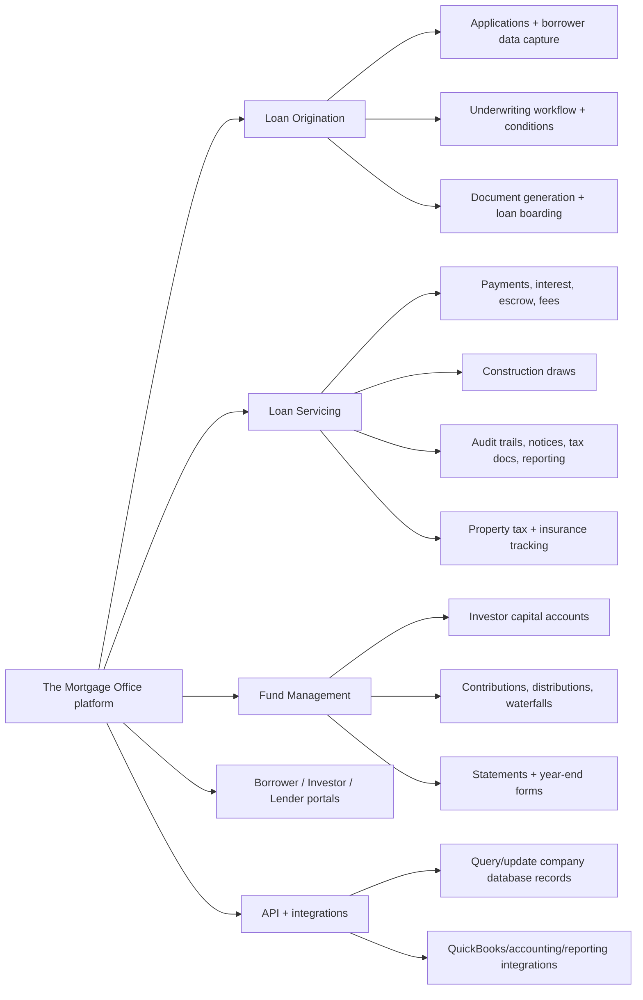
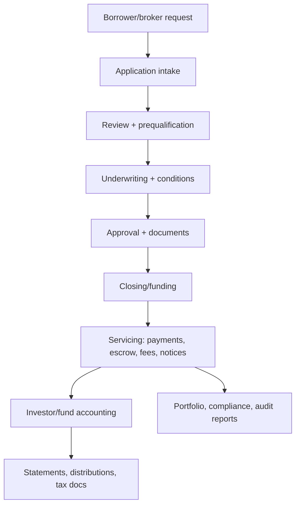
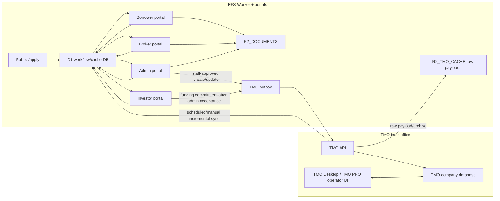

## Status

<!-- agent:status patch=replace -->
EFS workers.dev production: `/apply` public prequalification + D1-backed `application_leads` admin review is deployed in Worker version `dd2fa976-a72c-4661-8a2d-aee196c57eb3` as of 2026-05-27; local `bun dev` on port 4200 mounts `/apply`; public site/footer email is `info@equityfundingsource.com`; logged-out navigation exposes Borrower Login, Apply for a Loan, Broker Portal, and Investor Portal with Broker Portal placed between Apply and Investor. Cloudflare Access protects /login/access-callback with ACCESS_TEAM_DOMAIN/AUD. Application lead notifications still route through Resend testing-mode config `APPLICATION_LEAD_NOTIFICATION_TO=brian.takita@gmail.com` and `APPLICATION_LEAD_NOTIFICATION_FROM=Equity Funding Source <onboarding@resend.dev>` until an EFS-owned sending domain is verified. Custom-domain cutover is deferred; continue using https://equityfundingsource.brian-takita.workers.dev until further notice.
<!-- /agent:status -->

## Exchange

<!-- agent:exchange patch=append -->
### Session Summary

*Compacted. Content archived to `/home/brian/work/btakita/agent-loop/.agent-doc/archives/71b0db3f68b7c54571017f333b0989d1db07efa4e5ecf5ec73437e2e857072ad-20260527-155257.md`*

Compacted content:
- Archived 2 response topic(s): Broker Portal header order; deploy
- Prior summary/context: ### Session Summary *Compacted. Content archived to `/home/brian/work/btakita/agent-loop/.agent-doc/archives/71b0db3f...
❯ Please analyze TMO's featureset, offerings, and workflow from public docs. Diagram the offerings.
❯ Analyze how the TMO desktop would fit into the workflow of the existing system.
### Re: TMO public-doc analysis — gpt-5

Short version: TMO is best treated as the accounting/servicing-grade system of record for loan, servicing, fund, and investor-account mechanics. The EFS app should remain the branded, role-specific workflow layer in front of it: public intake, borrower/broker/investor UX, admin review, R2 document handling, notifications, and cache-first portal reads.

#### Public TMO offering map

TMO's public product pages group the platform into three core packages: loan origination, loan servicing, and fund management. The top-level product page positions it as a configurable full-lifecycle system of record for origination through servicing/reporting, with borrower/investor portals, automated payments/escrow/fees/distributions, audit trails, and configurable workflows. The servicing page adds the operational details EFS cares about: payment processing, interest/escrow/fee calculations, borrower and investor portals, QuickBooks integration, communication storage, intelligent document generation, tax docs, email/SMS payment notices, tax/insurance tracking, construction draws, and custom letters. The fund-management page covers investor capital, contributions/distributions, waterfalls, pools/partners, statements, electronic transfers, and tax reporting.

The public API docs matter because they show TMO is not only a desktop UI. They describe JSON web services for querying and modifying company databases at `https://api.themortgageoffice.com`. Their 2026 changelog also points in the right direction for EFS sync: `GetLoans`, `GetLoanFunding`, attachments, history, trust-ledger, event-journal, lender-history, and related endpoints have been gaining timestamp/audit fields and filters. That supports incremental polling/change-feed style integration even if outbound webhooks are not available.

#### Public-doc workflow

That maps closely to the current EFS business model: borrower application or broker deal enters the same internal review path; admin moves it through Application Received, Processing, Underwriting, Documents, Funded, plus denial/close states; approved/open loans become investor opportunities; investors commit funds; accepted funds become positions and distributions.

#### Fit With The Existing EFS System

Recommended boundary:

- **TMO owns** loan numbers, servicing math, payment schedules, interest/escrow/fee calculations, construction draw accounting, investor/funding records where EFS chooses to mirror them, official notices/statements/tax docs, and audit/accounting-grade reports.
- **EFS owns** public prequalification, branded borrower/broker/investor UX, secure borrower messaging, local admin review, application leads, investor opportunity publishing, accreditation/onboarding, R2 document storage, document intelligence review, notification history, stale/sync indicators, and user-facing workflow state.
- **The integration owns** ID mapping, TMO cache rows, raw payload archives, sync batches, and an outbox for writes that must replay to TMO when TMO/API access is unavailable.

For current EFS code/planning, this means the existing D1/R2 cache-first plan is the right shape. Portal pages should not require live TMO calls during request handling. Instead, scheduled/manual sync pulls TMO loan/funding/document/payment-schedule state into D1/R2, and portal writes that must affect TMO should be staff-approved then queued/replayed. That matches the current PRD requirement that investor/admin read APIs use the local TMO cache and that TMO-dependent writes use a D1 outbox.

#### TMO Desktop / PRO Role

Public docs now describe TMO PRO as the web-based successor to the older desktop product, while the system-requirements page still documents the desktop environment: Windows desktop OS, Office, SQL Server for SQL-server installs, internet access, and an MS Word COM add-in for notice/mail-merge behavior. So I would not make the EFS Worker depend on a desktop machine being online. Treat Desktop/PRO as an internal EFS operator console, not as customer-facing infrastructure.

Where Desktop/PRO fits:

- **Daily operations console:** Judith/Robert can continue using TMO for servicing, loan maintenance, reports, notices, statements, construction draws, insurance/tax tracking, and special accounting workflows.
- **Exception handler:** if an API gap exists, EFS should surface the pending action in Admin and let staff complete it in TMO Desktop/PRO, then sync the result back.
- **Validation source:** during `#xt4d`, capture screenshots/exports/status fields from the actual EFS TMO account so the EFS status mapper and field mapper match their real configuration rather than generic TMO marketing docs.
- **Not a portal replacement:** TMO has borrower/investor/lender portal modules, but EFS is already building branded portals. Running both customer-facing portal stacks will create duplicate messaging, document, and status surfaces unless EFS explicitly chooses TMO's portals for a subset of users.

#### Integration Implications

1. Keep **staff approval before TMO writeback**. AI extraction can prefill candidate fields, but only admin-approved changes should call TMO borrower/loan/lender/application endpoints.
2. Prefer **TMO API + incremental sync** over desktop automation. Public API docs show timestamp/audit-filter progress; existing local docs already cover `NewLoanApplication`, `GetLoans`, `GetLoan`, `GetLoanFundings`, `AddLoanFunding`, attachments, borrowers, lenders, and updates.
3. Keep **R2 as the portal document source of truth** for uploads and downloads. Sync selected artifacts to TMO attachments or Dropbox only when needed; do not make borrowers/investors wait on TMO attachment availability.
4. Resolve the **webhook question** with Mortgage Office support. If webhooks exist, add a signed Worker endpoint. If not, tighten polling to timestamp-filtered 5-15 minute sync plus an admin "sync now" button.
5. Decide whether EFS will use **TMO investor/lender portal offerings** at all. TMO's enhanced Lender Portal includes document publishing, statement delivery, and expanded investment offerings; those overlap with the EFS investor portal, so the product decision should be explicit.

#### Sources Checked

- Public TMO product overview: https://www.themortgageoffice.com/products/
- Public TMO loan origination page: https://www.themortgageoffice.com/products/loan-origination-software/
- Public TMO loan servicing page: https://www.themortgageoffice.com/products/loan-servicing-software/
- Public TMO fund management page: https://www.themortgageoffice.com/products/fund-management-software/
- Public TMO PRO announcement: https://www.themortgageoffice.com/applied-business-software-inc-announces-release-of-the-mortgage-office-pro/
- Public TMO Desktop/Web requirements: https://services.themortgageoffice.com/specs.aspx
- Public TMO API docs: https://developers.themortgageoffice.com/
- Public enhanced lender portal note: https://www.themortgageoffice.com/resources/new-lender-portal/
- Public automated insurance tracking note: https://www.themortgageoffice.com/resources/automated-insurance-tracking-with-tmo/
- Local EFS context: `src/equityfundingsource-dev/docs/business-logic.md`, `src/equityfundingsource-dev/prds/equity-funding-source-lending-portal-prd.md`, `src/equityfundingsource-dev/docs/tmo-webhooks-question.md`, and local `docs/TMO/*.md` endpoint notes.

Closeout evidence: changed path is this session document only; no code changed. Commands used included `tsift status`, `tsift status --fix`, `agent-doc preflight/read/plan`, public-doc web/curl checks, local `rg`/`sed` inspection, `git status`, and this `agent-doc finalize`. Verification is source-review only; no test suite was run because there were no code changes. Confidence is high on public TMO offering/workflow shape, medium on EFS-specific TMO module usage until the EFS TMO inventory backlog item is finished. No escalation was used.
<!-- agent:boundary:b30d7b6a -->
<!-- /agent:exchange -->
###
<!--
Is there an admin for the borrower portal messages? Can we have an email notification whenever a borrow sends a message? Can we support an email respons back into the chat? Can the borrower receive emails whenever an admin responds with a message?
-->

<!-- agent:queue -->
preset #spec-test-commit-push
- ~do [#y17k]~
- do [#xt4d]
- do [#0e1p]
<!-- /agent:queue -->

## Backlog

<!-- agent:backlog -->
- [ ] [#xt4d] Inventory TMO usage once access is restored: screenshots, exports, required fields, statuses, document flows, notifications, reports, integrations, and workflows EFS actually uses.
- [ ] [#0e1p] Draft phased TMO replacement roadmap after the demo: EFS-first MVP, TMO sync/cutover plan, document intelligence/search, borrower/broker/investor/admin portals, and tenant-ready resale packaging.
- [ ] [#f4rq] Verify an EFS-owned sending domain in Resend, then switch APPLICATION_LEAD_NOTIFICATION_FROM and APPLICATION_LEAD_NOTIFICATION_TO from testing-mode values to EFS production addresses.
- [ ] [#k2xg] Send Robert the six-question TMO outbound webhook prompt in src/equityfundingsource-dev/docs/tmo-webhooks-question.md for him to forward to Mortgage Office, then record the response and decide push vs. tightened polling.
- [ ] [#qr72] [recommended] By May 27, 2026, send Lucas a written bridge plan: $500 now from personal funds if available, ask for the remaining $500 to be paid after EFS payment clears or by an agreed near-term date, and invoice EFS immediately for $5,000 with a smaller immediate continuation retainer accepted if Judith pushes back.
- [ ] [#s62t] [recommended] Prepare EFS invoice with truthful hours/value; Lucas cost is $4,150 (83h @ $50), so floor is 42h/$4,200 and recommended ask is 50-60h/$5,000-$6,000 with any concession as an explicit courtesy credit.
- [ ] [#m6ch] Get Google Suite admin credentials from Robert (SMTP + Google Calendar integration)
- [ ] [#p40t] [recommended] Google Calendar/G Suite notification integration after Google admin credentials are available
- [ ] [#q2x2] HTML email templates: lighter navy + gold, 2-3 drip for PBM orphan investor outreach
- [ ] [#x5rn] Convert EFS logo JPEG → transparent PNG/SVG (Robert sent JPEG)
- [ ] [#kzt6] Collect testimonials for carousel (6–12 min: investors, brokers, borrowers) — push Judith + Robert helping
- [ ] [#kxsx] Form submission pipeline
- [ ] [#4vb5] Online presence cleanup (after Judith approves)
- [ ] [#a3gc] Consolidate domains under equityfundingsource.com
- [ ] [#zhyg] Take down/redirect Weebly and WordPress sites
- [ ] [#vd6p] Update directory listings (Yelp, Manta, hard money directories)
- [ ] [#tfee] Consolidate Facebook pages
- [ ] [#1w4n] Optimize LinkedIn profile
- [ ] [#7fx4] OCR ingestion schema/state machine: add provider-neutral document_processing tables for documents, versions, OCR runs, pages/chunks, extracted fields, entity mentions/edges, review decisions, provider cost, and retry/error state.
- [ ] [#d1h2] OCR provider adapter: process private R2 documents through pluggable parsers starting with Ragie Parse or Workers AI/Claude where appropriate; keep original R2 object as source of truth and persist source page/bounding-box evidence.
- [ ] [#f5kq] OCR admin review workflow: show extracted fields with source evidence, confidence, and diffable approval/rejection before any TMO borrower, loan, lender, or loan-application writeback.
- [ ] [#ntcr] Search/index spike: keep D1/R2 canonical and evaluate Ragie index plus Cloudflare Vectorize/SQL edge tables before adopting Neo4j, FalkorDB, Convex, or another separate graph database.
- [ ] [#7a4d] [recommended] OCR/TMO field extraction: custom/fillable docs -> reviewed extracted fields -> TMO update/create flow
- [ ] [#k9zj] Graph/vector database for Judith's document search dashboard (cross-doc search, any doc type)
- [ ] [#x0px] Tier 1: Workers AI pre-screening
- [ ] [#xgqg] Tier 2: Claude API document review
- [ ] [#kf1p] Tier 3: Ragie Parse + Index for approved docs
- [ ] [#4ktv] Discuss Ragie content validation with Bob Remeika (scheduled call)
- [ ] [#dvmr] [recommended] Corky: add long mono-call mixed-speaker recovery (separate diarization confidence, tighter bad-span detection, forced re-diarize on flagged windows)
<!-- /agent:backlog -->

## Review

<!-- agent:review -->
- [/] [#next-steps] Remaining EFS workers.dev production state: D1 API token unblocked; migrations 0025/0026 are already applied; Cloudflare Access env vars are deployed for /login/access-callback on workers.dev using the one-time PIN IdP. Custom domain cutover remains intentionally deferred; true Google Workspace SSO remains gated on Google admin credentials.
- [/] [#37ah] [recommended] Broker portal backend: replace static broker demo data with TMO-backed submit-deal, pipeline, commissions, documents, and notifications
- [/] [#dzmm] TMO webhooks: confirm outbound webhook support (Robert to check with Mortgage Office)
- [/] [#qakx] Investor portal document pages: replace static Documents, Statements, and Accreditation fixture data with D1/R2-backed APIs and authenticated upload/request/download flows.
- [/] [#1v5m] Resolved 2026-05-25: created an EFS-specific Cloudflare API token scoped to account 1e7e194ff8da4ad9e40ce041aea84f76 with D1, Workers Scripts, R2, observability, and read-only user/account metadata permissions; updated passage btak/equityfundingsource/cloudflare_api_token. D1 migration list/apply now succeeds and reports no pending migrations.
- [/] [#jnzs] [recommended] Await Judith or EFS reviewer approval on funded-deal images, copy, lien-position wording, and legal/disclosure language before invoicing or launch sign-off. Technical D1 migration, Worker deploy, and live funded-deals/admin-route smoke tests completed 2026-05-23.
- [/] [#dropbox-sync-adapter] Dropbox sync adapter: after Dropbox access is available, push/pull R2_DOCUMENTS with idempotent retries, backfill, tombstone handling, and per-document sync logs.
<!-- /agent:review -->

## Completed / Reaped

<!-- agent:icebox -->
- [ ] [#e1kb] Point equityfundingsource.com and www.equityfundingsource.com at the Cloudflare Pages project equityfundingsource, then verify / and /funded-deals on the custom domain; if admin routes are expected on the custom domain too, decide whether to route those paths to the Worker or move the dynamic app fully behind the same hostname.
<!-- /agent:icebox -->

<!-- agent:done archive=tasks/professional/equityfundingsource.done.md -->
- 2026-05-24 [#a20z] Set EFS Cloudflare deployment credentials (CLOUDFLARE_API_TOKEN and CLOUDFLARE_ACCOUNT_ID) in src/equityfundingsource-dev/.env, then rerun bun run deploy:worker for src/equityfundingsource-dev commit 7ce187e or latest main.
- 2026-05-24 [#r2-upload-cache] R2 upload cache path: make token/admin uploads write original bytes to R2 first, persist metadata in D1, and serve portal downloads from R2 even when Dropbox access is unavailable.
- 2026-05-24 [#dropbox-cache-contract] Dropbox/R2 document cache contract: define R2 key namespace, D1 document metadata, Dropbox path mapping, content hashes, sync_status, last_dropbox_synced_at, tombstones, and conflict policy for uploaded documents.
- 2026-05-24 [#portal-cache-api] Portal cache APIs: cut investor/admin portal pages over to cache-only reads with last-synced/stale indicators and an outbox for portal writes that must replay to TMO later.
- 2026-05-24 [#tmo-cache-worker] TMO sync Worker: build idempotent manual/scheduled pulls with page cursors, retries, tombstones, sync batches, and D1/R2 writes that do not require TMO during portal requests.
- 2026-05-24 [#tmo-cache-model] TMO cache contract: define D1 read-model tables plus R2 raw payload/document object paths, TMO IDs, cursors, checksums, last_synced/stale/deleted state, and conflict policy for portal-visible data.
- 2026-05-24 [#cf-d1-cache-deploy] Resolve Cloudflare D1 API authorization for account 1e7e194ff8da4ad9e40ce041aea84f76, apply migration 0023_tmo_cache_and_r2_documents.sql, then deploy worker commit 3ada2de.
- 2026-05-24 [#ck54] Investor portal private document storage: add a separate private R2_DOCUMENTS bucket plus provider-neutral document metadata and authenticated download APIs; treat R2 as the canonical uploaded-document cache and keep Dropbox as a later sync adapter.
- 2026-05-24 [#njsx] Tier 0: Cloudflare WAF + upload limits
- 2026-05-24 [#ft47] Token-based document upload flow
- 2026-05-24 [#yh4b] Admin dashboard (Cloudflare Access auth)
- 2026-05-24 [#zjbe] Admin investor document workflow: upload and publish deal due-diligence, investor statements, tax docs, and accreditation files from R2 with visibility and review status controls.
- 2026-05-24 [#9vv3] Investor portal end-to-end QA: seed and test investor signup, accreditation, published deal documents, funding commitment, admin acceptance, positions, distributions, and statements with TMO simulator plus R2 documents.
- 2026-05-24 [#2rpv] Set Cloudflare Access env vars (ACCESS_TEAM_DOMAIN, ACCESS_AUD) on the equityfundingsource Worker and configure the CF Access application that protects /login/access-callback, then verify an admin sign-in via Google SSO.
- 2026-05-24 [#0r24] Apply migration 0025_upload_tokens.sql to remote D1 once review #1v5m unblocks D1 API token permissions, then smoke test POST /api/admin/upload-tokens and POST /api/uploads/by-token/<token> against the live Worker.
- 2026-05-24 [#7chq] Apply migration 0026_broker_portal.sql to remote D1 alongside 0025 once review #1v5m unblocks D1 API token permissions, then smoke test POST /api/broker/deals against the live Worker.
<!-- /agent:done -->
