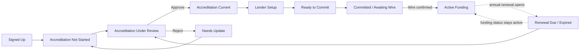
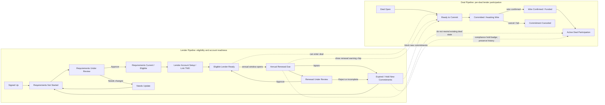

## Status

<!-- agent:status patch=replace -->

committed
<!-- /agent:status -->

## Exchange

<!-- agent:exchange patch=append -->
### Session Summary

*Compacted. Content archived to `/home/brian/work/btakita/agent-loop/.agent-doc/archives/71b0db3f68b7c54571017f333b0989d1db07efa4e5ecf5ec73437e2e857072ad-20260615-170908.md`*

Compacted content:
- Archived 1 response topic(s): lender bank wire instruction reveal
- Prior summary/context: ### Session Summary *Compacted. Content archived to `/home/brian/work/btakita/agent-loop/.agent-doc/archives/71b0db3f...`

### Re: investor pipeline resequence — gpt-5

I recommend correcting the admin label to **Accreditation** rather than **Accredation**. If EFS wants the broader annual workflow language, use **Requirements** for investor-facing copy and **Accreditation** for the admin decision point.

The current admin board is a single monotonic lender lifecycle: Signed Up -> Accredited -> Lender Ready -> Committed -> Active. In the source, those later stages mean:

- **Lender Ready**: a lender/TMO account is linked, so the person can be used as a funding source.
- **Committed**: the lender has at least one pending fund commitment, usually awaiting wire confirmation.
- **Active**: at least one fund row is active, meaning the wire was confirmed and the lender is actively invested.

I would not make this two separate pipelines. Use one lender pipeline, but make accreditation a visible compliance dimension inside it. Two disconnected pipelines would make admins answer “is this person ready to fund?” in one place and “are they current annually?” in another. A single board should answer both, with compliance chips carried forward into the funding stages.

Suggested lane sequence:

1. **Signed Up**: account exists, no annual requirements submitted.
2. **Accreditation Not Started**: lender still needs to submit the annual questionnaire/evidence.
3. **Accreditation Under Review**: submitted and awaiting EFS decision.
4. **Accreditation Current**: EFS approved; if no lender account exists, move next to setup.
5. **Lender Setup**: admin needs to create/link the lender account.
6. **Ready to Commit**: lender account is linked and accreditation is current.
7. **Committed / Awaiting Wire**: lender committed to a deal, wire not confirmed.
8. **Active Funding**: wire confirmed; show compliance chip such as Current, Renewal due, Expired, or Under review.

I would avoid renaming the final lane to **Compliant**. Compliance can expire annually while an investment remains active, so “Compliant” is better as a status badge/filter, not the terminal funding stage. If the current **Active** label feels too broad, rename it to **Active Funding** and add the compliance badge next to it.

When EFS admins approve accreditation, the card should leave **Accreditation Under Review** immediately. If the lender account is already linked, it should land in **Ready to Commit**; otherwise it should land in **Lender Setup**. Rejections should go to **Needs Update** or back to **Accreditation Not Started** with the rejection reason visible.

Implementation note: the current code treats signup self-attestation as enough for the old **Accredited** lane. For this revised flow, admin-approved annual accreditation should drive **Accreditation Current**; self-attestation should remain signup evidence, not the approval state.

I left `#investor-pipeline-resequence` gated on explicit approval because this cycle was a proposal request, not an implementation request. Cycle proof: changed paths are the session document only; source inspected under `src/equityfundingsource-dev`; no tests were run because this was proposal-only; escalation none; confidence medium-high.

### Re: lender vs deal pipeline — gpt-5

You are right: **Ready to Commit**, **Committed**, and **Wire Confirmed** should be deal-pipeline states, not lender-pipeline lanes, because they describe a lender's participation in a specific deal.

Revised split:

- **Lender pipeline** answers: is this lender eligible and administratively ready? It should cover signup, annual requirements/accreditation, review, current/expired status, and whether the lender account is linked.
- **Deal Pipeline** answers: where is this lender's commitment for this deal? It should own Ready to Commit, Committed/Awaiting Wire, Wire Confirmed/Funded, and any per-deal exceptions.

For **Annual Renewal Due**, I would move the lender back into the accreditation/requirements area of the lender pipeline, but not all the way back to first-time onboarding. Treat it as a renewal branch:

1. **Requirements Current / Eligible**
2. **Annual Renewal Due**
3. **Renewal Under Review**
4. **Requirements Current / Eligible** after approval, or **Expired / Ineligible for New Commitments** if the renewal lapses

Existing active deals should not move backward in the Deal Pipeline just because the annual renewal opens. Instead, deal cards should show a lender compliance chip or hold state. A due-soon/due renewal can warn admins; an expired renewal should probably block new commitments until approved, while preserving historical and currently active deal state.

So the earlier recommendation changes: keep the lender board focused on accreditation/requirements and eligibility, and let the Deal Pipeline carry the per-deal funding progression.

I updated the pending `#investor-pipeline-resequence` review item to reflect that split. Cycle proof: changed paths are the session document only; no source files changed; no tests were run because this was a proposal/queue response; escalation none; confidence high.

### Re: lender/deal pipeline mermaid — gpt-5

Here is the split as a Mermaid diagram. The lender pipeline owns eligibility and requirements; each deal participation owns its own commitment/funding state.

The key rule: **Annual Renewal Due** moves the lender into a renewal/requirements branch on the lender pipeline. It should warn or block future commitments depending on due vs. expired, but it should not move an already funded deal backward from `Wire Confirmed / Funded` or `Active Deal Participation`.

Cycle proof: changed paths are the session document only; no source files changed; no tests were run because this was a diagram/proposal response; escalation none; confidence high.

### Re: Mermaid diagram closeout — gpt-5

The lender/deal pipeline Mermaid diagram has been added above. It keeps annual requirements and eligibility in the Lender Pipeline, keeps Ready to Commit / Committed / Wire Confirmed in the Deal Pipeline, and shows renewal due/expired as warning or hold signals that do not rewind already-funded deal participation.

Cycle proof: changed paths are the session document only; no source files changed; no tests were run because this was a diagram/document response; escalation none; confidence high.
❯ corky gpu transcribe + diarize conversations with robert-waldman
❯ [phone_20260615-141048_8059070885.m4a](../../mail/contacts/robert-waldman/recordings/phone_20260615-141048_8059070885.m4a)
❯ [phone_20260615-142316_8059070885.m4a](../../mail/contacts/robert-waldman/recordings/phone_20260615-142316_8059070885.m4a)
❯ [phone_20260615-133630_8059070885.m4a](../../mail/contacts/robert-waldman/recordings/phone_20260615-133630_8059070885.m4a)

### Re: Robert Waldman call transcripts — gpt-5

Corky GPU transcription + diarization is complete for the three Robert Waldman recordings. Each run used `--diarize --speakers Brian,Robert --language en`; Corky reported CUDA enabled on the RTX 5090 and `Full-audio diarization quality OK` for all three files.

Created transcripts:

- `mail/contacts/robert-waldman/recordings/phone_20260615-133630_8059070885.md` — 10:50, 189 lines
- `mail/contacts/robert-waldman/recordings/phone_20260615-141048_8059070885.md` — 12:06, 90 lines
- `mail/contacts/robert-waldman/recordings/phone_20260615-142316_8059070885.md` — 17:05, 150 lines

Commit proof: the transcript files are committed inside `mail` as `440c79c Add Robert Waldman call transcripts`; the parent repo submodule pointer is committed as `eb34c6293 chore: record Robert Waldman call transcripts`. Existing unrelated dirty mailbox/sync content in `mail` was left untouched.

Verification: checked the transcript files for unresolved `Unknown`, `SPEAKER`, blank-audio, hallucination, and inaudible placeholder labels; no matches. `make check` passed. `gh run list --workflow CI --limit 1` could not inspect CI because this repo has no workflow named `CI`.

Preflight warning note: agent-doc also flagged three unrelated review items that may already be resolved (`#dropbox-sync-adapter`, `#dzmm-writeback-replay`, `#zwws-vestings-local`); I did not mutate those items in this transcription cycle.

Cycle proof: changed paths are the three new transcript markdown files in `mail`, the parent `mail` submodule pointer, and this session document closeout; commands included three `corky transcribe` runs, output inspection, targeted git staging/commits, `make check`, and CI lookup; escalation none; confidence high for transcription completion and medium-high for diarization speaker labels because they are automated and not manually corrected.

### Re: conversation/system architecture review — gpt-5

> **Queue prompt:**
>
> Please review the conversations against our current system. Use terminology such as a lender is "interested in loan" instead of applying to lend, "fractionalization" for multi-lender deals, etc. Is the current system architecture in line, additional work needed, with what we discussed in these conversations?

Short answer: the current architecture is directionally in line with the conversations, but I would not call it fully aligned yet. The core split is right: borrowers apply for loans, brokers submit deals, admins publish approved/open loans as available investor deals, and lenders express interest in loans rather than "applying" to lend.

What is already aligned:

- The investor portal has the right first action: **I'm interested**. It persists `investor_deal_interests`, sends staff/investor notifications, and the admin Deal Detail has an **Interested** tab/count.
- The admin side can see multiple interested lenders for a deal, which matches Robert's point that EFS may choose among several interested lenders.
- Funding records support multiple lenders on a deal at the data level: `funds` has `pending`/`active`, amount, lender account, and `position_type` of `fractional_interest` or `whole_note`.
- Vestings and special instructions are already modeled EFS-local with multiple vestings per investor, which fits the "one person may fund through trust / personal / IRA / entity" discussion.
- The lender/deal pipeline split from the prior response remains correct: the lender pipeline should track eligibility/account readiness; the deal pipeline should track deal-specific interest, selection, conditions, wire, funding, recording, and closeout.

The main gaps:

1. **Terminology is inconsistent.** Some PRD/business-logic text and UI still say investors/lenders "commit funds" as the first action, "apply" for deals, or have "applied deals." Based on the calls, reserve **apply/application** for borrower loan applications and lender-account setup/request. For investment opportunities use **interested in this loan**, **request package**, **selected lender**, **funding commitment**, **fractionalization**, and **multi-lender transaction**.

2. **The lender-side commitment flow is too self-service.** The current investor detail has **Commit Funding** and **Sign Deal Documents**. Robert described commitment as usually verbal/email/admin-mediated after package review and a Judith/April conversation. He also clarified the lender generally does not sign the loan docs; the borrower signs/notarizes loan docs, the lender wires, and the lender receives the required purchase/disclosure statement. So the investor signature step should be removed or reframed as a lightweight acknowledgement/internal workflow marker, not the business commitment.

3. **Interest should become an admin work queue, not just a notification.** After a lender marks interest, EFS may send a fuller package, schedule/have a call, record requested conditions or special doc language, decide whether the lender is selected, then mark the verbal commitment / ready-to-draw-docs state. The current system stores interest and emails, but does not yet model package sent, call status, selected lender(s), pre-doc conditions, or prior-to-funding conditions.

4. **Fractionalization is supported but not operationalized.** Multiple `funds` rows can represent a fractionalized loan, but there is not yet a first-class allocation workflow for up to 10 lenders, one lender using multiple vestings/entities, multiple wires, or the majority-control / 50%+ warning Robert described. That can stay light, but the admin should be able to see and manage allocations deliberately instead of inferring them from raw fund rows.

5. **The loan/funding lifecycle needs the Robert sequence exposed.** A useful admin deal flow is: available loan -> lender interested -> package/call -> selected or conditional -> ready for docs -> borrower signs/notarizes docs -> lender wires -> funded -> recorded/closed. TMO/ABS can remain the system of record for some stages, but if TMO does not expose all of them cleanly, EFS needs local admin markers so the UI matches how Judith/April actually work.

I added three follow-up backlog items: `#lender-terminology-audit`, `#deal-interest-workflow`, and `#fractionalization-allocations`. The existing `#investor-pipeline-resequence` review item still looks like the right parent for the lender/deal pipeline split.

Preflight note: agent-doc also flagged likely already-resolved review items (`#dropbox-sync-adapter`, `#dzmm-writeback-replay`, `#zwws-vestings-local`); I did not mutate those in this review cycle. Session-size note: preflight warned the exchange is large, but the queue was active, so I kept draining.

Cycle proof: changed paths are the session document only via finalize/backlog mutation; source inspected included the three June 15 Robert Waldman transcripts, `docs/business-logic.md`, `prds/rpzm-investor-dashboard-rework.md`, `prds/investor-pipeline-admin.md`, the investor deal marketplace/detail UI, admin deal detail, migrations, and investor portal tests. Commands included `agent-doc preflight/plan/read`, `tsift status/search`, and targeted `rg`/`sed`. No tests were run because this was a review/document response with no source changes. Escalation none. Confidence high.
<!-- agent:boundary:5c85699d -->
<!-- /agent:exchange -->
###
<!--
Is there an admin for the borrower portal messages? Can we have an email notification whenever a borrow sends a message? Can we support an email response back into the chat? Can the borrower receive emails whenever an admin responds with a message?
-->

<!-- agent:queue preset="#spec-test-commit-push" priority go -->
- do [#lender-terminology-audit]
- do [#deal-interest-workflow]
- do [#fractionalization-allocations]
<!-- /agent:queue -->

## Backlog

<!-- agent:backlog priority queue -->
- [ ] [#lender-terminology-audit] [recommended] Investor/lender terminology audit: reserve "apply/application" for borrower loan applications and lender-account requests; use "interested in this loan/deal", "request package", "funding commitment", and "fractionalization"/"multi-lender transaction" in investor/admin UI, PRDs, and tests. Advances #investor-pipeline-resequence/#rpzm.
- [ ] [#deal-interest-workflow] [recommended] Deal-interest workflow pass: make investor interest create an admin work queue for package sent, call scheduled/completed, selected lender(s), pre-doc conditions/instructions, and admin-recorded verbal funding commitment; remove or reframe lender-side "Sign Deal Documents" as a non-binding acknowledgement if retained. Advances #investor-pipeline-resequence/#67v2/#rpzm.
- [ ] [#fractionalization-allocations] [recommended] Fractionalization/multi-lender model: define per-deal lender allocations linked to investor vestings/entities, support multiple wires/beneficiaries, up-to-10 lender guidance, 50%+ control warning, and TMO writeback mapping once #7a4d/#dzmm unblock. Advances #zwws/#dzmm/#investor-pipeline-resequence.
<!-- /agent:backlog -->

## Review

<!-- agent:review -->
- [/] [#investor-pipeline-resequence] [operator-verify] [recommended] Await explicit approval of the revised lender/deal pipeline split, then implement: correct the admin label to Accreditation/Requirements; keep the lender pipeline focused on signup, first-time/annual requirements, under-review/current/renewal-due/expired states, and lender-account eligibility/linking; move per-deal Ready to Commit, Committed/Awaiting Wire, and Wire Confirmed/Funded states into the Deal Pipeline; show lender compliance badges/holds on deal cards; update UI/tests.
- [/] [#efs-cutover-sso-plan] Workers.dev to custom-domain/SSO closeout: write and execute a cutover checklist for equityfundingsource.com/www routing, /login/access-callback, rollback, and Google Workspace SSO after #m6ch credentials arrive. Advances #next-steps.
- [/] [#zwws-vestings-local] [recommended] Investor dashboard phase 4 local half: capture/display vestings and special instructions in EFS D1/UI with tmo_cache_outbox enqueue; leave TMO push gated on #dzmm/#7a4d. Advances #zwws.
- [/] [#67v2-auto-advance] Admin pipeline auto-advance: define stage requirement checks from the TMO-aligned Kanban, run them against D1/tmo_cache, and enqueue audited status updates; keep replay gated by #dzmm. Advances #67v2.
- [/] [#jnzs-approval-followup] [recommended] Send/track funded-deals approval packet: attach current screenshots/copy/lien-position language plus the full_application ESIGN/UETA disclosure excerpt, record Judith/EFS reviewer decision, and convert requested edits into implementation backlog. Advances #jnzs.
- [/] [#xcvg-prod-email] [recommended] Borrower secure-message email production pass: after #f4rq/#m6ch/#p40t or #z3kx path-of-record is decided, enable borrower/admin outbound notifications, verify inbound reply threading, and add production env/runbook checks. Advances #xcvg.
- [/] [#dzmm-writeback-replay] EFS->TMO writeback replay: once #7a4d field map and #k2xg support answers arrive, replay tmo_cache_outbox with idempotency keys, conflict logging, retry/dead-letter state, and tests across broker/admin/investor writebacks. Advances #dzmm/#37ah/#67v2/#zwws.
- [/] [#xcvg] [recommended] Borrower message email round-trip: email notification when a borrower sends a secure-portal message, inbound email reply that appends back into the D1 chat, and a borrower-facing email when an admin replies. Builds on the shipped chat_sessions/chat_messages + admin owner. Gated on a verified Resend EFS sending domain (f4rq) and Google Workspace SMTP (m6ch/p40t). (Distinct from the operator/comms emails to Judith + Robert.)
- [/] [#jnzs] [recommended] Await Judith or EFS reviewer approval on funded-deal images, copy, and lien-position wording before invoicing or launch sign-off. The funded-deals page carries no standalone legal/disclosure text; the disclosure needing legal review is the ESIGN/UETA Electronic record and signature disclosure on the borrower full-application/document-uploads flow (full_application.tsx). Funded-deals copy was reframed as real closed deals and shipped.
- [/] [#67v2] Admin loan pipeline: TMO-aligned stages + Kanban (drag cards, auto-advance when stage requirements met) synced to dashboard; mirror TMO stages as single source of truth. From 2026-06-03 call. Relates to #dzmm/#k2xg.
- [/] [#zwws] [recommended] Investor dashboard rework — remaining phases are externally gated: 4 vestings/special-instructions (TMO writeback-gated #dzmm/#k2xg/#7a4d); 6 new-deal email + workflow-priority dashboard (#f4rq). Shipped: P1 nav (30037e3), P2 dashboard-composite landing (3e06907), P2b interest-button + distributions/statements cleanup (efs cd4253a), P3 simplified portfolio (8d40c66), P5 accreditation→annual Requirements (efs 1957f64). Plan: src/equityfundingsource-dev/prds/rpzm-investor-dashboard-rework.md. Queue one phase at a time.
- [/] [#next-steps] Remaining EFS workers.dev production state: D1 API token unblocked; migrations 0025/0026 are already applied; Cloudflare Access env vars are deployed for /login/access-callback on workers.dev using the one-time PIN IdP. Custom domain cutover remains intentionally deferred; true Google Workspace SSO remains gated on Google admin credentials.
- [/] [#dzmm] TMO webhooks UNAVAILABLE per operator (2026-06-13). Read-side tightened polling is shipped (scheduled tmo-sync with configurable interval + due-gating + tmo_cache read mirror). Remaining gated: EFS to TMO writeback (tmo_cache_outbox replay) needs the #7a4d write field map + #k2xg support answers before it can replay.
- [/] [#dropbox-sync-adapter] Dropbox sync adapter: #dropbox-sync-contract shipped the shared documents Dropbox metadata, document_sync_logs idempotency schema, pure sync planner, and mocked adapter tests. Remaining: after Dropbox access is available, wire the real credential-backed worker to push/pull R2_DOCUMENTS with retries, backfill, tombstone replay, and per-document sync logs.
<!-- /agent:review -->

## Completed / Reaped

<!-- agent:icebox -->
- [ ] [#xt4d] Inventory TMO usage once access is restored: screenshots, exports, required fields, statuses, document flows, notifications, reports, integrations, and workflows EFS actually uses.
- [ ] [#0e1p] Draft phased TMO replacement roadmap after the demo: EFS-first MVP, TMO sync/cutover plan, document
- [ ] [#f4rq] Verify an EFS-owned sending domain in Resend, then switch APPLICATION_LEAD_NOTIFICATION_FROM and APPLICATION_LEAD_NOTIFICATION_TO from testing-mode values to EFS production addresses.
- [ ] [#k2xg] Send Robert the six-question TMO outbound webhook prompt in src/equityfundingsource-dev/docs/tmo-webhooks-question.md for him to forward to Mortgage Office, then record the response and decide push vs. tightened polling.
- [ ] [#m6ch] Get Google Suite admin credentials from Robert (SMTP + Google Calendar integration)
- [ ] [#p40t] [recommended] Google Calendar/G Suite notification integration after Google admin credentials are available
- [ ] [#q2x2] HTML email templates: lighter navy + gold, 2-3 drip for PBM orphan investor outreach
- [ ] [#x5rn] Convert EFS logo JPEG → transparent PNG/SVG (Robert sent JPEG)
- [ ] [#kzt6] Collect testimonials for carousel (6–12 min: investors, brokers, borrowers) — push Judith + Robert helping
- [ ] [#kxsx] Form submission pipeline
- [ ] [#4vb5] Online presence cleanup (after Judith approves)
- [ ] [#a3gc] Consolidate domains under equityfundingsource.com
- [ ] [#zhyg] Take down/redirect Weebly and WordPress sites
- [ ] [#vd6p] Update directory listings (Yelp, Manta, hard money directories)
- [ ] [#tfee] Consolidate Facebook pages
- [ ] [#1w4n] Optimize LinkedIn profile
- [ ] [#7fx4] OCR ingestion schema/state machine: add provider-neutral document_processing tables for documents, versions, OCR runs, pages/chunks, extracted fields, entity mentions/edges, review decisions, provider cost, and retry/error state.
- [ ] [#d1h2] OCR provider adapter: process private R2 documents through pluggable parsers starting with Ragie Parse or Workers AI/Claude where appropriate; keep original R2 object as source of truth and persist source page/bounding-box evidence.
- [ ] [#f5kq] OCR admin review workflow: show extracted fields with source evidence, confidence, and diffable approval/rejection before any TMO borrower, loan, lender, or loan-application writeback.
- [ ] [#ntcr] Search/index spike: keep D1/R2 canonical and evaluate Ragie index plus Cloudflare Vectorize/SQL edge tables before adopting Neo4j, FalkorDB, Convex, or another separate graph database.
- [ ] [#7a4d] [recommended] OCR/TMO field extraction: custom/fillable docs -> reviewed extracted fields -> TMO update/create flow
- [ ] [#k9zj] Graph/vector database for Judith's document search dashboard (cross-doc search, any doc type)
- [ ] [#x0px] Tier 1: Workers AI pre-screening
- [ ] [#xgqg] Tier 2: Claude API document review
- [ ] [#kf1p] Tier 3: Ragie Parse + Index for approved docs
- [ ] [#4ktv] Discuss Ragie content validation with Bob Remeika (scheduled call)
- [ ] [#dvmr] [recommended] Corky: add long mono-call mixed-speaker recovery (separate diarization confidence, tighter bad-span detection, forced re-diarize on flagged windows)
- [ ] [#e1kb] Point equityfundingsource.com and www.equityfundingsource.com at the Cloudflare Pages project equityfundingsource, then verify / and /funded-deals on the custom domain; if admin routes are expected on the custom domain too, decide whether to route those paths to the Worker or move the dynamic app fully behind the same hostname.
- [ ] [#z3kx] GoHighLevel CRM as messaging/notifications path of record (Robert's enterprise GHL); integrate with the site so notifications also surface in-app; avoid SendGrid/extra recurring fees. From 2026-06-03 call. Relates to #xcvg.
<!-- /agent:icebox -->

<!-- agent:done archive=tasks/professional/equityfundingsource.done.md -->

<!-- completed work archived in tasks/professional/equityfundingsource.done.md -->
<!-- /agent:done -->
