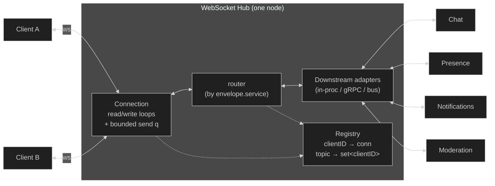
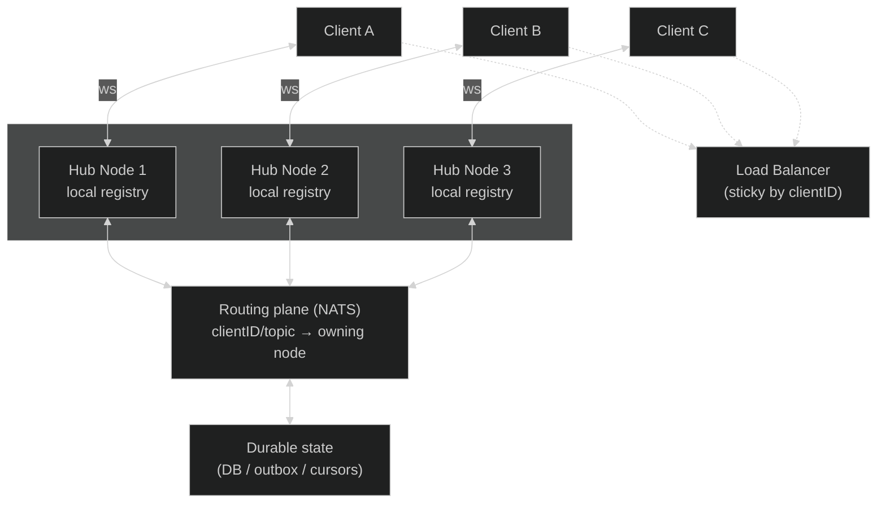
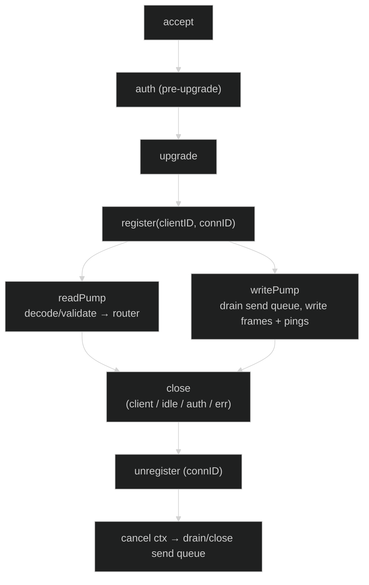

# WebSocket Hub: Design Doc

**Author:** Brian Takita
**Audience:** Haiven backend + frontend + product
**Status:** Draft for team review (pre-implementation)
**Scope:** A single WebSocket Hub in Go: one persistent connection per client, multiplexing many downstream services (chat, presence, notifications, moderation, UI state, etc) over that one socket.

# 1. Assumptions & Constraints

- Multiplex many downstream services (chat, presence, notifications, moderation, UI state, etc) over one connection per client.
- Clients are on unreliable networks. Reconnects are normal. The design must handle reconnections gracefully. Clients may be under high compute load.
- Most traffic is small + frequent + latency-sensitive. Chat, Presence, Notifications, State Updates in an interactive environment.
- Public traffic is untrusted + requires authentication. Downstream services are internal and trusted.
- At-least-once delivery needs to be reliable (e.g. chat). At-most-once delivery does not need to be guaranteed (e.g. presence).
- Initial design supports < ~100k connections (assumption to be benchmarked) & can grow past ~100k. Interfaces should be built in to support sharding.
- A user may or may not have multiple different clients connecting.
- The client SDK + hub are under our control & are designed in tandem.
- OAuth with JWT used for security.

# 2. High Level Design

## 2.0 Single node (< ~100k connections)



## 2.0b Multi-node (> ~100k connections)

Once one node isn't enough, run many hub nodes behind a load balancer. Each node still owns its own sockets (section 3). Two pieces make it scale:

- Registry behind an interface (section 2.3.1), so the single-node map swaps for sharded reads without touching the rest.
- A routing plane (a bus like NATS, keyed by clientID/topic) for cross-node delivery. A node publishes to the plane; the node that owns the target socket delivers it locally. Same-node traffic stays local and skips the bus.



## 2.1 How client connect, authenticate, & stay connected

1. Connect: Client opens wss://.../connect. Auth happens before the WebSocket upgrade at the HTTP layer (e.g. a Gin/Chi middleware). A short-lived JWT is passed via header or query param. The HTTP layer can validate the token.
2. Authenticate: On success, we validate the JWT, extract clientID from its sub, and assign a fresh connID.
3. Stay Connected: The connection is pinned to one Hub. The client can send an `auth.refresh` to refresh the token.

## 2.2 How messages are framed and routed

A single JSON envelope wraps every message. The `service` field is the routing key.

```
{
  "v":    1,                    // envelope version (additive evolution)
  "id":   "01J...ULID",         // message id (ULID: sortable, dedup + ordering)
  "ts":   1720900000000,        // server-stamped epoch ms
  "service": "chat",            // routing key → downstream adapter / from downstream
  "type": "message.create",     // service-specific message type
  "client": "u_123",            // server-stamped identity (JWT `sub`; ignored if client sends it)
  "device": "d_ios_9f",         // originating device (client-supplied, echoed back)
  "topic": "room:42",           // optional: fan-out target / subscription
  "seq":  8891,                 // per-service monotonic sequence (ordering/dedup)
  "corr": "c_local_7712",       // optional client-generated correlation id (optimistic-send echo, acks)
  "payload": { }                // opaque, service-defined body
}
```

- Client -> Hub -> Downstream: A hub read loop in a goroutine decodes the envelope, validates it, and the router dispatches to the downstream adapter registered for `envelope.service`. If unknown, an error frame is sent back to the client from the Hub.
- Downstream -> Hub -> Client: Downstream sends an envelope for a direct message (`client`) or a broadcast (`topic`).

## 2.3 Concurrency Model

Two goroutines per connection: one reads from the client, one writes to the client.

- readPump goroutine: Reads messages from the client via the socket. Decodes envelopes, validates, and sends to the downstream router.
- writePump goroutine: Channel receives enqueued messages from the downstream router and writes to the socket. Drains a bounded `chan []byte`, writes frames. Also pings the client.

### 2.3.1 Registry ownership

- (a) Single hub goroutine (actor): one goroutine owns the `map[clientID]*conn` and `map[topic]set` and mutates them via channels (register, unregister, broadcast). No locks, no data races by construction. Simple to reason about; the hub goroutine can become a throughput ceiling under very high fan-out.
- (b) Sharded lock-based registry: sync.Map or an array of N shards each guarded by its own `RWMutex`, keyed by `hash(clientID) % N`. Scales fan-out across cores; more care needed around lock ordering and iteration.
- My default: start with (a) for correctness and legibility, with the registry access behind an interface so we can drop in (b) if profiling shows the hub goroutine is hot. Topic fan-out may be one of the first things that may require sharded reads under high load.

### 2.4 How downstream services integrate

Downstream integration is behind one Go interface so the transport is swappable:

```go
type Downstream interface {
    // Name is the routing key clients address (envelope.service).
    Name() string
    // Handle is called for each client→service message.
    Handle(ctx context.Context, msg Envelope) error
}

// The hub gives downstreams a handle to push back to clients:
type Sink interface {
    SendToClient(clientID string, msg Envelope) error // returns ErrSlowConsumer / ErrNotConnected
    SendToTopic(topic string, msg Envelope) (delivered int)
}
```

Three concrete transports, in increasing order of decoupling:

- In-process (fastest, simplest): the chat service is a Go package linked into the hub. Great for v1 and for co-located services.
- gRPC (bi-directional stream per service): the hub holds a stream to each downstream. Clear boundary, independent deploy.
- Message bus (NATS/Redis Streams/Kafka): the hub publishes client→service on a subject and subscribes to service→client.

The interface is the contract; we can run different services on different transports at the same time.

## 3. Stateful hub vs stateless routing

The hub is **stateful at the connection edge**: an open TCP/WebSocket connection belongs to one process, and that process must remember its read/write pumps, authenticated identity, subscriptions, bounded send queue, and local `clientID -> conn` registry entry. That state is ephemeral and node-local; a load balancer cannot move a live socket to another node.

The design should nevertheless keep **durable application/session state outside the hub**. Messages that must survive reconnects, delivery acknowledgements, resume cursors, and authoritative subscription or presence data belong in a database, outbox/log, or downstream service. A JWT carries identity and authorization claims, not mutable session state. On reconnect, the client presents the JWT plus its last acknowledged cursor, and the new hub node rebuilds ephemeral connection state from durable sources.

"Stateless routing" applies only to a routing *decision* that can be recomputed from the message, such as hashing `clientID` to a shard or publishing `topic=room:42` to a bus subject. Delivery still relies on state somewhere:

- Each hub node keeps the connections and subscriptions currently local to that node.
- A bus can broadcast a topic to all hub nodes, after which each node fans out only to its local subscribers. This avoids a global connection directory, but the nodes remain stateful.
- Direct cross-node delivery needs either a directory such as `clientID -> nodeID` (stateful, usually external with a lease/TTL) or deterministic ownership by shard.

Sticky routing is an optimization, not a correctness requirement. If a client reconnects to a different node, the old socket and its in-memory queue disappear; the new node authenticates the client, creates a new `connID`, restores durable state, and resumes reliable streams from the last acknowledged cursor. Ephemeral signals such as typing or presence may simply be regenerated or dropped.

## 4. Low-level design

### 4.1 Connection lifecycle



- register: Insert into registry. If `clientID` already has a live conn, apply the duplicate-connection policy before inserting.
- unregister: Idempotent and driven by whichever pump exits first; both exits funnel through a `sync.Once`-guarded close so we never double-unregister or double-close the send channel.
- read loop: `SetReadLimit` (max frame), `SetReadDeadline` refreshed on each pong, decode, validate, dispatch. Any read error → close.
- write loop: `select` over the send queue and a ping ticker; every write gets a `SetWriteDeadline`. A write timeout means the consumer is dead → close.

### 4.2 Envelope & routing decisions

Router keeps `map[service]Downstream`. Decision per inbound message:

1. Envelope well-formed & within size limit? No → error frame (or close on repeated abuse).
2. `service` known? No → error frame `unknown_service`.
3. Rate within the client's budget for this service? No → drop or error per policy.
4. Dispatch to `downstream.Handle`. `Handle` enqueues onto the adapter's own queue and returns; a worker does the slow gRPC/DB work. If it did that work inline, the readPump would park in `Handle`, stop reading the socket, stop processing pongs, and the connection would get killed as dead. So `Handle` stays non-blocking and a slow downstream can't stall the read loop.

### 4.3 Backpressure

Backpressure is per message class, not one global policy. Every send queue is bounded. When it fills, or the client is slow, the producer picks a policy:

- Block the producer. A blocking send on a full queue stalls the shared fan-out goroutine and delays every other client on it. So enqueue non-blocking and pick from the options below.
- Drop-newest / drop-oldest. Ok for fire-and-forget (typing).
- Conflate / coalesce. Presence state (offline/idle/online) coalesces with LWW: keep only the latest value per key. Other state can be replaced or merged.
- Spill. On overflow, persist to a durable outbox (Sqlite, an append-only log, or a bus with retention) and remove from memory. Recovery is a cursor over the log: on drain below a low-water mark, or on reconnect, stream from the last acked message and advance the cursor as acks land.
- Disconnect a slow consumer. Last resort. Close it, let it reconnect + resume.

The policy is a property of the message class, declared in a small table, not hardcoded per call site:

```
class             overflow policy       guarantee
chat.message      spill→outbox          at-least-once (+ dedup)
presence.state    conflate-by-entity    at-most-once (latest wins)
typing.indicator  drop-newest           at-most-once
notification      spill→outbox          at-least-once
moderation.action spill→outbox          at-least-once
```

### 4.4 Fan-out

Downstream pushes one message to many clients (an announcement, everyone in room 42).

- Addressing: `SendToTopic(topic, env)`. Registry holds `map[topic]set<clientID>`. Clients subscribe/unsubscribe via control messages the hub authorizes.
- Delivery: iterate the topic's set, enqueue on each client's send queue non-blocking. A slow client hits its own overflow policy and never stalls the fan-out or the other recipients.
- Under load: large fan-outs pressure the single hub goroutine (section 2.3). Split it. Keep membership changes serialized in a per-topic actor, and move delivery to a bounded worker pool. The broadcast is a job on a buffered channel; M workers drain it and enqueue to each recipient. The channel is the queue, no hand-written push/pop.
- Cross-node: `SendToTopic` publishes to the routing plane. Each node delivers to its local subscribers. No node needs the global client list.

### 4.5 Heartbeat / dead-connection detection

- App-level ping/pong, not just TCP keepalive (too coarse, and often stripped by proxies or load balancers). The server pings every `pingInterval` (say 20s); the pong handler refreshes the read deadline.
- Read deadline is `pingInterval * ~2.5`. Miss it and the connection is declared dead, closed, unregistered. Catches half-open connections TCP thinks are fine.
- Write deadline on every write catches a consumer whose receive buffer is wedged.
- The client runs its own idle detection and reconnects with jittered exponential backoff, so a mass disconnect (a node restart) doesn't become a thundering-herd reconnect.

## 5. Delivery guarantees

- At-most-once (default, cheapest): send and forget. Right for presence + typing; a lost tick is fixed by the next one.
- At-least-once (ack + redelivery + client dedup by id): right for chat, notifications, moderation. Needs an outbox on the send side and a dedup window on the receive side. Costs storage and admits duplicates the client swallows.
- Exactly-once: not building it. It's at-least-once + idempotent handling + dedup, and calling it "exactly once" oversells it. If a class truly needs it, use idempotency keys, not distributed transactions.

Guarantee is per message class (the table in section 4.3), so we only pay for durability where it matters.

## 6. Edge cases

### 6.1 Reconnect & duplicate connections
`connID` is the tie-breaker. Options:
- Last-writer-wins (default): the newest connection for an identity evicts the older one (send it a `superseded` close frame). Matches "switched networks / reopened the app."
- Reject duplicate: keep the old, refuse the new. Rarely what users want.
- Allow multi-device: key the registry by `(clientID, deviceID)` and fan-out to all. Product decision (section 8, frontend question): one user on phone + desktop at once?

The race: unregister must compare-and-swap on `connID`. Only delete the entry if the registered `connID` still equals the exiting conn's. Without it, a laggy old connection's cleanup fires after the reconnect registered a fresh conn under the same key and evicts the live one. The actor model serializes this for free; with sharding you write to the Map under a lock. A different `deviceID` is a coexisting connection, not a duplicate.

Client-side dedup: the client doesn't retain every message id. `id` is a ULID (time-ordered), so the client keeps a per-service high-water mark plus a small recent-id set sized to the resume window (last N or last T seconds). Anything below the mark is already processed, so drop it. Bounded regardless of session length.

Optimistic send: the sender stamps a client-local `corr`, renders optimistically, then gets the fan-out echo carrying the authoritative `id`, the same `corr`, and the origin `device`. The sending device matches `corr` and replaces its optimistic copy. Other devices have no matching `corr` and render it as normal inbound. That's why `device` is in the envelope: it separates "my own echo on this device" from "my other device's message."

Resume: on reconnect the client presents a `resumeToken` (the last id/`seq` it saw per service). At-least-once classes replay from the outbox after it. At-most-once classes get current state (a presence snapshot).

### 6.2 Out-of-order delivery
Per-service monotonic sequence numbers stamped by the hub or downstream. The client can reorder or dedup on them. For chat, small reorders are usually fine and cheaper than strict ordering. For state-like classes, conflation (section 4.3) makes ordering moot, since latest wins.

### 6.3 Oversized / malformed messages
`SetReadLimit` rejects oversized frames at the socket layer (close code `1009`). Envelope validation (schema, size, required fields) rejects malformed ones with an error frame. Repeated abuse from one connection gets a close plus a brief ban. A bad frame never panics the read loop; decode errors are data, not crashes.

### 6.4 A downstream service going down
- Circuit breaker per downstream: after N consecutive failures, open the breaker (stop dispatching, fail fast with `service_unavailable`). After a cooldown, allow one half-open probe. Success closes it, failure re-opens. One dead downstream never takes the hub with it.

  ```go
  type Breaker struct {
      mu        sync.Mutex
      failures  int
      state     state         // closed | open | halfOpen
      openUntil time.Time
      threshold int           // consecutive failures to trip
      cooldown  time.Duration
  }

  func (b *Breaker) Allow() bool {
      b.mu.Lock(); defer b.mu.Unlock()
      if b.state == open {
          if time.Now().After(b.openUntil) { b.state = halfOpen; return true } // one probe
          return false
      }
      return true // closed or half-open probe already granted
  }

  func (b *Breaker) Record(err error) {
      b.mu.Lock(); defer b.mu.Unlock()
      if err == nil {
          b.failures, b.state = 0, closed // success → close
          return
      }
      b.failures++
      if b.state == halfOpen || b.failures >= b.threshold {
          b.state, b.openUntil = open, time.Now().Add(b.cooldown)
      }
  }
  ```
  Call `Allow()` before dispatch, `Record(err)` after. (Time is injected and mockable in real code; `time.Now()` shown for brevity.)
- Buffering vs shedding:
  - At-least-once classes (chat, notifications): buffer in the bounded unacked queue. On overflow, spill to the durable outbox (section 4.3). If durable is also exhausted, shed the oldest and send the client a `service_degraded` control message so the UI can show "reconnecting." Replay from the outbox cursor on recovery.
  - At-most-once classes (presence, typing): don't buffer. Shed silently, but emit a lightweight degraded signal (say `presence.stale`) so the client greys out presence instead of trusting stale state.
  - The hub's own liveness is never contingent on a downstream being up.

### 6.5 Slow consumers
Covered by section 4.3: a per-class overflow policy, escalating to disconnect + resume. The invariant: one slow client can never degrade delivery for other clients or stall a shared goroutine.

## 7. Tradeoffs

- Delivery guarantee vs complexity: at-least-once + resume is a real feature with real cost (outbox, dedup, storage). Buy it only for classes that need it. Presence stays cheap.
- Latency vs throughput: batching or coalescing writes raises throughput but adds a few ms of latency. For chat, bias latency (flush promptly). For presence, bias throughput (coalesce, flush on a tick).
- Stateful vs stateless: section 3. Stateful is lower latency and simpler but scales vertically and loses in-mem state on node loss. Stateless/hybrid scales horizontally and survives node loss at the cost of a hop and more ops surface.
- Memory per connection: the dominant cost at scale, broken down in section 7.1.

### 7.1 Memory per connection

On the Go heap:

- Two goroutines (readPump, writePump): 8KB starting stack each, so ~16KB. The pump loops stay shallow.
- Read + write buffers: gorilla/websocket allocates 4KB each per conn (8KB). Shrinkable, and write buffers can be pooled (WriteBufferPool).
- Send queue: a bounded `chan []byte` of capacity N. The channel header is tiny; the cost is queued messages when it backs up. N=64 at ~256 bytes is up to ~16KB full, near zero drained. Main tunable.
- Conn struct + registry/topic entries: a few hundred bytes.
- TLS, if the hub terminates wss: a few KB up to ~16-32KB of record buffers per conn. Usually terminate TLS at the load balancer so the hub sees plain WS and skips this.
- Kernel socket buffers: SO_RCVBUF/SO_SNDBUF per socket, tens of KB each by default. Kernel RSS, not Go heap, and often the largest per-conn cost. Tunable.

Rough budget: ~20-40KB per conn on the Go heap with gorilla defaults, or ~10-20KB with pooling and a small send queue. So 10k conns is ~0.2-0.4GB heap, 100k conns is ~2-4GB, plus kernel socket buffers that can match or exceed that. Watch RSS, not just Go heap.

Levers, by impact: terminate TLS at the load balancer (drops the biggest allocation), pool write buffers, keep the send queue small, conflate so a burst doesn't balloon queued bytes, tune kernel socket buffers, and split into multiple processes if one huge heap makes GC pauses hurt.

## 8. Working with the team

### Questions for the backend team
1. Delivery guarantees and persistence: do we need at-least-once + resume for chat in v1, or is at-most-once acceptable to start?
   - Options: (a) at-most-once everywhere first, add durability later; (b) at-least-once for chat/notifications/moderation from day 1.
   - My lean: (a), for the fastest correct core, with the class-policy table (section 4.3) in place so upgrading a class to at-least-once is a config change plus an outbox, not a rewrite.
   - What would change my mind: if product treats a dropped chat message as a data-integrity bug rather than a UX blip, I'd build the outbox in v1.
2. Scale-out topology and target scale: session affinity at the LB vs a routing plane, and how many concurrent connections are we sizing for?
   - Options: (a) single node + vertical scale; (b) sticky sessions at the LB; (c) hybrid routing plane (section 3).
   - My lean: build (a) now behind interfaces that make (c) a drop-in. Don't build the plane until the numbers demand it.
   - What would change my mind: a hard availability SLA (no client drop on a single node loss) pulls the routing plane into v1.

### Questions for the frontend team
1. Reconnect and resume: does the client hold a `resumeToken` and dedup by message `id`, or should the server guarantee no duplicates?
   - Trade-off: client-side dedup keeps the server simple (at-least-once + resend); server-side no-dup pushes complexity and state onto the hub.
   - My lean: the client dedups by `id` (cheap, robust across reconnects). I'd want to hear how much per-service state frontend is comfortable tracking.
2. Multi-device and duplicate connections: is one user allowed on multiple devices at once, and what happens to the older connection on reconnect? (section 6.1)
   - Options: last-writer-wins (evict old), or true multi-device fan-out keyed by `(clientID, deviceID)`.
   - Impact: this changes the registry key, the presence model, and the reconnect UX. As much a product decision as an engineering one, so I'd want frontend + product in the room.
   - Related: envelope schema + versioning. I'd want frontend to co-own the `type` catalog and confirm additive-only evolution works for their release cadence.

### How I'd split the work (3 engineers, 1-2 sprints)
Contract-first: day 1 we agree on the envelope schema (section 2.2) and the `Downstream`/`Sink`/registry interfaces (section 2.4). Everyone builds against interfaces and integrates continuously.

- Track A, connection layer (owns the socket): HTTP auth + pre-upgrade rejection, upgrade, per-conn read/write pumps, heartbeat + deadlines, registry (single-goroutine actor), graceful shutdown. Deliverable: clients connect, stay alive, and are looked up. Exposes the registry + `Sink`.
- Track B, routing + envelope + downstream (owns message flow): envelope encode/decode + validation, router, the three downstream transports (start in-process), the per-class overflow policies + conflation, at-least-once outbox for the classes that need it. Deliverable: a client message reaches a downstream and back.
- Track C, fan-out + resilience + observability (owns "does it hold up"): topic subscribe/fan-out, reconnect + resume protocol, duplicate-connection policy, circuit breakers, metrics + tracing (section 9), and a load-test harness that simulates unreliable-network clients (drops, slow consumers, reconnect storms).

These parallelize because A owns the socket, B owns message semantics, and C owns cross-cutting resilience. They meet at the shared interfaces, not in the same files. The load-test harness (C) keeps A and B honest.

## 9. How we'll know it's working

Instrument from day 1. These double as SLOs and as the early-warning system.

- Connections: current concurrent, connect/disconnect rate, reconnect rate (a spike means a network or deploy problem), auth-reject rate.
- Throughput + latency: messages/sec in/out per service, end-to-end delivery latency (client to downstream to client), ping RTT distribution.
- Backpressure (the leading indicator): send-queue depth per connection (p50/p99), dropped-message count per class, conflation hit rate, slow-consumer disconnects. Rising queue depth predicts trouble before users feel it.
- Downstream health: per-service error rate, circuit-breaker state, dispatch latency.
- Resource: goroutine count (should track ~2x connections; a divergence means a pump leak), memory per connection, GC pressure.

Load test against the SLOs: N concurrent clients on simulated unreliable networks, sustained + burst fan-out, one downstream killed mid-test, a cohort of deliberately-slow consumers. Working well means the latency SLO holds, memory doesn't grow beyond connection count, one dead downstream doesn't degrade the others, and slow consumers get shed without collateral damage.

## 10. What I'd intentionally defer

- Multi-node clustering and the routing plane: build the seam (section 3), not the plane, until scale or availability forces it.
- Binary envelope (protobuf/msgpack): JSON until the schema stabilizes; the `v` field makes the switch cheap.
- Exactly-once: not building it; idempotency keys where a class truly needs it.
- Rich moderation + admin tooling: hooks and metrics now, the console later.
- Per-room ACLs + fine-grained authz: coarse auth in v1, the granular model once product defines the roles.
- Message history/replay beyond the resume window: the outbox covers reconnect resume; long-term history is a separate service, not the hub's job.

## Appendix: a single message's path

Client A sends a chat line to room 42:

1. Client A serializes an envelope `{v:1, service:"chat", type:"message.create", topic:"room:42", payload:{text:"gg"}}` and writes it to its socket. (It may set `id`/`client`; the hub overwrites them.)
2. `readPump` (conn A) reads the frame, checks size (`ReadLimit`), decodes + validates the envelope, and stamps `id` (ULID), `ts`, `client:"u_A"`, `seq`.
3. The router looks up `service:"chat"`, checks A's rate budget, and calls `chat.Handle(ctx, env)`, which enqueues onto chat's own queue so the read loop doesn't block on chat.
4. The chat service persists the message, resolves room 42's members, and for each calls `sink.SendToTopic("room:42", outEnv)`.
5. The registry resolves `room:42` to `{u_A, u_B, u_C}`. Each gets the message on its bounded send queue. If B's queue is full, B's chat overflow policy applies (spill to outbox), and B's slowness doesn't touch A or C.
6. `writePump` (conn C) wakes on its queue, sets a write deadline, and writes the frame to C's socket.
7. Client C receives it, dedups by `id` (a no-op the first time), and renders it. On a later reconnect, C sends its last-seen `id` for chat and the outbox replays anything after it.

In-node hops for the common case: read, route, downstream, registry, write. One node, no bus. Cross-node: step 4's `SendToTopic` publishes to the routing plane and the node owning B or C delivers locally, one extra hop, only for clients not on this node.
