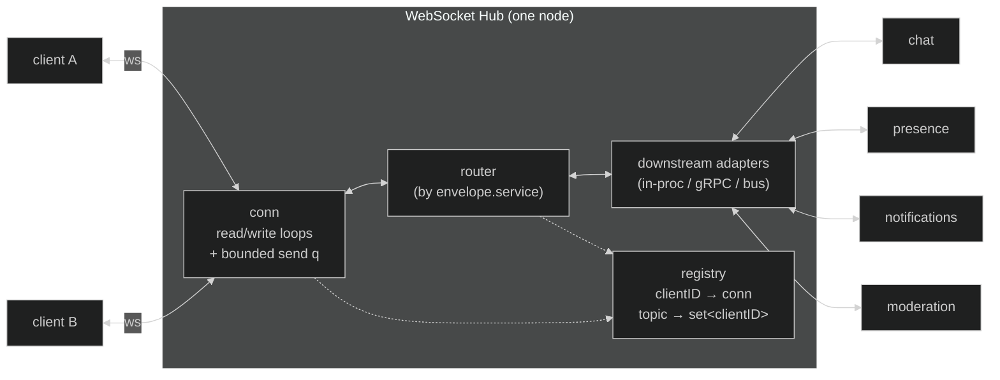
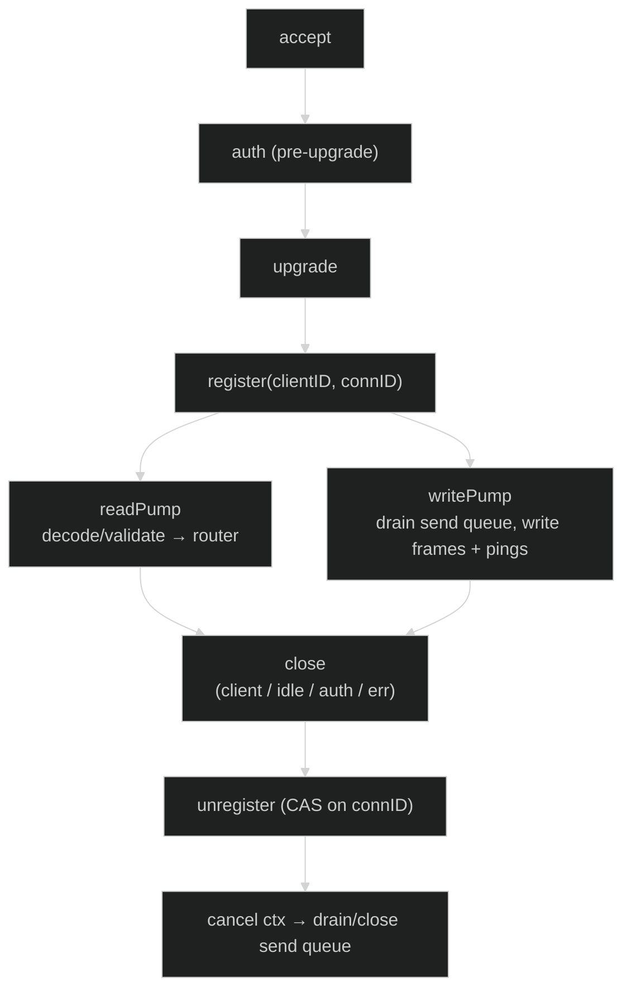

# WebSocket Hub — Design Doc

**Author:** Brian Takita
**Audience:** Haiven backend + frontend + product
**Status:** Draft for team review (pre-implementation)
**Scope:** A single WebSocket Hub in Go: one persistent connection per client, multiplexing many downstream services (chat, presence, notifications, moderation) over that one socket.

> This is a design doc, not a finished product. I've called out assumptions inline and separated "build now" from "defer." Where I lean on prior experience building realtime backpressure/sync primitives, I've folded the *reasoning* into the design rather than reaching for a framework — see [§9 Why not a framework](#9-why-not-a-framework-yet).

---

## 1. Assumptions & constraints

I'm making these explicit so they're easy to challenge:

- **Scale target (unknown — needs input):** I design the single-node hub concretely and treat multi-node scale-out as a *seam*, not a v1 build. My default assumption is "tens of thousands of concurrent connections per node," which one Go process handles comfortably. If we're targeting millions, the routing-plane decision (§3) moves earlier.
- **Clients are on unreliable networks.** Reconnects are normal, not exceptional. The design assumes drops, duplicate connections, and resumes are routine.
- **Most traffic is small, frequent, latency-sensitive** (chat lines, presence ticks, notifications). A few message classes are state-like (presence) where only the latest value matters.
- **Downstream services are internal and trusted.** The hub authenticates *clients*; it trusts downstream services (mTLS/network boundary, not per-message auth).
- **Delivery guarantee is per-message-class, not global.** Presence can be at-most-once; a moderation action probably wants at-least-once. I don't assume one guarantee fits everything.
- **We control both the client SDK and the hub.** So the envelope and reconnect/resume protocol are ours to define together with frontend.

---

## 2. High-level design



### 2.1 How clients connect, authenticate, and stay connected

1. **Connect:** client opens `wss://.../connect`. Auth happens *before* the WebSocket upgrade — a short-lived bearer token (JWT or opaque session token) in the `Authorization` header or a query param (query param only if the client can't set headers; it leaks into logs, so header is preferred). We validate the token at the HTTP layer and reject with `401` before upgrading. **Rationale:** authenticating pre-upgrade means an unauthenticated client never gets a goroutine or a socket slot — it's the cheapest place to shed bad load.
2. **Identify:** on success we stamp a server-authoritative `clientID` (from the token subject) and a per-connection `connID` (a fresh generation counter). The client never asserts its own identity in message bodies — the hub stamps it. This kills a whole class of spoofing bugs.
3. **Maintain:** the connection is held by one node (it's a TCP socket — inherently stateful, pinned to a node). We keep it alive with app-level ping/pong + read deadlines (§4.5). Token refresh: the client can send a `auth.refresh` control message with a new token before the old one expires, so we don't have to tear down a live socket just because a JWT aged out.

### 2.2 How messages are framed and routed

A single JSON (v1) envelope wraps every message. The `service` field is the routing key. See [§8 envelope schema](#8-message-envelope-schema).

- **Client → downstream:** read loop decodes the envelope, validates it, and the router dispatches to the downstream adapter registered for `envelope.service`. Unknown service → error frame back to the client, connection stays up.
- **Downstream → client(s):** downstream pushes an envelope naming a target (`clientID`, or a `topic` for fan-out). The router resolves targets against the registry and enqueues onto each target's send queue.

### 2.3 Concurrency model in Go

The classic, boring, correct pattern — two goroutines per connection plus owned state:

- **`readPump` goroutine (1 per conn):** the *only* reader of the socket. Decodes envelopes, validates, hands them to the router. Owning all reads in one goroutine is required — gorilla/nhooyr sockets are not safe for concurrent reads.
- **`writePump` goroutine (1 per conn):** the *only* writer of the socket. Drains a **bounded** `chan []byte` (the send queue) and writes frames + pings. Single-writer for the same reason.
- **Registry ownership:** two viable shapes, and this is a real trade-off:
  - **(a) Single hub goroutine (actor):** one goroutine owns the `map[clientID]*conn` and `map[topic]set` and mutates them via channels (`register`, `unregister`, `broadcast`). No locks, no data races by construction. Simple to reason about; the hub goroutine can become a throughput ceiling under very high fan-out.
  - **(b) Sharded lock-based registry:** `sync.Map` or an array of `N` shards each guarded by its own `RWMutex`, keyed by `hash(clientID) % N`. Scales fan-out across cores; more care needed around lock ordering and iteration.
  - **My default: start with (a)** for correctness and legibility, with the registry access behind an interface so we can drop in (b) if profiling shows the hub goroutine is hot. Fan-out (the thing that stresses the single goroutine) is the first thing I'd move to sharded reads.
  - **On "CAS on `connID`" (§6.1) — it's a *logical* compare-and-swap, not a hardware one.** A Go `map` is a multi-word structure, so `sync/atomic` CAS (which only works on a single machine word — `atomic.Int64`, `atomic.Pointer[T]`) **cannot** atomically swap a map entry. So in the actor model the compare-then-delete is atomic for free (one goroutine, serialized). In the sharded-lock model it's a compare-and-delete **inside the write lock** — real hardware CAS is reserved for word-sized state (the `connID` generation counter via `atomic.AddUint64`, or an `atomic.Pointer` swap of an *immutable* registry snapshot for a read-mostly copy-on-write variant, which is O(n)-copy-per-mutation and wrong for our write-hot connect/disconnect path). **Registry = lock or actor; CAS = the per-entry generation check, and only lock-free if you accept COW.**

    ```go
    // sharded-lock: compare-and-delete (logical CAS on connID)
    func (s *shard) unregister(k clientKey, connID uint64) {
        s.mu.Lock()
        if c, ok := s.m[k]; ok && c.connID == connID { // only if still ours
            delete(s.m, k)
        }
        s.mu.Unlock()
    }
    // connID itself is a genuine atomic:
    // connID := atomic.AddUint64(&gen, 1)
    ```
- **Context propagation:** every goroutine is born from the connection's `context.Context`; closing it (auth expiry, shutdown, dead conn) cascades cleanly to both pumps.

Per-connection cost is ~2 goroutines + one bounded buffer + envelope scratch. That's the dominant memory line (§7 tradeoffs).

### 2.4 How downstream services integrate

Downstream integration is behind one Go interface so the transport is swappable:

```go
type Downstream interface {
    // Name is the routing key clients address (envelope.service).
    Name() string
    // Handle is called for each client→service message.
    Handle(ctx context.Context, msg Envelope) error
}

// The hub gives downstreams a handle to push back to clients:
type Sink interface {
    SendToClient(clientID string, msg Envelope) error // returns ErrSlowConsumer / ErrNotConnected
    SendToTopic(topic string, msg Envelope) (delivered int)
}
```

Three concrete transports, in increasing order of decoupling:

- **In-process** (fastest, simplest): the chat service is a Go package linked into the hub. Great for v1 and for co-located services.
- **gRPC** (bi-directional stream per service): the hub holds a stream to each downstream. Clear boundary, independent deploy.
- **Message bus** (NATS/Redis Streams/Kafka): the hub publishes client→service on a subject and subscribes to service→client. **This is also the natural cross-node fan-out plane** (§3).

The interface is the contract; we can run different services on different transports at the same time.

---

## 3. Stateful hub vs stateless routing

This is the decision that shapes everything, so I'm pulling it out.

The socket itself is *always* stateful — a TCP connection is pinned to exactly one node. So "stateless hub" never means "no state on the node." It means **where the routing/membership plane lives**:

| | **Stateful hub (v1 default)** | **Stateless routing (scale-out)** | **Hybrid (my real recommendation)** |
|---|---|---|---|
| Connection state | In node memory | In node memory (unavoidable) | In node memory |
| Routing/registry | In node memory | Externalized (bus + shared presence/routing table) | Local registry + shared routing plane for cross-node |
| Cross-node fan-out | N/A (single node) | Via bus subjects / pub-sub | Publish to bus keyed by clientID/topic; owning node delivers |
| Reconnect to a different node | Loses in-mem state | Fine — state was external | Fine — routing plane re-resolves the client |
| Latency | Lowest (one hop) | +1 hop per message through the bus | Local stays local; cross-node pays one hop |
| Ops complexity | Lowest | Highest (bus, routing table, dedup) | Medium |
| Failure blast radius | Whole node's clients drop | Smaller — clients reconnect anywhere | Node loss drops its sockets; clients reconnect + re-resolve |

**Recommendation:** ship the **stateful single node** first (it's the correct core and we need the connection layer regardless), but hide the registry and fan-out behind interfaces so the **hybrid** is a drop-in: keep the live socket + a local registry on each node, and add a **routing plane** (start with NATS or Redis pub/sub) that maps `clientID → owning node` and carries cross-node messages. We do *not* externalize the socket; we externalize *addressing*. This gets horizontal scale and node-loss survivability without paying the bus hop for the common single-node case.

**What I'd defer:** the routing plane itself. Build the seam now (interfaces), build the plane when the connection count or the availability requirement forces multi-node — not before. Premature clustering is where these systems rot.

---

## 4. Low-level design

### 4.1 Connection lifecycle



- **register:** insert into registry. If `clientID` already has a live conn, apply the **duplicate-connection policy** (§6.1) before inserting.
- **unregister:** idempotent — driven by whichever pump exits first; both exits funnel through a `sync.Once`-guarded close so we never double-unregister or double-close the send channel.
- **read loop:** `SetReadLimit` (max frame), `SetReadDeadline` refreshed on each pong, decode, validate, dispatch. Any read error → close.
- **write loop:** `select` over the send queue and a ping ticker; every write gets a `SetWriteDeadline`. A write timeout means the consumer is dead → close.

### 4.2 Envelope & routing decisions

Router keeps `map[service]Downstream`. Decision per inbound message:

1. Envelope well-formed & within size limit? No → error frame (or close on repeated abuse).
2. `service` known? No → error frame `unknown_service`.
3. Rate within the client's budget for this service? No → drop or error per policy (§4.3).
4. Dispatch to `downstream.Handle`. Non-blocking from the read loop's perspective — the adapter owns its own queue so a slow downstream can't stall the socket read loop.

### 4.3 Backpressure (the part I care most about)

Backpressure is per message class, not one global policy. Each send queue is **bounded**; the interesting question is *what happens when it's full*. Options, and where each fits:

- **Block the producer:** the danger isn't the *client→hub* read side — each connection has its own `readPump`, so a slow *sender* only stalls its own goroutine. The danger is the *hub→client* write side: when a **shared** producer (a fan-out loop, or a downstream pushing to many clients) does `clientCh <- msg` and one client's bounded send queue is full, a *blocking* send stalls that shared goroutine — and now one slow **receiver** delays delivery to every other client on that loop. So the rule is: enqueue to a client send queue **non-blockingly** (`select { case ch <- msg: default: applyOverflowPolicy() }`) and let the policy below decide. Per-connection goroutines protect the read path; the write/fan-out path needs non-blocking enqueue.
- **Drop-newest / drop-oldest:** fine for fire-and-forget classes (typing indicators). Drop-oldest for "latest wins" feel.
- **Conflate / coalesce:** for **state-like** classes (presence: "player is online/idle/offline"), the queue should hold *only the latest* value per key, not a backlog. A slow consumer catching up sees current truth, not a replay of every transition. This is a queue keyed by `(service, entityID)` where a new value overwrites the pending one.
- **Spill:** for must-not-lose classes, overflow goes to a bounded durable buffer (outbox — an append-only log in an embedded store like BoltDB/SQLite, or the bus with retention) instead of memory. **Recovery is a cursor over that log:** when the consumer drains below a low-water mark (or reconnects with a `resumeToken`), stream sequentially from the last-acked offset in **bounded batches** — never load the whole backlog into memory — re-enqueue in order, and advance/delete the cursor as acks arrive. Heavier; reserve for at-least-once classes.
- **Disconnect the slow consumer:** last resort — if a client can't keep up past a threshold, close it and let it reconnect + resume. Protects the rest of the system.

The policy is a property of the message class, declared in a small table, not hardcoded per call site:

```
class            overflow policy       guarantee
chat.message     spill→outbox          at-least-once (+ dedup)
presence.state   conflate-by-entity    at-most-once (latest wins)
typing.indicator drop-newest           at-most-once
notification     spill→outbox          at-least-once
moderation.action spill→outbox         at-least-once
```

> This "policy per class" framing is the one place my prior work most directly informs the design — I've built backpressure primitives (bounded relay, conflation, spill-to-durable, drop policies, role-based routing) as reusable pieces before. Here I'd implement only the two or three policies we actually need, in the hub, in Go stdlib + channels. See [§9](#9-why-not-a-framework-yet).

### 4.4 Fan-out

Downstream pushes one message to many clients (e.g., "server-wide announcement," "everyone in room 42"):

- **Addressing:** `SendToTopic(topic, env)`. Registry holds `map[topic]set<clientID>`; clients subscribe/unsubscribe via control messages (which the hub authorizes).
- **Delivery:** iterate the topic's set, enqueue on each client's send queue **without blocking** — a full/slow queue applies that client's per-class overflow policy; it must never stall the fan-out loop or the other recipients.
- **Hot path & worker model:** large fan-outs are exactly what pressures the single hub goroutine (§2.3). If profiling shows it, split the two concerns: keep **membership mutation** (subscribe/unsubscribe) serialized in a per-topic actor for correctness, and move the **delivery iteration** to a bounded **worker pool** — the broadcast becomes a job pushed onto a buffered `chan job`, and M workers dequeue and do the non-blocking enqueue to each recipient. You don't hand-write a push/pop "queue actor": a buffered channel already gives you concurrent-safe MPMC queue semantics, so producers push and workers pop the same channel. The per-recipient enqueue stays non-blocking regardless.
- **Cross-node:** in the hybrid model, `SendToTopic` publishes to the routing plane; each node delivers to its local subscribers. No node needs the global client list.

### 4.5 Heartbeat / dead-connection detection

- **App-level ping/pong** (not just TCP keepalive, which is too coarse and often stripped by proxies/load balancers). Server sends a ping every `pingInterval` (e.g. 20s); pong handler refreshes the read deadline.
- **Read deadline** = `pingInterval * ~2.5`. Miss it → declare dead, close, unregister. This catches half-open connections that TCP thinks are fine.
- **Write deadline** on every write catches a consumer whose receive buffer is wedged.
- Client mirrors with its own idle detection and **reconnect with jittered exponential backoff** so a mass disconnect (node restart) doesn't become a thundering-herd reconnect.

---

## 5. Delivery guarantees (product-facing framing)

- **At-most-once** (default, cheapest): send and forget. Right for presence and typing — a lost presence tick is corrected by the next one.
- **At-least-once** (ack + redelivery + client-side dedup by message ID): right for chat, notifications, moderation. Requires an outbox on the send side and a dedup window on the receive side. Costs memory/storage and adds the possibility of duplicates the client must swallow.
- **Exactly-once:** I would *not* build this. It's at-least-once + idempotent handling + dedup, and calling it "exactly once" oversells it. If a class truly needs it, we get there with idempotency keys, not a distributed-transactions rabbit hole.

The guarantee is chosen **per message class** (the table in §4.3), so we only pay for durability where it matters.

---

## 6. Edge cases

### 6.1 Reconnect & duplicate connections
The `connID` generation counter is the tie-breaker. Policy options:
- **Last-writer-wins (default):** newest connection for the same identity evicts the older one (send it a `superseded` close frame). Matches "user switched networks / reopened the app."
- **Reject duplicate:** keep the old, refuse the new. Rarely what users want.
- **Allow multi-device:** key the registry by `(clientID, deviceID)` and fan-out to all. This is a *product* decision (§10 frontend Q) — do we support one user on phone + desktop simultaneously?

**Registry key & the race:** the identity key is `(clientID, deviceID)`, and eviction/unregister must be a **compare-and-swap on `connID`** — an unregister only deletes the entry if the currently-registered `connID` still equals the exiting conn's. Without this, a laggy old connection's cleanup can fire *after* the reconnect registered a fresh conn under the same key and silently evict the new (live) one. In the actor model this ordering is serialized for free; with sharded locks you write the CAS explicitly. A different `deviceID` is a coexisting connection, not a duplicate.

**Client-side dedup (bounded):** the client does **not** retain every message id. Because `id` is a ULID (time-ordered), the client keeps a per-service **high-water mark** plus a small recent-id set sized to the redelivery/resume window (last *N* or last *T* seconds). Anything with an id below the mark is assumed already processed → drop. Redelivery only happens inside that window, so memory stays bounded regardless of session length.

**Optimistic send / echo dedup:** the sender stamps a client-local `corr` on the outbound message. It renders optimistically, then receives the topic fan-out echo carrying the authoritative `id` + the same `corr` + the origin `device`. The originating device matches by `corr` and replaces its optimistic copy (no duplicate render); the user's *other* devices have no matching `corr`, so they render it as normal inbound. That's why `device` is in the envelope — without it you can't distinguish "my own echo on this device" from "my other device's message."

**Resume:** on reconnect the client presents a `resumeToken` (last message ID/`seq` it saw per service). For at-least-once classes we replay from the outbox after that ID. For at-most-once classes we send current state (presence snapshot) and move on.

### 6.2 Out-of-order delivery
Per-`(service)` monotonic sequence numbers stamped by the hub/downstream. Client can reorder or dedup on them. For chat, small reorders are usually acceptable and cheaper than strict ordering; for state-like classes, conflation (§4.3) makes ordering moot — latest wins.

### 6.3 Oversized / malformed messages
`SetReadLimit` rejects oversized frames at the socket layer (close code `1009`). Envelope validation (schema + size + required fields) rejects malformed ones with an error frame. Repeated abuse from one connection → close + brief ban. Never let a bad frame panic the read loop; decode errors are data, not crashes.

### 6.4 A downstream service going down
- **Circuit breaker** per downstream: after N consecutive failures, *open* the breaker (stop dispatching, fail fast with `service_unavailable`); after a cooldown, allow one *half-open* probe; success *closes* it, failure re-opens. One dead downstream never takes the hub with it.

  ```go
  type Breaker struct {
      mu        sync.Mutex
      failures  int
      state     state         // closed | open | halfOpen
      openUntil time.Time
      threshold int           // consecutive failures to trip
      cooldown  time.Duration
  }

  func (b *Breaker) Allow() bool {
      b.mu.Lock(); defer b.mu.Unlock()
      if b.state == open {
          if time.Now().After(b.openUntil) { b.state = halfOpen; return true } // one probe
          return false
      }
      return true // closed or half-open probe already granted
  }

  func (b *Breaker) Record(err error) {
      b.mu.Lock(); defer b.mu.Unlock()
      if err == nil {
          b.failures, b.state = 0, closed // success → close
          return
      }
      b.failures++
      if b.state == halfOpen || b.failures >= b.threshold {
          b.state, b.openUntil = open, time.Now().Add(b.cooldown)
      }
  }
  ```
  Call `Allow()` before dispatch; `Record(err)` after. (Time is injected/mockable in real code; `time.Now()` shown for brevity.)
- **Buffering vs shedding:**
  - *At-least-once classes* (chat/notifications): buffer in the **bounded** unacked queue; on overflow, **spill to the durable outbox** (§4.3); if durable is also exhausted/unavailable, shed the oldest and send the client a `service_degraded` control message so the UI can show "reconnecting." Replay from the outbox cursor on recovery.
  - *At-most-once classes* (presence/typing): **don't buffer** — shed silently, but emit a lightweight degraded signal (e.g. `presence.stale`) so the client greys out presence instead of showing stale state as fresh.
  - The hub's own liveness is never contingent on a downstream being up.

### 6.5 Slow consumers
Covered by §4.3 — per-class overflow policy, escalating to disconnect + resume. The invariant: **one slow client can never degrade delivery for other clients** or stall a shared goroutine.

---

## 7. Tradeoffs (mixed product + engineering)

- **Delivery guarantee vs complexity:** at-least-once + resume is a real feature with real cost (outbox, dedup, storage). We buy it only for classes that need it. Presence stays cheap.
- **Latency vs throughput:** batching/coalescing writes raises throughput and per-message efficiency but adds a few ms of latency. For chat I'd bias latency (flush promptly); for presence I'd bias throughput (coalesce + flush on a tick).
- **Stateful vs stateless:** §3. Stateful is lower latency and simpler but scales vertically and loses in-mem state on node loss; stateless/hybrid scales horizontally and survives node loss at the cost of a hop and more ops surface.
- **Memory per connection:** ~2 goroutines + a bounded send buffer + scratch. At 50k conns this is the dominant cost. Levers: smaller send buffers (tighter backpressure), conflation (bounded regardless of burst), binary envelopes (§8) to shrink scratch. This is the number I'd watch first under load.

---

## 8. Message envelope schema

JSON for v1 (debuggable, ubiquitous client support). Binary (protobuf/msgpack) is a later optimization once the shape is stable — the `v` field lets us evolve.

```jsonc
{
  "v":    1,                    // envelope version (additive evolution)
  "id":   "01J...ULID",         // message id (ULID: sortable, dedup + ordering)
  "ts":   1720900000000,        // server-stamped epoch ms
  "service": "chat",            // routing key → downstream adapter / from downstream
  "type": "message.create",     // service-specific message type
  "client": "u_123",            // server-stamped identity (JWT `sub`; ignored if client sends it)
  "device": "d_ios_9f",         // originating device (client-supplied, echoed back)
  "topic": "room:42",           // optional: fan-out target / subscription
  "seq":  8891,                 // per-service monotonic sequence (ordering/dedup)
  "corr": "c_local_7712",       // optional client-generated correlation id (optimistic-send echo, acks)
  "payload": { }                // opaque, service-defined body
}
```

Design notes: identity and timestamps are **server-authoritative** (`client` = JWT `sub`; client-supplied values overwritten). `id` is a server-assigned ULID → dedup key + coarse time-order. **`corr` is client-generated** and echoed unchanged: the sender stamps a temporary local id on send, the hub assigns the authoritative `id` and echoes `corr` in the fan-out copy, so the originating device can match the echo to its optimistically-rendered message and dedup it (§6.1). `device` scopes that dedup to the sending device — a user's *other* devices see the message as normal inbound.

---

## 9. Why not a framework (yet)

I've built realtime backpressure and reliable-sync primitives before (bounded relay with spill/conflation/drop policies, durable outbox, presence/membership with last-writer-wins). It would be easy to reach for a library. **I'd recommend against it for this hub.** Reasons:

- The hub needs a *small slice* of those ideas — two or three overflow policies and one outbox. Pulling in a general framework imports concepts and API surface we don't need and can't easily debug under load.
- Go stdlib channels + gorilla/nhooyr WebSocket + a bounded send queue cover the core cleanly. The sophisticated part is *choosing the right policy per message class*, which is design work, not a dependency.
- Owning the ~200 lines that matter (send queue, conflation map, outbox) keeps the failure modes legible to the whole team.

So: **borrow the reasoning, not the runtime.** If we later find we're reinventing a lot of the same machinery across services, that's the moment to extract a shared internal package — earned, not adopted up front.

---

## 10. Working with the team

### Questions for the backend team
1. **Delivery guarantees & persistence — do we need at-least-once + resume for chat in v1, or is at-most-once acceptable to start?**
   *Options:* (a) at-most-once everywhere first, add durability later; (b) at-least-once for chat/notifications/moderation from day 1.
   *My lean:* (a) for the fastest correct core, with the class-policy table (§4.3) already in place so upgrading a class to at-least-once is a config change plus an outbox, not a rewrite.
   *What would change my mind:* if product considers a dropped chat message a data-integrity bug (not a UX blip), I'd build the outbox in v1.
2. **Scale-out topology & target scale — session affinity at the LB vs a routing plane, and how many concurrent connections are we sizing for?**
   *Options:* (a) single node + vertical scale; (b) sticky sessions at the LB; (c) hybrid routing plane (§3).
   *My lean:* build (a) now behind interfaces that make (c) a drop-in; don't build the plane until the numbers demand it.
   *What would change my mind:* a hard availability SLA (no client drop on a single node loss) pulls the routing plane into v1.

### Questions for the frontend team
1. **Reconnect & resume semantics — will the client hold a `resumeToken` + dedup by message `id`, or should the server guarantee no duplicates?**
   *Trade-off:* client-side dedup lets the server stay simple (at-least-once + resend); server-side no-dup pushes complexity and state onto the hub.
   *My lean:* client dedups by `id` (cheap, robust across reconnects). I'd want to hear from frontend how much per-service state they're comfortable tracking.
2. **Multi-device & duplicate connections — is one user allowed on multiple devices at once, and what should happen to the older connection on reconnect?** (§6.1)
   *Options:* last-writer-wins (evict old), or true multi-device fan-out keyed by `(clientID, deviceID)`.
   *Impact:* this changes the registry key, the presence model, and the reconnect UX. It's as much a product decision as an engineering one — I'd want frontend + product in the room.
   *Bonus:* envelope schema + versioning — I'd want frontend to co-own the `type` catalog and confirm additive-only evolution works for their release cadence.

### How I'd split the work (3 engineers, 1–2 sprints)
Contract-first: **day 1 we agree on the envelope schema (§8) and the `Downstream`/`Sink`/registry interfaces (§2.4).** Everyone then builds against interfaces, integrating continuously.

- **Track A — Connection layer (owns the socket):** HTTP auth + pre-upgrade rejection, upgrade, per-conn read/write pumps, heartbeat/deadlines, registry (single-goroutine actor), graceful shutdown. *Deliverable:* clients can connect, stay alive, and be looked up. *Interface it exposes:* registry + `Sink`.
- **Track B — Routing, envelope & downstream (owns message flow):** envelope encode/decode + validation, router, the three downstream transports (start in-process), the per-class backpressure/overflow policies + conflation, at-least-once outbox for the classes that need it. *Deliverable:* a client message reaches a downstream and a downstream message reaches a client.
- **Track C — Fan-out, resilience & observability (owns "does it hold up"):** topic subscribe/fan-out, reconnect + resume protocol, duplicate-connection policy, circuit breakers for downstream outages, metrics/tracing (§11), and a load-test harness that simulates unreliable-network clients (drops, slow consumers, reconnect storms).

These parallelize cleanly because A owns the socket, B owns message semantics, and C owns cross-cutting resilience — they meet at the shared interfaces, not in the same files. The load-test harness (C) is what keeps A and B honest as they go.

---

## 11. How we'll know it's working

Instrument from day 1 — these double as SLOs and as the early-warning system:

- **Connections:** current concurrent, connect/disconnect rate, reconnect rate (a spike = network or deploy problem), auth-reject rate.
- **Throughput & latency:** messages/sec in & out per service, end-to-end delivery latency (client→downstream→client), ping RTT distribution.
- **Backpressure (the leading indicator):** send-queue depth per connection (p50/p99), dropped-message count per class, conflation hit rate, slow-consumer disconnects. Rising queue depth predicts trouble before users feel it.
- **Downstream health:** per-service error rate, circuit-breaker state, dispatch latency.
- **Resource:** goroutine count (should track ~2× connections; a divergence means a pump leak), memory per connection, GC pressure.

Load test against the SLOs: N concurrent clients on simulated unreliable networks, sustained + burst fan-out, one downstream killed mid-test, a cohort of deliberately-slow consumers. "Working well" = latency SLO held, no memory growth beyond connection count, one dead downstream doesn't degrade the others, and slow consumers get shed without collateral damage.

---

## 12. What I'd intentionally defer

- **Multi-node clustering / routing plane** — build the seam (§3), not the plane, until scale or availability forces it.
- **Binary envelope** (protobuf/msgpack) — JSON until the schema stabilizes; `v` field makes the switch cheap.
- **Exactly-once** — not building it; idempotency keys where a class truly needs it.
- **Rich moderation/admin tooling** — hooks and metrics now; the console later.
- **Per-room ACLs & fine-grained authz** — coarse auth in v1; the granular model once product defines the roles.
- **Message history/replay beyond the resume window** — the outbox covers reconnect resume; long-term history is a separate service, not the hub's job.

---

## Appendix: a single message's path (walkthrough)

Client A sends a chat line to room 42:

1. **Client A** serializes an envelope `{v:1, service:"chat", type:"message.create", topic:"room:42", payload:{text:"gg"}}` and writes it to its socket. (It may set `id`/`client`; the hub overwrites them.)
2. **`readPump` (conn A)** reads the frame, checks size (`ReadLimit`), decodes the envelope, validates it, and stamps `id` (ULID), `ts`, `client:"u_A"`, `seq`.
3. **Router** looks up `service:"chat"` → the chat `Downstream`, checks A's rate budget for chat, and calls `chat.Handle(ctx, env)` (which enqueues onto chat's own queue — the read loop doesn't block on chat).
4. **Chat service** persists the message, resolves room 42's members, and for each recipient calls `sink.SendToTopic("room:42", outEnv)` (or `SendToClient` per member).
5. **Registry** resolves `room:42` → `{u_A, u_B, u_C}`; for each, the message is enqueued on that client's bounded send queue. If B's queue is full, B's chat overflow policy applies (spill→outbox, since chat is at-least-once) — B's slowness doesn't touch A or C.
6. **`writePump` (conn C)** wakes on its queue, sets a write deadline, and writes the frame to C's socket.
7. **Client C** receives it, dedups by `id` (no-op first time), and renders it. On a later reconnect, C presents its last-seen `id` for chat and the outbox replays anything after it.

Total in-node hops for the common case: read → route → downstream → registry → write. One node, no bus. Cross-node (hybrid): step 4's `SendToTopic` publishes to the routing plane and the node owning B/C delivers locally — one extra hop, only for clients not on this node.
