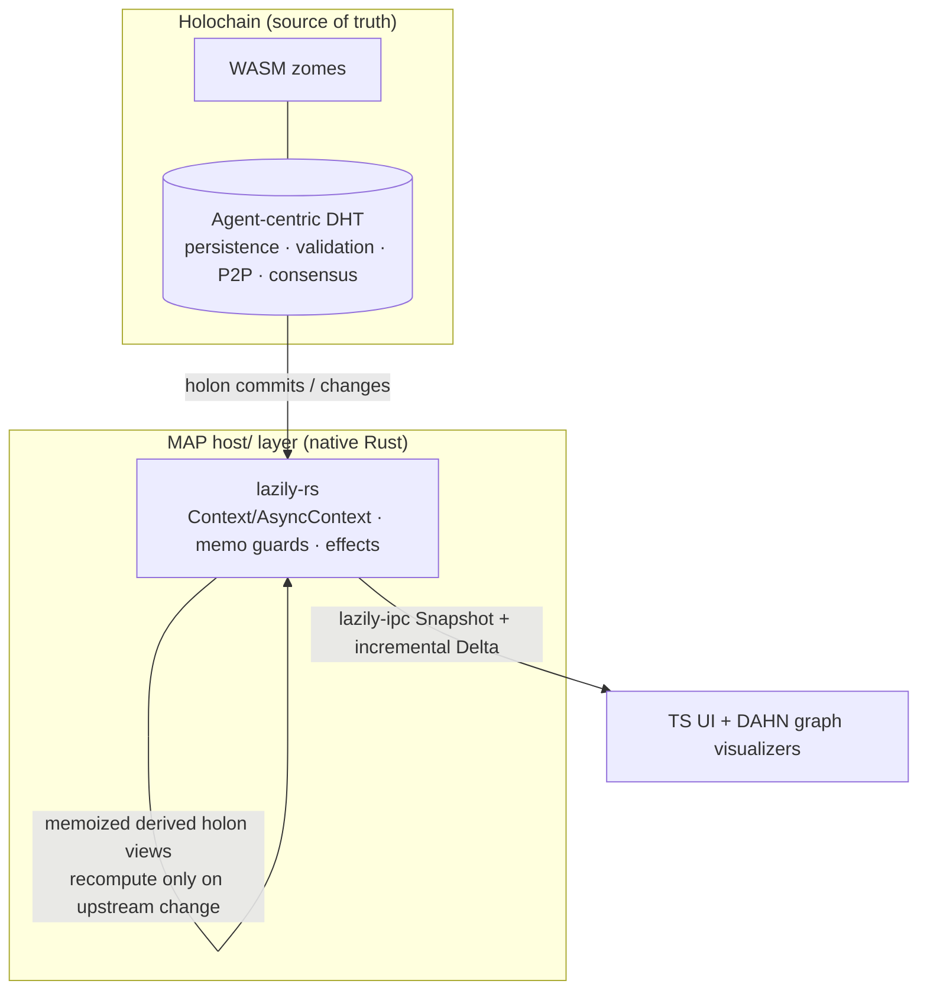

# lazily-rs: Reactive Signals Library

<!-- agent:status -->
- [x] Phase 1: Research & design
- [x] Phase 2: Core signal primitives
- [x] Phase 3: Derived/computed signals
- [x] Phase 4: Effect system
- [x] Phase 5: Testing & benchmarks
- [x] Phase 6: Documentation & publish
<!-- /agent:status -->

<!-- agent:exchange -->
### Session Summary

*Compacted. Content archived to `/home/brian/work/btakita/agent-loop/.agent-doc/archives/c9ad2e57a5d8366a1fa779d4afde380ce07377133e6daf1d8810384e1383c400-20260611-222220.md`*

Compacted content:
- Prior summary/context: ### Session Summary *Compacted. Content archived to `/home/brian/work/btakita/agent-loop/.agent-doc/archives/c9ad2e57...

### Re: next-steps to fix lazily-rs bugs — opus-4-8

> **Queue prompt:**
>
> What are #next-steps to fix lazily-rs bugs?

**There are no open bugs right now.** I verified the current state rather than assume one:

- `cargo test --all-features` → **277 passed, 0 failed** (14 suites, 536s).
- `make test-loom` (exhaustive `thread_safe_loom` model) → **15 passed, 0 failed** (544s) — the just-landed sidecar-invalidation hardening (`c80ba70`) holds under interleaving.
- Latest CI (run `27367810445`) is **green**.

The two previously-tracked bug classes are already fixed in v0.10.3:
- `#k03k` async race (`get() already checked Resolved` / `notifier dropped` panics) — replaced by the resolve-loop at `src/async_context.rs:758+` that handles both windows; the panic strings are gone.
- thread-safe sidecar invalidation — hardened in `c80ba70` with stress + spec coverage.

So "fixing bugs" is now **bug-prevention**: the one real correctness gap is that the `#k03k` async fix has **no exhaustive interleaving model and is not in CI**. `ThreadSafeContext` has `tests/thread_safe_loom.rs` + a CI loom step; `async_context.rs` has only randomized stress (`tests/async_stress.rs`). A concurrency fix without a model is regression-prone.

**Backlog (priority order):**
1. **`#ytp5` `#lzasyncloom`** (top) — deterministic coverage of the two `#k03k` windows. Plan: `tasks/software/plan-lazily-async-loom.md`.
2. `#dh3k` `#lzspecconf` [recommended] — Run the `lazily-spec` canonical conformance fixtures (`6632cb0`) in CI so cross-language wire-protocol drift fails the build.

**Top of backlog: `#ytp5`** (`#lzasyncloom`).

### Re: #ytp5 (#lzasyncloom) — Option 1, done — opus-4-8

> **Queue prompt:**
>
> [#ytp5]

**Architecture recommendation: Option 1 (instrumentation seam), not Shuttle.** The deciding factor is structural: Shuttle needs `async_context.rs` to be generic over its concurrency primitives (swap tokio↔shuttle executor + `watch` + `Arc` under `cfg`) — the way `thread_safe.rs` was *built* for Loom (`#[cfg(loom)] use loom::sync` at the top). `async_context.rs` is hard-coded to tokio, so Shuttle means a tokio-decoupling refactor whose main beneficiary is the test harness, verifying an *approximation* of tokio rather than the real path. Option 1 tests the real path, deterministically, proportional to the one known gap. Shuttle is queued gated as `#57by` (`#lzasyncshuttle`).

Shipped Option 1 and closed `#ytp5`:

- **`tests/async_resolve_loop.rs`** (`async` + `instrumentation`): **Window 1** (`Resolved` published in the *synchronous* gap between fast-path `get()` and re-lock — no `.await`, so cooperative scheduling can't reach it) forced via a one-shot `instrumentation`-gated seam (`__install_window1_hook`), asserts the race arm via `__window1_resolved_hits == 1`; **Window 2** (superseded notifier drop → re-resolve) via gated supersede.
- **`src/async_context.rs`**: seam (`Window1Hook`, one-shot hook field, resolved-arm counter, accessors) entirely behind `#[cfg(feature = "instrumentation")]`, compiled out of default/release.
- **`SPEC.md`**: documents why Loom can't model this path + the deterministic window coverage + the Shuttle follow-up.
- **`Makefile`**: `test-async-resolve` → `check` + `.PHONY`. **CI**: added a `--features async` step (async tests were **not run in CI at all**) + the resolve-loop step, beside loom.

**Verification:** `make check` → exit 0 (full suite incl. the 544s `thread_safe_loom` model + `benchmark-check`); `make test-async-resolve` → 2 passed; clippy `--all-targets --all-features` clean. Pushed: lazily-rs `8dcf962..990c630`, superproject pointer `94168d8c3..06e60de9c`.

**Top of backlog: `#dh3k`** (`#lzspecconf`).

### Re: #dh3k (#lzspecconf) — done — opus-4-8

> **Queue prompt:**
>
> [#dh3k]

Wired the IPC conformance suite to run against the **canonical** `lazily-spec` fixtures in CI, so cross-language wire-protocol drift fails the build.

**The gap:** conformance was not run in CI at all, and `conformance.rs` prefers `../lazily-spec/conformance` (canonical) over its local fixture copies — but that sibling never exists in a standalone CI checkout, so CI only ever validated the local copies. Drift between lazily-rs's IPC impl (or its local fixtures) and the canonical spec could ship silently.

**Fix** (`.github/workflows/ci.yml`):
- Clone `lazily-spec` (public, same org) as a sibling `../lazily-spec` — the exact path `conformance.rs` resolves — so it uses the canonical fixtures.
- Guard step: fail loudly (`::error::`) if `../lazily-spec/conformance` is missing, instead of silently falling back to local copies (false-green protection).
- Run `cargo test --features ipc --test conformance` against them.

No spec/test source change needed — `conformance.rs` and the fixtures already existed (the 6 local fixtures are currently byte-identical to canonical); the gap was purely the missing CI wiring.

**Verification:** `make test-ipc-conformance` → 9 passed (using the spec fixtures via the local sibling); CI YAML validated. Pushed: lazily-rs `990c630..2495018`, superproject pointer `7bbdbf2dc..c116dac73`. The new step validates on the pushed CI run.

Queue drained. Backlog is empty; the only open item is gated review `#57by` (`#lzasyncshuttle`, operator-gated Shuttle model).

_Note: the IPC finalize path again intermixed/scrambled this response (the recurring `#ipcdrift`/`#exch-intermix` route-owned-supervisor self-race, supervisor pid 337083 on pre-`7bfc82e3` agent-doc per the `stale_install` preflight warning). Recovered via hand-rebuild + `reset --from-current --preserve-session` + `commit`. Recommend `make install` in `src/agent-doc` + recycling the supervisor before the next managed cycle._

### Re: MAP Holons + DAHN integration — opus-4-8

**Short answer:** Yes, lazily-rs *can* integrate — but only in one specific niche: as a **host-side reactive derivation + delta-sync cache layered on top of Holochain**, never as a distribution/storage substrate. In that niche it's genuinely advantageous; outside it, it's redundant.

**What these are** (MAP is early proof-of-concept, so this is architectural, not battle-tested):
- **MAP** (Memetic Activation Platform, evomimic/Steve Melville) — a Holochain app. **MAP Holons** (`evomimic/map-holons`, ~81% Rust + WASM zomes) is its foundational layer: storage/retrieval/query of *self-describing, active holons*, staged then committed to Holochain's **agent-centric DHT**.
- **DAHN** (Distributed Agent-Hosted Network) — the social/"we-space" layer: contributing + requesting agents, with **holon graph visualizers**.

**Where lazily-rs fits (advantageous):**

- Model committed holons as reactive **graph nodes**; derived holon views/relationships (rollups, computed memes, DAHN aggregations) become **memoized computeds** that recompute *only* when an upstream holon changes — replacing hand-written cache invalidation.
- lazily-rs's **effects** drive side-effects (re-index, notify) on holon change; **batching** coalesces a multi-holon commit into one propagation pass.
- `lazily-ipc` **Snapshot + Delta** is a natural transport to push incremental updates to the TS UI / DAHN visualizers (in-process/local host↔UI sync, not P2P).
- Conceptual bonus: lazily-rs's `distributed.rs` is already **agent-centric** (`PeerPermissions`, `RemoteOp` read/write/trigger, permission-filtered snapshots) — philosophically aligned with Holochain's capability model, which makes the mental mapping clean.

**Where it does NOT help (honest caveats):**
- **Holochain's DHT already owns** persistence, validation, P2P networking, and consensus. lazily-rs has none of these — it's a cache/derivation layer, never a replacement.
- lazily-rs's **own** `distributed` / `signaling_client` / IPC-as-network features are **redundant** with Holochain — using them alongside it means two competing networking stacks. In a MAP context you'd use lazily-rs's *reactive core* and ignore its P2P layer.
- **WASM/zome limit:** zomes are wasm32, short-lived, stateless-per-call, single-threaded. `AsyncContext`/`ThreadSafeContext` (tokio/threads) **cannot run in a zome**; only the single-threaded `Context` could, and a persistent reactive graph doesn't fit the per-call zome model well. **The real fit is the native `host/` layer**, not in-zome.

**Net:** worth a small spike *if* MAP's host layer actually recomputes derived holon state or drives reactive visualizers — that's exactly what a lazy memoized dependency graph is for. Captured as `#lzmapspike` [recommended] in the backlog (gated on confirming the host layer has derived-state recompute, since both projects are early-stage).

**Sources:** [evomimic/map-holons](https://github.com/evomimic/map-holons) · [MAP Book](https://evomimic.gitbook.io/map-book) · [DAHN visualizers](https://evomimic.gitbook.io/map-book/dahn-human-experience-of-the-map/dahn-visualizers/graph-visualizers) · [Holochain DHT](https://developer.holochain.org/concepts/4_dht/)
<!-- agent:boundary:85280f9f -->
<!-- /agent:exchange -->
###
<!--
-->

## Queue 

<!-- agent:queue preset="#spec-test-build-install-commit-push" go -->
Please look at Map Holons + DAHN. Can lazily-rs integrate with Map? Would it be advantageous?

our core design specs and implementation plans are here: https://memetic-activation-platform.github.io/map-dev-docs/core/
[8:30 PM]evomimic: our roadmap is defined here: https://memetic-activation-platform.github.io/map-dev-docs/roadmap/
[8:30 PM]evomimic: near-term work is being driven by: https://memetic-activation-platform.github.io/map-dev-docs/roadmap/desc-driven-impl-plan/
[8:32 PM]evomimic: we're targeting end of Q3 (August) to have something we can demo
<!-- /agent:queue -->

## Backlog

<!-- agent:backlog queue -->
- [ ] [#pw26] #lzmapspike=[recommended] Spike: lazily-rs as a host-side reactive derivation + Snapshot/Delta UI-sync cache for MAP holons (evomimic/map-holons, Holochain). Model committed holons as reactive graph nodes; derived holon views/relationships as memoized computeds that recompute only on upstream change; stream lazily-ipc Snapshot/Delta to the TS UI / DAHN graph visualizers. Native host/ layer only (AsyncContext needs tokio; zomes are wasm32/short-lived/single-threaded so in-zome use is limited to single-threaded Context). Do NOT use lazily distributed/signaling — Holochain DHT owns P2P/persistence/validation/consensus. Gate on MAP host-layer actually recomputing derived holon state.
<!-- /agent:backlog -->

## Review

<!-- agent:review -->
- [/] [#57by] #lzasyncshuttle=[recommended, operator-gated] Exhaustive Shuttle interleaving model for the async resolve loop beyond the two known #k03k windows. Requires making src/async_context.rs generic over its concurrency primitives (swap tokio<->shuttle executor + watch + Arc under cfg) the way thread_safe.rs is generic over atomics for Loom — a real architectural change whose main beneficiary is the test harness, verifying an approximation of tokio rather than the real path. BLOCKED on operator approval to take on the tokio-decoupling cost; do only if the async graph grows more concurrency-critical paths. Window 1+2 already deterministically covered by tests/async_resolve_loop.rs.
- [/] [#jpf1] #webrtc-data=WebRTC data channel transport for peer-to-peer IPC (beyond signaling)
- [/] [#w30b] #gh-org=Create GitHub org (lazily-reactive or lazily) and transfer repos
<!-- /agent:review -->

## Icebox

<!-- agent:icebox -->
<!-- /agent:icebox -->

## Completed / Reaped

<!-- agent:done archive=tasks/software/lazily-rs.done.md -->

<!-- completed work archived in tasks/software/lazily-rs.done.md -->
<!-- /agent:done -->
