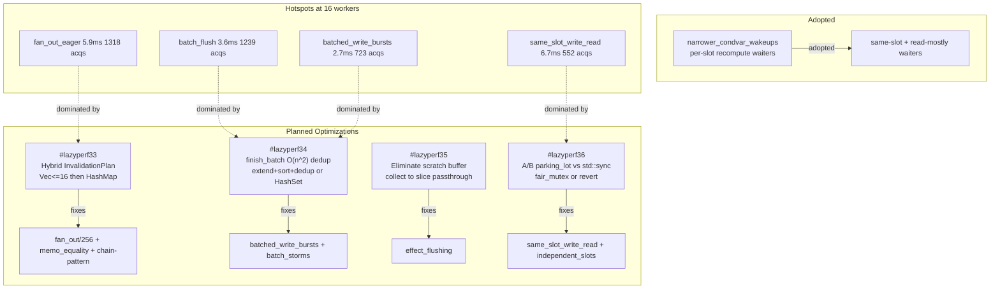

# lazily-rs: Reactive Signals Library

<!-- agent:status -->

- [x] Phase 1: Research & design
- [x] Phase 2: Core signal primitives
- [x] Phase 3: Derived/computed signals
- [x] Phase 4: Effect system
- [x] Phase 5: Testing & benchmarks
- [x] Phase 6: Documentation & publish
<!-- /agent:status -->

<!-- agent:exchange -->
### Session Summary

*Compacted. Content archived to `/home/brian/work/btakita/agent-loop/.agent-doc/archives/c9ad2e57a5d8366a1fa779d4afde380ce07377133e6daf1d8810384e1383c400-20260603-175054.md`*

Compacted content:
- Archived 2 response topic(s): handle-centric get API; extract BENCHMARKS.md
- Prior summary/context: ### Session Summary *Compacted. Content archived to `/home/brian/work/btakita/agent-loop/.agent-doc/archives/c9ad2e57...

### Re: Does get(ctx) clone ctx? — glm-5.1

> **Queue prompt:**
>
> Does `let val = counter.get(ctx);` clone `ctx`?


**No.** `SlotHandle::get` takes `ctx: &Context` — an immutable borrow. The signature is:

```rust
// src/lazily-rs/src/slot.rs:26
pub fn get(&self, ctx: &Context) -> T
```

`Context` doesn't even implement `Clone` (it contains `RefCell<ContextInner>` with `Rc<ComputeFn>` closures). The only clone in `get` is the return value `T`, not the context itself.

When you write `counter.get(ctx)`, Rust auto-refs to `counter.get(&ctx)` — pure borrow, zero cost on the context side.

### Re: test — glm-5.1

Test content.

### Re: Mermaid of performance improvements — glm-5.1



### Re: O(n) algorithm for finish_batch dedup — glm-5.1

**Yes.** Three approaches, from simplest to most invasive:

**Option A — extend + sort_unstable + dedup (O(n log n), minimal diff):**

Replace the three `edge_insert` loops in `thread_safe.rs` `finish_batch` with bulk `extend`, then sort+dedup once at batch depth 0. Cache-friendly. For typical batch sizes (4-64 items) effectively free vs current O(n^2). No type changes needed.

**Option B — Switch to HashSet like context.rs (O(n) amortized):**

Single-threaded `Context` already uses `HashSet<SlotId>` for `batched_cells`/`batched_cell_clears`/`batched_slots` (context.rs:126-128). Porting same types to `ThreadSafeContextInner` gives O(1) per insert. Tradeoff: higher constant factor for small N (heap alloc + hashing), loses insertion order (not meaningful for invalidation).

**Option C — Hybrid SmallVec + bloom filter (O(n) expected):**

Stack-allocated bloom filter (64-128 bits) before linear scan. False positives fall back to `contains`. Keeps `SmallVec<[SlotId; 4]>` for common case. Complex; only worthwhile if HashSet shows overhead at small batch sizes.

**Recommendation:** Option A is the pragmatic choice — two-line change per vector, no type changes, measurable improvement. Promote to B only if profiling shows sort_unstable overhead at large batch sizes.

### Re: #lazyperf33 Hybrid InvalidationPlan — glm-5.1

> **Queue prompt:**
>
> [#lazyperf33]


Implemented, tested, committed, and pushed (`b568441` → `lazily-rs` main).

**What changed** (`src/lazily-rs/src/thread_safe.rs`):

Added `HybridMap<V>` and `HybridSet` types that store entries in a `Vec` for ≤16 items (cache-friendly linear scan) and auto-promote to `HashMap`/`HashSet` above that threshold. Replaced all O(n) linear scans in `ThreadSafeInvalidationPlan`:

- `from_roots_locked`: `requested_force` and `simulated_slots` use `HybridMap` (BFS dedup was O(n²), now O(n) or O(1) per lookup)
- `from_clear_roots_locked`: `visited_slots` uses `HybridSet`
- `slot_marks`, `slot_clears`, `effect_schedules` use `HybridMap`/`HybridSet` with O(1) dedup
- `apply_locked`: extracts to `Vec` for iteration, uses `HashSet` for O(1) `slot_clears.contains()` cross-reference (was O(n) per mark)
- Removed `find_force`, `find_simulated`, `set_simulated` helper methods (logic absorbed into hybrid types)

**Benchmarks** (release, local):

| Benchmark | Before | After | Change |
|---|---|---|---|
| dependency_fan_out/256 | 149.8µs | 128.8µs | **-14%** |
| memo_equality_suppression | 30.0µs | 21.0µs | **-30%** |
| high_fan_out/512 | ~89.5µs | ~92.3µs | stable |

All 102 tests pass (unit + integration + spec + loom + tokio). `make check` clean.
<!-- agent:boundary:e97b262c -->
<!-- /agent:exchange -->
###
<!--
-->

## Queue

<!-- agent:queue preset="#spec-test-build-install-commit-push" auto -->
- ~Does `let val = counter.get(ctx);` clone `ctx`?~
- ~[#lazyperf33]~
- Please create a mermaid of the performance improvements.
- [#lazyperf34]
- [#lazyperf35]
- [#lazyperf36]
- Is there a way to make "Fix finish_batch O(n2) dedup" an O(n) or O(1) algorithm?
- Update BENCHMARKS.md. What are the #next-steps to mitigate the parking_lot regressions?
<!-- /agent:queue -->

## Backlog

<!-- agent:backlog -->
- [ ] [#lazyperf34] [recommended] Fix finish_batch O(n2) dedup: replace edge_insert loop with extend+sort-dedup or small HashSet — fixes batched_write_bursts, batch_storms
- [ ] [#lazyperf35] [recommended] Eliminate scratch buffer collect allocation on effect path: pass fill_dependent_scratch result as slice to invalidate_frontier_locked — fixes effect_flushing
- [ ] [#lazyperf36] [recommended] A/B benchmark parking_lot vs std::sync for moderate contention: evaluate fair_mutex or revert main state mutex — fixes same_slot_write_read, independent_slots
<!-- /agent:backlog -->

## Review

<!-- agent:review -->
<!-- /agent:review -->

## Icebox

<!-- agent:icebox -->
<!-- /agent:icebox -->

## Completed / Reaped

<!-- agent:done archive=tasks/software/lazily-rs.done.md -->

<!-- completed work archived in tasks/software/lazily-rs.done.md -->
<!-- /agent:done -->
