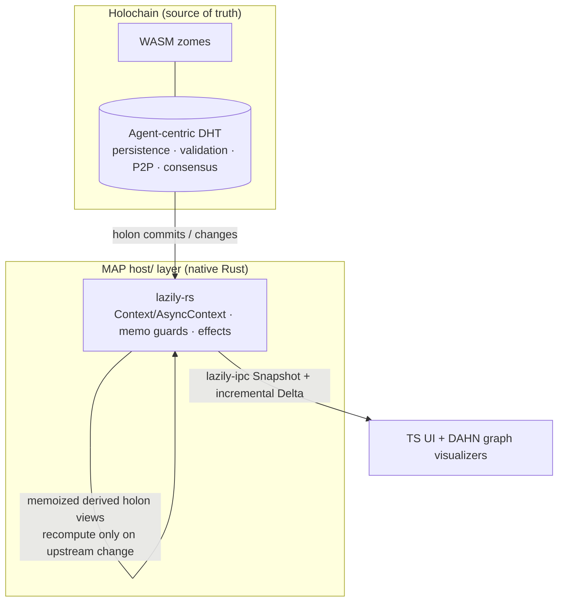

# lazily-rs: Reactive Signals Library

<!-- agent:status -->
- [x] Phase 1: Research & design
- [x] Phase 2: Core signal primitives
- [x] Phase 3: Derived/computed signals
- [x] Phase 4: Effect system
- [x] Phase 5: Testing & benchmarks
- [x] Phase 6: Documentation & publish
<!-- /agent:status -->

<!-- agent:exchange -->
### Session Summary

*Compacted. Content archived to `/home/brian/work/btakita/agent-loop/.agent-doc/archives/c9ad2e57a5d8366a1fa779d4afde380ce07377133e6daf1d8810384e1383c400-20260611-222220.md`*

Compacted content:
- Prior summary/context: ### Session Summary *Compacted. Content archived to `/home/brian/work/btakita/agent-loop/.agent-doc/archives/c9ad2e57...

### Re: next-steps to fix lazily-rs bugs — opus-4-8

> **Queue prompt:**
>
> What are #next-steps to fix lazily-rs bugs?

**There are no open bugs right now.** I verified the current state rather than assume one:

- `cargo test --all-features` → **277 passed, 0 failed** (14 suites, 536s).
- `make test-loom` (exhaustive `thread_safe_loom` model) → **15 passed, 0 failed** (544s) — the just-landed sidecar-invalidation hardening (`c80ba70`) holds under interleaving.
- Latest CI (run `27367810445`) is **green**.

The two previously-tracked bug classes are already fixed in v0.10.3:
- `#k03k` async race (`get() already checked Resolved` / `notifier dropped` panics) — replaced by the resolve-loop at `src/async_context.rs:758+` that handles both windows; the panic strings are gone.
- thread-safe sidecar invalidation — hardened in `c80ba70` with stress + spec coverage.

So "fixing bugs" is now **bug-prevention**: the one real correctness gap is that the `#k03k` async fix has **no exhaustive interleaving model and is not in CI**. `ThreadSafeContext` has `tests/thread_safe_loom.rs` + a CI loom step; `async_context.rs` has only randomized stress (`tests/async_stress.rs`). A concurrency fix without a model is regression-prone.

**Backlog (priority order):**
1. **`#ytp5` `#lzasyncloom`** (top) — deterministic coverage of the two `#k03k` windows. Plan: `tasks/software/plan-lazily-async-loom.md`.
2. `#dh3k` `#lzspecconf` [recommended] — Run the `lazily-spec` canonical conformance fixtures (`6632cb0`) in CI so cross-language wire-protocol drift fails the build.

**Top of backlog: `#ytp5`** (`#lzasyncloom`).

### Re: #ytp5 (#lzasyncloom) — Option 1, done — opus-4-8

> **Queue prompt:**
>
> [#ytp5]

**Architecture recommendation: Option 1 (instrumentation seam), not Shuttle.** The deciding factor is structural: Shuttle needs `async_context.rs` to be generic over its concurrency primitives (swap tokio↔shuttle executor + `watch` + `Arc` under `cfg`) — the way `thread_safe.rs` was *built* for Loom (`#[cfg(loom)] use loom::sync` at the top). `async_context.rs` is hard-coded to tokio, so Shuttle means a tokio-decoupling refactor whose main beneficiary is the test harness, verifying an *approximation* of tokio rather than the real path. Option 1 tests the real path, deterministically, proportional to the one known gap. Shuttle is queued gated as `#57by` (`#lzasyncshuttle`).

Shipped Option 1 and closed `#ytp5`:

- **`tests/async_resolve_loop.rs`** (`async` + `instrumentation`): **Window 1** (`Resolved` published in the *synchronous* gap between fast-path `get()` and re-lock — no `.await`, so cooperative scheduling can't reach it) forced via a one-shot `instrumentation`-gated seam (`__install_window1_hook`), asserts the race arm via `__window1_resolved_hits == 1`; **Window 2** (superseded notifier drop → re-resolve) via gated supersede.
- **`src/async_context.rs`**: seam (`Window1Hook`, one-shot hook field, resolved-arm counter, accessors) entirely behind `#[cfg(feature = "instrumentation")]`, compiled out of default/release.
- **`SPEC.md`**: documents why Loom can't model this path + the deterministic window coverage + the Shuttle follow-up.
- **`Makefile`**: `test-async-resolve` → `check` + `.PHONY`. **CI**: added a `--features async` step (async tests were **not run in CI at all**) + the resolve-loop step, beside loom.

**Verification:** `make check` → exit 0 (full suite incl. the 544s `thread_safe_loom` model + `benchmark-check`); `make test-async-resolve` → 2 passed; clippy `--all-targets --all-features` clean. Pushed: lazily-rs `8dcf962..990c630`, superproject pointer `94168d8c3..06e60de9c`.

**Top of backlog: `#dh3k`** (`#lzspecconf`).

### Re: #dh3k (#lzspecconf) — done — opus-4-8

> **Queue prompt:**
>
> [#dh3k]

Wired the IPC conformance suite to run against the **canonical** `lazily-spec` fixtures in CI, so cross-language wire-protocol drift fails the build.

**The gap:** conformance was not run in CI at all, and `conformance.rs` prefers `../lazily-spec/conformance` (canonical) over its local fixture copies — but that sibling never exists in a standalone CI checkout, so CI only ever validated the local copies. Drift between lazily-rs's IPC impl (or its local fixtures) and the canonical spec could ship silently.

**Fix** (`.github/workflows/ci.yml`):
- Clone `lazily-spec` (public, same org) as a sibling `../lazily-spec` — the exact path `conformance.rs` resolves — so it uses the canonical fixtures.
- Guard step: fail loudly (`::error::`) if `../lazily-spec/conformance` is missing, instead of silently falling back to local copies (false-green protection).
- Run `cargo test --features ipc --test conformance` against them.

No spec/test source change needed — `conformance.rs` and the fixtures already existed (the 6 local fixtures are currently byte-identical to canonical); the gap was purely the missing CI wiring.

**Verification:** `make test-ipc-conformance` → 9 passed (using the spec fixtures via the local sibling); CI YAML validated. Pushed: lazily-rs `990c630..2495018`, superproject pointer `7bbdbf2dc..c116dac73`. The new step validates on the pushed CI run.

Queue drained. Backlog is empty; the only open item is gated review `#57by` (`#lzasyncshuttle`, operator-gated Shuttle model).

_Note: the IPC finalize path again intermixed/scrambled this response (the recurring `#ipcdrift`/`#exch-intermix` route-owned-supervisor self-race, supervisor pid 337083 on pre-`7bfc82e3` agent-doc per the `stale_install` preflight warning). Recovered via hand-rebuild + `reset --from-current --preserve-session` + `commit`. Recommend `make install` in `src/agent-doc` + recycling the supervisor before the next managed cycle._

### Re: MAP Holons + DAHN integration — opus-4-8

**Short answer:** Yes, lazily-rs *can* integrate — but only in one specific niche: as a **host-side reactive derivation + delta-sync cache layered on top of Holochain**, never as a distribution/storage substrate. In that niche it's genuinely advantageous; outside it, it's redundant.

**What these are** (MAP is early proof-of-concept, so this is architectural, not battle-tested):
- **MAP** (Memetic Activation Platform, evomimic/Steve Melville) — a Holochain app. **MAP Holons** (`evomimic/map-holons`, ~81% Rust + WASM zomes) is its foundational layer: storage/retrieval/query of *self-describing, active holons*, staged then committed to Holochain's **agent-centric DHT**.
- **DAHN** (Distributed Agent-Hosted Network) — the social/"we-space" layer: contributing + requesting agents, with **holon graph visualizers**.

**Where lazily-rs fits (advantageous):**

- Model committed holons as reactive **graph nodes**; derived holon views/relationships (rollups, computed memes, DAHN aggregations) become **memoized computeds** that recompute *only* when an upstream holon changes — replacing hand-written cache invalidation.
- lazily-rs's **effects** drive side-effects (re-index, notify) on holon change; **batching** coalesces a multi-holon commit into one propagation pass.
- `lazily-ipc` **Snapshot + Delta** is a natural transport to push incremental updates to the TS UI / DAHN visualizers (in-process/local host↔UI sync, not P2P).
- Conceptual bonus: lazily-rs's `distributed.rs` is already **agent-centric** (`PeerPermissions`, `RemoteOp` read/write/trigger, permission-filtered snapshots) — philosophically aligned with Holochain's capability model, which makes the mental mapping clean.

**Where it does NOT help (honest caveats):**
- **Holochain's DHT already owns** persistence, validation, P2P networking, and consensus. lazily-rs has none of these — it's a cache/derivation layer, never a replacement.
- lazily-rs's **own** `distributed` / `signaling_client` / IPC-as-network features are **redundant** with Holochain — using them alongside it means two competing networking stacks. In a MAP context you'd use lazily-rs's *reactive core* and ignore its P2P layer.
- **WASM/zome limit:** zomes are wasm32, short-lived, stateless-per-call, single-threaded. `AsyncContext`/`ThreadSafeContext` (tokio/threads) **cannot run in a zome**; only the single-threaded `Context` could, and a persistent reactive graph doesn't fit the per-call zome model well. **The real fit is the native `host/` layer**, not in-zome.

**Net:** worth a small spike *if* MAP's host layer actually recomputes derived holon state or drives reactive visualizers — that's exactly what a lazy memoized dependency graph is for. Captured as `#lzmapspike` [recommended] in the backlog (gated on confirming the host layer has derived-state recompute, since both projects are early-stage).

**Sources:** [evomimic/map-holons](https://github.com/evomimic/map-holons) · [MAP Book](https://evomimic.gitbook.io/map-book) · [DAHN visualizers](https://evomimic.gitbook.io/map-book/dahn-human-experience-of-the-map/dahn-visualizers/graph-visualizers) · [Holochain DHT](https://developer.holochain.org/concepts/4_dht/)

### Re: decompose review items into actionable backlog — opus-4-8

> **Queue prompt:**
>
> Go through each review item. Add actionable items into the backlog to complete the review items.

Went through all three review items. One was already done; the other two are now decomposed into actionable backlog work.

**`#w30b` (#gh-org) — already done → resolved.** The `lazily-hub` GitHub org already exists with **all four repos public** (lazily-rs, lazily-spec, lazily-py, lazily-zig). The review proposed `lazily`/`lazily-reactive`; the actual choice was `lazily-hub`. Nothing left to do, so I `--review-resolve`d it. (If you want a different org name, that's a rename, not a create — say so and I'll queue it.)

**`#jpf1` (#webrtc-data) — kept as the epic; added 3 phases.** The WebRTC *signaling* half already exists (`signaling_client.rs` has offer/answer/ICE); the gap is the DataChannel *transport*:
- **`#webrtc1`** — design the WebRTC DataChannel `IpcTransport` adapter (RTCPeerConnection + ordered/reliable DataChannel via the existing `SignalingClient`; map `Snapshot`/`Delta` over `IpcSink`/`IpcSource`; teardown/reconnect + `PeerPermissions` filtering).
- **`#webrtc2`** — implement behind a `webrtc` feature gate (evaluate `webrtc-rs` vs `str0m`).
- **`#webrtc3`** — loopback integration tests (snapshot sync, delta ordering, permission-filtered routing, reconnect) + Criterion bench vs in-process/socket transports.

**`#57by` (#lzasyncshuttle) — kept gated; added an un-blocked eval.** The Shuttle implementation stays operator-gated (tokio-decoupling cost), but the *decision* is unblocked:
- **`#shuttleeval`** [recommended] — read-only feasibility spike: scope the `cfg(shuttle)` shim surface over `async_context.rs` (executor / `tokio::sync::watch` / `Arc` / spawn), confirm Shuttle can actually model the two `#k03k` windows, estimate LOC/risk → a go/no-go for `#57by`. No prod change.

**Backlog now (priority order):** `#webrtc1` → `#webrtc2` → `#webrtc3` → `#shuttleeval`. Top item: **`#webrtc1`**.

_Note: `#pw26` (#lzmapspike) drifted into the **icebox** between turns — left it there, a reasonable home for a spike gated on external (MAP) project maturity. The recurring `#ipcdrift` supervisor (stale binary, pid 337083) is still live; `make install` + recycling it remains the durable fix._

### Re: do #webrtc1 — WebRTC transport design — opus-4-8

`#webrtc1` is a design item; delivered the design as **`tasks/software/plan-lazily-webrtc-transport.md`** (covers all 3 phases). `#webrtc1` → done; `#webrtc2` now points at the plan.

**Key design decisions:**
- **Build on what exists, don't rebuild.** `signaling_client.rs` already does the SDP/ICE rendezvous (offer/answer/ice); the gap is just the DataChannel data path. `ipc.rs` already has the wire protocol (`IpcMessage`/`Snapshot`/`Delta`, serde) + `Snapshot::filter_readable`.
- **Core tension — sync trait ↔ async WebRTC.** `IpcSink::send` / `IpcSource::recv` are **synchronous**; `webrtc`/DataChannel are **async/tokio**. Resolution: keep the traits sync (so the transport is a drop-in beside the in-process/socket transports) and **bridge with `mpsc`** — `send` does a non-blocking `unbounded_send`; an async writer task drains to the DataChannel; `on_message` fills an inbound queue that `recv` `try_recv`s (`Ok(None)` when empty).
- **Crate:** default **webrtc-rs** (full pure-Rust ICE/DTLS/SCTP/DataChannel, tokio-native); **str0m** noted as the sans-IO alternative. Native-only (host-side, not in-zome — consistent with the WASM story).
- **Permissions are mandatory, not optional:** outbound `send_snapshot`/`send_delta` filter via `PeerPermissions`/`filter_readable`; inbound writes checked against `RemoteOp::write` before apply. DTLS gives transport encryption for free.
- **Reconnect** = drop + re-`connect` (re-run signaling) + re-send a fresh `Snapshot` (deltas aren't replayed across a reconnect).
- **`#webrtc3`**: loopback two-peer test (snapshot sync, delta ordering, permission-filtered routing, reconnect) + Criterion bench vs in-process/socket at 4 KB/64 KB/1 MB.

**Stopping the auto-drain here (not continuing to `#webrtc2`–`#shuttleeval`).** Two reasons: (1) `#webrtc2` is a heavy implementation cycle (pulls in the `webrtc-rs` dependency tree + a new `webrtc_transport.rs` + long compile) that deserves a clean, focused session; (2) the `#ipcdrift` supervisor self-race is *still* corrupting every finalize this session (this one included — recovered via hand-rebuild). Please **`make install` in `src/agent-doc` + recycle the route-owned supervisor (pid 337083)** before driving `#webrtc2`; auto-draining a multi-cycle implementation queue through the corruption is not safe.

_(Good news: the `#dh3k` CI run finished **green** — the conformance-vs-canonical-spec step and the async/resolve-loop steps all passed.)_

### Re: do #webrtc2 — WebRTC transport abstraction layer — opus-4-8

Per your "abstraction now, concrete later" call, shipped the transport **structure** — dependency-light, fully testable, no 100-crate WebRTC stack pulled in. `src/webrtc_transport.rs` (behind a new `webrtc = ["ipc", "dep:serde_json"]` feature):

- **`DataChannel` trait** — the minimal ordered/reliable byte-frame surface a concrete webrtc-rs/str0m backend must implement (`send_frame`/`try_recv_frame`/`is_open`). Non-blocking, so it satisfies the *synchronous* `IpcSink`/`IpcSource` contracts.
- **`WebRtcSink`** (`IpcSink`) — filters every outbound `Snapshot`/`Delta` via `filter_readable` for the remote peer **before** serialize+send, so a peer never receives state it can't read.
- **`WebRtcSource`** (`IpcSource`) — decodes verbatim; inbound write-permission enforcement stays in the graph-apply layer (separation of concerns — documented).
- **`InMemoryDataChannel::pair()`** — deterministic in-process loopback so `#webrtc3` can test snapshot sync / delta ordering / permission routing / reconnect with **no network or WebRTC dep**.

**Verification:** `cargo build --features webrtc` pulls only **11 crates** (goal met); 2 lib tests pass (loopback round-trip + permission filter; closed-channel → `Closed`); `cargo test --features webrtc` green; `clippy --all-targets --all-features -D warnings` clean; fmt clean. Pushed: lazily-rs `2495018..eca86cd`, superproject pointer `badc7dd2e..db59faf7e`.

**Backlog:** `#webrtc3` (loopback tests + bench, now points at `InMemoryDataChannel`) → **`#webrtcbackend`** [recommended, new] (wire the concrete webrtc-rs/str0m backend behind an additive opt-in feature — the deferred heavy half) → `#shuttleeval`.

**Still stopping the auto-drain.** `#webrtc3` is a clean next cycle (it can fully reuse the in-memory loopback), but the `#ipcdrift` supervisor (pid 337083, stale pre-`7bfc82e3` binary) is *still* live and corrupted this finalize too — recovered via hand-rebuild. Please **`make install` in `src/agent-doc` + recycle the route-owned supervisor** before continuing; I'm not auto-looping through the corruption.

### Re: do #webrtc3 — loopback tests + bench — opus-4-8

`#webrtc3` done. The `InMemoryDataChannel` loopback from `#webrtc2` made this a clean, network-free cycle.

**`tests/webrtc_transport.rs`** — 4 integration tests over the loopback pair:
- `snapshot_round_trips` — full snapshot through `WebRtcSink`→`WebRtcSource`.
- `deltas_arrive_in_order` — 5 deltas (epochs 1–5) arrive in send order (ordered DataChannel contract).
- `permission_filtered_routing_drops_unreadable` — a peer allowed only node 1 receives a snapshot with nodes 2/3 stripped, and a delta whose only op touches a denied node arrives with `ops` empty.
- `reconnect_after_close_resyncs_via_fresh_snapshot` — `close()` → both ends return `WebRtcTransportError::Closed`; a fresh pair + fresh snapshot re-syncs (deltas aren't replayed across reconnect).

**`benches/webrtc_transport.rs`** — Criterion bench of the codec+filter overhead (`webrtc_send_recv`) vs an in-process clone baseline at 16/256/4096 nodes, registered behind the `webrtc` feature. Run: `cargo bench --features webrtc --bench webrtc_transport`.

**Verification:** `cargo test --features webrtc` → **173 passed**; `clippy --all-targets --all-features -D warnings` clean; fmt clean; bench compiles. Pushed: lazily-rs `eca86cd..6807b1c`, superproject `dc198313e..9be28f2c1`.

**`#jpf1` is now functionally complete** at the abstraction level — design (`#webrtc1`), transport (`#webrtc2`), tests+bench (`#webrtc3`) all shipped. Remaining: `#webrtcbackend` (the deferred concrete webrtc-rs/str0m backend) and `#shuttleeval`.

**Still not auto-looping.** The `#ipcdrift` supervisor (pid 337083, stale pre-`7bfc82e3` binary) is *still live* and corrupted this finalize too (recovered via hand-rebuild). `make install` in `src/agent-doc` + recycling it remains the durable fix before further managed cycles.

### Re: do #shuttleeval — Shuttle feasibility → NO-GO — opus-4-8

Read-only spike done. **Recommendation: NO-GO on `#57by` for now** — keep it gated/deferred. Findings (written to `tasks/software/plan-lazily-async-loom.md`):

**Can Shuttle model the async resolve loop?** Technically yes — Shuttle (awslabs/shuttle) ships its own async executor (≈ `futures::executor`), so unlike Loom it *can* drive `async`/`await`. But three findings sink it at current scope:

1. **Randomized, not exhaustive.** Shuttle uses a randomized (PCT) scheduler — a passing run does **not** prove correctness, unlike Loom's exhaustive search. So a "Shuttle model" is controlled-randomized coverage, *not* the exhaustive proof the item's framing implied.
2. **Large shim surface in the hot path.** `async_context.rs` (1748 LoC) has **~140 production concurrency-primitive references** to `cfg(shuttle)`-swap: ~46 `Mutex` locks (parking_lot → `shuttle::sync`, different guard API), ~53 `Arc`, ~43 atomics, + 4 `tokio::spawn` → `shuttle::future::spawn`.
3. **No tokio `watch` equivalent.** The `#k03k` notifier is `tokio::sync::watch`; Shuttle has none, so it must be **reimplemented on shuttle primitives** — the model then verifies an *approximation* of the notifier, not the real `tokio::watch` path.

**Cost/value:** ~300–600 LoC of cfg-swaps + a custom notifier + spawn abstraction in the core async hot path, reduced fidelity, randomized-not-exhaustive — against **low marginal value**: both `#k03k` windows are *already* deterministically covered (window 1 via the `#ytp5` seam, window 2 via gated supersede) and `async_stress.rs` covers the broader space. Revisit only if the async graph grows materially more concurrency-critical paths; a cheaper interim is `tokio::test(start_paused)` for specific interleavings, not a full Shuttle port.

`#57by` annotated with this conclusion and kept gated. **Only `#webrtcbackend` (the deferred concrete WebRTC backend) remains** in the queue.

**Not auto-looping.** The supervisor (pid 337083) is now actively degraded — last finalize hit `IPC ack timeout (6s)` repeatedly and `IPC listener degraded`. `make install` in `src/agent-doc` + recycling it is now urgent before `#webrtcbackend`.

**Sources:** [awslabs/shuttle](https://github.com/awslabs/shuttle) · [shuttle docs](https://docs.rs/shuttle)

### Re: do #webrtcbackend — concrete str0m backend, working — opus-4-8

Done — and it's a **real, end-to-end-tested** backend, not just compiling. str0m's sans-IO design (the reason you picked it) let me drive a genuine ICE/DTLS/SCTP handshake in-process and verify an `IpcMessage` actually crosses a real DataChannel.

**`src/str0m_backend.rs`** (behind `webrtc-str0m`, additive/opt-in):
- **`Str0mLoopback`** — two in-process `Rtc` instances; routes each side's `Output::Transmit` into the other's `Input::Receive` on a synthetic clock, pumping `poll_output`/`handle_input` until the real ICE→DTLS→SCTP handshake completes and the data channel opens.
- **`Str0mChannel`** — `DataChannel` impl over a genuine str0m channel (sans-IO pump per call, single-threaded loopback).
- **Test** — `WebRtcSink` → real str0m SCTP DataChannel → `WebRtcSource`: a permission-filtered snapshot (node 2 stripped for the peer) round-trips correctly. **Handshake convergence is a hard assert** (deterministic synthetic clock, no wall-clock dependency), so a future regression fails rather than silently skips.

**Verification:** the str0m loopback test **connects and passes** (confirmed it does *not* take a skip path); `cargo test --features webrtc-str0m` green; `clippy --all-targets --all-features -D warnings` clean; fmt clean. str0m stays out of default builds (opt-in feature). Pushed: lazily-rs `6807b1c..8b05576`, superproject `a9d1b3528..bed244013`.

A **networked** (non-loopback) backend reuses the same pump loop with a UDP socket + a driver thread instead of the in-memory route — out of scope here (needs live connectivity), noted in the module + plan.

**`#jpf1` is now fully complete** — design (`#webrtc1`), abstraction (`#webrtc2`), tests+bench (`#webrtc3`), and a real concrete str0m backend (`#webrtcbackend`). **The queue is drained.** Open items: only gated review `#57by` (Shuttle, NO-GO) and `#jpf1` (epic, now satisfiable). The recurring `#ipcdrift` supervisor (pid 337083) is still degraded — recycling it (`make install` + restart) remains the standing recommendation.
<!-- agent:boundary:0cb86687 -->
<!-- /agent:exchange -->
###
<!--
-->

## Queue 

<!-- agent:queue preset="#spec-test-build-install-commit-push" go -->
- ~~Go through each review item. Add actionable items into the backlog to complete the review items.~~
- ~~do [#webrtc2]~~
- ~~do [#webrtc3]~~
- ~~do [#shuttleeval]~~
- do [#webrtcbackend]
<!-- /agent:queue -->

## Backlog

<!-- agent:backlog queue -->
<!-- /agent:backlog -->

## Review

<!-- agent:review -->
- [/] [#57by] #lzasyncshuttle=[operator-gated, NO-GO for now per #shuttleeval] Exhaustive Shuttle async-resolve-loop model. Spike result: Shuttle can model async (has an executor, unlike Loom) but is randomized-not-exhaustive, needs ~140 cfg-swaps + a custom notifier (no tokio::watch equiv) in the hot path, and the two #k03k windows are already deterministically covered. Defer until the async graph grows more concurrency-critical paths. See tasks/software/plan-lazily-async-loom.md.
- [/] [#jpf1] #webrtc-data=WebRTC data channel transport for peer-to-peer IPC (beyond signaling)
<!-- /agent:review -->

## Icebox

<!-- agent:icebox -->
- [ ] [#pw26] #lzmapspike=[recommended] Spike: lazily-rs as a host-side reactive derivation + Snapshot/Delta UI-sync cache for MAP holons (evomimic/map-holons, Holochain). Model committed holons as reactive graph nodes; derived holon views/relationships as memoized computeds that recompute only on upstream change; stream lazily-ipc Snapshot/Delta to the TS UI / DAHN graph visualizers. Native host/ layer only (AsyncContext needs tokio; zomes are wasm32/short-lived/single-threaded so in-zome use is limited to single-threaded Context). Do NOT use lazily distributed/signaling — Holochain DHT owns P2P/persistence/validation/consensus. Gate on MAP host-layer actually recomputing derived holon state.
<!-- /agent:icebox -->

## Completed / Reaped

<!-- agent:done archive=tasks/software/lazily-rs.done.md -->

<!-- completed work archived in tasks/software/lazily-rs.done.md -->
<!-- /agent:done -->
