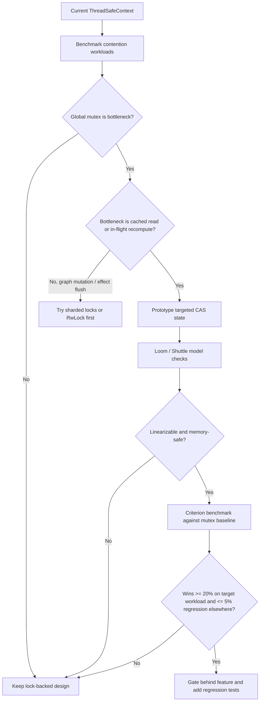
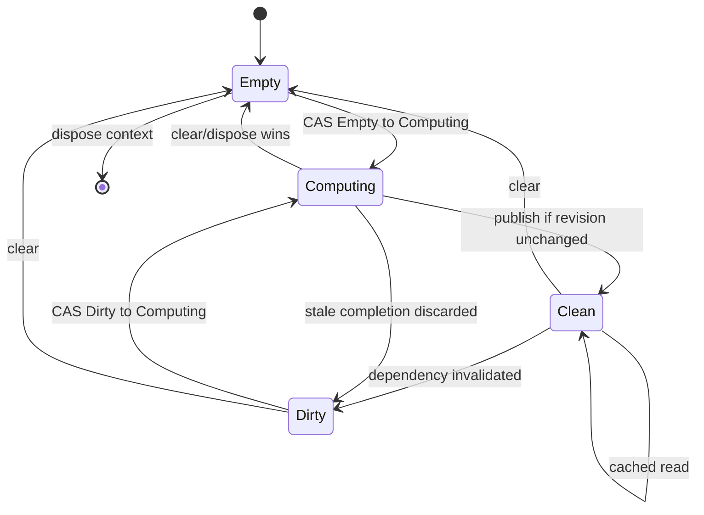
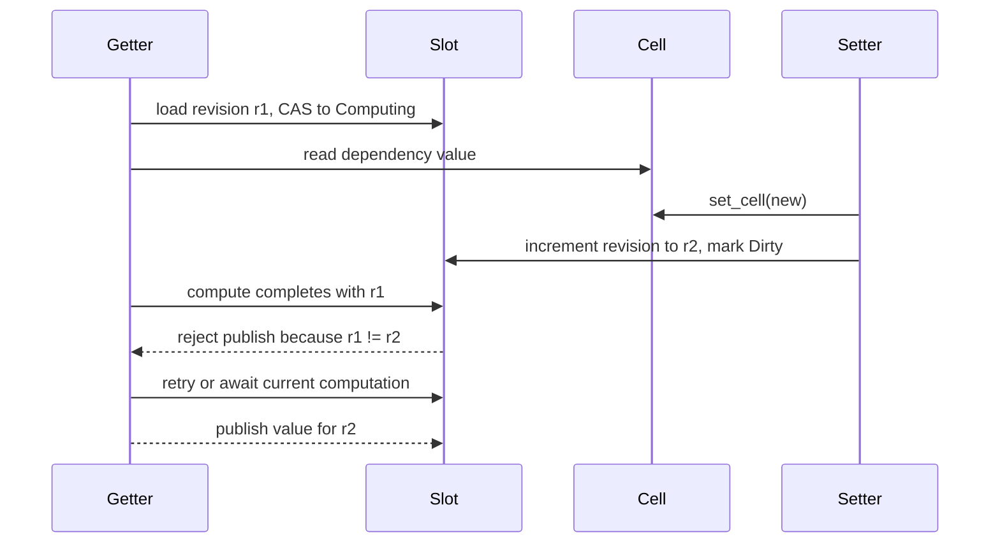
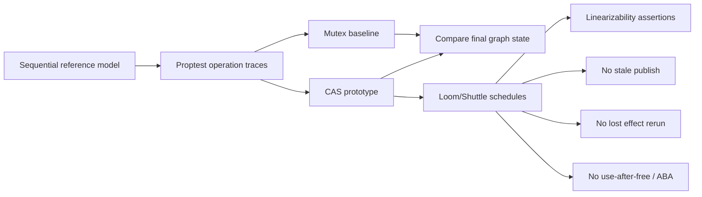

# lazily-rs lock-free context evaluation plan

## Answer

A lock-free mechanism such as CAS may perform better for narrow hot paths:
cached reads, in-flight slot recompute deduplication, and revision publication.
It is unlikely to be a safe first replacement for the whole lock-backed graph.
The graph mutates multiple nodes at once: dependencies, dependents, dirty flags,
effect queues, cleanup state, and batch state. A full lock-free rewrite would
need linearizability proofs, memory reclamation rules, and model coverage before
it should replace the current mutex-backed `ThreadSafeContext`.

The practical path is to keep the lock-backed context as the correctness
baseline, benchmark the actual contention patterns, then evaluate smaller CAS
optimizations only where they have a clear linearization point.

## Decision Flow

## Candidate CAS Scope

Do not start with a fully lock-free graph. Start with one of these scoped
candidates:

- **Slot revision CAS:** an atomic slot revision lets a getter publish only if
  the revision it computed from is still current.
- **In-flight recompute CAS:** a slot state CAS elects one recomputing task or
  thread while other callers await or spin/yield on the same in-flight result.
- **Cached value fast path:** an atomic pointer/`Arc` snapshot allows cached
  reads to avoid taking the graph lock when the slot revision and dependency
  revision snapshot match.
- **Effect queue coalescing bit:** an atomic scheduled flag can suppress duplicate
  effect queue pushes, but queue mutation still needs a lock or a proven
  multi-producer queue.

## Slot State Model

## Concurrent Get/Set Race

## Proof Obligations

Every accepted CAS path must define:

- **Linearization point:** the exact atomic operation where each public method
  takes effect.
- **Memory ordering:** the `Acquire`, `Release`, or `AcqRel` edges that make
  values, dependencies, and dirty flags visible without relying on `SeqCst` by
  accident.
- **ABA avoidance:** either no pointer reuse is observable, or node storage uses
  stable `Arc` ownership and generation tags.
- **Reclamation safety:** no reader can observe freed slot, cell, effect, or
  cleanup state.
- **Dependency consistency:** a published value must correspond to the exact
  dependency set observed during the same slot revision.
- **Effect coalescing:** an invalidation wave may schedule an effect at most once
  per flush boundary and must not drop a required rerun.
- **Batch boundary preservation:** no CAS fast path may publish or flush effects
  before the outermost batch exits.

## Benchmark Matrix

| Workload | Purpose | Expected lock-free upside |
|---|---|---|
| Cached slot read, many threads | Measures global lock read bottleneck | High if reads dominate |
| Concurrent first `get` | Measures duplicate compute and publish contention | Medium with in-flight CAS |
| Concurrent `set_cell` on one cell | Measures invalidation serialization | Low unless sharded |
| Disjoint cells/slots across threads | Measures false sharing from one graph lock | Medium with sharding |
| Diamond dependency invalidation | Measures duplicate downstream scheduling | Low to medium |
| Effect-heavy invalidation | Measures queue/cleanup serialization | Low; correctness risk high |
| Batch set/clear storms | Measures batch boundary contention | Low until batching is redesigned |

Use Criterion or a custom harness with fixed thread counts: 1, 2, 4, 8, 16, and
hardware-concurrency. Record throughput, p50/p95 latency, allocations, and
regression against the current mutex baseline.

## Safety Test Matrix

Minimum proof suite:

- Loom or Shuttle models for two-slot dependency chains, diamond dependencies,
  effect coalescing, batch boundaries, clear/dispose races, and stale completion.
- Proptest traces comparing CAS implementation results to a sequential reference
  model and the current mutex-backed implementation.
- Stress tests that run under Miri where possible for unsafe-free variants.
- No `unsafe` in the first prototype unless a separate memory reclamation proof
  exists.

## Phases

1. **Baseline measurement:** add benchmark harnesses for the current
   `ThreadSafeContext`; do not change runtime behavior.
2. **Target selection:** choose one hot path only if benchmarks show a real
   bottleneck and the operation has a single clear linearization point.
3. **Model prototype:** implement the candidate in an isolated module with Loom
   tests before integrating it into `ThreadSafeContext`.
4. **Runtime prototype:** gate the CAS path behind a feature flag and compare it
   with the mutex baseline.
5. **Adoption gate:** keep the CAS path only if it beats the mutex baseline on
   the target workload, avoids broad regressions, and passes all model tests.

## Recommendation

Do not replace the lock-backed context wholesale. Evaluate targeted CAS for slot
revision publication and in-flight recompute deduplication first. If the
benchmarks show graph mutation or effect flushing as the bottleneck, prefer
sharded locks or an `RwLock` design before a lock-free graph rewrite.
