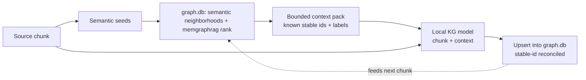

# Plan: GraphRAG context for the local KG model

## Question (operator, #kggraphscope)

> Should we integrate the memgraphrag, semantic neighborhoods, and graphdb to
> determine the context for the local model?

**Recommendation: yes — bounded, deterministic, confidence-gated GraphRAG
context augmentation for the extractor.** The retrieval machinery already
exists; the extractor just doesn't consume it yet.

## Current state (verified)

- `extract_documents_to_projection` (tsift-kg) extracts each chunk in
  **isolation**. `OllamaKgExtractor::chat_request_body(chunk_text)` sends only a
  system prompt + the raw chunk as the user message — no graph context, no
  already-known entities, no neighbors.
- Retrieval surfaces already exist over `.tsift/graph.db`:
  - `tsift semantic` / `tsift related` — semantic-neighborhood expansion
    (resolve NL phrase → semantic seeds → expand graph neighborhoods).
  - `tsift-memgraphrag` — `KgSemanticProvider` (semantic concept extraction +
    embeddings), `rank_memory_events` (recency/decay ranking).
  - `graph.db` — the substrate holding `semantic_entity` / `kg_*` / AST nodes.

So the gap is **wiring existing retrieval into the extractor prompt**, not
building retrieval.

## Why integrate (the case for yes)

Stateless per-chunk extraction is the core quality limitation:
- **Duplicate / variant entities** — the model re-invents `stable_id_seed`s it
  cannot reconcile against entities already in the graph.
- **Missed cross-chunk relations** — an edge whose endpoints live in different
  chunks is never emitted because the model never sees the other endpoint.
- **No incremental consistency** — re-extraction (#kgextractrefresh) duplicates
  instead of updating.

Feeding the model the relevant existing subgraph lets it align to canonical
entities and bridge chunks. This is exactly GraphRAG: the graph informs the
model, the model's output updates the graph.

## Design

Before extracting a chunk, build a **bounded context pack** from `graph.db`:

1. **Seed** — derive salient terms from the chunk; resolve to semantic seeds via
   the existing `semantic`/`related` path.
2. **Expand** — top-K neighbors of those seeds by connectivity + recency
   (memgraphrag ranking with decay), capped by a token budget — the same
   bounded-scan discipline as `#kgwiring` (never dump the 418k-node graph).
3. **Inject** — a compact "known entities — reuse these stable ids when they
   match" block (stable_id_seed, label, kind, confidence) into the
   system/user prompt alongside the chunk.
4. **Extract + reconcile** — the model emits entities/relations that reference
   the injected stable ids where they match; upsert preserves stable fact ids.

## Guards (why staged, not all-at-once)

- **Context poisoning** — stale/wrong prior facts bias the model. Inject only
  high-confidence, recent facts (confidence threshold + provenance/recency).
- **Determinism** — retrieval must be stably ordered so re-runs preserve stable
  fact ids (Run Manifest contract). No `Math.random`-style nondeterminism.
- **Cost / context window** — per-chunk retrieval adds graph queries + larger
  prompts; Qwen3-32B context is finite. Bounded top-K + cache seed→neighbors.
- **Bounded-scan cap** — the existing `DEFAULT_EVIDENCE_MAX_SCAN_NODES` (50k)
  concern (#kggraphscope original) is the same discipline applied to retrieval:
  rank from a bounded candidate set, never a full scan.

## Phases (one backlog id per phase)

- **Phase 1 `#kgctxretrieve`** — a deterministic, bounded `kg context-pack`
  retrieval API in tsift-kg: chunk/seeds → ranked known-entity pack from
  graph.db (reusing semantic/related + memgraphrag ranking). Pure + tested with
  a fixture graph.
- **Phase 2 `#kgctxinject`** — thread the context pack into
  `OllamaKgExtractor::chat_request_body` (a context-aware prompt variant);
  `extract_documents_to_projection` retrieves per chunk when a graph-db is
  supplied. Confidence/recency gating + token budget.
- **Phase 3 `#kgctxincremental`** — graph-aware re-extraction: changed-file
  re-extract reconciles against existing stable ids instead of duplicating
  (composes with #kgextractrefresh).

## Relationship to existing backlog

- Subsumes the original `#kggraphscope` (bounded-scan cap) — same bounded
  discipline, now applied to retrieval-for-context, not just evidence display.
- Independent of `#kgleasewire` / `#kgleasereap` (lease lifecycle) but benefits
  from them: graph-aware extraction runs the local model more, so reference-
  counted load/unload matters more.
