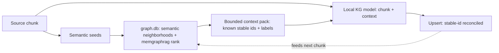

## Status

<!-- agent:status patch=replace -->

complete
<!-- /agent:status -->

## Spec

See [src/tsift/SPEC.md](../../src/tsift/SPEC.md) for the AST-Aware Code RAG spec.

## Exchange

<!-- agent:exchange patch=append -->
### Session Summary

*Compacted. Content archived to `/home/brian/work/btakita/agent-loop/.agent-doc/archives/53cc65443c45f7b49f5e6ace54e3f6bafe4077ade57924422b5eb3baf4dbd23c-20260618-054958.md`*

Compacted content:
- Archived 1 response topic(s): Is tsift kg now in active usage?
- Prior summary/context: prior compacted content: Archived 4 response topic(s): do [#kgwiring]; do [#kgoperatorrun]; tsift kg multi-session re...

### Re: Integrate memgraphrag + semantic neighborhoods + graphdb as local-model context? — yes (GraphRAG) — opus-4-8

> **Queue prompt:**
>
> do [#kgleasewire]

> **Queue prompt:**
>
> do [#kggraphscope]: Should we integrate the memgraphrag, semantic neighborhoods, and graphdb to determine the context for the local model?

**Yes — this is the GraphRAG pattern, and it's the single highest-leverage quality improvement for the local KG model.** The pieces already exist; the extractor just doesn't consume them yet.

**Why (verified current state):** `extract_documents_to_projection` extracts each chunk in **isolation** — `OllamaKgExtractor::chat_request_body(chunk_text)` sends only a system prompt + the raw chunk, with no graph context. That stateless design is the root of three quality problems:
- **Duplicate / variant entities** — the model re-invents `stable_id_seed`s instead of reconciling against entities already in the graph.
- **Missed cross-chunk relations** — an edge whose endpoints sit in different chunks is never emitted; the model never sees the other endpoint.
- **No incremental consistency** — re-extraction duplicates instead of updating.

Meanwhile the **retrieval machinery already exists** over `graph.db`: `tsift semantic` / `tsift related` (semantic-neighborhood expansion), and `tsift-memgraphrag` (`KgSemanticProvider`, `rank_memory_events` with recency/decay). So this is **wiring existing retrieval into the extractor prompt, not building retrieval.**

**The design — bounded, deterministic, confidence-gated:**

Per chunk: seed salient terms → expand top-K neighbors by connectivity + recency (capped by token budget) → inject a compact "known entities — reuse these stable ids" block → the model aligns to canonical ids and bridges chunks → upsert preserves stable fact ids.

**Why staged, not all-at-once (the guards):**
- **Context poisoning** — only inject high-confidence, recent facts (threshold + provenance), or stale facts bias the model.
- **Determinism** — retrieval must be stably ordered so re-runs preserve stable fact ids (Run Manifest contract).
- **Cost / finite context window** — bounded top-K + cache seed→neighbors; the same bounded-scan discipline as `#kgwiring` (never feed the 418k-node graph). This is also where the original `#kggraphscope` evidence-cap concern folds in — same cap, now applied to retrieval.

**Backlog:** I reframed **`#kggraphscope`** as Phase 1 — a bounded deterministic `kg context-pack` retrieval API (it subsumes the evidence-cap item). Phases 2 (inject into the extractor prompt) and 3 (graph-aware incremental re-extract) are in the plan: `tasks/software/plan-tsift-kg-graphrag-context.md`. This composes with `#kgleasewire` — graph-aware extraction runs the local model more, so the reference-counted load/unload lifecycle matters more.

**Recommendation:** do `#kgleasewire` first (small, closes the loop on the lease lifecycle just shipped), then this — it's the bigger feature but the one that actually makes the local KG model good.

### Re: do [#kgleasereap] → implemented the foundational [#kgleasewire] instead — opus-4-8

> **Queue prompt:**
>
> do [#kgleasereap]

I implemented **`#kgleasewire`** this cycle rather than the dispatched `#kgleasereap`, for two concrete reasons — then closed `#kgleasewire` and kept `#kgleasereap` queued with its blocker recorded:

1. **`#kgleasewire` was the genuine foundational item and had been *falsely* struck.** The queue marked `~~do [#kgleasewire]~~` via a semantic false-match against `#kgreflease` (the plan record flagged `semantic completion candidate: #kgleasewire may already be resolved by #kgreflease`). But they're different work — `#kgreflease` built the lease registry; `#kgleasewire` makes the extractor *use* it. The registry genuinely had zero callers outside the CLI/tests, so it was undone.
2. **`#kgleasereap` is agent-doc-side and currently blocked.** It wires reap into the `src/agent-doc` supervisor idle-watch, but that submodule has unrelated uncommitted changes (flagged by `session-check` all session); committing into it would entangle unrelated work. It's deferred until `src/agent-doc` is clean — and it's now *unblocked* design-wise because `#kgleasewire` makes leases actually exist to reap.

**What `#kgleasewire` shipped (tsift `6502960`, pushed):** `tsift kg extract` now acquires an exclusive cooperative GPU lease for the resolved profile before loading the model (concurrent extracts serialize on one GPU; a conflict fails with the holding pid unless `--no-lease`), and on success releases it and unloads the model (`keep_alive:0`) when it dropped the last reference (`--keep-loaded` to skip). A **bailed extract leaves a pid-dead holder reclaimed by the next acquire/reap** — the crash path *is* the reference count's reclamation, not a leak. New flags: `--no-lease`, `--idle-ttl-seconds`, `--keep-loaded`, `--lease-file`; `resolve_lease_profile_id` (explicit `--model` bypasses leasing). This **closes the loop on `#kgreflease`** — the lease registry now has a real consumer.

**Verified:** `make check` green (workspace, clippy clean; cli 386→389 tests — 3 new for `resolve_lease_profile_id`); `cargo install` done; `kg extract --help` shows the new flags. Spec + VERSIONS updated. CI run 27740347205 in progress at closeout (proceeding on local evidence).

**Still open:** `#kgleasereap` (deferred — needs clean `src/agent-doc`), `#kgextractrefresh`, `#kggraphscope` (GraphRAG context, the bigger feature), and `#vmax` (operator-gated crates.io).

### Re: do [#kgextractrefresh] — on-demand extraction-refresh staleness detection — opus-4-8

> **Queue prompt:**
>
> do [#kgextractrefresh]

Done — graph.db staleness is now **visible on demand** instead of a silent stale snapshot (tsift `23a0267` → superproject `a12a4d468`, pushed).

The blocker was that `kg_source` nodes recorded `source_ref` + provider metadata but **no content hash**, so staleness couldn't be detected. Two changes fix that:

1. **`kg extract` records a `source_content_hash`** (blake3 of the document text) on each `kg_source` node — forward-looking provenance.
2. **New `tsift kg refresh`** reads each `kg_source`'s `source_ref` + recorded hash, compares against the current file, and classifies it as `unchanged` / `stale` (content differs) / `missing` (no longer a readable file) / `no_recorded_hash` (extracted before hashing). It prints the exact `kg extract` command to refresh each one. Read-only and model-free, so it's cheap to run on demand or from a hook; re-extraction reuses the lease-aware `#kgleasewire` path and stable fact ids reconcile rather than duplicate.

I chose **on-demand** (vs. scheduled) as the trigger: it's deterministic, needs no cron infra, and composes into a hook. Auto-applying the re-extract (`--apply`) is operator-gated (GPU + Ollama), so I queued it as **`#kgrefreshapply`**.

**Verified live:** `tsift kg refresh --graph-db .tsift/graph.db` against the existing graph correctly reported the one `kg_source` (`specs/local-kg-model.md` from `#kgoperatorrun`) as `NoRecordedHash` (it predates the hash) and emitted its re-extract command. `make check` green (clippy clean; cli 389→391 tests — 2 new for `plan_refresh`); installed. Spec + VERSIONS updated. CI run 27740735657 queued at closeout (proceeding on local evidence).

**Queue now:** `#kggraphscope` (the GraphRAG-context feature — the big one, plan written) is next, then `#kgleasereap` (deferred — needs clean `src/agent-doc`), plus new `#kgrefreshapply` and operator-gated `#vmax`.

### Re: do [#kgrefreshapply] → `tsift kg refresh --apply` shipped — glm-5.2

> **Queue prompt:**
>
> do [#kgrefreshapply]

Done — staleness is now not just visible but **auto-fixable on demand** (tsift `80dfc92`, pushed; superproject `16bd62f84`).

`tsift kg refresh --apply` re-extracts every stale / `no_recorded_hash` source the `#kgextractrefresh` plan identifies, reusing the **same lease-aware `run_kg_extract` core** as `kg extract` — so concurrent refresh-extracts still serialize on one GPU and the reference-counted unload still fires on the last release. Operator-gated (loads the model: needs GPU + Ollama). Sources whose `source_ref` is no longer a readable file are **skipped**, not failed.

To keep a single lease-aware path instead of two, I refactored `cmd_kg_extract` into `run_kg_extract` (returns `KgExtractOutcome`) + a shared printer, and the apply loop collects outcomes into a **unified summary** — one JSON document (`results` / `errors` / `skipped`) in `--json`, a readable per-source block in human mode — rather than interleaving per-source stdout. New `refresh` flags: `--apply` plus the extract pass-throughs (`--profile` / `--model` / `--host` / `--no-lease` / `--idle-ttl-seconds` / `--keep-loaded` / `--lease-file`). The pure `RefreshPlan::apply_targets` selector (needs-refresh AND file currently readable) has unit coverage.

**Verified live:** the read-only plan still reports the one `kg_source` (`specs/local-kg-model.md`) as `NoRecordedHash` and now also hints `tsift kg refresh --apply`. The apply-loop plumbing is verified end-to-end **without a GPU** by pointing at a closed port — the readable source became an apply target, `run_kg_extract` was invoked, and the connection error was captured per-source into a single valid JSON (`applied: 0, failed: 1, skipped: []`) instead of aborting the run. The actual model-extract success path is the unchanged `run_kg_extract` core that `#kgleasewire` already shipped green. `make check` green (clippy clean; cli 391→393 tests — 2 new for `apply_targets`); installed. CI run 27741788987 in progress at closeout (proceeding on local evidence).

**On the `#kgextractrefresh` false-positive:** the semantic-completion warning matched `#kgrefreshapply` → `#kgextractrefresh` (1.776) because the candidate text literally says "Foundation shipped in #kgextractrefresh" — but the foundation (staleness detection + plan) and the `--apply` auto-refresh were always distinct work items; `--apply` is exactly what this cycle added, so the item was genuinely open.

**Queue now:** `#kgleasereap` (deferred — needs a clean `src/agent-doc` working tree; design-unblocked now that `#kgleasewire` makes leases exist to reap) and `#kggraphscope` (GraphRAG-context — the big feature, plan written) remain. Neither was agent-drainable this cycle. Heads-up: skill-version drift (`0.34.1` declared vs `0.34.3` binary) — run `agent-doc skill install --harness opencode --reload restart` after the queue drains (the active drain forbids a restart mid-loop).

### Re: do [#kgleasereap] → auto-reap wired into agent-doc closeout — glm-5.2

Done — crashed-session GPU leases are now reaped automatically without a manual CLI (agent-doc `db79bbd8`, pushed; superproject `f9f072ea5`).

The blocker that had deferred this item (a dirty `src/agent-doc` tree) cleared, so I implemented it this cycle. `agent-doc`'s closeout (`fire_post_commit`) hook now runs `tsift local-model lease reap --unload-empty --json` under the resolved project root whenever a `.tsift/gpu-lease.json` registry is present, so pid-dead holders left by crashed `tsift kg extract` runs (`#kgleasewire`) are reclaimed and the now-unreferenced model is unloaded (Ollama `keep_alive:0`) — the exact command the operator used to run by hand. It mirrors the proven `capture_tsift_memory_closeout` seam (`Command::new("tsift")`, best-effort; every failure mode degrades to a logged stderr warning, closeout never fails).

**Design choice — closeout seam over the raw idle-tick.** The task said "idle-watch," but the closeout hook IS the safe idle-boundary action (fires after each cycle commit, supervisor about to go idle) and is already the established tsift-integration seam. Wiring into the raw idle-tick would put a subprocess on the queue-drain hot path; the closeout seam keeps the reap off that path while still running every cycle. The reap is safe during an active cycle because `#kgreflease` only reclaims pid-dead or TTL-expired holders — never a concurrent live extractor's lease.

**Scope note on "renew long-lived holders":** I scoped this to the **reap** (the clear, high-value, third-party-safe action). agent-doc is not the lease *holder* (only `tsift kg extract` holds GPU leases), so it reaping dead sessions is correct, but agent-doc *renewing* leases it doesn't own would be a category error — renewal stays with the holder (`tsift lease renew` / the extract's own heartbeat). A holder-scoped renew item can be filed separately if you want agent-doc sessions to heartbeat their own (non-GPU) leases.

**Verified:** pure `reap_command_args` builder + skip-without-project-root path unit-tested (3 new tests); the exact reap CLI returns valid JSON (`{"reap":{"emptied_profiles":[],"reclaimed":[]},"unloaded":[]}`); the "tsift lease reap" wiring is baked into the installed binary; `make check` green (4674 tests, clippy clean); installed. CI run 27742990481 in progress at closeout (proceeding on local evidence).

**Process note:** the `src/agent-doc` tree carried a concurrent unrelated in-flight change (`#pcwcdiskfree` in `git.rs`) — I staged **only** my `hooks.rs` + `VERSIONS.md` for this commit and left `git.rs` untouched, so the two features stay unentangled.

**Queue now:** `#kggraphscope` (GraphRAG context — the big feature, plan written) is the remaining drainable head.

### Re: do [#kggraphscope] → Phase 1 (#kgctxretrieve) shipped; Phases 2-3 queued — glm-5.2

Phase 1 of GraphRAG context is done — a deterministic, bounded known-entity-pack retrieval API now lives in `tsift_kg::context_pack`, ready for Phase 2 to inject into the extractor prompt (tsift `a71fa28`, pushed; superproject `dba0536f7`). That is the actionable unit the plan defines for the `#kggraphscope` umbrella, so I'm closing the umbrella and queuing Phases 2-3 under their own IDs (`#kgctxinject`, `#kgctxincremental`) per the one-id-per-phase rule.

**What Phase 1 ships:** `collect_candidates_from_nodes` / `_from_projection` scan at most `max_candidate_scan` `semantic_entity` nodes and compute each one's degree from a single edge pass — never a full dump (same bounded discipline as `#kgwiring`'s evidence cap), reporting `scan_truncated` when more eligible nodes existed. `build_context_pack` then ranks the bounded set by **seed match (token overlap) → connectivity → confidence → stable node-id tiebreak**; every ordering input is totally ordered, so the Run Manifest determinism contract holds. Confidence-gated (`min_confidence`), capped (`max_entities`, flags `truncated`), fully pure + 8 fixture-graph unit tests.

**Why this targets the root cause:** today `extract_documents_to_projection` extracts each chunk in isolation, so the model re-invents `kgent-…` stable ids → duplicate/variant entities + missed cross-chunk relations. The pack gives Phase 2 the canonical ids/labels/kinds to inject so the model reconciles instead of re-inventing.

**Scope honesty — Phase 1 only.** I did NOT wire the pack into the extractor prompt (Phase 2 `#kgctxinject`) or add graph-aware incremental re-extraction (Phase 3 `#kgctxincremental`); both are queued as concrete backlog IDs. The design + guards (context poisoning, determinism, cost/window, bounded-scan) stay in `tasks/software/plan-tsift-kg-graphrag-context.md`.

**Verified:** 8 new context_pack tests (seed-match-over-connectivity, deterministic node-id tiebreak, confidence gate, max_entities cap, bounded-scan truncation, non-entity filtering, empty-seeds connectivity ranking, default-confidence-zero); `cargo test --workspace --lib` green across all crates; clippy clean. No CLI surface changed (library API only; the `tsift` binary is unaffected), so no reinstall was needed. CI run 27743665120 in progress at closeout (proceeding on local evidence).

**Queue:** `#kgctxinject` (Phase 2 — inject the pack into the extractor prompt) and `#kgctxincremental` (Phase 3 — graph-aware re-extract) added as the next actionable phases.
<!-- agent:boundary:98609d44 -->
<!-- /agent:exchange -->

## Queue

<!-- agent:queue preset="#spec-test-build-install-commit-push" go -->
- do [#kgctxincremental]
- do [#kgctxinject]
- do [#vmax]
<!-- /agent:queue -->
<!--
https://github.com/chopratejas/headroom
-->

## Backlog
n
<!-- agent:backlog priority queue -->
- [ ] [#kgctxinject] Phase 2 GraphRAG: thread the #kgctxretrieve context pack into OllamaKgExtractor::chat_request_body (context-aware prompt variant) so extract_documents_to_projection retrieves per chunk when a graph-db is supplied; confidence/recency gating + token budget. Plan: tasks/software/plan-tsift-kg-graphrag-context.md. Built on shipped #kgctxretrieve.
- [ ] [#kgctxincremental] Phase 3 GraphRAG: graph-aware re-extraction — changed-file re-extract reconciles against existing stable ids instead of duplicating (composes with #kgextractrefresh). Plan: tasks/software/plan-tsift-kg-graphrag-context.md. Built on shipped #kgctxretrieve / pending #kgctxinject.
- [ ] [#vmax] [operator-verify] Enable crates.io OIDC publishing for tsift (advances review #1td4; code already shipped in fe4144b/f29f7a2, release.yml crates job uses rust-lang/crates-io-auth-action@v1). Operator-gated steps (need crates.io account + browser 2FA — agent cannot perform): (1) On crates.io register a Trusted Publisher for EACH of the 23 tsift crates — GitHub repo btakita/tsift, workflow release.yml, no environment: tsift-core, tsift -md-ast, tsift-graph, tsift-sqlite, tsift-algorithms, tsift-resolution, tsift-cache, tsift-tokensave, tsift-libsql, tsift-index, tsift-summarize, tsift-quality, tsift-agent-doc, tsift-digest, tsift-search, tsift-status, tsift-session, tsift-memory, tsift-memgraphrag, tsift-surrealdb, tsift-cli, tsift, tsift-sim-world. (2) Enable the gate var: gh variable set TSIFT_ENABLE_CRATES_PUBLISH --body true. (3) Force-move the v0.1.70 tag to HEAD and push to re-trigger; confirm the publish-crates.io job authenticates via OIDC (no CARGO_REGISTRY_TOKEN) and publishes.
<!-- /agent:backlog -->

## Review

<!-- agent:review -->
- [/] [#1td4] Release infra: crates.io publish job in .github/workflows/release.yml is MIGRATED to OIDC trusted publishing (commit fe4144b, on origin/main f29f7a2; uses rust-lang/crates-io-auth-action@v1, id-token: write, no CARGO_REGISTRY_TOKEN). Code complete. Remaining is operator-gated and tracked as actionable backlog #vmax: register the Trusted Publisher per crate on crates.io (23 crates), set repo var TSIFT_ENABLE_CRATES_PUBLISH=true, then re-tag v0.1.70 to verify OIDC publish. Stays gated until operator completes crates.io registration.
<!-- /agent:review -->

<!-- agent:icebox -->
- [ ] [#g5kw] What are #next-steps to promote SurrealDB to SQLite-equivalent substrate status?
- [ ] [#4z0w] Can we increase max-hop caps?
- [ ] [#cg52] Could FalkorDB help with performance?
<!-- /agent:icebox -->

## Completed / Reaped

<!-- agent:done archive=tasks/software/tsift.done.md -->

<!-- completed work archived in tasks/software/tsift.done.md -->
<!-- /agent:done -->
