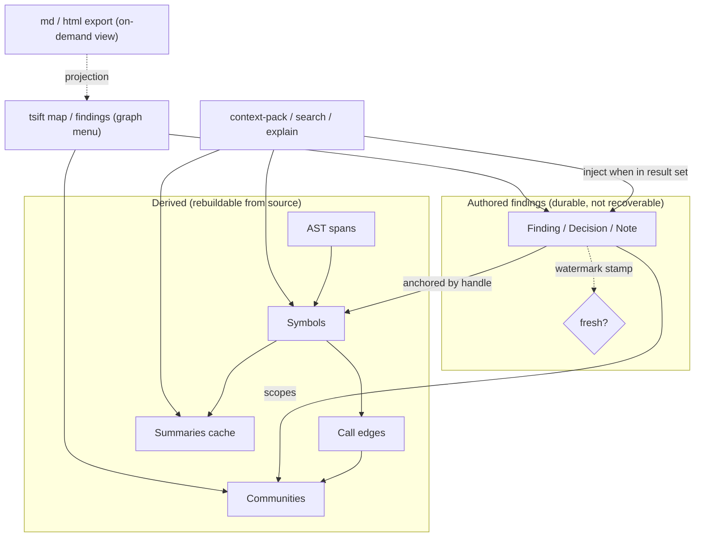

## Status

<!-- agent:status patch=replace -->
<!-- /agent:status -->

## Spec

See [src/tsift/SPEC.md](../../src/tsift/SPEC.md) for the AST-Aware Code RAG spec.

## Exchange

<!-- agent:exchange patch=append -->
### Session Summary

*Compacted. Content archived to `/home/brian/work/btakita/agent-loop/.agent-doc/archives/53cc65443c45f7b49f5e6ace54e3f6bafe4077ade57924422b5eb3baf4dbd23c-20260605-235959.md`*

Compacted content:
- Archived 3 response topic(s): #0y9e publish opencode-tsift to npm; NPM_TOKEN secret + CI publish attempt; release + publish (token updated)
- Prior summary/context: ### Session Summary *Compacted. Content archived to `/home/brian/work/btakita/agent-loop/.agent-doc/archives/53cc6544...

### Re: Can tsift cache system-level design knowledge in a graph? — opus-4-8

Short answer: yes, and the substrate is already there. tsift's `GraphStore` contract (SurrealDB / libsql / SQLite backends, SPEC §"Provider-Neutral Graph Substrate") plus Louvain `communities`, `graph` path queries, and the `summaries.db` cache are exactly the bones you'd build this on. What you're describing isn't a new system — it's a **new node class** layered onto the existing graph.

The key distinction to make first is between two kinds of metadata:

- **Derived metadata** — extracted from code: AST spans, call edges, communities, similarity, summaries. tsift already computes and caches all of this. It's reproducible from source, so it can be invalidated and rebuilt freely.
- **Authored metadata ("findings")** — *why* the parts fit together: design decisions, invariants, gotchas, "these two modules are coupled through X", research conclusions. This is **not** recoverable from source — it's the agent's (or your) accumulated understanding. This is the genuinely new ask, and it's worth treating as a first-class, durable layer rather than scattering it across markdown.

### Re: How to model findings effectively

Model each finding as a typed graph node — `Finding` / `Decision` / `Note` — with **typed edges to the code it concerns** (symbols, files, communities). The design decisions that matter for it to be useful long-term:

- **Anchor to stable handles, not line numbers.** Edge findings to symbol handles / tagpaths (the same anchors `source-read` and `symbol-read` already expose), so a finding survives reformatting and small edits instead of rotting on the first diff.
- **Carry provenance + confidence + freshness.** Who/what authored it (agent run, session id, user), how confident, and a watermark. tsift already has the precedent here: `community_graph_watermark` / `community_detection_cache_key`. Stamp findings with the graph watermark at capture time; when the underlying symbols move past that watermark, mark the finding **stale** rather than silently trusting it. Stale-but-visible beats wrong-and-confident.
- **Make them retrievable on the existing hot path.** The win isn't storing findings — it's *injecting* them. `context-pack`, `search`, and `explain` already fold in cached summaries; extend that so a finding attached to a symbol/community in the result set rides along in the envelope. Then the agent gets the "why" for free at the moment it's navigating the "what".

### Re: The "graph menu" for the agent

This is a natural new command — call it `tsift map` (or `tsift findings`). It's a budget-aware envelope like everything else: top-level communities as the menu, each annotated with attached findings and expansion handles, so the agent can drill from "systems overview" → community → symbols → the findings explaining their coupling. It's essentially `communities` + the findings layer + handle-preserving expansion, which is the established tsift navigation idiom.

### Re: Graph DB vs. md/html for visibility

Not either/or — **the graph store is the source of truth, md/html is a projection.** Reasons to keep canonical state in the graph:

- It's queryable and anchored (you can ask "what findings touch this symbol/community", invalidate by watermark, dedup).
- It rides the retrieval path so the agent gets it without reading a doc.

But raw graph rows are poor for human/agent *reading*. So generate md/html **on demand** as a view (`tsift map --format md|html`) — same pattern as session/diff digests rendering compact output from structured state. You get queryability *and* visibility without two sources of truth drifting apart. Markdown for in-repo/agent consumption (greppable, commit-friendly); HTML when you want an interactive, clickable graph for a human browsing a large codebase.

### Re: What if the user doesn't request findings?

Don't pollute the store, and don't make the agent guess. Two capture modes, capture **opt-in by default**:

- **Explicit** — `tsift finding add` (agent or user), or a finding harvested when the user clearly states a decision.
- **Passive harvest** — tsift already digests agent-doc session archives and summaries. Auto-extract *candidate* findings from those at low confidence, store them as **drafts** (clearly flagged, excluded from default injection), and only promote to trusted on confirmation. Gate the whole auto-capture path behind a `.tsift/config.toml` flag so a user who never asked for this sees zero behavior change.

The failure mode to avoid is a graph that fills with confident-sounding, unverified, stale "findings" — which is worse than no findings. Confidence + freshness gating and draft-vs-trusted status are what keep it honest.

### Net recommendation

It's a strong fit and a low-risk extension because it reuses the substrate. I've queued it as a `[recommended]` backlog item (findings graph layer) rather than starting implementation, since the active queue was inactive and this is a design question. If you want to proceed, the first concrete slice I'd spec is: the `Finding` node + anchored edge schema in `GraphStore`, watermark-based staleness, and injection into `context-pack` — the menu command and md/html export build cleanly on top of that. The one thing to watch is staleness/rot; anchoring to handles + watermark gating is the mitigation, not an afterthought.
<!-- agent:boundary:aa18e0dc -->
<!-- /agent:exchange -->
###
<!--
What are #next-steps to promote SurrealDB to SQLite-equivalent substrate status?
-->

## Queue

<!-- agent:queue auto preset="#spec-test-build-install-commit-push" go -->
- Add a documentation section for the findings graph layer, detailing its design, implementation, and benefits. Update as we implement.
- [#trt1]
<!-- /agent:queue -->

## Backlog

<!-- agent:backlog queue -->
- [ ] [#trt1] [recommended] Findings graph layer: add authored Finding/Decision/Note nodes to GraphStore, anchored by stable symbol-handle/tagpath edges (not line numbers), with provenance+confidence+freshness fields gated on community_graph_watermark for staleness; expose retrieval via context-pack/search injection and a / graph-menu command; opt-in/passive capture from agent-doc session archives; md/html as on-demand projection, graph store as source of truth. Spec in src/tsift/SPEC.md.
<!-- /agent:backlog -->

## Review

<!-- agent:review -->
- [/] [#0y9e] I set NPM_TOKEN="$(passage btak/NPM_TOKEN)". Publish to npm.
- [/] [#astnav-npm] Configure NPM_TOKEN + TSIFT_ENABLE_NPM_PUBLISH secrets, publish opencode-tsift to npm (medium)
- [/] [#surreal-batch-bfs] #surreal-batch-bfs-gated: Batch frontier expansion - gated (low)
- [/] [#surreal-fixture] Record SurrealDB samples in graph-db-performance-history.json fixture (medium)
- [/] [#surrealbulk-close] Close #surrealbulk review item: re-run benchmarks, update SPEC.md benchmark table, mark done
- [/] [#rankdefault] Promote ranked_neighborhood into default graph lookup/context-pack/evidence output only after quality gates pass; compare ranked vs unranked output on real backlog/code queries for useful-hit density, duplicate-name precision, handle coverage, latency, and emitted tokens.
- [/] [#surrealbulk] Batch SurrealDB projection load: replace per-row upsert loops with bulk/transactional row load plus one-pass secondary-index rebuild; measure refresh/load separately.
- [/] [#full-e2e-verify] In fresh project: opencode plugin opencode-tsift && opencode then /tsift-status. On success mark #e2e-install done.
- [/] [#npm-publish-verify] After auth configured, tag release and verify publish-opencode-plugin CI job succeeds and opencode-tsift appears on npmjs.org
- [/] [#npm-auth-setup] Configure NPM_TOKEN secret + TSIFT_ENABLE_NPM_PUBLISH=true variable in GitHub repo settings
- [/] [#e2e-install] Verify end-to-end install: fresh opencode project + opencode plugin opencode-tsift + /tsift-status
<!-- /agent:review -->
###
<!--
Can we increase max-hop caps?
Could FalkorDB help with performance?
-->

<!-- agent:icebox -->
<!-- /agent:icebox -->

## Completed / Reaped

<!-- agent:done archive=tasks/software/tsift.done.md -->

<!-- completed work archived in tasks/software/tsift.done.md -->
<!-- /agent:done -->
