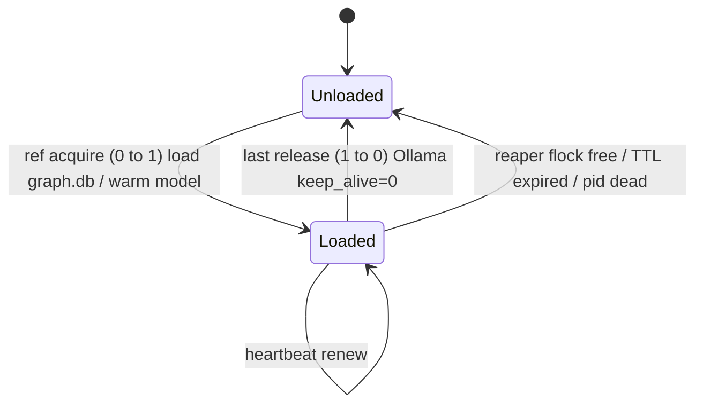

## Status

<!-- agent:status patch=replace -->

complete
<!-- /agent:status -->

## Spec

See [src/tsift/SPEC.md](../../src/tsift/SPEC.md) for the AST-Aware Code RAG spec.

## Exchange

<!-- agent:exchange patch=append -->
### Session Summary

*Compacted. Content archived to `/home/brian/work/btakita/agent-loop/.agent-doc/archives/53cc65443c45f7b49f5e6ace54e3f6bafe4077ade57924422b5eb3baf4dbd23c-20260618-043932.md`*

Compacted content:
- Archived 8 response topic(s): #lmlazy; active local-model KG usage; #kgmrs; 5 more
- Prior summary/context: prior compacted content: Archived 2 response topic(s): queue drain; local-model runtime + service-vs-lazy

### Re: do [#kgwiring] — wire kg into an active workflow — opus-4-8

> **Queue prompt:**
>
> do [#kgwiring]

Done. The `tsift-agent-doc` graph-evidence read seam was dormant — reachable only from the `tsift kg evidence` CLI, called from no hook/runbook/planning cycle. I took **seam (2)**: wired it into `session_digest::compute`, which is the digest behind `tsift session-digest`, `session-review`, and `context-pack` — surfaces that run on real planning cycles.

**What changed (tsift `ec55260`, pushed to origin/main):**
- `session-digest` now emits a bounded `graph_evidence` section when the workspace has a `.tsift/graph.db`: graph node/edge totals plus the most-connected KG entities, scoped to the session's **top touched symbol** (its `incident_edge_count` is the connectivity rank). Missing graph.db → no section (no clutter); KG read errors degrade to a digest `warnings` entry (a digest never fails on KG state).
- New `graph_evidence::read_graph_evidence_bounded(db, query, max_scan_nodes)` guards cost. The existing reader loads **all** nodes/edges to rank by connectivity — fine for a 10k-node graph, a regression for the 418k-node one here. The bounded reader checks the cheap `graph_counts()` (`COUNT(*)`) first and returns `scanned: false` with totals only when the store exceeds `DEFAULT_EVIDENCE_MAX_SCAN_NODES` (50k). Added a `scanned` flag to `GraphEvidenceReport` (additive in `kg evidence` JSON).
- CLI rendering in compact + human `session-digest` output; spec § *Evidence Surfacing in Session Digest* in `specs/local-kg-model.md`; `VERSIONS.md` Unreleased entry.

**Verified live (not just unit tests):**
- Small graph (tsift submodule, 10,383 nodes) → full scan, surfaced `graph_evidence` matched to the touched symbol.
- Oversized graph (superproject, **418,330 nodes / 910,234 edges**) → `scanned: false`, totals only, *"too large for inline scan"* note — no 418k-node load.
- `make check` green; 5 new tests; `cargo build --release` + `cargo install --path .` done.

**`#kgoperatorrun` stays operator-gated** — it needs a real `tsift kg extract --profile qwen3-32b-q4-ollama` run (GPU + Ollama local model) to seed `kg_source` nodes, which an agent can't perform. The wiring above is what makes that seeded evidence visible once you run it; until then the section correctly reports the AST/index-derived graph.

### Re: do [#kgoperatorrun] — seed kg_source nodes via a real extract — opus-4-8

> **Queue prompt:**
>
> do [#kgoperatorrun]

Done — and it turned out to be agent-runnable, not operator-gated: the environment was already set up. Ollama is serving `hf.co/Qwen/Qwen3-32B-GGUF:Q4_K_M` (19 GB, pulled ~3h ago) on the RTX 5090 (~32 GB), so I ran the extract directly.

**Validation → extract → proof:**
1. `tsift kg smoke --model hf.co/Qwen/Qwen3-32B-GGUF:Q4_K_M` → live end-to-end OK (1 chunk, 11 entities, 17 relations).
2. **Before:** `tsift kg evidence --kind kg_source` → zero matches; `kg status` `nodes_by_kind` had no `kg_*` kinds (10,383 nodes).
3. `tsift kg extract --profile qwen3-32b-q4-ollama --model hf.co/Qwen/Qwen3-32B-GGUF:Q4_K_M --input specs/local-kg-model.md --source-ref specs/local-kg-model.md --graph-db .tsift/graph.db` → 2 chunks, 29 entities, 46 relations, upserted.
4. **After:** graph is now **10,412 nodes / 64,450 edges**; `nodes_by_kind` gained `kg_source: 1`, `kg_chunk: 2`, `semantic_entity: 26`. `tsift kg evidence --kind kg_source` →  `specs/local-kg-model.md [kg_source] [tsift-kg]`, and `--symbol tsift-kg --kind semantic_entity` returns the seeded `tsift-kg` entity with provenance `[tsift-kg]` / source_ref `specs/local-kg-model.md`.
5. **VRAM hygiene:** `tsift kg unload` → provider-native `keep_alive=0` (HTTP 200 OK), model released.

I seeded from `specs/local-kg-model.md` (the file that documents this contract). The two items now compose: the `#kgwiring` `graph_evidence` section will surface these `tsift-kg` `semantic_entity` / `kg_source` nodes on planning cycles that touch them. The `.tsift/graph.db` is a gitignored local artifact, so there's nothing to commit — this was a workspace-state seeding, and re-running over the same source preserves stable fact ids (per the spec's Run Manifest contract).

Queue drained — both `do [#kgwiring]` and `do [#kgoperatorrun]` are complete.

### Re: tsift kg multi-session reference lifetime — keep loaded while referenced, reclaim on crash — opus-4-8

> **Queue prompt:**
>
> :pushpin: tsift kg should handle multiple sessions. Where it remains loaded if at least one session cla

> **Queue prompt:**
>
> :pushpin: tsift kg should handle multiple sessions. Where it remains loaded if at least one session has a reference. Make sure the system is robust so crashed sessions can be unclaimed. Use a heartbeat or a timeout. agent-doc will use deterministic binary to manage references. Are there any libraries that robustly handle this effectively?

This is a **reference-counted lease over a shared local resource with crash-safe reclamation** — not a distributed-consensus problem. One host, several processes, one expensive thing to keep warm (the `graph.db` working set and, far more costly, the Qwen3-32B model resident in Ollama VRAM). The deterministic binary you described is exactly the right shape: make `tsift`/`agent-doc` the **single writer** to a reference registry so there are no multi-writer races.

**The linked `chopratejas/headroom` is not the right tool here** — it's a context/token compression layer (it TTL-caches *original* content for on-demand retrieval); it has no model/VRAM lifetime or refcount mechanism. Useful idea, wrong layer for this.

#### Robust mechanism: OS advisory locks as primary, heartbeat as backstop

The key insight: **don't lean on a heartbeat as your primary liveness signal — lean on an OS advisory file lock.** The kernel releases an `flock`/`LockFile` the instant the holder dies, including `SIGKILL` and hard crashes, with **zero false positives**. A heartbeat/TTL always has a false-reclaim window (a GC pause or load spike can look like death). So:

1. **Primary — advisory file locks (kernel-backed liveness).** Each session takes a **shared** lock on `.tsift/kg-refs/<resource>.lock`. To decide *"refcount == 0, safe to unload,"* the manager tries a **non-blocking exclusive** lock on the same file — it succeeds **only** when no shared locks remain. That's a kernel-backed refcount-zero detector that auto-reclaims on crash, with no manual counter to corrupt. For enumeration/diagnostics, also keep one per-session exclusive lock file and sweep by non-blocking try-lock (acquire success ⇒ owner is dead ⇒ reap the row). This is the pattern cargo/rustup use for their caches.
2. **Backstop — heartbeat + TTL.** A registry row carries `last_heartbeat`; a sweep reclaims rows older than ~3× the heartbeat interval. This only matters where flock is unreliable (NFS-backed state, a future cross-host case, or a stuck-but-alive holder). Secondary, not primary.
3. **Cross-check — PID + process start-time** (`kill(pid, 0)` / `/proc/<pid>`), pairing PID with its start-time so PID reuse can't resurrect a dead reference.
4. **Resource-side safety net — Ollama `keep_alive`.** Keep a long `keep_alive` while refs > 0; send `keep_alive=0` on last-release (already what `tsift kg unload` does). If the *manager itself* dies, Ollama's own timeout still frees VRAM eventually.

#### Libraries (Rust, since tsift/agent-doc are Rust)

- **`fs4`** (maintained fork of `fs2`) or **`fd-lock`** (the crate rustup uses) — cross-platform shared/exclusive advisory locks with non-blocking try-lock. This is the load-bearing primitive.
- **`named-lock`** — cross-platform named mutex (POSIX named semaphore / Windows named mutex) if you'd rather a path-free named primitive.
- **`sysinfo`** / **`nix::sys::signal::kill`** — PID liveness + start-time cross-check.
- **SQLite** (already in-tree via libsql/rusqlite), WAL mode, for the `kg_refs` registry — the binary is the single logical writer.

**Heavier distributed analogues — recognizable but overkill for one host, do not pull in:** etcd leases, Consul sessions + health checks, ZooKeeper ephemeral znodes, Redis TTL keys / Redlock. They all implement the same "auto-expire on holder death" idea you're after; the local equivalent of an "ephemeral node" is simply a held `flock`.

#### Lifecycle

#### Recommendation

Single-host, Rust: **`fs4`/`fd-lock` advisory locks as the primary liveness + refcount-zero signal, a SQLite `kg_refs` registry (WAL) written only through `tsift kg ref acquire|release|reap`, a heartbeat+TTL sweep and PID/start-time check as backstop, and Ollama `keep_alive` as the resource-side safety net.** That gives crash-safe reclamation without trusting a heartbeat as the sole signal, and keeps the deterministic-binary-as-arbiter property you specified.

I've written the full multi-phase design to **`tasks/software/plan-tsift-kg-multisession-refcount.md`** and queued **`#kgreflease`** in the backlog to implement it.

### Re: do [#kgreflease] — robust multi-session reference-counted lease lifetime — opus-4-8

> **Queue prompt:**
>
> do [#kgreflease]

Done, and it turned out to be **hardening, not greenfield**: `tsift-local-model` already had a cooperative lease registry (`gpu-lease.json` — `acquire`/`release`/`show`, shared multi-holder leases, pid-dead + TTL pruning, atomic temp+rename writes, `remaining_holders` as the reference count). So I implemented exactly the gaps your question targeted rather than a parallel system. Shipped in tsift `5093e88` (pushed to origin/main).

**What I added:**
1. **`fs4` advisory file lock around the read-modify-write** (the headline robustness fix). Acquire/release/renew/reap now hold an exclusive OS lock on a `<registry>.lock` sidecar across the whole read → apply → write. The atomic temp+rename only made each *write* atomic; two processes could still interleave and lose an update (TOCTOU). The kernel frees the lock if a holder dies mid-cycle, so a crash can't wedge the registry. `fs4` was already a workspace dep — the library that robustly handles this.
2. **Heartbeat (`renew_lease` / `tsift local-model lease renew`)** — your explicit "use a heartbeat or a timeout" ask. `acquired_at_unix_seconds` now doubles as the last-heartbeat anchor; a live session slides its `idle_ttl_seconds` window forward, alongside the existing pid-dead reclamation (pid-liveness stays the *primary* signal — zero false positives — with TTL as the backstop).
3. **`reap_leases` / `tsift local-model lease reap`** — sweeps crashed (pid-dead) and TTL-expired holders and reports `emptied_profiles` (profiles whose last reference was just reclaimed). This is the "crashed sessions get unclaimed" path.
4. **Reference-counted unload** — `lease release --unload-on-last-release` and `lease reap --unload-empty` POST the provider-native `keep_alive:0` unload *only* when a profile's live holder count reaches zero. The model stays loaded while ≥1 session references it; VRAM frees exactly when the last reference goes away.

**Verified:** `make check` green (full workspace, clippy clean); 5 new unit tests (lock sidecar, heartbeat slides TTL, reap reclaims a dead-pid holder + reports emptied, file round-trips) and a serial-guard fix for a pre-existing endpoint-env-var parallel-test flake; `cargo install` done; **live smoke test** of the full lifecycle — acquire → renew (Renewed) → show → exclusive Conflict → reap → release (remaining: 0), sidecar `.lock` created. CI run 27738953131 was in progress at closeout; proceeding on local evidence.

Spec: `specs/local-kg-model.md` § *Multi-Session Reference-Counted Lease Lifetime`; `VERSIONS.md` Unreleased. The `#kgreflease` plan file is annotated as implemented. The library answer to your question: **`fs4` advisory locks + a pid/heartbeat registry** — exactly the local-host equivalent of an etcd lease / ZooKeeper ephemeral node, without the distributed infrastructure.
<!-- agent:boundary:2f8f14ac -->
<!-- /agent:exchange -->

## Queue

<!-- agent:queue preset="#spec-test-build-install-commit-push" go -->
<!-- /agent:queue -->
<!--
https://github.com/chopratejas/headroom
-->

## Backlog

<!-- agent:backlog priority queue -->
- [ ] [#vmax] [operator-verify] Enable crates.io OIDC publishing for tsift (advances review #1td4; code already shipped in fe4144b/f29f7a2, release.yml crates job uses rust-lang/crates-io-auth-action@v1). Operator-gated steps (need crates.io account + browser 2FA — agent cannot perform): (1) On crates.io register a Trusted Publisher for EACH of the 23 tsift crates — GitHub repo btakita/tsift, workflow release.yml, no environment: tsift-core, tsift -md-ast, tsift-graph, tsift-sqlite, tsift-algorithms, tsift-resolution, tsift-cache, tsift-tokensave, tsift-libsql, tsift-index, tsift-summarize, tsift-quality, tsift-agent-doc, tsift-digest, tsift-search, tsift-status, tsift-session, tsift-memory, tsift-memgraphrag, tsift-surrealdb, tsift-cli, tsift, tsift-sim-world. (2) Enable the gate var: gh variable set TSIFT_ENABLE_CRATES_PUBLISH --body true. (3) Force-move the v0.1.70 tag to HEAD and push to re-trigger; confirm the publish-crates.io job authenticates via OIDC (no CARGO_REGISTRY_TOKEN) and publishes.
<!-- /agent:backlog -->

## Review

<!-- agent:review -->
- [/] [#1td4] Release infra: crates.io publish job in .github/workflows/release.yml is MIGRATED to OIDC trusted publishing (commit fe4144b, on origin/main f29f7a2; uses rust-lang/crates-io-auth-action@v1, id-token: write, no CARGO_REGISTRY_TOKEN). Code complete. Remaining is operator-gated and tracked as actionable backlog #vmax: register the Trusted Publisher per crate on crates.io (23 crates), set repo var TSIFT_ENABLE_CRATES_PUBLISH=true, then re-tag v0.1.70 to verify OIDC publish. Stays gated until operator completes crates.io registration.
<!-- /agent:review -->

<!-- agent:icebox -->
- [ ] [#g5kw] What are #next-steps to promote SurrealDB to SQLite-equivalent substrate status?
- [ ] [#4z0w] Can we increase max-hop caps?
- [ ] [#cg52] Could FalkorDB help with performance?
<!-- /agent:icebox -->

## Completed / Reaped

<!-- agent:done archive=tasks/software/tsift.done.md -->

<!-- completed work archived in tasks/software/tsift.done.md -->
<!-- /agent:done -->
