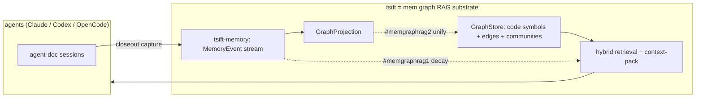

## Status

<!-- agent:status patch=replace -->
<!-- /agent:status -->

## Spec

See [src/tsift/SPEC.md](../../src/tsift/SPEC.md) for the AST-Aware Code RAG spec.

## Exchange

<!-- agent:exchange patch=append -->
### Session Summary

*Compacted. Content archived to `/home/brian/work/btakita/agent-loop/.agent-doc/archives/53cc65443c45f7b49f5e6ace54e3f6bafe4077ade57924422b5eb3baf4dbd23c-20260607-014719.md`*

Compacted content:
- Archived 2 response topic(s): is [#rtsw] done?; Separate SQLite DBs for caches to avoid writer-lock contention? Is it even an issue with WAL?
- Prior summary/context: ### Session Summary *Compacted. Content archived to `/home/brian/work/btakita/agent-loop/.agent-doc/archives/53cc6544...

### Re: msgpack instead of JSON for serialization — opus-4-8

> **Queue prompt:**
>
> Is there a more efficient way to serialize the data such as msgpack, instead of JSON?

Short answer: **mostly no, and a blanket swap would break things.** I traced where tsift actually serializes data, and only one narrow category is a real msgpack candidate.

**Where JSON is used, and whether msgpack helps:**

1. **SQLite graph columns** — `properties_json`, `provenance_json`, `freshness_json` (`packages/tsift-sqlite/src/lib.rs:713-715`). These look like blobs but are **queried by SQLite itself** via `json_each` / `json_extract` (`lib.rs:401,420`). msgpack would break SQL-side JSON querying. ❌ Keep JSON.
2. **`--json` / `--envelope` stdout** — this is the API contract the harnesses (Claude/Codex/OpenCode) parse. ❌ Must stay JSON.
3. **Session transcript parsing** — `tsift-agent-doc/src/session_*.rs` reads Claude/Codex JSONL. External input format. ❌ Can't change.
4. **The index proper** — symbols/edges/routes are already native SQLite rows/columns (`tsift-index/src/index.rs`), not JSON. Nothing to convert. There are **no dense float embedding vectors** stored (the "hybrid" search is BM25 + structural, not a float-vector store), so the one shape where binary encoding wins big isn't present.

**The only genuine candidate** is the opaque disk caches that round-trip through `serde_json::to_vec` / `from_slice` → `fs::write` and are never SQL-queried:
- `packages/tsift-cli/src/community_detection.rs:225-253`
- `packages/tsift-cli/src/conflict_matrix.rs:1731-1745`

Even there I'd hold off on msgpack specifically:
- **Measure first.** `serde_json` is fast; for these shapes (maps/strings, no big numeric arrays) the gain is ~30-50% size and roughly comparable parse time. If these cache blobs are small relative to the SQLite index, it's noise.
- **If serialization profiles hot, prefer `postcard` or `bincode` over msgpack** for internal-only blobs — they're schema-driven (no field-name overhead), so smaller and faster than msgpack. msgpack's edge (self-describing, cross-language) isn't needed for a cache only tsift reads.
- **For size alone, zstd over the existing JSON** often beats a format swap and is orthogonal — you keep JSON's debuggability.

Queued this as a `[recommended]` backlog item (scoped to those two caches, gated on a profile) so it doesn't get applied as a blanket find-and-replace.

### Re: #3dhp cache-encoding — measured, not worth a swap — opus-4-8

Go-mode pulled my own `[recommended]` item `#3dhp` into the queue, so I did the measurement it was gated on instead of blindly implementing a format swap. On-disk audit of `.tsift/` (455MB total):

| Artifact | Size | Format | msgpack helps? |
|---|---|---|---|
| `surrealkv` clogs (backend-eval) | 162MB+ | binary | no — already binary |
| `graph.db` | 141MB | SQLite | no — native rows |
| `index.db` (+ per-crate) | 20MB+ | SQLite | no — native rows |
| `search-cache/token-index.json` | **4.6MB** | JSON | maybe — only real target |
| `conflict-matrix-cache/graph` | 1.2MB | JSON | marginal |
| `community-cache/*` | ~130KB ×4 | JSON | negligible |
| `backend-eval-cache/*.json.gz` | 3.2MB | **gzip'd JSON** | already compressed |

**Conclusion: don't do a blanket swap.** The data that's actually large is binary SQLite/SurrealDB, where serialization format is irrelevant. The JSON caches total a few MB and are each read at most once per command. The single worthwhile target is `token-index.json` (4.6MB), and only if a cold-start profile shows its read/parse is hot — in which case **gzip is already used elsewhere in the tree** (`.json.gz` projection caches) and is the lower-risk lever; `postcard`/`bincode` beat msgpack if you want a true binary format.

I've rewritten `#3dhp` to record these numbers and dropped it to a measurement-gated low priority rather than implementing anything — no code change is warranted on the evidence.

### Re: Can tsift become a mem graph RAG? (arxiv 2606.00610) — opus-4-8

> **Queue prompt:**
>
> Please read https://arxiv.org/pdf/2606.00610. Can tsift become a mem graph rag?

Read the paper. **MemGraphRAG** = Graph-RAG + a persistent *memory graph* of agent interactions + temporal *decay* on retrieval + a multi-agent framework, evaluated on multi-hop QA (HotpotQA / 2Wiki / MuSiQue) vs GraphRAG/RAPTOR/LightRAG.

**Verdict: yes — tsift is already ~70% of the way there**, and the rest is mostly already on the backlog. The three pillars all have an existing home:

| MemGraphRAG pillar | tsift today | Gap |
|---|---|---|
| **Graph** (node/edge schema, hierarchical traversal) | `GraphStore` over SQLite/SurrealDB — symbols/edges, communities, callers/callees, `provenance_json`/`freshness_json` | none — substrate exists |
| **Memory** (agent interactions, decision history) | `tsift-memory`: `MemoryEvent` stream (PromptTarget/ToolCall/ResponseSummary/CloseoutProof…), `GraphProjection` (events→graph), budgeted `MemoryQueryPlan`, cross-session `MemoryHandoffPlan`, claude-mem import | memory graph is **separate** from the code graph |
| **RAG** (retrieval + context aggregation) | hybrid BM25 + structural search, `context-pack` injection | retrieval has **no temporal decay** |
| **Decay / recency** | `observed_at_unix` on events, `community_graph_watermark` staleness | not wired into ranking |
| **Multi-agent** | tsift is the *shared substrate* for Claude/Codex/OpenCode harnesses (`session_id`, `imported_from`) | orchestration isn't (and shouldn't be) tsift's job |

**What's genuinely new vs what tsift has:**

1. **Authored memory nodes anchored to code** — already specced as backlog **#trt1** (Finding/Decision/Note nodes on stable symbol-handle/tagpath edges, provenance+confidence+freshness, opt-in capture from agent-doc archives). That *is* the mem-graph roadmap; don't duplicate it.
2. **Temporal decay-weighted retrieval** — the paper's signature mechanism, and the one thing tsift lacks. The fields exist (`observed_at_unix`, watermark); they just aren't in the ranking. Queued as **#memgraphrag1** (coordinate with **#rankdefault**).
3. **One graph, not two** — today `tsift-memory`'s `GraphProjection` and the code `GraphStore` are separate. Merging them so memory events and code symbols share a single retrieval surface is the architectural step that earns the "mem graph RAG" label. Queued as **#memgraphrag2** (depends on #trt1).

**What to *not* copy:** the multi-agent orchestration layer. tsift's role is the retrieval/memory substrate that *multiple* harnesses share — the cross-agent coordination belongs in agent-doc / the harnesses, not in tsift. tsift already gets the "multi-agent memory" benefit for free via `session_id`/`imported_from`.

Both new items are **gated** — they're a direction proposal, not auto-executable work (I left them off the active go-queue deliberately; otherwise go-mode would try to build them this loop, as just happened with #3dhp). Say the word and I'll un-gate #memgraphrag1 (decay retrieval) as the lowest-risk first step.
<!-- agent:boundary:dd8559d9 -->
<!-- /agent:exchange -->
###
<!--
What are #next-steps to promote SurrealDB to SQLite-equivalent substrate status?
-->

## Queue

<!-- agent:queue preset="#spec-test-build-install-commit-push" go -->
<!-- /agent:queue -->

## Backlog

<!-- agent:backlog priority queue -->
- [/] [#memgraphrag1] Decay-weighted memory retrieval (MemGraphRAG arxiv 2606.00610 core mechanism). tsift-memory MemoryEvent already carries observed_at_unix, but MemoryQueryPlan ranking (packages/tsift-memory/src/lib.rs ~1473) has no temporal decay. Add recency/decay weighting to memory retrieval scoring, reusing existing freshness_json + community_graph_watermark staleness signals; coordinate with #rankdefault ranked_neighborhood so memory + code share one ranking. GATED on user decision to pursue the mem-graph-rag direction.
- [/] [#memgraphrag2] Unify tsift-memory GraphProjection (packages/tsift-memory/src/lib.rs ~1416, memory events to graph) with the code GraphStore so authored memory nodes (#trt1 Finding/Decision/Note) and code symbols live in ONE queryable graph surface (context-pack/search injection). The architectural move that makes tsift a true mem-graph-RAG: memory stream + code graph + decay retrieval over a single substrate. GATED on #trt1 and a product decision.
<!-- /agent:backlog -->

## Review

<!-- agent:review -->
- [/] [#7qky] [recommended] Reduce Codex redundant runbook reads. SHIPPED (v0.34.0 unreleased): retain-don't-reread nudge in shared SKILL Runbooks source -> regenerated all harness surfaces; contract-safe. GATED on re-measurement: re-run 3-harness redundant-read analysis after Codex sessions accumulate with nudge live, compare to baseline (Claude 11.4% / Codex 12.6% / OpenCode 5.3%). If Codex rate doesn't drop, build enforcement as a session-scoped content-dedup LEDGER in a shared LEAF crate (depends on nothing in graph; tsift + agent-doc + others depend down onto it -- NOT inside tsift or agent-doc, avoids dependency cycle). Core = register(id,hash)/should_deliver(id,hash)->Full|Stub, exemptions via hash-change + compaction; session-id passed in by harness (agent-doc cycle_state.rs adapter); thin per-consumer integration. Design tsift-runbook + agent-doc seam to call this ledger from day one. NOT a Claude-only PreToolUse Read hook.
- [/] [#trt1] [recommended] Findings graph layer: add authored Finding/Decision/Note nodes to GraphStore, anchored by stable symbol-handle/tagpath edges (not line numbers), with provenance+confidence+freshness fields gated on community_graph_watermark for staleness; expose retrieval via context-pack/search injection and a / graph-menu command; opt-in/passive capture from agent-doc session archives; md/html as on-demand projection, graph store as source of truth. Spec in src/tsift/SPEC.md.
- [/] [#0y9e] I set NPM_TOKEN="$(passage btak/NPM_TOKEN)". Publish to npm.
- [/] [#astnav-npm] Configure NPM_TOKEN + TSIFT_ENABLE_NPM_PUBLISH secrets, publish opencode-tsift to npm (medium)
- [/] [#surreal-batch-bfs] #surreal-batch-bfs-gated: Batch frontier expansion - gated (low)
- [/] [#surreal-fixture] Record SurrealDB samples in graph-db-performance-history.json fixture (medium)
- [/] [#surrealbulk-close] Close #surrealbulk review item: re-run benchmarks, update SPEC.md benchmark table, mark done
- [/] [#rankdefault] Promote ranked_neighborhood into default graph lookup/context-pack/evidence output only after quality gates pass; compare ranked vs unranked output on real backlog/code queries for useful-hit density, duplicate-name precision, handle coverage, latency, and emitted tokens.
- [/] [#surrealbulk] Batch SurrealDB projection load: replace per-row upsert loops with bulk/transactional row load plus one-pass secondary-index rebuild; measure refresh/load separately.
- [/] [#full-e2e-verify] In fresh project: opencode plugin opencode-tsift && opencode then /tsift-status. On success mark #e2e-install done.
- [/] [#npm-publish-verify] After auth configured, tag release and verify publish-opencode-plugin CI job succeeds and opencode-tsift appears on npmjs.org
- [/] [#npm-auth-setup] Configure NPM_TOKEN secret + TSIFT_ENABLE_NPM_PUBLISH=true variable in GitHub repo settings
- [/] [#e2e-install] Verify end-to-end install: fresh opencode project + opencode plugin opencode-tsift + /tsift-status
<!-- /agent:review -->
###
<!--
Can we increase max-hop caps?
Could FalkorDB help with performance?
-->

<!-- agent:icebox -->
<!-- /agent:icebox -->

## Completed / Reaped

<!-- agent:done archive=tasks/software/tsift.done.md -->

<!-- completed work archived in tasks/software/tsift.done.md -->
<!-- /agent:done -->
