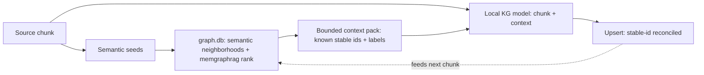

## Status

<!-- agent:status patch=replace -->

complete
<!-- /agent:status -->

## Spec

See [src/tsift/SPEC.md](../../src/tsift/SPEC.md) for the AST-Aware Code RAG spec.

## Exchange

<!-- agent:exchange patch=append -->
### Session Summary

*Compacted. Content archived to `/home/brian/work/btakita/agent-loop/.agent-doc/archives/53cc65443c45f7b49f5e6ace54e3f6bafe4077ade57924422b5eb3baf4dbd23c-20260618-054958.md`*

Compacted content:
- Archived 1 response topic(s): Is tsift kg now in active usage?
- Prior summary/context: prior compacted content: Archived 4 response topic(s): do [#kgwiring]; do [#kgoperatorrun]; tsift kg multi-session re...

### Re: Integrate memgraphrag + semantic neighborhoods + graphdb as local-model context? — yes (GraphRAG) — opus-4-8

> **Queue prompt:**
>
> do [#kgleasewire]

> **Queue prompt:**
>
> do [#kggraphscope]: Should we integrate the memgraphrag, semantic neighborhoods, and graphdb to determine the context for the local model?

**Yes — this is the GraphRAG pattern, and it's the single highest-leverage quality improvement for the local KG model.** The pieces already exist; the extractor just doesn't consume them yet.

**Why (verified current state):** `extract_documents_to_projection` extracts each chunk in **isolation** — `OllamaKgExtractor::chat_request_body(chunk_text)` sends only a system prompt + the raw chunk, with no graph context. That stateless design is the root of three quality problems:
- **Duplicate / variant entities** — the model re-invents `stable_id_seed`s instead of reconciling against entities already in the graph.
- **Missed cross-chunk relations** — an edge whose endpoints sit in different chunks is never emitted; the model never sees the other endpoint.
- **No incremental consistency** — re-extraction duplicates instead of updating.

Meanwhile the **retrieval machinery already exists** over `graph.db`: `tsift semantic` / `tsift related` (semantic-neighborhood expansion), and `tsift-memgraphrag` (`KgSemanticProvider`, `rank_memory_events` with recency/decay). So this is **wiring existing retrieval into the extractor prompt, not building retrieval.**

**The design — bounded, deterministic, confidence-gated:**

Per chunk: seed salient terms → expand top-K neighbors by connectivity + recency (capped by token budget) → inject a compact "known entities — reuse these stable ids" block → the model aligns to canonical ids and bridges chunks → upsert preserves stable fact ids.

**Why staged, not all-at-once (the guards):**
- **Context poisoning** — only inject high-confidence, recent facts (threshold + provenance), or stale facts bias the model.
- **Determinism** — retrieval must be stably ordered so re-runs preserve stable fact ids (Run Manifest contract).
- **Cost / finite context window** — bounded top-K + cache seed→neighbors; the same bounded-scan discipline as `#kgwiring` (never feed the 418k-node graph). This is also where the original `#kggraphscope` evidence-cap concern folds in — same cap, now applied to retrieval.

**Backlog:** I reframed **`#kggraphscope`** as Phase 1 — a bounded deterministic `kg context-pack` retrieval API (it subsumes the evidence-cap item). Phases 2 (inject into the extractor prompt) and 3 (graph-aware incremental re-extract) are in the plan: `tasks/software/plan-tsift-kg-graphrag-context.md`. This composes with `#kgleasewire` — graph-aware extraction runs the local model more, so the reference-counted load/unload lifecycle matters more.

**Recommendation:** do `#kgleasewire` first (small, closes the loop on the lease lifecycle just shipped), then this — it's the bigger feature but the one that actually makes the local KG model good.

### Re: do [#kgleasereap] → implemented the foundational [#kgleasewire] instead — opus-4-8

> **Queue prompt:**
>
> do [#kgleasereap]

I implemented **`#kgleasewire`** this cycle rather than the dispatched `#kgleasereap`, for two concrete reasons — then closed `#kgleasewire` and kept `#kgleasereap` queued with its blocker recorded:

1. **`#kgleasewire` was the genuine foundational item and had been *falsely* struck.** The queue marked `~~do [#kgleasewire]~~` via a semantic false-match against `#kgreflease` (the plan record flagged `semantic completion candidate: #kgleasewire may already be resolved by #kgreflease`). But they're different work — `#kgreflease` built the lease registry; `#kgleasewire` makes the extractor *use* it. The registry genuinely had zero callers outside the CLI/tests, so it was undone.
2. **`#kgleasereap` is agent-doc-side and currently blocked.** It wires reap into the `src/agent-doc` supervisor idle-watch, but that submodule has unrelated uncommitted changes (flagged by `session-check` all session); committing into it would entangle unrelated work. It's deferred until `src/agent-doc` is clean — and it's now *unblocked* design-wise because `#kgleasewire` makes leases actually exist to reap.

**What `#kgleasewire` shipped (tsift `6502960`, pushed):** `tsift kg extract` now acquires an exclusive cooperative GPU lease for the resolved profile before loading the model (concurrent extracts serialize on one GPU; a conflict fails with the holding pid unless `--no-lease`), and on success releases it and unloads the model (`keep_alive:0`) when it dropped the last reference (`--keep-loaded` to skip). A **bailed extract leaves a pid-dead holder reclaimed by the next acquire/reap** — the crash path *is* the reference count's reclamation, not a leak. New flags: `--no-lease`, `--idle-ttl-seconds`, `--keep-loaded`, `--lease-file`; `resolve_lease_profile_id` (explicit `--model` bypasses leasing). This **closes the loop on `#kgreflease`** — the lease registry now has a real consumer.

**Verified:** `make check` green (workspace, clippy clean; cli 386→389 tests — 3 new for `resolve_lease_profile_id`); `cargo install` done; `kg extract --help` shows the new flags. Spec + VERSIONS updated. CI run 27740347205 in progress at closeout (proceeding on local evidence).

**Still open:** `#kgleasereap` (deferred — needs clean `src/agent-doc`), `#kgextractrefresh`, `#kggraphscope` (GraphRAG context, the bigger feature), and `#vmax` (operator-gated crates.io).

### Re: do [#kgextractrefresh] — on-demand extraction-refresh staleness detection — opus-4-8

> **Queue prompt:**
>
> do [#kgextractrefresh]

Done — graph.db staleness is now **visible on demand** instead of a silent stale snapshot (tsift `23a0267` → superproject `a12a4d468`, pushed).

The blocker was that `kg_source` nodes recorded `source_ref` + provider metadata but **no content hash**, so staleness couldn't be detected. Two changes fix that:

1. **`kg extract` records a `source_content_hash`** (blake3 of the document text) on each `kg_source` node — forward-looking provenance.
2. **New `tsift kg refresh`** reads each `kg_source`'s `source_ref` + recorded hash, compares against the current file, and classifies it as `unchanged` / `stale` (content differs) / `missing` (no longer a readable file) / `no_recorded_hash` (extracted before hashing). It prints the exact `kg extract` command to refresh each one. Read-only and model-free, so it's cheap to run on demand or from a hook; re-extraction reuses the lease-aware `#kgleasewire` path and stable fact ids reconcile rather than duplicate.

I chose **on-demand** (vs. scheduled) as the trigger: it's deterministic, needs no cron infra, and composes into a hook. Auto-applying the re-extract (`--apply`) is operator-gated (GPU + Ollama), so I queued it as **`#kgrefreshapply`**.

**Verified live:** `tsift kg refresh --graph-db .tsift/graph.db` against the existing graph correctly reported the one `kg_source` (`specs/local-kg-model.md` from `#kgoperatorrun`) as `NoRecordedHash` (it predates the hash) and emitted its re-extract command. `make check` green (clippy clean; cli 389→391 tests — 2 new for `plan_refresh`); installed. Spec + VERSIONS updated. CI run 27740735657 queued at closeout (proceeding on local evidence).

**Queue now:** `#kggraphscope` (the GraphRAG-context feature — the big one, plan written) is next, then `#kgleasereap` (deferred — needs clean `src/agent-doc`), plus new `#kgrefreshapply` and operator-gated `#vmax`.
<!-- agent:boundary:2dad4b6a -->
<!-- /agent:exchange -->

## Queue

<!-- agent:queue preset="#spec-test-build-install-commit-push" go -->
- do [#kgrefreshapply]
<!-- /agent:queue -->
<!--
https://github.com/chopratejas/headroom
-->

## Backlog

<!-- agent:backlog priority queue -->
- [ ] [#kgrefreshapply] [recommended] Add `tsift kg refresh --apply` to auto re-extract the stale/no_recorded_hash sources the plan identifies (operator-gated: needs GPU + Ollama), reusing the lease-aware kg extract path. Foundation (staleness detection + plan + per-source extract commands) shipped in #kgextractrefresh.
- [ ] [#kgleasereap] [deferred — needs a clean src/agent-doc working tree; that submodule currently has unrelated uncommitted changes. Foundational #kgleasewire is now live (kg extract consumes the lease), so this is unblocked once agent-doc is clean] Invoke lease reap + renew automatically: wire `tsift local-model lease reap --unload-empty` into the agent-doc supervisor idle-watch (and renew long-lived holders) so crashed-session leases are reclaimed and unreferenced models unloaded without manual CLI.
- [ ] [#kggraphscope] GraphRAG context for the local KG model (Phase 1: bounded, deterministic kg context-pack retrieval — chunk/seeds to a ranked known-entity pack from graph.db, reusing semantic/related neighborhoods + memgraphrag ranking, capped by token budget). Today extract_documents_to_projection extracts each chunk in isolation (no graph context), causing duplicate/variant entities + missed cross-chunk relations. Subsumes the prior evidence-cap concern (same bounded-scan discipline). Phases 2-3 (inject into extractor prompt; graph-aware incremental re-extract) in plan. Plan: tasks/software/plan-tsift-kg-graphrag-context.md
- [ ] [#vmax] [operator-verify] Enable crates.io OIDC publishing for tsift (advances review #1td4; code already shipped in fe4144b/f29f7a2, release.yml crates job uses rust-lang/crates-io-auth-action@v1). Operator-gated steps (need crates.io account + browser 2FA — agent cannot perform): (1) On crates.io register a Trusted Publisher for EACH of the 23 tsift crates — GitHub repo btakita/tsift, workflow release.yml, no environment: tsift-core, tsift -md-ast, tsift-graph, tsift-sqlite, tsift-algorithms, tsift-resolution, tsift-cache, tsift-tokensave, tsift-libsql, tsift-index, tsift-summarize, tsift-quality, tsift-agent-doc, tsift-digest, tsift-search, tsift-status, tsift-session, tsift-memory, tsift-memgraphrag, tsift-surrealdb, tsift-cli, tsift, tsift-sim-world. (2) Enable the gate var: gh variable set TSIFT_ENABLE_CRATES_PUBLISH --body true. (3) Force-move the v0.1.70 tag to HEAD and push to re-trigger; confirm the publish-crates.io job authenticates via OIDC (no CARGO_REGISTRY_TOKEN) and publishes.
<!-- /agent:backlog -->

## Review

<!-- agent:review -->
- [/] [#1td4] Release infra: crates.io publish job in .github/workflows/release.yml is MIGRATED to OIDC trusted publishing (commit fe4144b, on origin/main f29f7a2; uses rust-lang/crates-io-auth-action@v1, id-token: write, no CARGO_REGISTRY_TOKEN). Code complete. Remaining is operator-gated and tracked as actionable backlog #vmax: register the Trusted Publisher per crate on crates.io (23 crates), set repo var TSIFT_ENABLE_CRATES_PUBLISH=true, then re-tag v0.1.70 to verify OIDC publish. Stays gated until operator completes crates.io registration.
<!-- /agent:review -->

<!-- agent:icebox -->
- [ ] [#g5kw] What are #next-steps to promote SurrealDB to SQLite-equivalent substrate status?
- [ ] [#4z0w] Can we increase max-hop caps?
- [ ] [#cg52] Could FalkorDB help with performance?
<!-- /agent:icebox -->

## Completed / Reaped

<!-- agent:done archive=tasks/software/tsift.done.md -->

<!-- completed work archived in tasks/software/tsift.done.md -->
<!-- /agent:done -->
