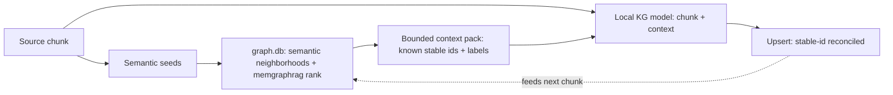

## Status

<!-- agent:status patch=replace -->

complete
<!-- /agent:status -->

## Spec

See [src/tsift/SPEC.md](../../src/tsift/SPEC.md) for the AST-Aware Code RAG spec.

## Exchange

<!-- agent:exchange patch=append -->
### Session Summary

*Compacted. Content archived to `/home/brian/work/btakita/agent-loop/.agent-doc/archives/53cc65443c45f7b49f5e6ace54e3f6bafe4077ade57924422b5eb3baf4dbd23c-20260618-054958.md`*

Compacted content:
- Archived 1 response topic(s): Is tsift kg now in active usage?
- Prior summary/context: prior compacted content: Archived 4 response topic(s): do [#kgwiring]; do [#kgoperatorrun]; tsift kg multi-session re...

### Re: Integrate memgraphrag + semantic neighborhoods + graphdb as local-model context? — yes (GraphRAG) — opus-4-8

> **Queue prompt:**
>
> do [#kggraphscope]: Should we integrate the memgraphrag, semantic neighborhoods, and graphdb to determine the context for the local model?

**Yes — this is the GraphRAG pattern, and it's the single highest-leverage quality improvement for the local KG model.** The pieces already exist; the extractor just doesn't consume them yet.

**Why (verified current state):** `extract_documents_to_projection` extracts each chunk in **isolation** — `OllamaKgExtractor::chat_request_body(chunk_text)` sends only a system prompt + the raw chunk, with no graph context. That stateless design is the root of three quality problems:
- **Duplicate / variant entities** — the model re-invents `stable_id_seed`s instead of reconciling against entities already in the graph.
- **Missed cross-chunk relations** — an edge whose endpoints sit in different chunks is never emitted; the model never sees the other endpoint.
- **No incremental consistency** — re-extraction duplicates instead of updating.

Meanwhile the **retrieval machinery already exists** over `graph.db`: `tsift semantic` / `tsift related` (semantic-neighborhood expansion), and `tsift-memgraphrag` (`KgSemanticProvider`, `rank_memory_events` with recency/decay). So this is **wiring existing retrieval into the extractor prompt, not building retrieval.**

**The design — bounded, deterministic, confidence-gated:**

Per chunk: seed salient terms → expand top-K neighbors by connectivity + recency (capped by token budget) → inject a compact "known entities — reuse these stable ids" block → the model aligns to canonical ids and bridges chunks → upsert preserves stable fact ids.

**Why staged, not all-at-once (the guards):**
- **Context poisoning** — only inject high-confidence, recent facts (threshold + provenance), or stale facts bias the model.
- **Determinism** — retrieval must be stably ordered so re-runs preserve stable fact ids (Run Manifest contract).
- **Cost / finite context window** — bounded top-K + cache seed→neighbors; the same bounded-scan discipline as `#kgwiring` (never feed the 418k-node graph). This is also where the original `#kggraphscope` evidence-cap concern folds in — same cap, now applied to retrieval.

**Backlog:** I reframed **`#kggraphscope`** as Phase 1 — a bounded deterministic `kg context-pack` retrieval API (it subsumes the evidence-cap item). Phases 2 (inject into the extractor prompt) and 3 (graph-aware incremental re-extract) are in the plan: `tasks/software/plan-tsift-kg-graphrag-context.md`. This composes with `#kgleasewire` — graph-aware extraction runs the local model more, so the reference-counted load/unload lifecycle matters more.

**Recommendation:** do `#kgleasewire` first (small, closes the loop on the lease lifecycle just shipped), then this — it's the bigger feature but the one that actually makes the local KG model good.
<!-- agent:boundary:da4ccd73 -->
<!-- /agent:exchange -->

## Queue

<!-- agent:queue preset="#spec-test-build-install-commit-push" go -->
- do [#kgleasewire]
- do [#kgleasereap]
- do [#kgextractrefresh]
- :pushpin: do [#kggraphscope]: Should we integrate the memgraphrag, semantic neighborhoods, and graphdb to determine the context for the local model?
<!-- /agent:queue -->
<!--
https://github.com/chopratejas/headroom
-->

## Backlog

<!-- agent:backlog priority queue -->
- [ ] [#kgleasewire] Wire the #kgreflease lease lifecycle into kg extract: acquire_lease (profile, holder pid) before model load in cmd_kg_extract/extract pipeline, release_lease --unload-on-last-release after, so concurrent extracts serialize on the GPU and VRAM auto-frees. Closes the loop on #kgreflease (registry currently has zero callers outside CLI/tests).
- [ ] [#kgleasereap] Invoke lease reap + renew automatically: wire `tsift local-model lease reap --unload-empty` into the agent-doc supervisor idle-watch (and renew long-lived holders) so crashed-session leases are reclaimed and unreferenced models unloaded without manual CLI.
- [ ] [#kgextractrefresh] Define a kg extract refresh trigger (on-demand re-extract of changed files, or scheduled) so .tsift/graph.db is not a stale manual snapshot; current graph.db is a Jun-14 one-shot.
- [ ] [#kggraphscope] GraphRAG context for the local KG model (Phase 1: bounded, deterministic kg context-pack retrieval — chunk/seeds to a ranked known-entity pack from graph.db, reusing semantic/related neighborhoods + memgraphrag ranking, capped by token budget). Today extract_documents_to_projection extracts each chunk in isolation (no graph context), causing duplicate/variant entities + missed cross-chunk relations. Subsumes the prior evidence-cap concern (same bounded-scan discipline). Phases 2-3 (inject into extractor prompt; graph-aware incremental re-extract) in plan. Plan: tasks/software/plan-tsift-kg-graphrag-context.md
- [ ] [#vmax] [operator-verify] Enable crates.io OIDC publishing for tsift (advances review #1td4; code already shipped in fe4144b/f29f7a2, release.yml crates job uses rust-lang/crates-io-auth-action@v1). Operator-gated steps (need crates.io account + browser 2FA — agent cannot perform): (1) On crates.io register a Trusted Publisher for EACH of the 23 tsift crates — GitHub repo btakita/tsift, workflow release.yml, no environment: tsift-core, tsift -md-ast, tsift-graph, tsift-sqlite, tsift-algorithms, tsift-resolution, tsift-cache, tsift-tokensave, tsift-libsql, tsift-index, tsift-summarize, tsift-quality, tsift-agent-doc, tsift-digest, tsift-search, tsift-status, tsift-session, tsift-memory, tsift-memgraphrag, tsift-surrealdb, tsift-cli, tsift, tsift-sim-world. (2) Enable the gate var: gh variable set TSIFT_ENABLE_CRATES_PUBLISH --body true. (3) Force-move the v0.1.70 tag to HEAD and push to re-trigger; confirm the publish-crates.io job authenticates via OIDC (no CARGO_REGISTRY_TOKEN) and publishes.
<!-- /agent:backlog -->

## Review

<!-- agent:review -->
- [/] [#1td4] Release infra: crates.io publish job in .github/workflows/release.yml is MIGRATED to OIDC trusted publishing (commit fe4144b, on origin/main f29f7a2; uses rust-lang/crates-io-auth-action@v1, id-token: write, no CARGO_REGISTRY_TOKEN). Code complete. Remaining is operator-gated and tracked as actionable backlog #vmax: register the Trusted Publisher per crate on crates.io (23 crates), set repo var TSIFT_ENABLE_CRATES_PUBLISH=true, then re-tag v0.1.70 to verify OIDC publish. Stays gated until operator completes crates.io registration.
<!-- /agent:review -->

<!-- agent:icebox -->
- [ ] [#g5kw] What are #next-steps to promote SurrealDB to SQLite-equivalent substrate status?
- [ ] [#4z0w] Can we increase max-hop caps?
- [ ] [#cg52] Could FalkorDB help with performance?
<!-- /agent:icebox -->

## Completed / Reaped

<!-- agent:done archive=tasks/software/tsift.done.md -->

<!-- completed work archived in tasks/software/tsift.done.md -->
<!-- /agent:done -->
