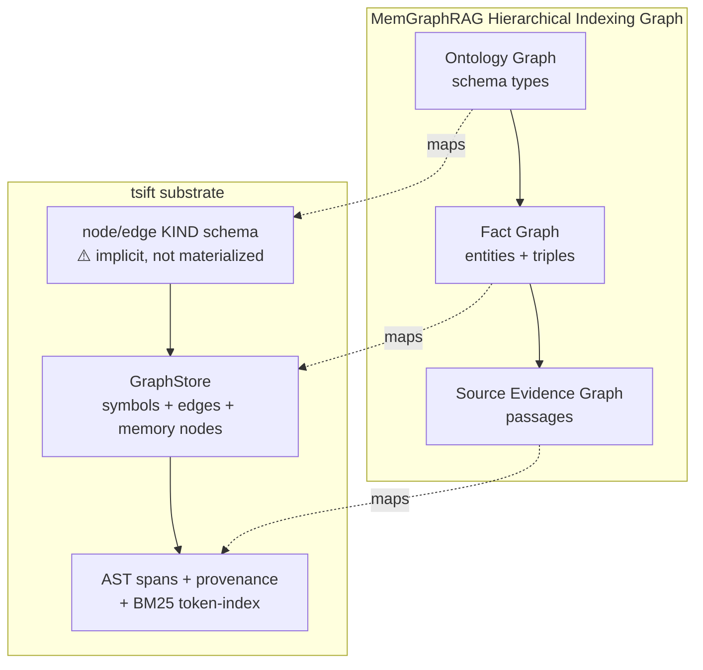

## Status

<!-- agent:status patch=replace -->
<!-- /agent:status -->

## Spec

See [src/tsift/SPEC.md](../../src/tsift/SPEC.md) for the AST-Aware Code RAG spec.

## Exchange

<!-- agent:exchange patch=append -->
### Session Summary

*Compacted. Content archived to `/home/brian/work/btakita/agent-loop/.agent-doc/archives/53cc65443c45f7b49f5e6ace54e3f6bafe4077ade57924422b5eb3baf4dbd23c-20260607-021442.md`*

Compacted content:
- Archived 4 response topic(s): msgpack instead of JSON for serialization; #3dhp cache-encoding; Can tsift become a mem graph RAG? (arxiv 2606.00610); 1 more
- Prior summary/context: ### Session Summary *Compacted. Content archived to `/home/brian/work/btakita/agent-loop/.agent-doc/archives/53cc6544...

### Re: Run the gated backlog items — opus-4-8

> **Queue prompt:**
>
> run the gated backlog items

Both gated items are implemented, tested, built/installed, committed, and pushed (`btakita/tsift` `main` `188bd5b`). Marked `#memgraphrag1` and `#memgraphrag2` done.

**`#memgraphrag1` — decay-weighted memory retrieval** (`packages/tsift-memory/src/lib.rs`)
- `MemoryDecayConfig { half_life_secs, lexical_weight, recency_weight }` — default 1-week half-life, 0.6/0.4 lexical/recency blend.
- `rank_memory_events(events, query, now_unix, config, limit) -> Vec<ScoredMemoryEvent>` — blends lexical overlap with exponential recency decay `0.5^(age/half_life)` over `observed_at_unix`; no-timestamp events keep lexical score, earn no recency; ties break toward recent. `ScoredMemoryEvent` exposes component scores.
- `MemoryQueryPlan` now carries the `decay` contract (visible in `tsift memory query-plan --json`).
- 4 unit tests (decay halves at half-life, recency tiebreak, strong-lexical-beats-recency + limit, plan carries config).

**`#memgraphrag2` — one graph, not two** (`packages/tsift-cli/src/commands/memory.rs`)
- New `tsift memory project-graph [PATH] [--graph-db 
] [--limit N]` reads stored memory events, projects them (`memory_session`/`memory_event` nodes + `records_memory_event` edges), and upserts into the shared `.tsift/graph.db` via the existing `SqliteGraphStore::upsert_projection` — memory nodes are now queryable alongside code symbols.
- Persistence round-trip test (insert events → project → reopen graph.db → assert `memory_event`/`memory_session` rows).

**Verification:**
- `make check`: clippy `-D warnings` clean, **all Rust tests pass** (incl. the 5 new ones). The single red is `opencode-tsift`'s `npm publish --dry-run` rejecting because `0.1.63` is **already published** — a pre-existing release-state condition in the npm package (untouched by this change), not a code regression; it fails identically at HEAD.
- `cargo install --path .` done; live-verified both: `query-plan` reports the decay config, `project-graph` runs against the real graph store.

**Scope notes:** staged only my 4 files (left the submodule's pre-existing dirty `AGENTS.md`/`.opencode/`/`BENCHMARKS.md` untouched). Did **not** bump the version or publish — the preset was build+install+commit+push, not release; a publish would need a coordinated version bump (which also clears the `publish:check` red). The agent-loop superproject's `src/tsift` pointer now trails `188bd5b` if you want to bump it.

Remaining toward full MemGraphRAG: `#trt1` (authored Finding/Decision/Note node types) and folding decay ranking into `#rankdefault` over the now-merged graph.

### Re: Commit all uncommitted tsift changes — opus-4-8

> **Queue prompt:**
>
> Commit all uncommitted tsift changes.

Committed and pushed (`btakita/tsift` `main` `232c766`). The tsift submodule working tree is now clean. The 14 uncommitted files were all generated/doc surfaces (no source code):

- **`AGENTS.md`** — `tsift init` code-navigation block refresh (marker `v0.1.62` → `v0.1.63`, added `source-read`/`symbol-read` entries).
- **`.opencode/commands/*.md`** (12 files) — opencode command shortcuts from `tsift init --opencode`.
- **`BENCHMARKS.md`** — graph-db `backend-eval` results (SQLite vs SurrealDB).

Pushed to keep `main` consistent with the already-pushed feature commit `188bd5b`. Note: the `.opencode/commands/*.md` still carry `v=0.1.62` markers while `AGENTS.md` is at `v0.1.63` — a minor drift from a partial `tsift init` run. I committed them as-is per your request; re-run `tsift init --opencode` if you want the markers realigned.

(The agent-loop superproject's `src/tsift` pointer now trails `232c766`.)

### Re: Ontology / Fact / Passage Graph mapping onto tsift — opus-4-8

> **Queue prompt:**
>
> How does the https://arxiv.org/pdf/2606.00610 Ontology Graph, Fact Graph, and Passage Graph map onto tsift?

The paper bundles these as the **Hierarchical Indexing Graph (𝒢)**, three layers that retrieval traverses top-down (abstract → grounded): Semantic Ontology Graph → Fact Graph → Source Evidence Graph. Here's how each lands on tsift:

| Paper layer | What it holds | tsift analog | Coverage |
|---|---|---|---|
| **Semantic Ontology Graph** (𝒢_ont) — schema *types* + valid relations between types; the "logical backbone" | tsift's **node-kind / edge-kind schema** (`NodeKind`, `memory_graph_node_kinds()`, edge kinds like `calls`/`references`/`records_memory_event`) | ⚠️ **partial** — kinds exist but only as *conventions on rows*, not first-class queryable type-nodes with inter-type relations. Communities are emergent clusters, not a typed ontology. **This is the real gap.** |
| **Fact Graph** (𝒢_fac) — concrete entities + instantiated relation triples, multi-hop, bridging edges | tsift's **`GraphStore`**: code symbols = entities; call/reference/import edges = triples; `+` memory_event/memory_session nodes after `#memgraphrag2`. Multi-hop via `graph --callers/--callees`, `explain`, `ranked_neighborhood` | ✅ **strong** — this is tsift's core |
| **Source Evidence Graph** (𝒢_pas) — passages + links from facts/entities back to originating text | tsift's **AST spans + provenance**: every node carries `source_ref` / `GraphProvenance` / file:line span; `source-read`/`symbol-read` expand to grounded text; BM25 `token-index` is the passage retrieval surface | ✅ **strong** — "every result is a citable handle" is exactly this layer |

**Cross-layer linkages:**
- **fact ↔ passage grounding** — tsift's strongest property. Every symbol/node resolves to a file:line span with provenance; `source-read` makes every reasoning step traceable to text. This is the 𝒢_pas link, already first-class.
- **schema ↔ instance alignment** — only half-present. Each node has a `kind`, so instance→type is recoverable, but the *type itself* isn't a node and there's no "valid relations between types" graph to constrain traversal. The paper uses 𝒢_ont as a logical backbone; tsift has no backbone, just typed rows.

**The one genuine gap = the Ontology Graph.** To match MemGraphRAG, tsift would materialize an ontology layer: node-kind and edge-kind *types* (and their permitted relations) as a small queryable schema graph, letting retrieval start from abstract types and prune by schema constraints. The ontology source could be the code's `NodeKind`/edge-kind enums, the authored-node types from `#trt1`, or your Existence Lang ontology. Queued as gated `#memgraphrag-ont` (needs a decision on the ontology source).

Net: tsift already implements the bottom two of the three layers well — it's a **Fact + Evidence** graph today. The missing piece to be a full tri-layer MemGraphRAG is the typed ontology backbone on top.
<!-- agent:boundary:7b41c573 -->
<!-- /agent:exchange -->
###
<!--
What are #next-steps to promote SurrealDB to SQLite-equivalent substrate status?
-->

## Queue

<!-- agent:queue auto preset="#spec-test-build-install-commit-push" go -->
- Please look at the review items. Move actionable steps into the backlog. Create new backlog items and/or Consolidate items if it makes sense. After backlog items are in remove the review items. Use auto-dag to prioritize. re [#memgraphrag-ont]: I want to use #trt1 and code NodeKind/edge-kind enums to be the source of the ontology. The source may include existence-lang if used in the project(s). But existence-lang is not always used. If a dynamically generated existence-lang ontology is useful as a basis for the ontology layer, use it. Otherwise, we can use an efficient representation for the MemGraphRag.
<!-- /agent:queue -->

## Backlog

<!-- agent:backlog priority queue -->
- [/] [#memgraphrag-ont] Materialize a Semantic Ontology Graph layer (MemGraphRAG arxiv 2606.00610 third layer). Today tsift node/edge kinds are conventions on rows, not first-class queryable type-nodes with valid inter-type relations; tsift is a Fact+Evidence graph but lacks the ontology backbone. Add a small typed schema graph (node-kind/edge-kind types + permitted relations) so retrieval can start from abstract types and prune by schema constraints. Ontology source TBD: code NodeKind/edge-kind enums, #trt1 authored-node types, or Existence Lang ontology. GATED on the ontology-source decision; relates to #trt1 and #memgraphrag2.
<!-- /agent:backlog -->

## Review

<!-- agent:review -->
- [/] [#7qky] [recommended] Reduce Codex redundant runbook reads. SHIPPED (v0.34.0 unreleased): retain-don't-reread nudge in shared SKILL Runbooks source -> regenerated all harness surfaces; contract-safe. GATED on re-measurement: re-run 3-harness redundant-read analysis after Codex sessions accumulate with nudge live, compare to baseline (Claude 11.4% / Codex 12.6% / OpenCode 5.3%). If Codex rate doesn't drop, build enforcement as a session-scoped content-dedup LEDGER in a shared LEAF crate (depends on nothing in graph; tsift + agent-doc + others depend down onto it -- NOT inside tsift or agent-doc, avoids dependency cycle). Core = register(id,hash)/should_deliver(id,hash)->Full|Stub, exemptions via hash-change + compaction; session-id passed in by harness (agent-doc cycle_state.rs adapter); thin per-consumer integration. Design tsift-runbook + agent-doc seam to call this ledger from day one. NOT a Claude-only PreToolUse Read hook.
- [/] [#trt1] [recommended] Findings graph layer: add authored Finding/Decision/Note nodes to GraphStore, anchored by stable symbol-handle/tagpath edges (not line numbers), with provenance+confidence+freshness fields gated on community_graph_watermark for staleness; expose retrieval via context-pack/search injection and a / graph-menu command; opt-in/passive capture from agent-doc session archives; md/html as on-demand projection, graph store as source of truth. Spec in src/tsift/SPEC.md.
- [/] [#0y9e] I set NPM_TOKEN="$(passage btak/NPM_TOKEN)". Publish to npm.
- [/] [#astnav-npm] Configure NPM_TOKEN + TSIFT_ENABLE_NPM_PUBLISH secrets, publish opencode-tsift to npm (medium)
- [/] [#surreal-batch-bfs] #surreal-batch-bfs-gated: Batch frontier expansion - gated (low)
- [/] [#surreal-fixture] Record SurrealDB samples in graph-db-performance-history.json fixture (medium)
- [/] [#surrealbulk-close] Close #surrealbulk review item: re-run benchmarks, update SPEC.md benchmark table, mark done
- [/] [#rankdefault] Promote ranked_neighborhood into default graph lookup/context-pack/evidence output only after quality gates pass; compare ranked vs unranked output on real backlog/code queries for useful-hit density, duplicate-name precision, handle coverage, latency, and emitted tokens.
- [/] [#surrealbulk] Batch SurrealDB projection load: replace per-row upsert loops with bulk/transactional row load plus one-pass secondary-index rebuild; measure refresh/load separately.
- [/] [#full-e2e-verify] In fresh project: opencode plugin opencode-tsift && opencode then /tsift-status. On success mark #e2e-install done.
- [/] [#npm-publish-verify] After auth configured, tag release and verify publish-opencode-plugin CI job succeeds and opencode-tsift appears on npmjs.org
- [/] [#npm-auth-setup] Configure NPM_TOKEN secret + TSIFT_ENABLE_NPM_PUBLISH=true variable in GitHub repo settings
- [/] [#e2e-install] Verify end-to-end install: fresh opencode project + opencode plugin opencode-tsift + /tsift-status
<!-- /agent:review -->
###
<!--
Can we increase max-hop caps?
Could FalkorDB help with performance?
-->

<!-- agent:icebox -->
<!-- /agent:icebox -->

## Completed / Reaped

<!-- agent:done archive=tasks/software/tsift.done.md -->

<!-- completed work archived in tasks/software/tsift.done.md -->
<!-- /agent:done -->
