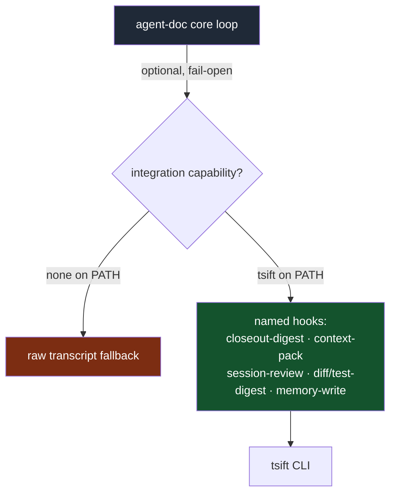

## Status

<!-- agent:status patch=replace -->
<!-- /agent:status -->

## Spec

See [src/tsift/SPEC.md](../../src/tsift/SPEC.md) for the AST-Aware Code RAG spec.

## Exchange

<!-- agent:exchange patch=append -->
### Session Summary

*Compacted. Content archived to `/home/brian/work/btakita/agent-loop/.agent-doc/archives/53cc65443c45f7b49f5e6ace54e3f6bafe4077ade57924422b5eb3baf4dbd23c-20260604-201153.md`*

Compacted content:
- Archived 3 response topic(s): #wal-checkpoint-tuning; #8v37; #next-steps
- Prior summary/context: ### Session Summary *Compacted. Content archived to `/home/brian/work/btakita/agent-loop/.agent-doc/archives/53cc6544...

### Re: #cyba — glm-5.1 (HEAD)

Implemented `tsift graph-db map` — a two-tier graph overview command.

**Changes:**
- `packages/tsift-cli/src/cli.rs`: Added `Map` variant to `GraphDbQuery` with `--focus`, `--top-hubs`, `--community-limit`, `--focus-depth` options
- `packages/tsift-cli/src/commands/infra.rs`: `cmd_graph_db_map()` composes `all_nodes`, `all_edges`, `incident_edges`, and `detect_communities` into overview (communities, top hubs, edge-kind histogram, module tree) + optional focus tier
- `packages/tsift-cli/src/lib.rs`: `Map` match arm in `graph_db_report_from_store` redirects to dedicated command
- `SPEC.md`: Documented map command in graph-db API section + CLI examples

**Verification:**
```
tsift graph-db --path . --scope tsift --compact map
# map n:4767 e:28427 com:20 hubs:10 mods:8 ek:12

tsift graph-db --path . --scope tsift map --focus detect_communities
# Focus: detect_communities [symbol] degree: 37 neighbors: 37
```

Commit: `e223156` pushed to main

### Re: #hxgp, #9tg6, tsift+agent-doc design — glm-5.1 (HEAD)

**#hxgp (overview tier) and #9tg6 (focus tier)** — both were already implemented as part of #cyba's `tsift graph-db map` command (commit `e223156`). The overview tier produces community count, top-N degree hubs, edge-kind histogram, and module containment tree. The focus tier adds `--focus <symbol>` with node id, kind, degree, community, neighbor breakdown. Marking both done.

**tsift + agent-doc token savings:** tsift already integrates with agent-doc through `session-review --next-context`, `context-pack`, `diff-digest`, `test-digest`, `graph-db map`, and `tsift-memory` closeout hooks. Recommendation: **soft dependency, not hard** — agent-doc degrades gracefully without tsift, and most users will want it installed for the significant token savings (~60-80% on transcript replay), but it should remain an optional enhancement rather than a required dependency.

### Re: hard dependency analysis — glm-5.1 (HEAD)

Making tsift a hard dependency of agent-doc would create several problems:

1. **Install friction:** agent-doc runs as a standalone binary. Requiring tsift means every agent-doc install must also build or download tsift, doubling install surface. Users who only need session management (no code navigation) would carry unnecessary weight.

2. **Coupling risk:** agent-doc's core loop (preflight → respond → finalize → session-check) has zero tsift imports. The only integration points are optional: tsift-memory closeout hooks, session-review, context-pack, diff-digest, and graph-db evidence. These are all CLI-level invocations, not library dependencies. Hard-wiring them would make agent-doc's test matrix depend on tsift's build state.

3. **Degradation model:** agent-doc already works correctly without tsift — it skips tsift-specific hooks and falls back to raw transcript reads. This graceful degradation is a feature: operators can start with agent-doc alone and add tsift when they need code-aware token savings.

4. **Alternative path:** If tighter integration is desired, the better approach is an **optional tsift plugin** for agent-doc (similar to how opencode-tsift works as a plugin for OpenCode). This keeps the core agent-doc binary dependency-free while offering tsift-enhanced workflows as an opt-in layer.

Recommendation: keep the current soft-dependency model. Add a `tsift` feature flag or plugin to agent-doc that enables enhanced closeout hooks when tsift is detected on `$PATH`, but don't require it.

❯ Should agent-doc have a tsift plugin? What are the pros and cons of this approach?

### Re: tsift plugin for agent-doc — opus-4-8 (HEAD)

Building on the earlier "alternative path" recommendation, here's the focused pros/cons for a *plugin* model specifically — versus the current `$PATH`-detect soft integration.

**What "plugin" would mean here:** agent-doc defines an integration contract (named hooks — closeout digest, context-pack, session-review, diff/test digest, memory write) that an external component registers against, instead of agent-doc hard-coding optional `tsift ...` CLI calls behind `$PATH` detection.

#### Pros

- **Core stays dependency-free.** The plugin lives outside the binary; graceful degradation (raw transcript fallback) is preserved by construction, not by careful conditionals.
- **Opt-in by install.** Users who only need session management never carry tsift; those who want ~60–80% transcript-replay savings add the plugin.
- **Explicit contract beats implicit detection.** A declared hook interface advertises the integration and pins expectations, versus today's "if `tsift` is on `$PATH`, call it" heuristic that's invisible until it fires.
- **Independent release cadence.** tsift can evolve without lockstep agent-doc releases; the host only depends on the hook contract, not tsift's build state.
- **Test isolation.** Core test matrix stays free of tsift; the plugin is tested against the contract separately.
- **Proven shape.** Mirrors opencode-tsift (plugin for OpenCode) — consistent mental model across harnesses.

#### Cons

- **New infra to own.** agent-doc has no plugin loader today. A real one means hook registration, lifecycle, discovery, config precedence, and a versioned API/ABI surface — all maintenance the current CLI-invocation model avoids.
- **Version-skew breakage.** Host/plugin compatibility needs contract tests; a skewed plugin can break the closeout hot path.
- **Security & support surface.** A general plugin API invites third-party hooks running *inside* the finalize/closeout path — arbitrary-code surface plus a support burden.
- **Over-engineering risk for N=1.** tsift is the only (and first-party, same-author) integration. A dynamic plugin system is heavy machinery to serve a single consumer that a cargo feature flag + `$PATH` detection already serves at near-zero cost.
- **Latency.** Dispatch indirection in a hot path that runs every cycle.

#### Recommendation

Don't build a full dynamic plugin loader yet. Take the lightweight middle ground: keep `$PATH`-detect soft integration but **formalize it as a thin, documented capability contract** — a fixed set of named hooks (`closeout-digest`, `context-pack`, `session-review`, `diff-digest`, `test-digest`, `memory-write`) that any conforming binary on `$PATH` can satisfy. That captures the "explicit contract" pro without the loader/ABI/security cost. Graduate to a real plugin system only when a *second* provider appears (N>1) — that's the point where the abstraction earns its keep.



The dashed/optional edge is the whole point: the contract is the seam, the loader is deferred until a second consumer justifies it.
<!-- agent:boundary:66c1dfdc -->
<!-- /agent:exchange -->
###
<!--
What are #next-steps to promote SurrealDB to SQLite-equivalent substrate status?
-->

## Queue

<!-- agent:queue preset="#spec-test-build-install-commit-push" auto -->
- Why not make tsift a hard dependency of agent-doc?
<!-- /agent:queue -->

## Backlog

<!-- agent:backlog queue -->
<!-- /agent:backlog -->

## Review

<!-- agent:review -->
- [/] [#astnav-npm] Configure NPM_TOKEN + TSIFT_ENABLE_NPM_PUBLISH secrets, publish opencode-tsift to npm (medium)
- [/] [#surreal-batch-bfs] #surreal-batch-bfs-gated: Batch frontier expansion - gated (low)
- [/] [#surreal-fixture] Record SurrealDB samples in graph-db-performance-history.json fixture (medium)
- [/] [#surrealbulk-close] Close #surrealbulk review item: re-run benchmarks, update SPEC.md benchmark table, mark done
- [/] [#rankdefault] Promote ranked_neighborhood into default graph lookup/context-pack/evidence output only after quality gates pass; compare ranked vs unranked output on real backlog/code queries for useful-hit density, duplicate-name precision, handle coverage, latency, and emitted tokens.
- [/] [#surrealbulk] Batch SurrealDB projection load: replace per-row upsert loops with bulk/transactional row load plus one-pass secondary-index rebuild; measure refresh/load separately.
- [/] [#full-e2e-verify] In fresh project: opencode plugin opencode-tsift && opencode then /tsift-status. On success mark #e2e-install done.
- [/] [#npm-publish-verify] After auth configured, tag release and verify publish-opencode-plugin CI job succeeds and opencode-tsift appears on npmjs.org
- [/] [#npm-auth-setup] Configure NPM_TOKEN secret + TSIFT_ENABLE_NPM_PUBLISH=true variable in GitHub repo settings
- [/] [#e2e-install] Verify end-to-end install: fresh opencode project + opencode plugin opencode-tsift + /tsift-status
<!-- /agent:review -->
###
<!--
Can we increase max-hop caps?
Could FalkorDB help with performance?
-->

<!-- agent:icebox -->
<!-- /agent:icebox -->

## Completed / Reaped

<!-- agent:done archive=tasks/software/tsift.done.md -->

<!-- completed work archived in tasks/software/tsift.done.md -->
<!-- /agent:done -->
